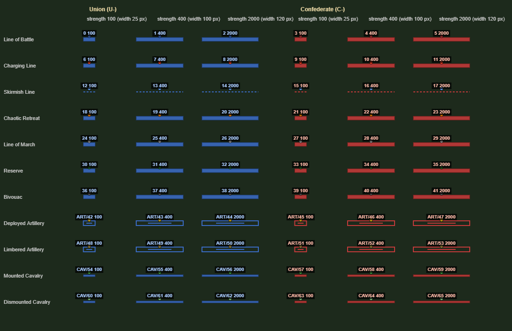
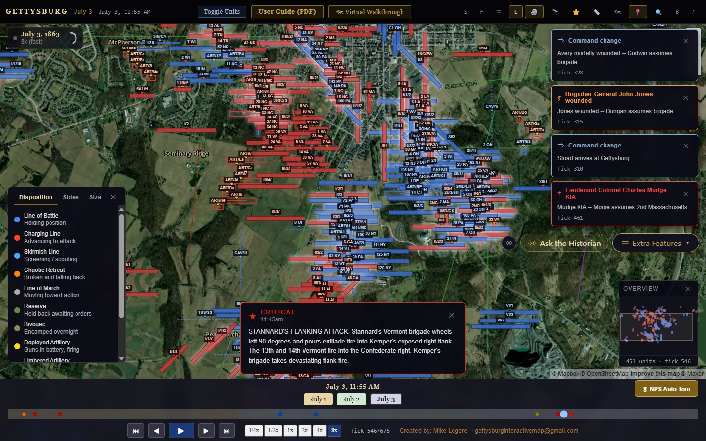
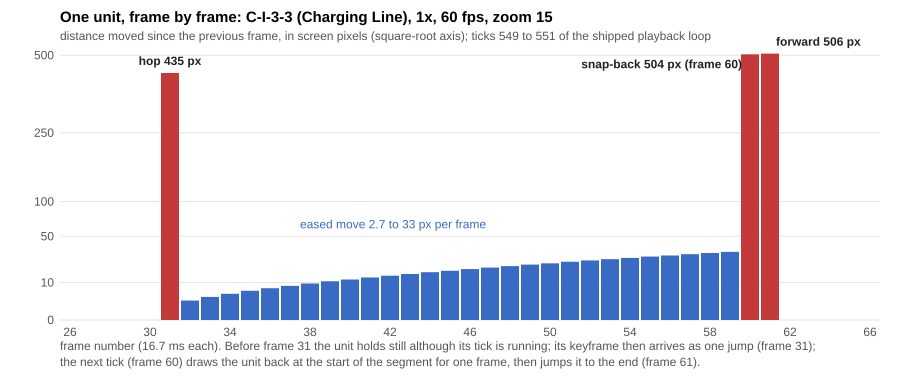
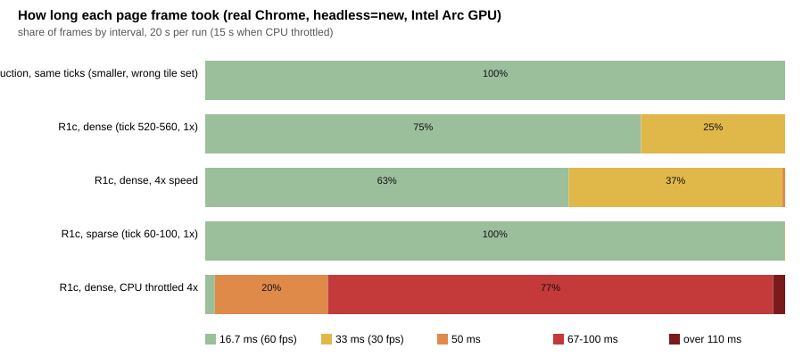
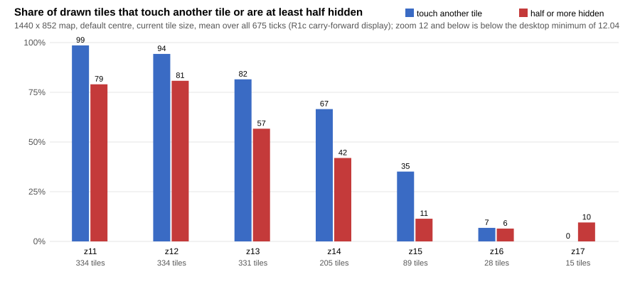

# 01 · Current unit tiles and jitter: what is shipped, what is wrong, and why

*Pitch research, prepared 2026-10-05. Nothing in this document changes the product. Every number comes from a script in [`harness-current/`](harness-current/) and is collected in [`data/current-metrics.json`](data/current-metrics.json). Screenshots are in [`shots/current/`](shots/current/).*

**Evidence labels** (the site's own vocabulary): **Measured** = read from a running page; **Computed** = derived by script from the shipped code and data; **Documented** = text in a file or on a page; **Modelled** = interpolated or inferred; **Unknown** = not established.

---

## 0. Summary

1. **Two builds were examined.** *Production* = `baseline/dist` (entry `index-Cg8FAMXN.js`, md5 `7ef75b95f4c02700430b8aa91e3a7459`); `tools/t0/baseline.py verify-live` on 2026-10-05 reported *IDENTICAL: live == baseline/dist (119 files, 148 requests)*. *R1c* = `release/R1c/dist` (entry `index-2531699e.js`, md5 `ae22c4cd7dc3d100bc6a84df776499a9`), the fixed train, not deployed.
2. **A tile is a thin coloured bar** (8 px tall, 120 px wide at most, 4 px for cavalry) with a 7 px badge and an id label, on one full-size 2D canvas. Its size does **not** change with zoom: a 120 px bar is 3.5 km at zoom 11, 623 m at the default 13.5 and 55 m at zoom 17. *(Computed, shown in the specimen sheets.)*
3. **The animation is a slideshow with teleports, not motion.** Of 1,209 consecutive keyframe pairs in the data, only 93 (7.7 %) are on adjacent ticks and can be interpolated; the other 1,116 (92.3 %) are *hold, then jump*. Across the battle the shipped loop produces 833 teleports of at least 8 px at zoom 13.5 (median 78 px = 404 m, 95th percentile 667 px, maximum 1,096 px, up to 47 units in one frame), against 99.9 % of unit-frames in which a tile does not move at all. *(Computed by replay; the replay was validated frame-for-frame against the real page.)*
4. **The jitter has six separate causes** (section 6): hold-then-hop keyframes, per-tick easing that stops every unit at every tick end, a stale-tick bug that draws an interpolating unit back at the start of its segment for one frame at each tick boundary (66 events, up to 458 px), a pop-in / one-frame vanish / pop-in sequence on every unit entry (407 units), a collision layout recomputed from scratch each redraw (tiles jump by more than 3 px 116 times a second with a still camera, and in 35 to 50 % of tile-frames during a zoom), and a main thread that cannot hold 60 fps in dense scenes (R1c: 44 to 51 fps, a quarter to a third of frames at 33 ms, draw callback 9.2 to 10.9 ms).
5. **Production draws the wrong units.** After its 3.5 s fast-forward intro the first view at tick 1 shows 100 tiles where the data has 21; jumping to July 3 shows 100 where 382 are expected; scrubbing to tick 540 shows 100 where 409 are expected. R1c draws exactly the expected set in all 10 checks. *(Measured.)*
6. **Tiles overlap and hide each other heavily at every zoom a user can reach.** At zoom 13 (the nearest computed zoom to the 13.5 default) 82 % of drawn tiles touch another tile and 57 % are half or more hidden (mean over all 675 ticks). Even at zoom 15, 35 % touch another tile, and at least one overlap exists on 608 of 675 ticks. Labels, not tiles, do most of the hiding. *(Computed from the shipped draw routine.)*
7. **Panels and popups hide more.** At tick 556, with the legend open, the vignette card and the event card showing, overlays cover 54 % of the map canvas and 177 of 414 tile centres in R1c (43 %). On a phone the same moment covers 55 % and 123 of 315. *(Measured rectangles, Computed intersection.)*
8. **Several things the site claims about its tiles are not true**: the legend colours match the drawn badge for only 3 of 11 dispositions; "dot radius scales with strength" is false (the radius is constant, the *width* scales, and it saturates at 480 men so a brigade and a division look the same); tile orientation is rotated 90° from what `placement_schema.json` says; the "engaged" glow means "within 40 screen pixels", which is about two thirds of all tiles at zoom 13 (mean 220 of 331) and almost none at zoom 17.
9. **Everything that pops up is catalogued in section 3.9**; none of it is proposed for removal. Two are dead code today (hover tooltip, commander succession cards).
10. **What works** (section 2) is worth keeping as vocabulary: side colour, outline for guns, dashed line for skirmishers, strength-proportional width for small units, the glow on the selected unit, label thresholds that keep low zooms quiet, and a very cheap draw when few units are on screen.

---

## 1. Method, instruments and limits

| Instrument | What it does | Evidence |
|---|---|---|
| Real-Chrome canvas probe ([`probe.js`](harness-current/probe.js), [`probe-light.js`](harness-current/probe-light.js)) | injected before the app loads; records every unit-canvas draw (tile, badge, label, leader line), own rAF cadence, rAF-callback duration, long tasks | Measured |
| Deterministic replay ([`model.mjs`](harness-current/model.mjs), [`sim.mjs`](harness-current/sim.mjs), [`replay.mjs`](harness-current/replay.mjs)) | slices the app's own `y1`, `F4`, `lS`, `Ed` out of the bundle text and runs them in a vm with a recording canvas; nothing is re-implemented | Computed |
| Replay validation | for 3 real R1c runs (487, 365 and 485 frames) the replay, fed the run's real rAF timestamps, reproduced every frame: tile count, sum of x, y, angle and width, label count; **0 differences** | Measured vs Computed |
| Data census ([`data-analysis.mjs`](harness-current/data-analysis.mjs)) | all 1,804 placement rows exactly as the app loads them | Computed |
| Overlap census ([`overlap.mjs`](harness-current/overlap.mjs)) | the shipped `lS` for 188 displayed states (every keyframe tick; the other ticks show an identical picture) at zoom 11 to 17, desktop and phone, with Chrome's own text widths | Computed |
| DOM rectangles ([`popup-rects.mjs`](harness-current/popup-rects.mjs)) | every overlay that can cover the canvas, in four states, both builds | Measured |
| Screenshots ([`shots.mjs`](harness-current/shots.mjs)) | real input, 1440x900 and 390x844 (DPR 3), both builds | Measured |

**Environment.** Chrome 155.0.8059.27 (`--headless=new`, real GPU: ANGLE Direct3D11, Intel Arc Pro 140T), Windows 11 Pro 10.0.26200, Intel Core Ultra 7 265H (16 threads), Node 24.19. Mapbox tiles only through the harness Referer injection; every browser process stayed at or under the 300-request cap. Production and R1c both load placement data from `data/` (identical files; R1c has one extra, `moments.json`).

**Limits, stated once.** Absolute fps and milliseconds are from one machine and one GPU; the *pattern* (bimodal 16.7 / 33.4 ms frames in dense scenes) is what matters. The phone runs are Chrome device emulation on this desktop, not a real handset. Production motion cannot be replayed exactly (its carry-forward cache depends on every tick it has ever drawn), so production statements about *which units are drawn* are measured, and statements about *how they move* rest on byte-identical interpolation code (section 5). The full list is in section 10.

---

## 2. What works today

- **Cheap and clean when few units are on screen.** R1c draws a sparse window (tick 60 to 100, about 110 tiles) at 60 fps with a 1.8 ms median draw callback; production at 60 fps throughout *(Measured)*.
- **Side is readable at a glance** (blue / red fill with a darker 1 px border), and the three *shapes* carry meaning: filled bar, outlined box with a centre line for guns, dashed line for skirmishers. Cavalry is thinner (4 px). See [`shots/current/specimen-sheet-lS-z17.png`](shots/current/specimen-sheet-lS-z17.png).
- **Strength-proportional width works for regiments and batteries**: 43 % of keyframe rows are under 100 px wide; the median regiment-like row has 288 men (72 px), 90 % are below the 480-man cap, and the median battery row is 24 px wide, so a regiment, a battery and a skirmish detachment differ at a glance *(Computed; it stops working for brigades and divisions, T6)*.
- **The selected tile gets the right treatment**: drawn last (on top), warm glow (`#e8d5a3`, 14 px), full opacity, a 10 px label even at low zoom.
- **Label thresholds keep wide views calm**: no labels below zoom 12 (14 on the phone), a 6-character stub at 12 to 14, the full id label from 14, and a strength number from 16.5.
- **A relaxation pass exists** and a thin leader line points from a displaced tile back to its true spot; it shows the right *intent* (never silently move a unit without saying so).
- **Hit flash and "engaged" pulse** show that the layer is meant to carry drama; the vocabulary (flash on losses, pulse on contact) is right even though today's rules are not (section 4).
- **The popups are rich**: 24 vignettes, 134 timed event cards, 42 commander-fate toasts, a unit panel and a legend. The owner singled them out as a strength; section 3.9 lists them all.
- **R1c fixes the structural bugs of production**: mouse pan and wheel work, the layer repaints on map movement and when data arrives, carry-forward is correct (10 of 10 checks), no fast-forward intro, the sound guard bug is fixed (section 3.8).

---

## 3. The tile today, catalogued

### 3.1 Anatomy



*Specimen sheet: the shipped `lS` routine run in a real canvas on synthetic placements (not a screenshot of the live app). Strengths 100, 400 and 2000.*

| Part | Rule | Evidence |
|---|---|---|
| Canvas | one full-size 2D canvas (z-index 10) above the Mapbox canvas; backing store = CSS pixels, **no devicePixelRatio scaling** | Measured (390 px backing store at DPR 3 on the phone) |
| Fill | Union `#3a6bc4`, border `#1a3a7a`; Confederate `#c43a3a`, border `#7a1a1a`; opacity 0.88 (1.0 selected) | Computed / Measured |
| Width | desktop `clamp(round(strength/4), 10, 120)` px; phone `clamp(round(strength/6), 10, 60)` | Computed |
| Height | 8 px; cavalry 4 px; artillery outline 10 px; skirmish line 2 px dashed (4 on, 3 off) | Computed |
| Shape | guns (`Deployed/Limbered Artillery`, or an id containing `ART`): 2 px outline plus a centre line half the width; `Skirmish Line`: dashed line; everything else: filled bar | Computed |
| Rotation | `rotate((bearing - 90) deg)`: the long axis points **along** the facing direction on 451 of 451 checked tiles | Computed |
| Badge | a 7 px circle (radius 3.5, black 80 % ring) 7 px above the tile centre **in screen space** (never rotated); colour from the disposition table, falling back to the side colour for `Line of Battle` | Computed |
| Label | black 72 % box, 3 x 2 px padding, centred 13 px above the tile centre; text `#aaccff` (Union) / `#ffbbaa` (Confederate); bold 8 px (zoom < 14), 9 px (14 to 16), 10 px (16 and up, or selected) | Measured |
| Leader line | 0.5 px line from the true position to a displaced tile when it was moved by more than 3 px; about 320 per frame in the dense scene at tick 546 | Measured |
| Trails | a second canvas (z-index 8) that is never resized, so it stays 300 x 150 px: trails exist only in the top-left 3.7 % of a 1440 x 852 map | Measured |

### 3.2 Shape, colour and badge per disposition and branch

Dispositions in the data (rows of 1,804): Line of Battle 759, Charging Line 266, Chaotic Retreat 174, Deployed Artillery 150, Line of March 133, Bivouac 132, Skirmish Line 69, Reserve 58, Mounted Cavalry 29, Limbered Artillery 21, Dismounted Cavalry 13. Units by branch (id and disposition rule): infantry 388, cavalry 33, artillery 57 of 478.

| Disposition | Tile | Badge colour drawn | Legend says | Match |
|---|---|---|---|---|
| Line of Battle (42 % of rows) | filled bar | **side colour** (`#3a6bc4` / `#c43a3a`) | `#4488ff` | no: for the Confederacy the badge is the same red as the bar |
| Charging Line | filled bar | `#ff4422` | `#ff4422` | yes |
| Skirmish Line | dashed line | `#66aaff` | `#44aaff` | no |
| Chaotic Retreat | filled bar | `#ff8800` | `#ff8800` | yes |
| Line of March | filled bar | `#aaaaaa` | `#aaaaaa` | yes |
| Reserve | filled bar | `#226622` | `#668844` | no |
| Bivouac | filled bar | `#555555` | `#888866` | no |
| Deployed Artillery | outline + line | `#f5c518` | `#ffdd00` | no |
| Limbered Artillery | outline + line (same as deployed) | `#c8a84a` | `#ccaa00` | no |
| Mounted Cavalry | thin bar | `#44aa44` | `#44cc88` | no |
| Dismounted Cavalry | thin bar (same as mounted) | `#88cc88` | `#228855` | no (and lighter where the legend is darker) |

*(Computed: [`legend-check.mjs`](harness-current/legend-check.mjs), 9 sample ticks.)* Reading: **six dispositions are the same bar and differ only by a 7 px dot**, mounted and dismounted cavalry are identical, deployed and limbered guns are identical, and the most common disposition (Line of Battle) has a badge that is the same colour as its own bar on the Confederate side.

### 3.3 Size at each zoom (z11 to z18)

The tile is the same number of pixels at every zoom; the ground it stands for is not.

| Zoom | m per px | 120 px tile = | 8 px height = | Label | "Engaged" radius (40 px) | Tiles in view at tick 556 (view centred on The Angle; the 13.5 row is the default camera) |
|---|---|---|---|---|---|---|
| 11 *(desktop: unreachable, clamped to 12.04)* | 29.4 | 3,523 m | 235 m | none | 1,174 m | 456 |
| 12 | 14.7 | 1,761 m | 117 m | 6-char stub, 8 px | 587 m | 456 |
| 13 | 7.3 | 881 m | 59 m | 6-char stub, 8 px | 294 m | 456 |
| 13.5 (default camera) | 5.2 | 623 m | 42 m | 6-char stub, 8 px | 208 m | 414 |
| 14 | 3.7 | 440 m | 29 m | id label, 9 px | 147 m | 315 |
| 15 | 1.8 | 220 m | 15 m | id label, 9 px | 73 m | 162 |
| 16 | 0.92 | 110 m | 7 m | id label, 10 px | 37 m | 43 |
| 17 | 0.46 | 55 m | 3.7 m | id label + strength, 10 px | 18 m | 20 |
| 18 | 0.23 | 28 m | 1.8 m | id label + strength, 10 px | 9 m | 2 |

*(Computed from the draw code; tiles in view from the shipped routine. m per px at latitude 39.812.)* **The desktop cannot reach zoom 11 or 12**: `maxBounds` of ±0.12° longitude clamps a 1440 px wide map to zoom 12.04 (Measured: a `jumpTo` to zoom 11 landed on 12.04). Zoom 11 is reachable only on narrow screens.

Screenshots of the zoom ladder at The Angle (a `terrain.json` key location, tick 556), desktop: [z11](shots/current/r1c-desktop-10-zoom-z11-the-angle-t556.jpg) [z12](shots/current/r1c-desktop-10-zoom-z12-the-angle-t556.jpg) [z13](shots/current/r1c-desktop-10-zoom-z13-the-angle-t556.jpg) [z14](shots/current/r1c-desktop-10-zoom-z14-the-angle-t556.jpg) [z15](shots/current/r1c-desktop-10-zoom-z15-the-angle-t556.jpg) [z16](shots/current/r1c-desktop-10-zoom-z16-the-angle-t556.jpg) [z17](shots/current/r1c-desktop-10-zoom-z17-the-angle-t556.jpg) [z18](shots/current/r1c-desktop-10-zoom-z18-the-angle-t556.jpg) (production: same names with `baseline-`). Phone: `*-phone-10-zoom-z11/13/15/17/18-*`. Default views: [production load](shots/current/baseline-desktop-01-load-tick1.jpg), [R1c load](shots/current/r1c-desktop-01-load-tick1.jpg), [production dense](shots/current/baseline-desktop-02-dense-t546-default-camera.jpg), [R1c dense](shots/current/r1c-desktop-02-dense-t546-default-camera.jpg).



### 3.4 Selection, hover, flash, glow, trails

- **Selection** (click a tile): the unit is both *selected* and *pinned*, drawn last with the warm glow, a 10 px label and an info panel at top left (R1c [before](shots/current/r1c-desktop-40-before-select-t150-z15.jpg), [after](shots/current/r1c-desktop-41-selected-unit-t150-z15.jpg); production [before](shots/current/baseline-desktop-40-before-select-t150-z15.jpg), [after](shots/current/baseline-desktop-41-selected-unit-t150-z15.jpg)).
- **Hover: nothing.** The hover tooltip component is mounted without its props and returns null. Measured: the pixel difference between "pointer on a tile" and "pointer elsewhere" is **0 pixels in production**; in R1c 1,060 pixels differ, all inside a 36 x 36 px faint gold ring that sits 48 px above the pointer (a stray indicator, not a unit reaction). Crops: [`baseline-desktop-43-hover-crop.png`](shots/current/baseline-desktop-43-hover-crop.png), [`r1c-desktop-45-hover-vs-none-side-by-side-x2.png`](shots/current/r1c-desktop-45-hover-vs-none-side-by-side-x2.png).
- **Hit flash**: for 1 s after a tick step in which a unit's strength fell, its fill turns light blue (`#88ccff`, Union) or orange (`#ff9944`, Confederate). It can only fire for a unit with rows on **both** the old and the new tick: 93 adjacent-tick pairs exist, 45 of them with a strength drop *(Computed)*. At 2x and faster several ticks are skipped per frame and only the end rows are compared.
- **"Engaged" glow and sound**: a Union and a Confederate tile within **40 screen pixels** pulse white (shadow 8 px, alpha 0.4 + 0.6 |sin(t/300)|, about 1.06 Hz, all tiles in the same phase). It is a function of zoom, not of contact: in the default view the mean number of "engaged" tiles over the 188 displayed states is **220 at zoom 13, 93 at 14, 16 at 15, 2 at 16**; at zoom 11 and 12 about 80 to 90 % of all tiles pulse together, at zoom 13 two thirds. (R1c replaces the pulse by a constant when reduced motion is requested; production does not.) *(Computed.)*
- **Trails**: segments between per-frame positions, only inside the 300 x 150 px canvas (above); in R1c cleared on every map move.

### 3.5 Label rules

Text is **always built from the unit id**, never from the order-of-battle designation (the draw routine passes an empty table). `U-20ME` becomes `20 ME`, `U-I-1-1` becomes `I/1/1`, `C-ART-Marye` becomes `ART/Marye`; from zoom 12 up to 14 it is cut to 6 characters (`ART/Ma`). *(Computed.)*

- **131 of 478 units share a 6-character label with another unit** (`CAV/2/` is shared by 9) and **96 share the full label** (`15 AL`, `26 NC`: the side prefix is stripped, so a Union and a Confederate unit can carry the same text; colour is the only difference).
- 100 of the 478 placement ids are **not in the order-of-battle table** (for example `C-ART-I-4`, `U-8IL`, `U-4TX`); selecting one highlights the tile but the info panel renders nothing, because the panel requires the OOB entry. *(Computed.)*
- Labels are placed with **no collision handling at all**; they hide tiles and each other (section 7).
- At zoom 16.5 and up the text includes the strength number; during playback that number changes with every interpolated step (section 6.6).

### 3.6 Density behaviour

At zoom 13.5 and tick 546 about 410 tiles are drawn; the relaxation pass (8 iterations of pairwise pushing on **unrotated** 12 px bands, from scratch every redraw) leaves most of them overlapping, because it ignores each tile's rotation and every label. 319 to 327 leader lines are drawn. Numbers in section 7. See the dense screenshots above and [`r1c-phone-02-dense-t546-default-camera.jpg`](shots/current/r1c-phone-02-dense-t546-default-camera.jpg).

### 3.7 The legend

Three tabs, open by default, 240 x 359 px at bottom left over the map (z 88): Disposition, Sides, Size. Screenshots: [disposition](shots/current/r1c-desktop-32-legend-disposition.jpg), [sides](shots/current/r1c-desktop-30-legend-sides.jpg), [size](shots/current/r1c-desktop-31-legend-size.jpg). What it says against what is drawn *(Documented vs Computed)*:

| Legend says | Drawn |
|---|---|
| Union `#3355cc`, Confederate `#cc4433` | `#3a6bc4`, `#c43a3a` (close, not equal) |
| "Dot outline = side color / Dot fill = disposition color" | the dot outline is a black 80 % ring for every unit; the side is carried by the **bar**, not the dot |
| "Dot radius scales with unit strength": Regiment (about 400) r 5, Brigade (about 2,000) r 7, Division (about 6,000) r 9 | the dot radius is a constant 3.5 px; the **bar width** carries strength, and 400 men = 100 px but 2,000 and 6,000 men are both 120 px |
| 11 disposition colours | 3 of 11 match (table in 3.2) |

### 3.8 Production versus R1c (the unit layer)

| | Production (`baseline/dist`) | R1c |
|---|---|---|
| Boot | "Loading", then a **3.5 s fast-forward of all 675 ticks** (the unit layer redraws about 213 times) from 1.4 s to 5.4 s, then the layout chooser | no intro |
| Mouse pan and wheel on the map | **do nothing**: the unit canvas has `pointer-events: auto` (drag moved the camera: no; wheel changed zoom: no) | work (drag and wheel measured; the layer redraws 40 times during a drag) |
| Layer follows the camera when paused | no redraw on move | redraws on move and resize |
| Data for days 2 and 3 | loaded only during playback past tick 200 / 420, **replacing** whole ticks | loaded on any seek, **merged** by unit id |
| Carry-forward cache | accumulates every unit ever drawn in visit order, never reset | reset on back-seek, rebuilt from tick 1 |
| Sound guard | `CanvasRenderer._lastSoundMs` refers to an undefined global: with the cannon sound on and any engaged pair, the draw throws and the playback loop stops. **Measured**: sound on, play at 1x from tick 546, `pageerror: CanvasRenderer is not defined`, the tick stayed at 546 for 6 s while the button showed the pause icon | fixed (same test: tick 546 to 557 in 6 s) |
| Frame step clamp | none | clamped to 100 ms |
| Reduced motion | glow keeps pulsing | glow constant, interpolation off |

### 3.9 Everything that pops up (kept; none is proposed for removal)

| Popup | Trigger | Position (code) | How long |
|---|---|---|---|
| **Vignette card** (24 in the data) | tick within trigger..trigger+2 | top 60, right 16, 340 x up to (100vh - 200), z 92 (R1c measured at x 900..1240 on 1440) | 1.5 s at 1x, **0.19 s at 8x** (tied to ticks, not seconds) |
| **Event card** (134 events, one per tick) | event at exactly the current tick, significance not low | bottom 120, centred, 460 wide, z 85 | 0.5 s at 1x, **62 ms at 8x** |
| **Commander toasts** (42 events; 11 ticks have two or more, at most 4) | playing, a succession tick crossed | top 60, right 16, 300 wide, stack of up to 4, z 200 | 4.5 s each |
| **Unit info panel** | selected or pinned unit that is in the OOB table | top 60, left 16, 280 wide, z 92 (full-width sheet on the phone) | until closed |
| Legend | open by default | bottom 160, left 16, 240 x 359, z 88 | until closed |
| Overview minimap | open by default | bottom right, 162 x 176, z 88 | until closed |
| HUD clock and speed | always | top 56, left 16, 160 x 43, z 88 | always |
| Timeline dock | always | bottom, 127 px tall, z 100: **the unit canvas extends under it** | always |
| NPS Auto Tour | button | bottom right, z 200; `flyTo` then plays 2x | per stop |
| Hover tooltip | none | **dead**: mounted without props, returns null | never |
| Commander succession cards | none | **dead**: the store array is initialised `[]` and never written (grep of both bundles) | never |

Popups overlap each other: the commander toasts sit at the same corner as the vignette card and above it (z 200 over 92), the "Ask the Historian / Extra Features" pills sit on top of the vignette body text, and the event card sits over the dock edge (screenshots [R1c playing 1x, frame 2](shots/current/r1c-desktop-60-playing-1x-2.jpg), [production popups](shots/current/baseline-desktop-20-popups-t556-z14.jpg), [phone](shots/current/r1c-phone-20-popups-t556-z14.jpg)).

### 3.10 Phone differences

Tile width capped at 60 px (61.5 % of rows are at the cap); labels start at zoom 14; the unit draw is capped at **30 redraws a second** (measured 29.8 to 30.0 while the page runs at 60 fps); the canvas backing store is 390 px wide on a DPR 3 screen, so tiles and text are drawn at 1x and upscaled 3x by the browser (the Mapbox canvas is 1170 px wide) *(Measured)*; the unit info panel is a bottom sheet and the vignette a bottom sheet that covers about half of the map. Screenshots: [load](shots/current/r1c-phone-01-load-tick1.jpg), [dense](shots/current/r1c-phone-02-dense-t546-default-camera.jpg), [popups](shots/current/r1c-phone-20-popups-t556-z14.jpg), production [dense](shots/current/baseline-phone-02-dense-t546-default-camera.jpg).

---

## 4. What is wrong, numbered

Severity is for the owner's rules (never hide vital information, no false claim, no jitter): **A** breaks a rule outright, **B** degrades it, **C** polish.

### Truth to the data

| # | Finding | Evidence | Sev. |
|---|---|---|---|
| T1 | **Production draws the wrong set of units.** Tick 1 after the intro: 100 tiles drawn vs 21 expected (79 ghosts from later ticks). "July 2" button: 100 vs 229 (138 missing). "July 3": 100 vs 382. Scrub to 540: 100 vs 409. After a full playback pass the scrub to 540 still shows 129 vs 409, and tick 1 shows 132 vs 21. R1c: 10 of 10 checks exact. | Measured ([`tests-state.mjs`](harness-current/tests-state.mjs)) | A |
| T2 | **Tiles never expire.** A unit is drawn from its first keyframe to tick 675 at its last position. 457 of 478 units have their last keyframe before tick 675. At tick 540, 386 of the 451 shown have had no keyframe for more than 2 hours and 358 for more than 6 hours; nothing on the tile says so. | Computed | A |
| T3 | **Intermediate strength is invented.** Between adjacent keyframes the strength is interpolated linearly and rounded; at zoom 16.5 and up the label shows it as a number (one battery's label changed 64 times in 11.9 s). The width changes with it. These values are not in the data. | Computed, Modelled | A |
| T4 | **Orientation is 90° off the schema.** `placement_schema.json`: "Line of Battle extends perpendicular to bearing." The routine rotates by `bearing - 90`, so the long axis lies along the facing direction (451 of 451 tiles). A division advancing east is drawn as a horizontal bar. | Documented vs Computed | A |
| T5 | **The legend is wrong** (3.7): 8 of 11 badge colours, the "dot outline", and the whole Size tab. | Documented vs Computed | A |
| T6 | **Width saturates**: 901 of 1,804 keyframe rows (49.9 %) are at the 120 px cap (strength 480 or more); the largest strength is 15,000. Brigades and divisions cannot be told apart; the legend promises they can. | Computed | B |
| T7 | **Ten unit ids carry the Union prefix with Confederate state codes** (`U-15AL`, `U-44AL`, `U-48AL`, `U-4TX`, `U-5TX`, `U-1TX`, `U-26NC`, `U-11NC`, `U-47NC`, `U-52NC`) and are drawn Union blue as Bivouac tiles (ticks 150 and 95). Whether this is an authoring error is **Unknown** until a historian checks; the renderer cannot tell. | Computed from ids | B |
| T8 | "Engaged" is a screen-space rule (3.4): at zoom 13, 220 tiles pulse. | Computed | B |
| T9 | Labels come from ids: 96 to 131 units share a label; 100 ids have no OOB entry so selecting them shows no panel; the panel shows disposition and strength only when the unit has a row at exactly the current tick (a unit with no keyframe on this tick shows less). Static OOB text is not time-aware (R1c panel for Lane's Brigade at 6:25 PM on July 1 reads "assumed division command when Pender fell"). | Computed, Measured screenshot | B |
| T10 | The data itself disagrees with its schema: `placement_schema.json` expects 600 to 700 units per tick and about 430,000 records; the files hold 1,804 rows on 188 of 675 ticks (median 7 rows per keyframe tick, maximum 87). 58 rows sit in the file of a different day (19 + 34 + 4 + 1) and 103 unit-ticks are duplicated across files (38 with identical positions). 23 keyframe pairs exceed the `F4` snap rule of 0.05° and 21 pairs imply more than the (assumed) plausible speed (20 infantry above 6 km/h, 1 cavalry above 16 km/h; maximum 28.5 km/h). | Computed | B |

### Overlap and hiding

| # | Finding | Evidence | Sev. |
|---|---|---|---|
| H1 | Tile-tile overlap at every reachable zoom (section 7). | Computed | A |
| H2 | **Labels hide tiles and each other**: at zoom 14, 36.6 labels per tick are more than 30 % covered by a later label; label boxes (12 px tall) are taller than the bars they annotate and cover other units' tiles and badges; the unit's own label covers at least 40 % of its own badge on 97 tiles per tick at zoom 14. | Computed | A |
| H3 | **Popups and controls hide tiles** (section 7.3): up to 54 % of the canvas and 177 of 414 tile centres at one moment. The timeline dock hides the bottom 127 px of the canvas permanently. The reverse also happens: tiles are painted over the Mapbox zoom and compass buttons (canvas z 10 over controls z 2; see the top right of [R1c zoom 13](shots/current/r1c-desktop-10-zoom-z13-the-angle-t556.jpg), where `CAV/2/` labels sit on the buttons). | Measured, Computed | A |
| H4 | **The click target is not the tile.** The pick uses the nearest *true* position within 0.002° of the click, not the drawn tile. At zoom 13 only about 19 % of a tile's pixels select that tile (37 % at 14, 56 % at 15, 66 % at 16, 72 % at 17; tick 556, centred on The Angle); at zoom 15 and above a click on bare ground (60 px or more from any tile) selects some unit in 47 to 100 % of cases (84 to 100 % at ticks 546 and 556). At zoom 12 a click 20 px from the centre of a 120 px tile selects nothing. Real clicks agreed with the model in 20 of 21 cases. | Measured, Computed | A |

### Motion (details in section 6)

| # | Finding | Sev. |
|---|---|---|
| M1 | Hold-then-hop: 833 teleports in the battle; 92.3 % of keyframe pairs are not animated | A |
| M2 | Per-tick easing: every interpolated unit stops at the end of every tick | B |
| M3 | One-frame snap-back at each tick boundary (66 events, up to 458 px) | A |
| M4 | Pop-in half a tick early, one frame absent, pop-in again (407 units) | A |
| M5 | Layout shimmer: collision offsets recomputed per frame | A |
| M6 | Dense frames miss vsync; draw cost grows with n² x 8 | A |
| M7 | Scrub and day jumps: dozens of units teleport or pop at once, no transition | B |
| M8 | Label digits flicker during playback at zoom 16.5+ | B |
| M9 | Phone: 30 redraws a second, 1x canvas on a 3x screen | B |
| M10 | Production: input swallowed, no repaint on pan, 3.5 s intro, ghost set | A |

### Dead or odd

X1 hover tooltip never renders; X2 succession cards never render; X3 the trail canvas is 3.7 % of the map; X4 the R1c pointer ring sits 48 px above the pointer; X5 the HUD in production prints the day two too high ("July 5, 1863" on July 3; fixed in R1c). X6 production's Overview caption reads "1 units · tick 1" at tick 150 and at tick 546 (screenshots [dense](shots/current/baseline-desktop-02-dense-t546-default-camera.jpg), [selected](shots/current/baseline-desktop-41-selected-unit-t150-z15.jpg)); R1c prints the right count and tick ("456 units · tick 556").

---

## 5. Where positions come from (anatomy of the bundle)

All locations are `line:column` in the minified entry (`baseline` / `R1c`). **The functions below are textually identical in both bundles except where stated.**

| Role | Function | Where | What it does |
|---|---|---|---|
| Playback clock | `Ed` (rAF loop) with `Gk` (start) and `Op` (stop) | 3355:4734 / 3355:4976 | `Hc += frameDelta`; one tick lasts `cF = 500 / speed` ms; when `Hc >= Pe` the tick advances by `floor(Hc / Pe)` and the fraction is `Hc / Pe` |
| Interpolation | `y1(placementsByTick, tick, fraction)` | 3350:54291 / 3350:54310 | merges the carry-forward cache with the rows of `tick`; interpolates **only** a unit that has rows on both `tick` and `tick + 1` |
| Per-pair blend | `F4(a, b, x)` with easing `z4(disposition)` | 3350:53793 (`z4` at 3350:53627) | `lat`, `lng` blended with the easing of the **next** disposition; `bearing` shortest arc; `strength` linear and rounded; **snaps** (no blend) when `|dlat| + |dlng| > 0.05` |
| Easing | `z4` | 3350:53627 | Charging Line `x²` (ease-in), Chaotic Retreat `1-(1-x)²` (ease-out), Line of March linear, everything else (Skirmish, Battle, Reserve, Bivouac...) ease-in-out quad |
| Projection | `dA`: `map.project([lng, lat])` for every unit every frame | 3355:5522 | float positions, **no pixel snapping**, no rounding |
| Draw | `lS(canvas, map, units, selected, pinned, filters, flashes, now)` via `e1` when paused | 3350:58119 | clears and redraws everything; relaxation; leader lines; tiles; badges; labels; "NN fps" text if the measured fps is below 45 (drawn at the bottom of the canvas, under the dock) |
| Hit flash | `uF(placementsByTick, oldTick, newTick, now)` | 3355:5677 | compares rows of the two ticks only |
| Click | `ht` with spatial index `aT`, query `Xx(.., 0.002)` | 3350:56272 / 3350:56445 | cells of 0.002°; nearest by degrees; no pixel radius |
| Mobile cap | inside `Ed`: `canvas.width < 500` and `now - last < 33` skips the frame | 3355 | 30 redraws per second |
| Layer element | `gF` creates the canvas (React ref), `J4` the trail canvas, `I4` an unused z 9 canvas, `A4` the night tint (z 6, multiply, 8 s transition) | 3355:8979, 3350:61785 | |
| R1c additions | `GtbgRepaint` on map `move` / `resize`; `i2` cache reset; clamp `Math.min(frameDelta, 100)`; pointer-events none | 3355:9291 (R1c) | |

The playback loop is **time-driven**; the positions it draws are **tick-driven**. That mismatch is the root of most of what follows.

---

## 6. The jitter, at its causes

The replay reproduces the page exactly (section 1), so each cause below is shown with the shipped code's own numbers. The whole-battle figures run the real loop at 60 Hz from tick 1 to 675 ([`fast-motion.mjs`](harness-current/fast-motion.mjs)); the windows use the real timestamps of each browser run.



*Unit C-I-3-3 (Charging Line), keyframes at ticks 550 and 551, 1x, 60 fps, zoom 15. Frames 0 to 30: no movement; frame 31: a 435 px jump; frames 32 to 59: an ease-in move of 2.7 to 33 px per frame; frame 60: the unit is drawn 504 px back at the start of its segment; frame 61: it jumps 506 px forward; then it holds. All of these are Computed from the shipped loop.* ([`exemplar-trace.json`](data/current-metrics.json) holds the series.)

### 6.1 Hold-then-hop keyframes (the slideshow)

The data is **sparse**: 1,804 keyframes on 188 of 675 ticks. `y1` blends a unit only between ticks `f` and `f+1` when both have a row. The 1,209 consecutive-keyframe pairs split as 93 adjacent (7.7 %), 141 two or three ticks apart (11.7 %), 975 four or more (80.6 %); the median gap is 17 ticks (85 minutes), the 90th percentile 138 ticks, the longest 658. For a longer gap the unit **sits still** and then arrives in **one frame** when the tick of its next keyframe starts.

| Speed | Seconds for the battle | Teleports per second | Median teleport | 95th percentile | Max in one frame |
|---|---|---|---|---|---|
| 1/4x | 1,348 | 0.62 | 78 px (404 m) | 667 px | 1,096 px, 47 units |
| 1x | 337 | 2.47 | same | same | same |
| 4x | 84 | 9.9 | same | same | same |
| 8x | 42 | 19.8 | same | same | same |

*(Computed, zoom 13.5; 833 teleports of 8 px or more, 159 frames contain at least one.)* 99.9 % or more of unit-frames have **no movement at all**. Tick 120 moves 47 units at once, tick 620 moves 42, tick 538 moves 31. Teleports in metres: median 404 m, the largest 5,690 m; `F4` additionally refuses to blend 23 pairs it considers too far.

### 6.2 Per-tick easing stops every unit at every tick end

For the units that *are* interpolated, `F4` eases each tick separately. Peak-to-mean step ratio, median over the 66 interpolated pairs: **1.94 at 1/4x, 1.85 at 1x, 1.57 at 4x** (an ideal constant-speed march would read 1.0). A unit that is "marching" accelerates and brakes once per tick: 2 Hz at 1x, 16 Hz at 8x, which also makes continuous marches over several ticks pulse. The easing function also depends on the *next* keyframe's disposition, so a unit changing from Line of Battle to Charging Line changes its speed profile mid-way.

### 6.3 Snap-back at every tick boundary (stale tick)

In the frame in which the tick advances, `Ed` has already stored the new tick but still passes the **old** tick `st` to `y1` together with the **new** (small) fraction. An interpolating unit is therefore drawn near the *start* of the segment it has just finished, for one frame, and then jumps to the end of it (frames 60 and 61 in the figure). Over the battle: **66 snap-backs, median 41 px, maximum 458 px at zoom 13.5**, identical at every speed because there is one per interpolated pair. In the real browser traces the sum of all tile positions shows out-and-back spikes at tick changes (for example 12,694 px out and 15,168 px back at tick 559, 8x; [`trace` runs](harness-current/run-browser.mjs)); the replay attributes them to these snap-backs and to the hops of section 6.1.

### 6.4 Pop-in, one frame absent, pop-in again

A unit that is not yet in the cache is appended when the fraction passes 0.5 of the **previous** tick, i.e. half a tick early. At the next tick boundary the stale `st` makes `y1` forget it for exactly one frame; the following frame brings it back. **407 units** do this on entry (71 more are present from tick 1). In the real browser the number of drawn tiles shows it directly: `403 > 404 (tick 520)`, `404 > 403`, `403 > 404 (tick 521)`; `404 > 406`, `406 > 404`, `404 > 409` (R1c, [`trace-1x-dense`](harness-current/run-browser.mjs)). There is no fade, no scale, no arrival marker; there is also no exit animation, because units never leave (T2).

### 6.5 The collision layout is recomputed from scratch each redraw

`lS` starts every redraw from the true positions and runs 8 passes of pairwise pushing with discrete choices (push vertically when the horizontal overlap is larger, otherwise horizontally). Small changes in one neighbour change the result for a whole cluster.

| Situation | Result | Evidence |
|---|---|---|
| Static camera, 1x, tick 520 to 560 (409 tiles) | the drawn offset of a tile changes by more than 3 px **116 times a second** | Computed (windows) |
| Static camera, 4x / 8x | 177 / 345 times a second | Computed |
| Smooth zoom 13.5 to 15 in 1 s (R1c repaints on move) | **35 % of tile-frames** jump more than 3 px, 22 % more than 10 px; mean 7.8 px, 95th percentile 41 px, **maximum 138 px per frame** | Computed ([`camera-motion.mjs`](harness-current/camera-motion.mjs)) |
| Smooth zoom 15 to 13 in 1 s | 49 % of tile-frames jump more than 3 px, 34 % more than 10 px; mean 13 px, p95 57 px, max 156 px | Computed |
| Pan 300 px in 0.5 s | stable (0.01 px mean) | Computed |

In production the layer does not repaint at all while the map moves (M10), so zooming does not shimmer there; it simply leaves the tiles behind.

### 6.6 Label digits

At zoom 16.5 and up the label contains the interpolated strength. Replay over ticks 548 to 571 at 1x around The Angle: **111 label text changes in 11.9 s (9.3 per second) on 10 units, one unit (`U-ART-A4US`) changing 64 times.** At zoom 15 there are none. These are numbers that are not in the data (T3).

### 6.7 Frame cadence, draw cost and long tasks (Measured)



| Run (20 s unless noted) | Page fps | Frame interval p50 / p95 / max (ms) | Frames over 20 ms | Unit redraws per s | Draw callback p50 / p95 / max (ms) | Long tasks |
|---|---|---|---|---|---|---|
| R1c dense, 1/4x (ticks 520 to 530) | 50.8 | 16.7 / 33.4 / 33.5 | 18.1 % | 50.6 | 9.2 / 13.1 / 25.3 | 0 |
| R1c dense, 1x (520 to 560) | 48.1 | 16.7 / 33.4 / 34.1 | 24.8 % | 47.9 | 9.6 / 12.3 / 17.5 | 0 |
| R1c dense, 2x (520 to 600) | 44.9 | 16.7 / 33.4 / 50.0 | 33.4 % | 44.7 | 10.6 / 15.8 / 28.4 | 0 |
| R1c dense, 4x (500 to 660) | 43.6 | 16.7 / 33.4 / 50.1 | 37.3 % | 43.4 | 10.9 / 14.7 / 22.8 | 0 |
| R1c dense, 8x (440 to 675, stops at 675) | 51.1 | 16.7 / 33.4 / 33.5 | 17.6 % | 35.0 | 9.9 / 13.4 / 19.1 | 0 |
| R1c sparse, 1x (60 to 100, about 110 tiles) | 60.0 | 16.7 / 16.8 / 50.0 | 0.1 % | 59.8 | 1.8 / 2.6 / 5.5 | 0 |
| R1c dense, 1x, **CPU 4x slower** | 15.0 | 66.7 / 83.4 / 150 | 98.3 % | 14.6 | 55.7 / 68.6 / 89.8 | 235 (15.1 s) |
| R1c dense, 4x, **CPU 4x slower** | 13.0 | 83.2 / 116.6 / 133.4 | 98.5 % | 12.8 | 57.8 / 73.9 / 112 | 201 (14.9 s) |
| Production, same ticks (a smaller, wrong set) | 60.1 | 16.7 / 16.8 / 17.1 | 0 % | 59.9 | 2.8 / 4.2 / 8.5 | 0 |
| Production, CPU 4x slower | 24.7 | 33.4 / 50.1 / 116.7 | 97.9 % | 24.3 | 29.0 / 37.2 / 66.9 | 18 |

In R1c's dense scenes the page falls into an **alternating 16.7 / 33.4 ms cadence** (one in four to one in three frames is a missed vsync), although the unit draw callback alone is about 10 ms; how the remaining frame time splits between React re-rendering of the tick state, Mapbox and compositing was not separated (**Unknown**). The draw itself is the relaxation: about n²/2 x 8 pair tests per redraw (409 tiles: 670,000), so the cost grows with the **square** of the unit count. Under a 4x slower CPU (an emulated slower device, not a measured phone) dense scenes run at 13 to 15 fps with a long task on almost every frame. Production is lighter because it draws fewer tiles, and the wrong ones (T1). On the phone the layer redraws at 30 per second by design (measured 29.8 to 30.0 per second; draw callback 7.7 / 9.3 / 13 ms in R1c, 1.3 / 2.1 / 3.5 ms in production).

### 6.8 Teleports on step and scrub (Computed)

Moving the tick without playback, carry-forward display, over all start ticks:

| Action | Units that jump (mean / p95 / max) | Units popping in (mean / max) | Units vanishing | Jump distance at zoom 13.5 (median / p95 / max) |
|---|---|---|---|---|
| Next tick (Right) | 1.4 / 8 / 47 | 0.6 / 29 | 0 | 74 / 613 / 1,096 px (385 / 3,180 / 5,690 m) |
| Back one tick (Left) | 1.4 / 8 / 47 | 0 | 0.6 / 29 | same |
| +12 ticks (Shift+Right, "Fwd 1hr") | 12 / 41 / 48 | 7.3 / 46 | 0 | 100 / 732 / 1,096 px |
| -12 ticks | 12 / 41 / 48 | 0 | 7.3 / 46 | same |
| +60 ticks | 38 / 64 / 72 | 38 / 99 | 0 | 108 / 793 / 1,096 px |
| One day forward | 65 / 86 / 94 | **139 / 216** | 0 | 119 / 810 / 1,205 px |
| One day back | 65 / 86 / 94 | 0 | **139 / 216** | same |

There is **no transition** on any of these: everything pops in one frame. Backward scrubbing makes units vanish (R1c); in production it also leaves ghosts (T1).

### 6.9 Production-only motion problems (Measured)

The 3.5 s fast-forward intro redraws the layer about 213 times while hundreds of ticks flash by; the canvas swallows mouse input (T1/M10); and the layer never repaints on map movement (units stay put while the satellite moves). With the cannon sound enabled the playback **freezes** at the first frame that has an engaged pair (3.8, Measured): the tick stops, the button still shows pause, and no error is shown to the user.

---

## 7. Overlap and hidden information on real data

Method (Computed): every displayed state (carry-forward: each unit at its latest keyframe at or before the tick, one state per keyframe tick, 188 states standing for all 675 ticks) is drawn with the shipped `lS` into a recording context with Chrome's own text widths. *Pairs* = tile bodies (rotated rectangles) overlapping by more than 0.5 px. *Hidden share* = share of a tile's area covered by **later-drawn tiles or other units' labels** (labels are painted after all tiles). A *badge* counts as hidden when half its disc is covered by others. A *label* is illegible when more than 30 % of its box is covered by a later label.



### 7.1 Desktop, 1440 x 852, default centre, mean over all 675 ticks

| Zoom | Tiles drawn (mean / max) | Ticks with at least one overlap | Overlapping pairs (mean / max @ tick) | Tiles touching another tile | Tiles half or more hidden (mean / max) | Almost fully hidden (95 %+) | Badges hidden by others | Own label over own badge (40 %+) | Illegible labels (mean / max) |
|---|---|---|---|---|---|---|---|---|---|
| 12 *(virtual)* | 334 / 478 | 675 / 675 | 2,954 / 5,080 @ 570 | 315 (94 %) | 270 / 404 | 118 | 271 | 53 | 185 / 301 |
| 13 | 331 / 478 | 675 / 675 | 1,044 / 1,778 @ 610 | 270 (82 %) | 188 / 300 | 38 | 203 | 117 | 95 / 165 |
| 14 | 205 / 321 | 625 / 675 | 311 / 563 @ 562 | 136 (67 %) | 86 / 160 | 11 | 103 | 97 | 37 / 71 |
| 15 | 89 / 147 | 608 / 675 | 42 / 78 @ 555 | 31 (35 %) | 10 / 28 | 0.7 | 16 | 64 | 2.5 / 8 |
| 16 | 28 / 49 | 476 / 675 | 1.1 / 4 @ 304 | 1.9 (7 %) | 1.8 / 8 | 0.2 | 3 | 22 | 0 |
| 17 | 15 / 26 | 13 / 675 | 0 / 1 @ 302 | 0 | 1.4 / 7 | 0.3 | 1.7 | 12 | 0.1 |

Zoom 11 (virtual on desktop): 7,240 pairs on average, 99 % of tiles touching another. At the default 13.5 the picture lies between the zoom 13 and 14 rows. Even where tile-tile contact falls away (zoom 16 and up), the label box (12 px tall) sits on top of the badge: at zoom 15, 64 of 89 tiles have 40 % or more of their own badge under their own label. *(All Computed; "badges hidden" and "own label" are separate counts.)*

Every unit, **any pan position** (virtual canvas), tiles drawn 334 on average: pairs per tick 7,239 (z11), 2,954 (z12), 1,053 (z13), 378 (z14), 123 (z15), 35 (z16), 18 (z17); at least one overlap on 675, 675, 675, 675, 675, 641 and 638 ticks. **There is no zoom at which every tick is clean.**

### 7.2 Phone, 390 x 607, default centre

| Zoom | Tiles (mean / max) | Ticks with an overlap | Pairs (mean / max) | Touching another tile | Half or more hidden (mean / max) |
|---|---|---|---|---|---|
| 11 | 334 / 478 | 675 | 3,719 / 6,390 | 322 | 238 / 359 |
| 13 | 287 / 424 | 662 | 551 / 983 | 219 | 72 / 125 |
| 14 | 117 / 194 | 608 | 103 / 199 | 63 | 57 / 108 |
| 15 | 33 / 55 | 476 | 3 / 13 | 5 | 3.6 / 16 |
| 17 | 13 / 24 | 13 | 0 / 1 | 0 | 2.3 / 8 |

### 7.3 Hidden by panels, popups and controls

Real DOM rectangles (1440 x 900 and 390 x 844) against the tiles the shipped routine draws (R1c layout; for production this is what its layout *would* cover, since its tile set is wrong).

| Moment | Canvas share under overlays | Tile centres under an overlay | Half or more under overlays |
|---|---|---|---|
| R1c desktop, tick 1, default view (legend, minimap, HUD, dock, pills) | 26 % | 13 of 21 | 13 |
| R1c desktop, tick 556 paused: legend + **vignette card + event card** + minimap | **54 %** | **177 of 414** | 178 |
| R1c desktop, playing 1x, tick 552: legend + **4 toasts** + event card | 41 % | 109 of 412 | 110 |
| R1c desktop, unit selected, tick 150, zoom 15: info panel + legend | 34 % | 5 of 79 | 6 |
| Production desktop, tick 556 (layout only) | 50 % | 118 of 414 | 119 |
| R1c phone, tick 556: event bar + vignette sheet | 55 % | 123 of 315 | 125 |
| Production phone, tick 556 (layout only) | 82 % | 228 of 389 | 229 |

The bottom 127 px of the canvas (15 %) is always under the **timeline dock**; it is part of every share above.

### 7.4 Hotspots

Where tiles pile up (place = nearest key location in `data/terrain.json`, the site's own gazetteer). Overlap clusters count the largest group of mutually touching tiles; many members are *stale* (T2), so the geographic density of *fresh* units (keyframe within the last hour) is given too.

| Tick | Place | Tiles in the largest overlap cluster (zoom 14, every unit, any pan) |
|---|---|---|
| 510 | Evergreen Cemetery gatehouse (147 m) | **84** |
| 293 | Trostle Farm (63 m) | 75 |
| 330 | Rose Woods (53 m) | 74 |
| 58 | Barlow's Knoll (174 m) | 18 |
| 62 | Oak Ridge (58 m) | 15 |
| 65 | Lutheran Theological Seminary (128 m) | 11 |

| Tick | Place | Units with a fresh keyframe within 150 m |
|---|---|---|
| 295 | Rose Woods (156 m) | **22** |
| 558, 560, 555 | The Angle (High Water Mark) (241 m) | 17 |
| 554 | The Angle | 16 |

The largest overlap cluster anywhere is 470 tiles (zoom 11, tick 620), 364 at zoom 13 (tick 553), 84 at zoom 14 (tick 510). By fresh keyframes the two busiest places are **Rose Woods (ticks 290 to 299)** and **The Angle (ticks 554 to 560)**; the 84-tile pile at tick 510 near the Evergreen Cemetery gatehouse is almost all stale: 72 of its 84 tiles have had no keyframe for more than 2 hours (median 182 ticks = 15 hours, only 5 fresh), whereas 32 of the 75 tiles in the tick 293 pile at Trostle Farm are fresh (T2).

---

## 8. What a replacement must guarantee (derived from the evidence)

These follow from the owner's rules and the findings above; they are inputs to the pitch, not designs.

1. **No overlap, ever**, including labels, badges and popups: the current layout cannot reach it at any zoom (7.1), so tile size and placement must be computed from the data and the camera together, and anything that cannot fit must be an explicit, reversible aggregation, never a silent overlap.
2. **Vital information is never covered**: side, unit identity, strength, disposition and the freshness of the position must stay readable; popups must keep clear of tiles or tiles must route around popups (7.3).
3. **Nothing on screen is invented**: no interpolated strength digits, no fresh-looking tile for a position that is hours old, no orientation contradicting the schema, no legend contradicting the drawing (T1 to T9). Every state needs a label from the site's vocabulary (Documented, Measured, Computed, Modelled, Contested, Unknown).
4. **Motion is derived from time, not from ticks**: positions must be a pure function of (clock, keyframes) so that a frame cannot depend on which tick was last stored (6.3, 6.4), and a hop between distant keyframes must become a travel the viewer can follow or an honest "relocated" marker (6.1).
5. **A frame budget**: 60 fps with 480 units at 4x CPU slowdown means the layout cannot be O(n²) per redraw with a from-scratch relaxation (6.5, 6.7); the layout must be incremental and stable.
6. **Every popup stays**: vignette, event card, toasts, unit panel, legend, minimap, HUD, tour (3.9). They need their own non-overlapping lanes and durations in seconds, not ticks.
7. **Hit targets equal what is drawn** (H4).

---

## 9. Reproduce

All scripts are in [`harness-current/`](harness-current/); they were run from `tmp/pitch-anim/a1/` (git-ignored) and use `tests/t0/lib.mjs` read-only. To re-run: copy the folder back to `tmp/pitch-anim/a1/`, then, with your own ports:

```
node run-browser.mjs r1c trace          # full probe, digests (validation input)
node replay.mjs r1c                     # replay vs real page: 0 differences expected
node run-browser.mjs r1c timing         # cadence, long tasks (also: baseline)
node tests-state.mjs baseline           # wrong-unit-set checks (also: r1c)
node tests-input.mjs baseline           # mouse, hover (also: r1c);  node hit-test.mjs r1c
node shots.mjs r1c desktop              # screenshots (also: baseline, phone)
node popup-rects.mjs r1c desktop        # overlay rectangles
node overlap.mjs r1c 11,12,13,14,15,16,17      # overlap census (add `phone`)
node fast-motion.mjs r1c; node analyze-sim.mjs r1c runs-r1c-timing-desktop.json <label>
node build-metrics.mjs                  # writes data/current-metrics.json
```

---

## 10. Unverified, and limits

- Frame times and fps are from one machine and one GPU; no real phone was used; the 4x CPU runs are emulation.
- Production motion is not replayed exactly (cache history); production claims about the *set* of tiles are measured, claims about movement rest on identical interpolation code (`F4`, `z4`, `O4`, `y1` apart from the cache; `Ed` apart from the clamp and reduced motion; `lS` apart from the sound guard and the pulse).
- T7 (ten `U-` ids with Confederate state codes) is inferred from the id text; **Unknown** until a historian looks. Whether very long single-keyframe moves (up to 5.7 km in one gap, up to 28.5 km/h implied) are authoring choices or errors is **Unknown**.
- Touch interaction (tap select, 300 ms tap rule) was read from code, not exercised.
- The hotspot clusters include stale tiles by construction (T2); the "fresh" table is the cleaner reading.
- Basemap GPU cost is inside the page frame times but not separated.
- The popup rectangle of the vignette card was measured at x 900 in R1c, while the code says right 16: R1c repositions it; production was not re-measured for every state.
