# 06. Collision-free layout: unit tiles that never obscure each other

Prepared 2026-10-05 for the owner's animation pitch (design research and prototype job; **no product code, data or tests were changed**). Author: agent `layout` (files: this page, `data/layout-results.json`, `data/layout-per-tick.json`, `data/layout-tile-spec.json`, and the reproducible lab `layout-lab/`, whose README lists every command). This page is generated from `layout-lab/doc/06-layout.template.md` and the result files by `layout-lab/build-doc.mjs`: no number in it is typed by hand.

The task: *the tiles must never obscure each other and never hide vital information.* This page defines both terms exactly, prototypes the four layout strategies the owner's brief names (a: semantic zoom and aggregation along the order of battle, b: constrained displacement with leader lines and temporal coherence, c: fan-out of co-located units into fixed slots, d: progressive disclosure), measures them on the **real** placements across **all 675 ticks and zooms 11 to 17**, and proposes one algorithm with a **provable** zero-overlap guarantee, shown in the three densest hotspots and confirmed in a real browser.

---

## 0. Verdict (answer first)

1. **It can be guaranteed, and the guarantee holds on every frame measured.** The proposed *certified layout* never emits a frame it has not checked: every tile is placed by an exact minimum-displacement search, a tile that cannot be placed within its displacement budget is **merged into an aggregate tile** (nothing is dropped), and an exact all-pairs check across the whole field decides when the solve is finished. On all 675 ticks at zoom 11 to 17 (4,725 cold solves under visibility rule A, the worst case; 14,175 over all three rules) the independent verifier counted **0 overlapping pairs, 0 clearance violations and 0 hidden units** (the shipped canvas draws a median of **1,833** overlapping pairs per tick at zoom 14, 2,252 at worst). In the 27 hybrid playback runs at 60 fps (16,200 frames, three hotspots, zoom 13-15, 1x to 16x) the verifier found 0 overlapping pairs and 0 unrepresented units across all of those frames (0 frames with an overlap).
2. **The four strategies are not alternatives, they are stages, and each alone fails** (section 3). Disclosure alone leaves up to 20,042 overlapping pairs; displacement alone leaves a typical 231 of 384 units without a tile at zoom 13; fan-out alone fails the same way; aggregation alone is safe but throws away detail and distorts position. The hybrid uses disclosure for labels, displacement for positions, fan-out for the expanded list and aggregation as the guaranteed fallback.
3. **The visibility rule matters more than any layout.** The shipped carry-forward rule (A) puts a typical 384 and at most 478 tiles on the map; at zoom 13 the certified layout puts 319 of 384 units inside aggregates on a typical tick. Under the latest-snapshot rule (B) a typical tick has 7 tiles (at most 85) and almost nothing needs to be aggregated. The layout algorithm is correct under either; the owner's choice of rule decides how much of the picture is individual tiles.
4. **Displacement is bounded and honest, or it can be switched off.** Default budget 48 px: a displaced tile keeps a pin on its true position and a leader line, never covers any tile's true position, and moves at most 48 px (= 176 m at zoom 14, 21 m at zoom 17). With the budget at 0 the same algorithm is pure aggregation and fan-out (section 10), the stance of the sibling data page (`03-data-fuel.md` section 9.6).
5. **Jitter.** Averaged over nine hotspot-and-zoom windows at 4x speed the shipped renderer makes 277 position pops per second (a glyph moving more than 3 px beyond its true position's motion in one frame), a p99 jerk of 19.6 px/frame^2, and every one of its frames overlaps (about 1,958 pairs). The certified layout makes 46 pops per second with p99 jerk 0.77 (at 1x: 8.6 pops/s against 164, p99 jerk 0.038 against 11.5). That is a large reduction, **not a fix**: at 16x (32 ticks per second) 90 pops per second remain. What remains are structural pushes (a tile appears and pushes a lower-priority neighbour); five smoothing and stability ideas were tried and **none removed them** (section 6.3), so that part is an open item, not a claim.
6. **Cost.** Time per solve on the densest tick (478 units): cold (a seek or a zoom jump) 93.5 ms median at zoom 13 and 112.1 ms p95 at zoom 12; warm (per frame during playback) 4.2 ms mean and 9.4 ms p99 at zoom 13, 8.0 ms mean and 13.8 ms p99 at zoom 14 (node, one thread, on a machine shared with other jobs; section 5.3). A cold solve is about six frames long at zoom 12-13 and the warm p99 at zoom 14 leaves little of a 16.7 ms frame for drawing: run the solver in a worker and hide a cold solve behind a transition.
7. **Two real bugs were found by the independent verifier while building this** (a spatial-hash stamp collision and a missing cross-group check, appendix B). Each produced one to two overlapping pairs in the frames where it struck, and both are now covered by tests. That is the argument for shipping the verifier with the layout: the guarantee is worth exactly as much as the check that certifies it.

---

## 1. Definitions

### 1.1 Vital information (the list)

A tile is a **chip** (the vital core, a fixed-size rounded box) plus an optional **name label** and, when displaced, a **pin** on the true position. **Vital information of a tile, always fully visible, never overlapped, never omitted:**

| # | Vital item | Where it lives | Source of the datum | Evidence label |
|---|---|---|---|---|
| V1 | **Short name** (at most 9 characters, e.g. `19 IN`, `I/1/1`) | inside the chip | order-of-battle id (the unit's code) | Documented (code derived from the id) |
| V2 | **Side** (Union or Confederate; half and half for a "Contact" aggregate) | chip hue and frame | the order of battle, **not the id prefix**: 10 placed ids carry the wrong prefix (section 2.4) | Documented |
| V3 | **Arm** (infantry, cavalry, artillery; a mixed mark for an aggregate) | glyph inside the chip | registry `arm` / id | Documented |
| V4 | **Representation** (a count badge `x n` or `+k` on an aggregate: how many placement records it stands for) | badge inside the chip | the layout | Computed (a count of records, never of men) |
| V5 | **Strength state** (current strength over reference strength) | bar inside the chip | placement `strength` over the larger of the unit's keyframes and the registry strength | Modelled (per-tick strength is not a casualty record, `03-data-fuel.md` fact 5) |
| V6 | **Selection** | ring, its 2 px reserved in every chip footprint so selecting never changes a footprint | the user | Computed |
| V7 | **True position** | the chip itself when it is not displaced, otherwise a 4 px **pin** on the true coordinate | placements | Modelled (hand-authored positions, `03-data-fuel.md` fact 1) |

**Secondary detail, allowed to collapse (and the first thing to go when space runs out):** the name label (designation), posture mark, facing arrow, engaged ring, numeric strength, corps badge, gun pips, the member hull of an aggregate, the leader line.

### 1.2 "Obscure" (the exact rule)

Two items **obscure** each other at a frame when they belong to **different tiles**, both are **solid** (render opacity at least 0.5), and their rectangles have a Euclidean clearance below zero (their interiors intersect). Items are chips, name labels and pins. Pin against pin is exempt (two units can stand on one coordinate: that is data, and the pins stay readable). A leader line is drawn beneath every chip and label, so it never obscures anything; leader crossings are counted as a tidiness measure, not a violation. **Design clearance:** the solver keeps at least 2 px between any two items so anti-aliasing and 1 px strokes never touch; the verifier reports clearance violations separately and requires zero overlaps.

In addition a **true position must not be covered**: no chip or label may cover the pin box of another tile (a displaced tile whose pin sits under somebody's chip would lie about where the unit is). The solver reserves every tile's true position for everybody else.

**"At every frame, including during motion"** means every rendered frame of a 60 fps playback and every cold solve after a seek or zoom jump, not only the frames at integer ticks. The measurements below verify every one of 16,200 hybrid playback frames (113,400 across all variants) and 14,175 hybrid cold solves (99,225 across the seven strategies).

**Where "solid" matters.** A tile that is fading in or out (opacity below 0.5) is not an obstacle and not obscured. The lab renders no fades, so everything it measures is steady geometry; the transition rule it implies for the motion layer is in section 6.4.

### 1.3 The tile spec (one place for every number)

All footprint numbers live in `layout-lab/lib/spec.mjs` and are exported to `data/layout-tile-spec.json`: **standard** chip 20 px tall (13 px body, 3 px strength bar, a 2 px selection ring on each side), width = 2 x 5 px padding + 14 px glyph + 3 px gap + measured text width of the short name + 2 x 2 px ring, 36 px minimum (aggregates add the badge); name label 14 px tall at 12 px type; minimum clearance 2 px; pin box 4 px; displacement budget 48 px. **compact** is a 16 px chip with a 40 px budget. **Text widths are measured in real Chrome** (`measure-text.mjs`: glyph advances of the two tile fonts at their real sizes, validated against `measureText` of all 478 real short codes and labels: worst error 3.3% and 3.7%, so a 4 % safety factor is applied). Other platforms render other fonts: the product must measure at run time and the guarantee then holds for the measured box (section 12).

### 1.4 Claims a displaced or aggregated tile makes (and does not make)

| What the viewer sees | What it claims | Label |
|---|---|---|
| a chip on its true position | the unit's authored keyframe position | Modelled |
| a displaced chip + pin + leader | "the unit is at the pin; the chip is parked up to 48 px away so it can be read" | Computed display offset of a Modelled position |
| an aggregate chip `I/1/1 x5` | "5 placement records of the I/1/1 formation are here" (the formation's visible members, not necessarily all its regiments) | Documented formation, Computed count |
| an aggregate chip `Lead +8` | "9 records from several corps, led by the highest-echelon, largest member" | Computed |
| the centre of an aggregate | the strength-weighted centroid of its members; their true positions are drawn as dots and the spread is reported | Computed |
| a `Contact x n` chip (both sides) | "n records of both sides within one tile footprint"; the per-side counts are in the badge text | Computed |

---

## 2. The problem on the real data

### 2.1 Which tiles are on the map (and an independent reproduction)

The lab loads the 47 placement and density files in the app's own load order (1,804 rows; 1,687 unique (unit, tick) keys; 478 placed ids; 117 repeated rows of which 73 differ in position, strength or posture) and applies one of three visibility rules defined by the sibling data page (`03-data-fuel.md` section 9.1):

| visibility rule | what is drawn | units on the field: max (tick) / typical |
|:---|:---|---:|
| A carry-forward (what production draws) | every unit with a keyframe up to the tick, at its last / interpolated position, forever | 478 (620) / 384 |
| B latest keyframe snapshot | only the units recorded at the most recent populated tick | 85 (120) / 7 |
| C carry-forward, 24-tick window | a unit disappears 24 ticks after its latest keyframe | 98 (72) / 44 |

**Cross-check.** The tile counts above equal the sibling page's (A: 478 at tick 620, typical 384; B: 85 at tick 120, typical 7; C: 98 at tick 72, typical 44) and the number of tiles sharing an identical lat/lng with another reproduces exactly under the hold position model that page uses (rule A: at most 125 at tick 565, typical 96, largest stack 4; rule B: at most 8, typical 0, largest stack 2; computed in `merge.mjs`). The sibling page's own numbers are 125 / 96 / 4 and 8 / 0 / 2: two independent implementations agree.

### 2.2 What production draws today, and proof that the port is faithful

`lib/legacy.mjs` is a source-level port of the shipped canvas renderer (`lS` in `baseline/dist/assets/index-Cg8FAMXN.js`: glyph width strength/4 clamped to 10-120 px, rotated by bearing, 8 relaxation passes, 12 px vertical threshold, black label pills). To check it, the real app (R1c build, real Chrome) was opened at three scenes by deep link and a canvas-2D hook recorded every glyph the app drew; the port predicted the same scene from the placement files:

| scene | zoom | glyphs drawn by the app in view | matched by the port | within 0.5 px | within 2 px | median error px | worst error px |
|:---|---:|---:|---:|---:|---:|---:|---:|
| tick 346 | 14.00 | 223 | 223 | 222 | 222 | 0.000 | 8.1 |
| tick 556 | 13.50 | 405 | 405 | 393 | 398 | 0.000 | 12.5 |
| tick 120 | 12.04 | 204 | 204 | 204 | 204 | 0.000 | 0.0 |

The port reproduces the app's glyph positions to a fraction of a pixel for almost every glyph (the outliers, one glyph of 223 and twelve of 405, are not diagnosed; the relaxation depends on the order of the units, which the port reproduces from the load order). The overlap counts below use the port's geometry (glyph polygons by separating-axis test, label pills from measured text widths scaled to the canvas font size; the pill width model is **not** validated against the app's `measureText`).

### 2.3 How big the problem is: shipped renderer and the new tiles at true positions (rule A)

|  | z11 29.4 m/px | z12 14.7 m/px | z13 7.3 m/px | z14 3.7 m/px | z15 1.8 m/px | z16 0.9 m/px | z17 0.5 m/px |
|:---|---:|---:|---:|---:|---:|---:|---:|
| **Shipped canvas**: overlapping pairs, typical tick / worst tick | 9,331 / 12,880 | 8,872 / 12,197 | 3,809 / 4,940 | 1,833 / 2,252 | 579 / 754 | 199 / 280 | 143 / 217 |
| Shipped canvas: largest relaxation move, px (typical / worst) | 165 / 213 | 135 / 207 | 101 / 151 | 59 / 97 | 34 / 43 | 24 / 29 | 14 / 23 |
| **New tiles at true positions**: overlapping chip pairs, typical / worst | 13,583 / 20,042 | 5,419 / 7,462 | 2,348 / 3,241 | 1,034 / 1,492 | 234 / 345 | 131 / 197 | 52 / 89 |
| New tiles at true positions: tiles overlapped by another, typical / worst | 384 / 476 | 383 / 476 | 374 / 469 | 349 / 443 | 252 / 332 | 192 / 276 | 153 / 222 |

*Reading it.* The shipped canvas overlaps thousands of pairs at every zoom up to 14 and still hundreds at zoom 16-17; its relaxation moves glyphs up to **97 px at zoom 14** (= 356 m) and recomputes from array order every frame. The new, smaller tiles at true positions are not a fix: even at **zoom 17** (0.46 m/px) a typical tick still has 52 overlapping chip pairs, because up to 125 tiles stand on a coordinate shared with another tile (typical 96) and, by the sibling page's count, 22 % of the tiles are within 25 m of a neighbour. **No zoom level solves it**; stacks need displacement, fan-out or aggregation at every zoom.

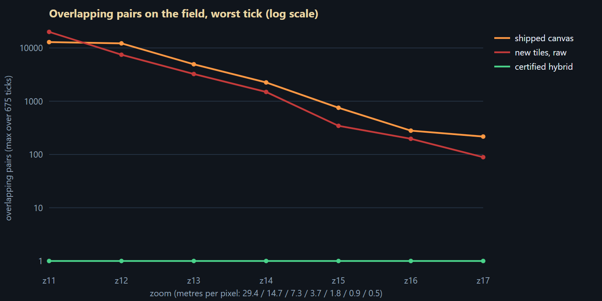

### 2.4 Data defects that touch layout

- **Side from the id prefix is wrong for 10 placed ids** (the renderer uses `unit_id.startsWith("U-")`). The lab computes the side from the order of battle where it can and, for ids it cannot resolve, from the state suffix **only when that suffix occurs only on the other side in the registry**; it flags the 10 it changed (the same 10 as the sibling page, ticks 95 and 150):

| id | prefix says | order of battle / state suffix says |
|:---|:---|:---|
| `U-26NC` | union | confederate |
| `U-11NC` | union | confederate |
| `U-47NC` | union | confederate |
| `U-52NC` | union | confederate |
| `U-15AL` | union | confederate |
| `U-44AL` | union | confederate |
| `U-48AL` | union | confederate |
| `U-4TX` | union | confederate |
| `U-5TX` | union | confederate |
| `U-1TX` | union | confederate |

  An aggregate that counted such a unit into a Union cluster would show the wrong side count (vital item V2). Fix the data or the renderer before aggregating.
- **Parents.** 383 of 478 ids resolve through the order of battle, 29 only through a documented id pattern (labelled as inferred), 66 have no parent and attach to their army as "unassigned". Aggregation along the order of battle is therefore exact for 80 % of the ids and heuristic or flat for the rest.
- **Repeated rows.** 117 rows repeat an already stated (unit, tick) key and 73 of those disagree; the app (and the lab) keep the row that loads last, so which position shows depends on file load order.
- **Brigade and its regiments on one coordinate.** A brigade record and its own regiments are often placed on the same point (tick 1: `U-I-1-1` and `U-2WI`), so a record and its descendants overlap by construction; aggregation (a brigade tile standing for its regiments) is the honest representation, not displacement.

---

## 3. Four strategies, prototyped and measured

All strategies sit behind one interface (`lib/strategies.mjs`), draw the **same chips**, are verified by the **same independent verifier** (`lib/geom.mjs`, shares no code with any solver) and are measured on the same frames: every tick 1-675 × zoom 11-17 × visibility rules A, B, C, cold start per tick, positions interpolated smoothly between a unit's keyframes (owner decision 5). "Hidden" = a unit on the field that is neither drawn nor counted in an aggregate. Rule A below; B and C in section 5.2.

| strategy: **overlap pairs, worst tick** / **units hidden, typical (worst)** / **largest displacement, px** | z11 | z13 | z14 | z15 | z17 |
|:---|---:|---:|---:|---:|---:|
| (d) progressive disclosure only | 20,042 / 0 (0) / 0 | 3,241 / 0 (0) / 0 | 1,492 / 0 (0) / 0 | 345 / 0 (0) / 0 | 89 / 0 (0) / 0 |
| (b) constrained displacement only | 0 / 375 (462) / 48 | 0 / 231 (301) / 48 | 0 / 114 (165) / 48 | 0 / 27 (52) / 48 | 0 / 0 (1) / 46 |
| (a) aggregation, data-driven | 0 / 0 (0) / 0 | 0 / 0 (0) / 0 | 0 / 0 (0) / 0 | 0 / 0 (0) / 0 | 0 / 0 (0) / 0 |
| (a) aggregation, semantic-zoom tiers | 0 / 0 (0) / 0 | 0 / 0 (0) / 0 | 0 / 0 (0) / 0 | 0 / 0 (0) / 0 | 0 / 0 (0) / 0 |
| (c) fixed-slot fan-out rosters | 0 / 384 (477) / 179 | 0 / 339 (418) / 264 | 0 / 238 (311) / 239 | 0 / 33 (73) / 254 | 0 / 0 (0) / 234 |
| **certified hybrid (a+b+c+d)** | 0 / 0 (0) / 48 | 0 / 0 (0) / 48 | 0 / 0 (0) / 48 | 0 / 0 (0) / 48 | 0 / 0 (0) / 46 |

*(overlap pairs on the worst tick / units hidden, typical tick and worst tick in brackets / largest displacement in px)*

### 3.1 (a) Semantic zoom and aggregation along the order of battle

**Algorithm.** Start from one tile per unit. A tile that overlaps another (chip against chip, or a chip covering a foreign true position) is merged with the best partner within reach: the partner with the **deepest common ancestor** in the order of battle, then the nearest; the result is an aggregate tile at the strength-weighted centroid (at the formation's own record when that record is one of the members) named after the common ancestor, with a count badge and an expandable list. Repeat to a fixed point. Two flavours: *data-driven* (merge exactly when tiles would overlap) and *semantic-zoom tiers* (also merge by zoom: corps below z11.6, divisions to z12.6, brigades to z14, regiments above).

**Result.** Zero overlaps and zero hidden units by construction at every zoom, and the cheapest solve. The price is detail and position: at zoom 13, 371 of 384 units sit inside aggregates (typical tick) and a single aggregate tile can stand for units up to 543 px (3,984 m) apart. The tier flavour was meant to be calmer in time (a tile should change only when the zoom crosses a threshold) but, as implemented, it is not: 44 churn events per second against 30 for the data-driven flavour at 4x, and it gains nothing in detail: both flavours end within a few tiles of each other (43 and 45 tiles at zoom 13) because the forced merges dominate.

**Failure cases.** Units from several corps piled on one hill (Cemetery Hill) merge across corps: the common ancestor is the army, so the name falls back to `Lead +k` (section 4.6) and the count is the only honest statement; two opposing units on one coordinate become a `Contact` tile. Unassigned ids (66) can only merge with whatever is nearest.

### 3.2 (b) Constrained displacement with leader lines and temporal coherence

**Algorithm.** Tiles are placed in priority order (selected, then larger formations, then larger strength, then id: fully static, so the order never reshuffles). Each chip goes to the **exact nearest free position** to where it would like to be (its true position, or where it was last frame minus a small relaxation toward the true position), inside a displacement budget of 48 px, **never covering any tile's true position**; a displaced chip gets a pin and a leader line. Section 4.2 gives the search and its proof of optimality.

**Result.** Zero overlaps among the tiles it places, but it cannot place them all: at zoom 13 a typical tick has 231 of 384 units without a tile, at zoom 14 114, and even at zoom 17 up to 1 (the stacks). Displacement alone *violates the never-hide rule* wherever the field is crowded; and it has no answer at all for 60 tiles on one coordinate (stress table, section 9).

### 3.3 (c) Fan-out of co-located units into a fixed-slot roster

**Algorithm.** Tiles whose chips overlap form a cluster; a cluster becomes a **roster block**: its members in order-of-battle order in fixed grid slots, the block placed (as one rigid macro tile) by the same exact search with a larger budget (96 px), every member keeping a pin and leader to its true position, no member's pin covered.

**Result.** The slots are tidy and stable, and for small clusters it is the best presentation (it is what the expandable list in section 4.7 uses). As a *whole-field* strategy it fails exactly like (b): at zoom 13 a typical tick leaves 339 units unplaced because the blocks are bigger than the clusters, blocks move up to 264 px, and leader crossings reach 147 per frame.

### 3.4 (d) Progressive disclosure

**Algorithm.** The chip (the vital core) is always drawn at the true position; the name label is added only where the free-space test passes (right, left, below, above), with a delay before it may appear and immediate removal when it stops fitting.

**Result.** Labels collapse gracefully (20% of leaf tiles keep a label at zoom 13, 79% at zoom 15) but it moves nothing, so the **chips themselves still overlap**: up to 1,492 pairs at zoom 14 and 89 at zoom 17. Disclosure is necessary (it is how secondary detail leaves) and insufficient.

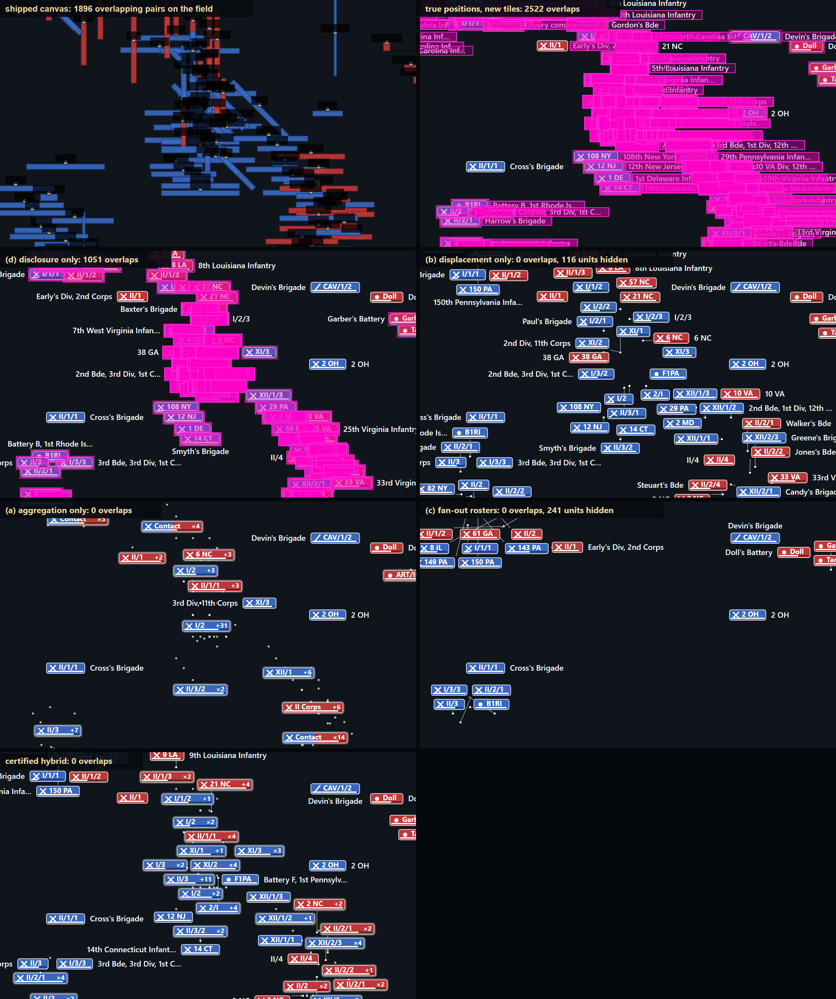

*(shipped canvas, true positions, (d), (b), (a), (c), certified hybrid; magenta = overlapping items)*

---

## 4. The recommended algorithm: certified layout

One solver, one verifier, one tile spec; the four strategies are **stages of the same pipeline**, not separate pipelines (no second code path to drift out of sync with the first).

### 4.1 Pipeline (one frame)

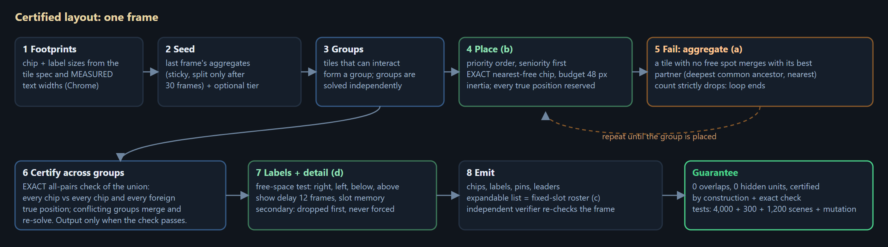

1. **Footprints** from the tile spec and measured text.
2. **Seed.** Last frame's aggregates are re-created (*sticky aggregates*); optionally a zoom-keyed tier pre-merges by echelon.
3. **Groups.** Tiles that could interact (anchors closer than 2 x budget + chip sizes) are grouped; groups are solved independently.
4. **Place** the tiles of a group in priority order, each by the exact nearest-free search (4.2). A tile starts from where it was last frame (inertia), relaxing 2 px/frame toward its true position; older tiles are placed first (seniority) so a newcomer yields instead of pushing.
5. **On failure, aggregate.** A tile that cannot be placed within the budget is merged with its best partner (deepest common ancestor, then nearest); a failed member of an aggregate that was being split goes back into it. Repeat until every tile of the group is placed.
6. **Certify across groups.** An aggregate's centroid can move into another group's reach, so the union of all placements is checked **exactly** (every chip against every other chip and every foreign true position); conflicting groups are merged and re-solved. The loop ends only when the check passes.
7. **Labels** (best effort, in the free space left, with show delay and slot memory).
8. **Emit** chips, labels, pins and leaders. The independent verifier (tests, lab, optional runtime assertion) re-checks the emitted frame.

**Splitting aggregates is deliberately lazy.** Merges are immediate; a split is only *tried* after the aggregate has existed for at least 30 frames (staggered with a per-aggregate offset, at most 2 trials per frame), with a smaller budget (48 minus a 12 px hysteresis band); if any member fails the whole group snaps back and the clock restarts. "Merge now, split later" is what removes the flicker (section 6).

### 4.2 The core primitive: exact nearest-free placement

For a tile with one rectangle part p and an obstacle rectangle o, the tile centres that violate the clearance g form the **open rectangle** (o.x0 - g - p.x1, o.x1 + g - p.x0) x (o.y0 - g - p.y1, o.y1 + g - p.y0). The feasible region is the plane minus the union of these open rectangles. The point of that region nearest to a desired centre P0 is either P0 or lies on an edge of one of the rectangles, so its x is one of {P0.x} U {x0, x1 of every rectangle} and its y one of {P0.y} U {y0, y1}. The search enumerates those candidates in order of increasing distance (branch and bound) and returns the first feasible one inside the budget disk. **Verified:** on 300 random scenes the result is feasible and equal to a 0.5 px brute-force scan of the disk (worst excess 0.00 px). A neighbourhood with more than 60 relevant obstacles is declared saturated and fails at once (a conservative failure: it can cause an unnecessary merge, never an overlap; section 10 measures the effect).

### 4.3 The guarantee

**Statement.** The frame the algorithm emits has (i) no two chips with an axis gap below the clearance, (ii) no chip covering another tile's true position, (iii) no label overlapping a chip, a pin or another label, and (iv) every unit on the field represented by exactly one tile (as itself or inside an aggregate).

**Proof.**
- *Within a group (i, ii).* Tiles are placed one after another; each is accepted only at a candidate that the exact test found feasible against **every previously placed chip and every true position of the group**. After the last tile, every pair has therefore been checked once, by the test that characterises feasibility.
- *A group solve terminates.* If any tile fails, at least one pair of tiles is merged (a failed tile always has a partner: the nearest tile of its group is the fallback), so the number of tiles in the group strictly decreases; a group of one tile has no obstacle inside it and sits on its true position. After at most n - 1 rounds every tile is placed.
- *Across groups (i, ii).* After all groups are solved the union of the placements is checked exactly. If a conflict exists the conflicting groups are merged and re-solved; the number of groups strictly decreases, so the loop ends, and it ends only when the exact check finds no conflict. Together with the previous two points every pair of tiles in the field has been checked.
- *Labels (iii).* A label is accepted only after the free-space test against all chips, displaced pins and earlier labels.
- *Representation (iv).* Merging only unions the id sets of tiles; nothing is ever removed.
- *Time.* The last two loops are the only unbounded ones; each strictly shrinks a finite set, so the algorithm always terminates, with **at worst a single aggregate per connected group** (which has no neighbour inside the group).

**What the proof does not cover:** (1) *rectangles, not pixels* (the boxes are the guarantee; glyph pixels inside a box are the visual designer's job); (2) *the text width* (the chip is as wide as the measured text; wider fonts need run-time measurement); (3) *quality* (the algorithm is greedy, not optimal; section 10 quantifies the dials); (4) *time* (worst-case cost grows with the crowd; measured, not bounded, section 5.3); (5) *continuity* (hysteresis is measured, not proven; section 6); (6) *transitions* (fading tiles are exempt by the opacity rule, which is a design contract, section 6.4).

**What backs the proof.** `selftest.mjs`: the verifier equals a brute force on 4,000 random rectangle sets; the nearest-free search equals a brute force on 300 scenes; the guarantee holds on 480 adversarial scenes and on 720 solves with random dial settings (budget 0-96, tiers, seniority, escalation, inertia and stickiness on and off); a negative control (displacement only, 60 identical anchors) fails as it should; three mutation tests show the verifier catches a chip dragged onto a chip, a label onto a chip and a pin under a chip:

- verifier == brute force on 4000 random rect sets
- nearestFree is feasible and optimal on 300 random scenes (worst excess over the 0.5 px brute force: 0.00 px)
- guarantee holds on 480 adversarial scenes (max rounds 40, slowest solve 249 ms)
- guarantee holds across the policy-dial space (240 random dial settings x 3 consecutive frames = 720 solves)
- negative control: 60 identical anchors, displacement only -> 54 tiles cannot be placed (the guarantee needs aggregation)
- mutation baseline: the clean layout has 0 overlaps
- mutation A (a chip dragged onto another chip) is detected
- mutation B (a label dragged onto a foreign chip) is detected
- mutation C (a true-position pin hidden under a foreign chip) is detected

### 4.4 Policy dials (the system is meant to be tuned and extended)

| dial | default | what it trades | measured in |
|---|---|---|---|
| `dMax` displacement budget | 48 px (standard), 40 (compact) | detail against how far a chip may sit from its true position | 10 |
| `band` split hysteresis | 12 px | flicker against how soon an aggregate opens | 6 |
| `splitDwell` | 30 frames | the same | 6 |
| `relax` | 2 px per frame | how quickly a displaced chip returns | 6 |
| `seniority` | on | pushes by newcomers | 6 |
| `labelShowDelay` | 12 frames | label flicker | 6 |
| `kCap` | 60 | solve time against unnecessary merges | 10 |
| `pinProtect` | on | cost of keeping every true position uncovered | 10 |
| `tier` | off (unstable in time as built) | semantic zoom by echelon | 6.3, 10 |
| `dMax2` escalation | off (raises pops and jerk) | fewer cross-corps merges against longer leaders | 6.3, 10 |
| visibility rule | A (shipped) | the number of tiles at all | 5.2 |
| footprint | standard | the number of aggregates | 10 |

New strategies, naming policies, priority functions and tile variants plug in by adding a function to `STRATEGIES` / `SPECS` and are measured by re-running `selftest.mjs`, `measure.mjs e1` and `e2` unchanged.

### 4.5 Labels and progressive disclosure

The chip carries every vital item, so a label that does not fit is **dropped, never forced**: placement tries right, left, below, above; a label may appear only after fitting for 12 consecutive frames and keeps its slot until it stops fitting. Labels are placed after all chips, so a secondary label can never push a vital chip. At zoom below 12 labels are off (as in the shipped renderer's first tier).

### 4.6 Naming an aggregate

If its members share a formation (brigade, battalion, division, corps) the chip shows that formation's short code and `x n`; if they come from several corps it shows its lead member (highest echelon, then strength) and `+k`; if both sides are present it shows `Contact` and `x n`. The share of aggregate units that carry a formation name is a quality measure reported in section 10 (**formation share**).

### 4.7 The expandable list

Opening an aggregate replaces it with a fixed-slot roster (the members in order-of-battle order, one slot each, a header, at most 24 slots then "+k more"), placed by the same exact search among every other chip, label and true position; each member keeps a pin and leader. The expansion is **certified like everything else**: it is applied only if the exact check of the whole frame passes, otherwise the list opens in a dock and the map is left exactly as it was.

**Measured.** At the three hotspots, zoom 14, 15 and 16, visibility rules A and C, a 1440 x 900 viewport, every aggregate in view was opened one at a time: of 202 aggregates, **58 (29%) opened in place** and the rest fell back to the dock, either because no free place exists within 200 px or because a member's true position lies under another tile (inside an aggregate the members' positions are not reserved, so another chip may cover one). So the **dock is the default presentation of the expandable list**, and the in-place roster an opportunistic, certified mode that works mostly from zoom 15. An engine-level "open" state that re-solves the neighbours (they would aggregate to make room) would raise the in-place share; it is not built.

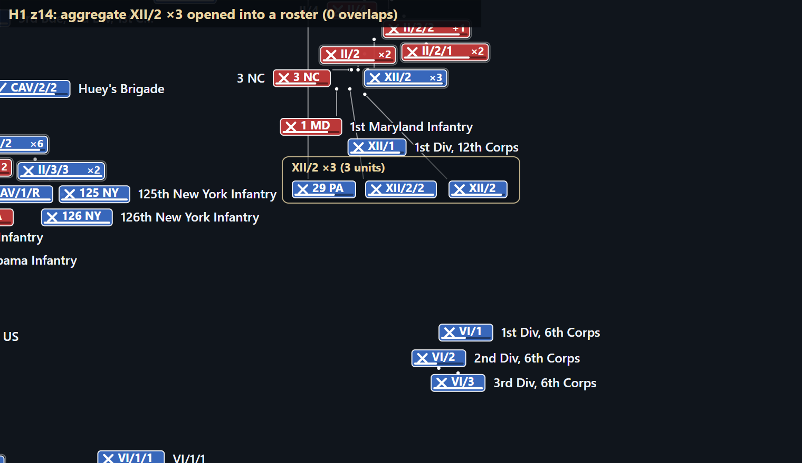

### 4.8 Complexity

Per frame: grouping O(n); placement O(sum over groups of g x K^2) with K bounded by `kCap` (60) and g the group size; aggregation rounds at most g - 1 per group; the placement passes actually run are in the last row of the table in section 5.1; certification O(n x neighbours). The lab's measured costs are in 5.3.

---

## 5. Results of the certified layout

### 5.1 All ticks, all zooms (visibility rule A, the worst case)

|  | z11 29.4 m/px | z12 14.7 m/px | z13 7.3 m/px | z14 3.7 m/px | z15 1.8 m/px | z16 0.9 m/px | z17 0.5 m/px |
|:---|---:|---:|---:|---:|---:|---:|---:|
| units on the field, typical / worst | 384 / 478 | 384 / 478 | 384 / 478 | 384 / 478 | 384 / 478 | 384 / 478 | 384 / 478 |
| tiles drawn, typical / worst | 19 / 33 | 51 / 67 | 124 / 156 | 242 / 286 | 345 / 415 | 384 / 478 | 384 / 478 |
| units inside aggregate tiles, typical / worst | 384 / 478 | 367 / 461 | 319 / 413 | 197 / 278 | 57 / 113 | 0 / 14 | 0 / 2 |
| **overlapping pairs, worst tick** | 0 | 0 | 0 | 0 | 0 | 0 | 0 |
| **units hidden, worst tick** | 0 | 0 | 0 | 0 | 0 | 0 | 0 |
| displaced tiles (typical / worst) | 0 / 11 | 14 / 38 | 40 / 55 | 97 / 118 | 127 / 152 | 123 / 173 | 83 / 123 |
| largest displacement: px = metres | 48 px = 1,405 m | 48 px = 704 m | 48 px = 352 m | 48 px = 176 m | 48 px = 88 m | 48 px = 44 m | 46 px = 21 m |
| name labels shown, share of leaf tiles | off (<z12) | 93% | 79% | 73% | 91% | 95% | 99% |
| aggregate spread, typical tick: p95 / worst, px | 115 / 202 | 148 / 313 | 127 / 268 | 127 / 233 | 93 / 191 | 0 / 120 | 0 / 96 |
| leader crossings, worst tick | 1 | 3 | 3 | 5 | 3 | 2 | 1 |
| placement passes per solve (one per group and merge round), typical / worst | 8 / 11 | 7 / 22 | 8 / 16 | 15 / 23 | 38 / 55 | 82 / 108 | 196 / 245 |

*Overlaps, hidden units: zero at every zoom for every tick. "Units inside aggregates" is the price of the footprint and the visibility rule, not of the algorithm.*

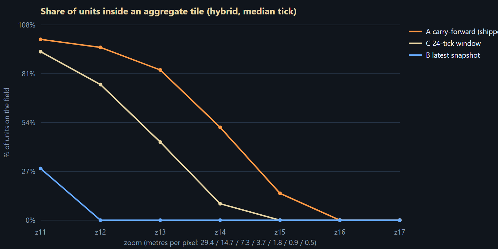

### 5.2 The three visibility rules

| rule | measure | z11 | z12 | z13 | z14 | z15 | z17 |
|:---|:---|---:|---:|---:|---:|---:|---:|
| A | units on the field typical / worst | 384 / 478 | 384 / 478 | 384 / 478 | 384 / 478 | 384 / 478 | 384 / 478 |
|  | tiles drawn typical / worst | 19 / 33 | 51 / 67 | 124 / 156 | 242 / 286 | 345 / 415 | 384 / 478 |
|  | units in aggregates typical / worst | 384 / 478 | 367 / 461 | 319 / 413 | 197 / 278 | 57 / 113 | 0 / 2 |
|  | overlap pairs worst tick | 0 | 0 | 0 | 0 | 0 | 0 |
| B | units on the field typical / worst | 7 / 85 | 7 / 85 | 7 / 85 | 7 / 85 | 7 / 85 | 7 / 85 |
|  | tiles drawn typical / worst | 5 / 32 | 6 / 49 | 7 / 56 | 7 / 71 | 7 / 83 | 7 / 85 |
|  | units in aggregates typical / worst | 2 / 85 | 0 / 78 | 0 / 58 | 0 / 23 | 0 / 5 | 0 / 0 |
|  | overlap pairs worst tick | 0 | 0 | 0 | 0 | 0 | 0 |
| C | units on the field typical / worst | 44 / 98 | 44 / 98 | 44 / 98 | 44 / 98 | 44 / 98 | 44 / 98 |
|  | tiles drawn typical / worst | 12 / 33 | 19 / 59 | 28 / 75 | 37 / 86 | 43 / 94 | 44 / 98 |
|  | units in aggregates typical / worst | 41 / 98 | 33 / 95 | 19 / 81 | 4 / 49 | 0 / 27 | 0 / 0 |
|  | overlap pairs worst tick | 0 | 0 | 0 | 0 | 0 | 0 |

### 5.3 Time per solve (node 24, one thread; `timing.mjs`)

*Measurement conditions: a 16-thread laptop CPU shared with other jobs (other agents' browsers and test runs were active; Windows reported about 50 % total CPU load at a sample taken while the first run of the script was in progress; the figures below come from the rerun that followed, load not sampled), the rest of the lab idle, one solver thread. Treat the figures as conservative: an idle machine is faster. Cold = a freshly created solver; the first of 31 repetitions (JIT warm-up) is dropped.*

**Cold** (a fresh solver: a seek, a zoom jump or the first frame), densest tick (tick 620, 478 units), median / p95 ms:

| zoom | raw | (b) displace | (a) aggregate | (a) tiers | (c) fan-out | **hybrid** |
|:---|---:|---:|---:|---:|---:|---:|
| z11 | 0.1 / 0.4 | 63.8 / 122.2 | 63.5 / 69.1 | 28.1 / 31.7 | 12.8 / 23.8 | 124.9 / 137.5 |
| z12 | 0.2 / 0.5 | 36.4 / 43.2 | 31.3 / 36.1 | 3.4 / 4.5 | 13.8 / 15.5 | 107.4 / 112.1 |
| z13 | 0.1 / 0.3 | 41.8 / 44.6 | 16.7 / 19.1 | 5.0 / 6.6 | 13.8 / 14.6 | 93.5 / 103.5 |
| z14 | 0.1 / 0.2 | 20.1 / 22.0 | 6.9 / 8.2 | 6.9 / 8.5 | 9.9 / 11.3 | 60.2 / 78.7 |
| z15 | 0.1 / 0.3 | 10.0 / 13.5 | 5.9 / 6.9 | 5.7 / 7.0 | 14.9 / 17.3 | 25.3 / 28.9 |
| z16 | 0.1 / 0.2 | 5.6 / 7.1 | 3.4 / 4.1 | 3.1 / 5.0 | 5.7 / 8.9 | 5.4 / 6.4 |
| z17 | 0.1 / 0.2 | 3.7 / 5.0 | 3.0 / 4.0 | 3.1 / 5.8 | 3.1 / 4.3 | 3.5 / 4.5 |

**Warm** (the per-frame cost during 10 s of 60 fps playback centred on the densest tick, inertia and sticky aggregates active):

| zoom | speed | units | tiles | mean ms | p95 ms | p99 ms | max ms | frames with overlap |
|:---|:---|---:|---:|---:|---:|---:|---:|---:|
| z12 | 1x | 478 | 53 | 2.2 | 5.8 | 9.1 | 105 | 0 |
| z12 | 4x | 477 | 51 | 2.3 | 6.9 | 9.8 | 117 | 0 |
| z12 | 16x | 465 | 48 | 2.4 | 6.7 | 11.4 | 95 | 0 |
| z13 | 1x | 478 | 127 | 4.2 | 6.8 | 9.4 | 96 | 0 |
| z13 | 4x | 477 | 127 | 4.1 | 6.5 | 8.6 | 99 | 0 |
| z13 | 16x | 465 | 119 | 3.8 | 6.6 | 8.3 | 90 | 0 |
| z14 | 1x | 478 | 273 | 8.0 | 10.6 | 13.8 | 55 | 0 |
| z14 | 4x | 477 | 256 | 6.9 | 10.0 | 12.6 | 69 | 0 |
| z14 | 16x | 465 | 244 | 6.2 | 9.5 | 14.2 | 50 | 0 |
| z15 | 1x | 478 | 408 | 6.4 | 8.4 | 9.5 | 20 | 0 |
| z15 | 4x | 477 | 399 | 6.3 | 8.2 | 10.3 | 19 | 0 |
| z15 | 16x | 465 | 378 | 5.6 | 7.4 | 9.4 | 18 | 0 |

Every tick of the battle, cold, at zoom 13: median 74.3 ms, p95 104.2 ms, worst 123.4 ms. So a seek at zoom 12-13 costs about a tenth of a second (six frames at 60 fps) and at zoom 15 and above under two frames; playback costs a few milliseconds per frame at zoom 12-13, but at zoom 14-15 the p99 reaches 13.8 ms of a 16.7 ms frame before any drawing, so the solver belongs in a worker. The same code in Chrome (V8) is reported in section 8.

---

## 6. Time: flicker, jitter, popping

Frame-by-frame playback at **60 fps for 10 s** around each hotspot, zoom 13, 14 and 15, at 1x (2 ticks/s), 4x and 16x (the app's top speed), seven variants: 189 runs. Definitions: **tile churn** = tile keys appearing or disappearing while carrying a unit that was on the field in both frames (data-driven entries and exits are not layout flicker; the first second is excluded as warm-up); **pop** = a leaf tile whose centre moves more than 3 px beyond its true position's own motion in one frame; **jerk** = |c(f+1) - 2c(f) + c(f-1)| of the rendered centre, which is 0 for a perfectly smooth glide. Mean over the nine hotspot-zoom combinations:

| speed | variant | runs | overlap pairs per frame | frames with any overlap | tile churn /s | label show-hide / slot changes per s | pops /s | jerk p99 (px/frame^2) | jerk max | tile-frames with jerk > 1 px | solve ms/frame |
|:---|:---|---:|---:|---:|---:|---:|---:|---:|---:|---:|---:|
| 1x | shipped renderer, shipped data path (hold + stateless relaxation) | 9 | 2024.0 | 5,400 of 5,400 | n/a | n/a | 163.8 | 11.546 | 1,438 | 1.3% | 3.5 |
| 1x | shipped relaxation on smoothly interpolated positions | 9 | 2001.0 | 5,400 of 5,400 | n/a | n/a | 896.9 | 34.840 | 317 | 7.6% | 3.6 |
| 1x | hybrid without inertia, sticky aggregates or seniority | 9 | 0.0 | 0 of 5,400 | 111.8 | 17.8 / 5.0 | 65.4 | 9.956 | 181 | 1.7% | 69.6 |
| 1x | **certified hybrid** | 9 | 0.0 | 0 of 5,400 | 16.0 | 9.0 / 2.9 | 8.6 | 0.038 | 92 | 0.3% | 7.3 |
| 1x | (b) displacement only | 9 | 0.0 | 0 of 5,400 | 0.0 | 10.6 / 3.4 | 14.5 | 0.037 | 94 | 0.3% | 30.0 |
| 1x | (a) aggregation only | 9 | 0.0 | 0 of 5,400 | 20.3 | 4.4 / 0.9 | 0.0 | 0.002 | 3 | 0.0% | 1.6 |
| 1x | (a) aggregation, semantic-zoom tiers | 9 | 0.0 | 0 of 5,400 | 28.4 | 4.4 / 0.9 | 0.0 | 0.002 | 3 | 0.0% | 2.1 |
| 4x | shipped renderer, shipped data path (hold + stateless relaxation) | 9 | 1958.2 | 5,400 of 5,400 | n/a | n/a | 277.0 | 19.550 | 1,443 | 2.4% | 3.6 |
| 4x | shipped relaxation on smoothly interpolated positions | 9 | 1946.2 | 5,400 of 5,400 | n/a | n/a | 2075.4 | 54.048 | 343 | 15.8% | 3.6 |
| 4x | hybrid without inertia, sticky aggregates or seniority | 9 | 0.0 | 0 of 5,400 | 329.8 | 37.5 / 13.5 | 205.6 | 29.346 | 188 | 4.8% | 68.3 |
| 4x | **certified hybrid** | 9 | 0.0 | 0 of 5,400 | 24.2 | 22.0 / 8.9 | 46.3 | 0.768 | 115 | 0.9% | 7.3 |
| 4x | (b) displacement only | 9 | 0.0 | 0 of 5,400 | 0.0 | 31.9 / 10.4 | 86.2 | 1.609 | 123 | 1.2% | 29.8 |
| 4x | (a) aggregation only | 9 | 0.0 | 0 of 5,400 | 30.1 | 7.1 / 2.1 | 0.0 | 0.040 | 15 | 0.0% | 1.5 |
| 4x | (a) aggregation, semantic-zoom tiers | 9 | 0.0 | 0 of 5,400 | 43.6 | 6.9 / 2.1 | 0.0 | 0.034 | 15 | 0.0% | 2.0 |
| 16x | shipped renderer, shipped data path (hold + stateless relaxation) | 9 | 1849.5 | 5,400 of 5,400 | n/a | n/a | 402.9 | 28.840 | 3,101 | 3.7% | 3.3 |
| 16x | shipped relaxation on smoothly interpolated positions | 9 | 1826.9 | 5,400 of 5,400 | n/a | n/a | 3074.9 | 66.281 | 371 | 23.2% | 3.3 |
| 16x | hybrid without inertia, sticky aggregates or seniority | 9 | 0.0 | 0 of 5,400 | 569.5 | 59.5 / 24.1 | 363.3 | 40.768 | 305 | 8.4% | 64.9 |
| 16x | **certified hybrid** | 9 | 0.0 | 0 of 5,400 | 34.5 | 38.0 / 20.2 | 89.7 | 4.667 | 371 | 2.1% | 6.2 |
| 16x | (b) displacement only | 9 | 0.0 | 0 of 5,400 | 0.0 | 59.9 / 21.5 | 167.5 | 8.445 | 371 | 2.7% | 29.3 |
| 16x | (a) aggregation only | 9 | 0.0 | 0 of 5,400 | 52.2 | 14.5 / 4.1 | 0.0 | 0.419 | 274 | 0.5% | 1.3 |
| 16x | (a) aggregation, semantic-zoom tiers | 9 | 0.0 | 0 of 5,400 | 72.7 | 14.3 / 4.1 | 0.0 | 0.382 | 274 | 0.4% | 1.9 |

### 6.1 What the numbers say

- **The shipped renderer is the jitter.** Its data path holds a unit's last keyframe and jumps at the next one (`03-data-fuel.md` fact 8), and its stateless relaxation re-sorts overlapping glyphs every frame: 164 pops per second at 1x, 277 at 4x, 403 at 16x. Interpolating the data alone (row 2 of each block) does **not** cure it, it makes it worse (2,075 pops per second at 4x): the relaxation, not the data, is the shuffle.
- **Hysteresis is what makes the new layout calm.** Without inertia, sticky aggregates and seniority the hybrid makes 330 tile churn events per second at 4x (with them: 24), 206 pops per second (with: 46) and a p99 jerk of 29.3 (with: 0.77); it also costs 68.3 ms per frame because every frame is a cold solve (with: 7.3 ms).
- **Zero overlap on every frame**: the hybrid, displacement-only, aggregation-only and tier variants have 0 frames with an overlap (hybrid, 16,200 frames); the shipped renderer overlaps on 5,400 of 5,400 frames at 4x.
- **Labels** show and hide 22.0 times per second and change side 8.9 times per second at 4x across about 229 tiles (11-12 frames of delay before a label may appear; immediate removal when it stops fitting).
- **Aggregation-only** never moves a tile (no pops) and is the calmest in jerk, but it has the fewest tiles (115 against 229) and its aggregates still churn (30 per second): the cost of calm is detail. **Displacement-only** is nearly as smooth as the hybrid but leaves on average 129 of 393 units without any tile on every frame.

### 6.2 What remains

A handful of pushes per second: a tile appears (a unit enters, an aggregate forms) where an existing tile sits and the lower-priority one is moved 5-48 px **in one frame**. Seniority (older tiles are placed first, so a newcomer yields) already cuts them (table below, first two rows); it does not remove them.

### 6.3 Ideas tried for the residual pushes and for purity (measured, kept in `lib/` for the record)

Same three 10 s windows at 4x (8 ticks per second) for every variant; mean over the windows (`experiments.mjs`):

| variant (three 10 s windows at 4x: H1 z13, H2 z13, H3 z14) | tiles | tile churn /s | pops /s | jerk p99 | jerk max | overlap pairs |
|:---|---:|---:|---:|---:|---:|---:|
| default (inertia, sticky aggregates, seniority) | 158 | 25.1 | 16.9 | 0.299 | 90 | 0 |
| no seniority | 152 | 39.4 | 27.9 | 1.243 | 110 | 0 |
| easing layer (k 0.3, ghost newcomers 8 frames, snap-back) | 158 | 25.1 | 18.3 | 0.353 | 90 | 0 |
| lookahead layer (W 8) | 157 | 25.6 | 18.2 | 0.395 | 90 | 0 |
| growth ramp (10 frames) | 175 | 188.0 | 121.6 | 16.360 | 122 | 0 |
| escalated budget (48 -> 72 px before merging across formations) | 170 | 24.0 | 25.5 | 0.915 | 123 | 0 |
| zoom tiers (corps below z11.6, division below z12.6, brigade below z14) | 149 | 97.1 | 16.6 | 0.450 | 97 | 0 |

- **Seniority** (older tiles first) is kept: without it churn rises by about half and the p99 jerk quadruples.
- **Easing the displacement** (an exponential filter on each tile's offset with newcomers as ghosts, snapped back whenever the eased position would overlap) and **lookahead** (the solver 8 frames ahead, displayed offset = triangular average over 17 frames, same snap-back rule) change nothing measurable (pops 16.9 per second without, 18.3 with easing, 18.2 with lookahead): a pushed tile has no safe intermediate position, so the filter snaps back (easing: 57% of the eased tile-frames were snapped back; lookahead: 26.3 tiles per frame had to snap back). Both are rejected.
- **Growth ramp** (newborn tiles enter at 50 % size and grow over 10 frames so a push becomes continuous) feeds back into the fail-and-merge rule: churn rises from 25.1 to 188.0 per second. Rejected.
- **Escalated budget** (accept a 72 px leader before merging across formations) raises the share of aggregate units that carry a formation name (section 10) but makes the pushes worse in time (pops 16.9 to 25.5 per second, p99 jerk 0.30 to 0.92): a plausible cause (not isolated) is that whether the escalation applies depends on a same-formation partner being in reach, which changes as units move. Left as an off-by-default dial.
- **Zoom tiers** (corps, division, brigade pre-merging by zoom) look better in the static tables of section 10 (a higher share of aggregate units with a formation name at zoom 12-13) but are **unstable in time as implemented**: the tier aggregates are rebuilt every frame and bypass the sticky-aggregate memory, so churn rises from 25.1 to 97.1 per second. A sticky tier (tier membership remembered like any other aggregate) is the obvious next experiment; it is not claimed here.

### 6.4 The contract this places on the motion layer

Layout guarantees steady geometry. For births, deaths, merges and splits the motion layer must keep the **opacity rule**: of two overlapping tiles at most one is solid (opacity at least 0.5) at any time, so a merge is a sequenced dissolve (old tiles fade below 0.5 before the aggregate rises above it) or a morph, never two solid chips on one spot. Label appearance and disappearance are exempt (they never overlap by construction). The residual pushes of 6.2 are exactly the events the motion layer should choreograph: with the layout known one frame ahead (the solver can run ahead of the display) a pushed tile can start moving the frame before the pusher arrives. That choreography is **not** verified here.

---

## 7. The three densest hotspots

Ranking: for each tick, the most units within 120 m of one unit (rule A, zoom independent; `hotspots.mjs --find`). The three distinct places on top: **H1** tick 346 (Day 2 evening), **H2** tick 293 (Day 2 afternoon), **H3** tick 556 (Day 3). Place names are the nearest `terrain.json` key location and are labels, not claims (placements sit in a different frame, `03-data-fuel.md` fact 11).

| hotspot | tick | nearest key location (m) | units within 150 m | Union / Confederate | median age (ticks since a unit last keyframe) | on a shared coordinate | corps present |
|:---|:---|---:|---:|---:|---:|---:|---:|
| **H1** | 346 | Evergreen Cemetery gatehouse (67) | 28 | 26 / 2 | 226 (max 278) | 15 | XI-1 7, XI-2 3, II-3 3, XI 3 |
| **H2** | 293 | Rose Woods (109) | 23 | 15 / 8 | 6 (max 45) | 16 | II-1 12, I 7, III 1, V 1 |
| **H3** | 556 | The Angle (High Water Mark) (241) | 22 | 16 / 6 | 5 (max 356) | 8 | II-2 10, I 6, II 2, II-3 1 |

**What the three piles are.** H1 is a *stale* pile: units placed on the evening of Day 1 and carried forward for hundreds of ticks (median age in the table); it disappears under rules B and C (second table below). H2 and H3 are live contact scenes (median age a handful of ticks) with both sides inside 150 m, and they survive every visibility rule: there the layout does real work whatever the owner decides.

**Zoom 13, 14, 15, rule A, every strategy** (per strategy: overlap pairs / units hidden; hybrid: **overlaps** / hidden / tiles with the aggregates in brackets / largest displacement px):

| hotspot | zoom | units on field | shipped: overlap pairs | raw: chip pairs overlapping | (b): overlaps / hidden | (a): overlaps / tiles | (c): overlaps / hidden | **hybrid: overlaps** / hidden / tiles / max displacement px |
|:---|:---|---:|---:|---:|---:|---:|---:|---:|
| **H1** t346 | z13 | 385 (385 in view) | 3,936 | 2,390 | 0 / 232 | 0 / 52 | 0 / 340 | **0** / 0 / 125 (58 agg, 318 units) / 41 |
| **H1** t346 | z14 | 385 (216 in view) | 1,896 | 1,051 | 0 / 116 | 0 / 106 | 0 / 241 | **0** / 0 / 242 (59 agg, 202 units) / 48 |
| **H1** t346 | z15 | 385 (111 in view) | 612 | 247 | 0 / 29 | 0 / 224 | 0 / 39 | **0** / 0 / 346 (23 agg, 62 units) / 45 |
| **H2** t293 | z13 | 341 (272 in view) | 2,892 | 1,950 | 0 / 197 | 0 / 44 | 0 / 299 | **0** / 0 / 118 (69 agg, 292 units) / 41 |
| **H2** t293 | z14 | 341 (150 in view) | 1,344 | 845 | 0 / 96 | 0 / 102 | 0 / 205 | **0** / 0 / 229 (54 agg, 166 units) / 47 |
| **H2** t293 | z15 | 341 (105 in view) | 443 | 184 | 0 / 20 | 0 / 206 | 0 / 29 | **0** / 0 / 310 (20 agg, 51 units) / 48 |
| **H3** t556 | z13 | 456 (456 in view) | 4,624 | 3,111 | 0 / 292 | 0 / 46 | 0 / 414 | **0** / 0 / 130 (70 agg, 396 units) / 41 |
| **H3** t556 | z14 | 456 (299 in view) | 2,186 | 1,394 | 0 / 156 | 0 / 123 | 0 / 283 | **0** / 0 / 277 (74 agg, 253 units) / 47 |
| **H3** t556 | z15 | 456 (126 in view) | 723 | 329 | 0 / 49 | 0 / 255 | 0 / 53 | **0** / 0 / 394 (37 agg, 99 units) / 47 |

**The same places under the three visibility rules at zoom 14:**

| hotspot | rule | units | shipped overlap pairs | raw chip pairs | hybrid overlaps | hybrid tiles | displaced tiles / max px | units in Contact tiles |
|:---|:---|---:|---:|---:|---:|---:|---:|---:|
| **H1** | A | 385 | 1,896 | 1,051 | 0 | 242 (59 agg / 202 units) | 95 / 48 | 0 |
| **H1** | B | 2 | 0 | 0 | 0 | 2 (0 agg / 0 units) | 0 / 0 | 0 |
| **H1** | C | 48 | 209 | 66 | 0 | 37 (7 agg / 18 units) | 14 / 40 | 0 |
| **H2** | A | 341 | 1,344 | 845 | 0 | 229 (54 agg / 166 units) | 92 / 47 | 0 |
| **H2** | B | 6 | 9 | 6 | 0 | 5 (1 agg / 2 units) | 3 / 36 | 0 |
| **H2** | C | 70 | 383 | 281 | 0 | 36 (10 agg / 44 units) | 17 / 48 | 0 |
| **H3** | A | 456 | 2,186 | 1,394 | 0 | 277 (74 agg / 253 units) | 100 / 47 | 0 |
| **H3** | B | 14 | 8 | 8 | 0 | 14 (0 agg / 0 units) | 6 / 36 | 0 |
| **H3** | C | 68 | 138 | 114 | 0 | 54 (3 agg / 17 units) | 22 / 46 | 0 |

Legend of the figures: blue = Union, red = Confederate; X = infantry, slash = cavalry, dot = artillery; the white bar under the code is the strength state; `x n` / `+k` = an aggregate (a count of placement records); small white dots = true positions of displaced tiles and of aggregate members; thin lines = leaders; magenta = overlapping items.

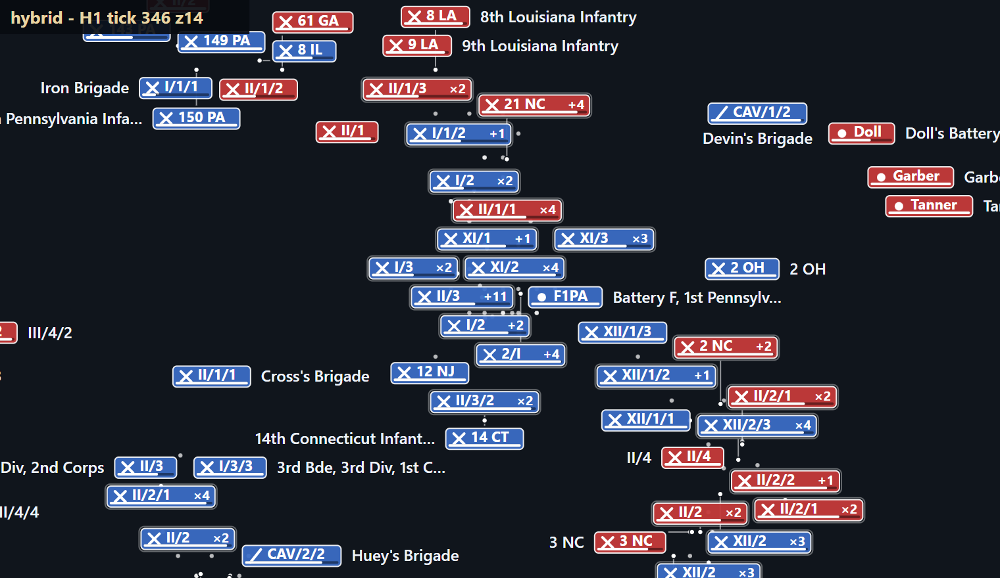
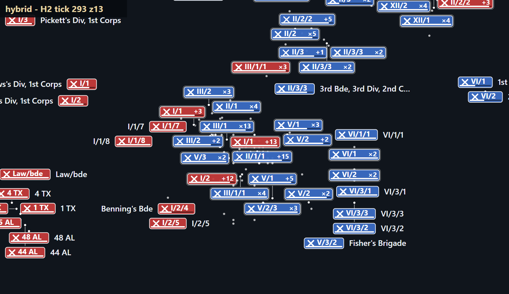
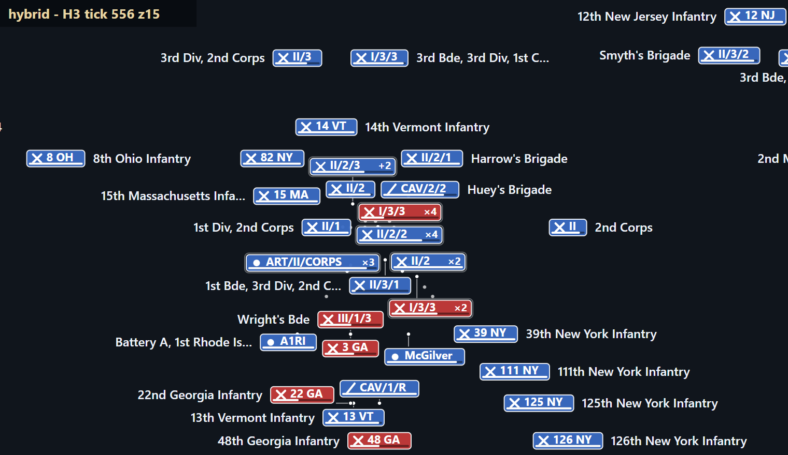
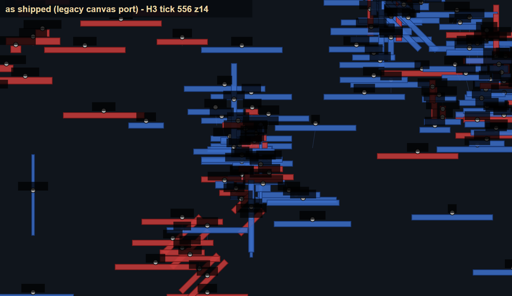
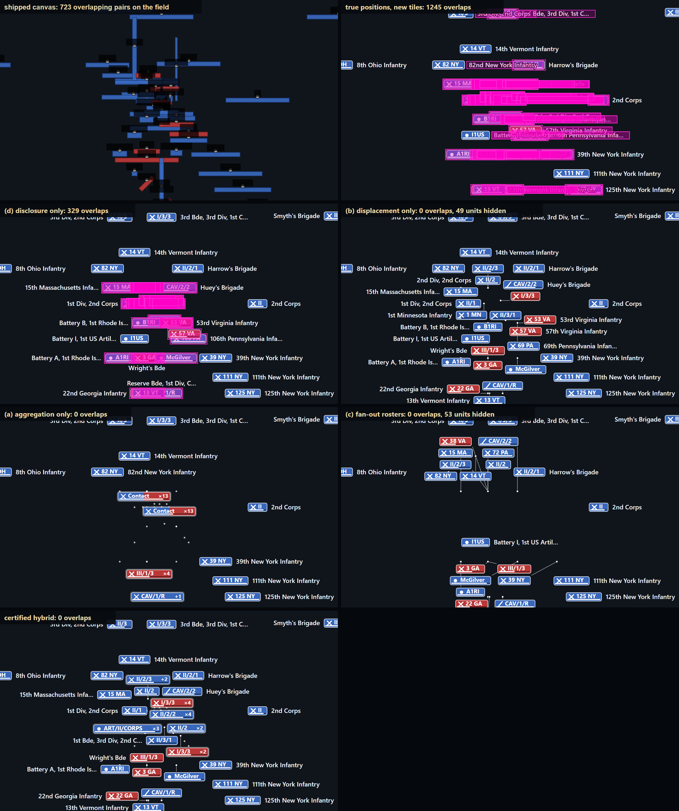

Real browser screenshots of the shipped app at tick 120 (zoom 14), tick 538 (13.5) and tick 551 (16) were taken by the sibling data page: `data/shots/*.jpg`.

**How the algorithm behaves.** Where chips cannot sit on their true positions they move at most 48 px and keep a pin and a leader; where even that is not enough the units of one formation merge into an aggregate (`I/1 +13`, `II/2/2 x4`); two opposing sides stay in separate aggregates unless a Union and a Confederate tile cannot be separated inside the budget, in which case they merge into a `Contact` tile (units in `Contact` tiles at zoom 14 in the table above). From zoom 16 the three hotspots are individual tiles with a few pins; the stacks on identical coordinates (a brigade and its regiments, batteries) never separate and are the reason displacement and aggregation exist at every zoom.

---

## 8. Browser confirmation

**The lab runs in Chrome on the real data files** (`lab.html`, port 9600; the same `lib/*.mjs`, no precomputed result). `shot-lab.mjs` drives it and reads back what the page computed: the densest tick (tick 620, 478 units), the independent verifier's overlap count, representation, and solve time in V8 (cold solver, 25 repetitions):

| zoom | units | tiles | aggregates | overlaps (page verifier) | unrepresented + duplicated | max displacement px | solve p50 ms (V8) | p95 ms |
|:---|---:|---:|---:|---:|---:|---:|---:|---:|
| z11 | 478 | 24 | 24 (478 units) | 0 | 0 | 0 | 139.1 | 466.8 |
| z12 | 478 | 62 | 38 (454 units) | 0 | 0 | 47 | 137.6 | 159.6 |
| z13 | 478 | 152 | 79 (405 units) | 0 | 0 | 41 | 113.1 | 135.4 |
| z14 | 478 | 283 | 76 (271 units) | 0 | 0 | 47 | 60.9 | 73.0 |
| z15 | 478 | 413 | 38 (103 units) | 0 | 0 | 45 | 26.3 | 39.9 |
| z16 | 478 | 478 | 0 (0 units) | 0 | 0 | 38 | 6.2 | 9.4 |
| z17 | 478 | 478 | 0 (0 units) | 0 | 0 | 36 | 4.8 | 6.6 |

300 frames (5 s at 60 fps) of playback at 4x with the stateful solver, verified frame by frame in the page:

| window | zoom | frames | overlap pairs | frames with overlap | unrepresented | solve ms mean / p95 / max |
|:---|---:|---:|---:|---:|---:|---:|
| H1 from tick 336 at 4x | z14 | 300 | 0 | 0 | 0 | 6.3 / 9.6 / 54 |
| H2 from tick 283 at 4x | z14 | 300 | 0 | 0 | 0 | 6.2 / 10.0 / 35 |
| H3 from tick 546 at 4x | z14 | 300 | 0 | 0 | 0 | 8.2 / 12.4 / 55 |
| H1 from tick 336 at 4x | z13 | 300 | 0 | 0 | 0 | 4.1 / 7.6 / 93 |

The live page, hybrid and shipped canvas port at H1 zoom 14 (screenshots of the running lab):

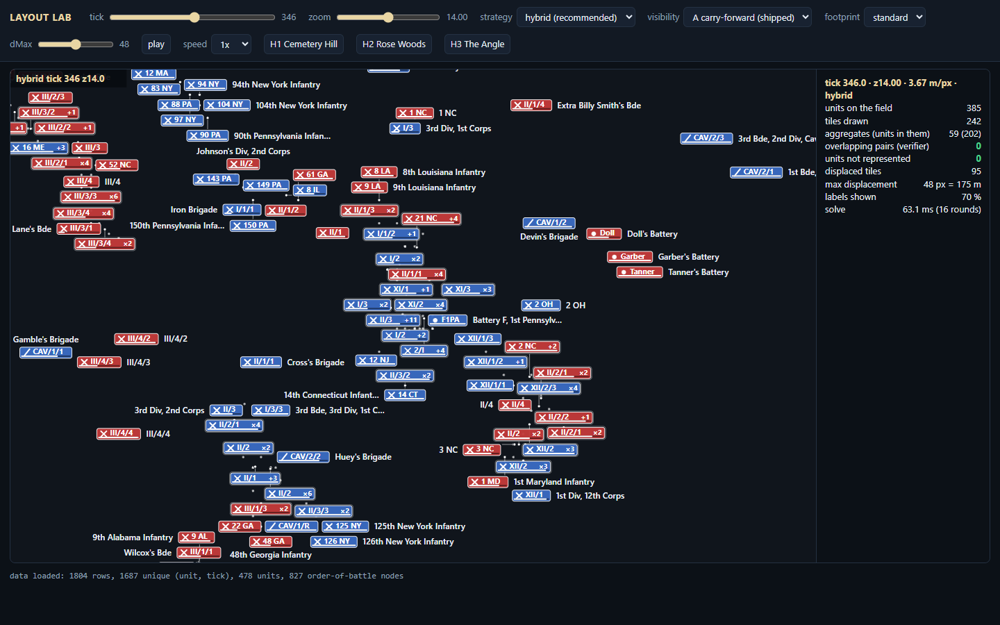
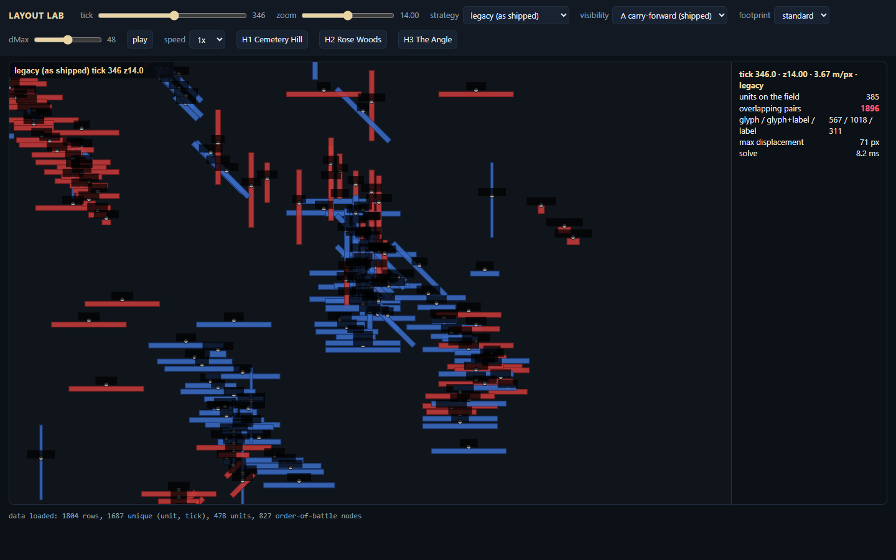

---

## 9. Failure cases and limits

**Stress outside the 1,804 keyframes** (real units, invented positions; `stress.mjs`), zoom 14, hybrid against displacement only:

| pattern | tiles in | tiles out | aggregates | overlaps | hidden | max displacement px | ms | hidden if displacement only |
|:---|---:|---:|---:|---:|---:|---:|---:|---:|
| point | 10 | 4 | 4 (10 units, largest 3) | 0 | 0 | 0 | 3 | 6 |
| point | 100 | 4 | 4 (100 units, largest 32) | 0 | 0 | 0 | 13 | 96 |
| point | 478 | 4 | 4 (478 units, largest 128) | 0 | 0 | 0 | 198 | 472 |
| twoPoints | 10 | 8 | 2 (4 units, largest 2) | 0 | 0 | 44 | 0 | 2 |
| twoPoints | 100 | 4 | 4 (100 units, largest 32) | 0 | 0 | 0 | 12 | 92 |
| twoPoints | 478 | 5 | 5 (478 units, largest 192) | 0 | 0 | 0 | 222 | 468 |
| line | 10 | 10 | 0 (0 units, largest 0) | 0 | 0 | 22 | 0 | 0 |
| line | 100 | 16 | 15 (99 units, largest 16) | 0 | 0 | 14 | 14 | 76 |
| line | 478 | 16 | 16 (478 units, largest 64) | 0 | 0 | 0 | 91 | 478 |
| grid | 10 | 10 | 0 (0 units, largest 0) | 0 | 0 | 0 | 0 | 0 |
| grid | 100 | 70 | 25 (55 units, largest 6) | 0 | 0 | 46 | 13 | 25 |
| grid | 478 | 61 | 59 (476 units, largest 32) | 0 | 0 | 22 | 95 | 425 |
| gauss | 10 | 10 | 0 (0 units, largest 0) | 0 | 0 | 21 | 0 | 0 |
| gauss | 100 | 52 | 19 (67 units, largest 7) | 0 | 0 | 40 | 21 | 41 |
| gauss | 478 | 77 | 49 (450 units, largest 81) | 0 | 0 | 35 | 150 | 391 |
| uniform | 10 | 10 | 0 (0 units, largest 0) | 0 | 0 | 0 | 0 | 0 |
| uniform | 100 | 100 | 0 (0 units, largest 0) | 0 | 0 | 40 | 2 | 0 |
| uniform | 478 | 220 | 140 (398 units, largest 7) | 0 | 0 | 44 | 95 | 209 |

- **Identical anchors:** 478 tiles on one point collapse to 4 aggregates (nine rounds); displacement alone hides 472 of them.
- **A long line** of 478 tiles at under 1 px spacing makes every displacement candidate collide: displacement alone drops **all** of them (every neighbourhood exceeds the saturation cap, a conservative failure), the hybrid merges them into 16 aggregates.
- **Cold-solve latency.** A cold solve at zoom 11-13 takes 93.5-124.9 ms median on the densest tick (p95 up to 137.5 ms; the shared machine inflates it). Run it in a worker, keep showing the previous layout, or hide it behind a transition.
- **Aggregate spread.** At low zoom a single aggregate can stand for units kilometres apart (largest 313 px at zoom 12). The hull dots and the spread number make this visible; a spread cap would trade against the guarantee and is left as a dial.
- **First-frame transient.** The first frame after a cold start differs from the second (inertia and sticky aggregates are not yet warm); the playback metrics exclude the first second for this reason, and a real seek is a scene change anyway.
- **Mutated inputs:** a unit with a wrong side counts into the wrong aggregate (section 2.4).

---

## 10. Sensitivity of the dials (hybrid, every fifth tick, rule A unless stated)

Cells: tiles drawn at the median tick (`t`) / share of units inside aggregates at the median tick (`agg`) / largest displacement over the sampled ticks / share of the aggregate units whose aggregate carries a formation name (`named`; the rest are `Lead +k` or `Contact`). Zoom 12 to 15; every fifth tick (135 ticks) of rule A unless the row says otherwise; footnote: solve times in this experiment were measured with 6 workers and are not quoted.

**Displacement budget**

| dMax | z12 | z13 | z14 | z15 |
|:---|---:|---:|---:|---:|
| 0 | 12 t / 100% agg / 0 px / 3% named | 43 t / 96% agg / 0 px / 11% named | 115 t / 85% agg / 0 px / 26% named | 217 t / 58% agg / 0 px / 36% named |
| 16 | 26 t / 99% agg / 16 px / 12% named | 78 t / 92% agg / 16 px / 30% named | 165 t / 77% agg / 16 px / 50% named | 272 t / 42% agg / 16 px / 58% named |
| 32 | 31 t / 99% agg / 32 px / 19% named | 91 t / 91% agg / 32 px / 40% named | 198 t / 65% agg / 32 px / 61% named | 310 t / 28% agg / 32 px / 69% named |
| 48 | 52 t / 95% agg / 48 px / 32% named | 124 t / 83% agg / 48 px / 55% named | 242 t / 51% agg / 48 px / 64% named | 345 t / 15% agg / 48 px / 65% named |
| 64 | 61 t / 95% agg / 64 px / 42% named | 145 t / 79% agg / 64 px / 59% named | 270 t / 42% agg / 64 px / 65% named | 364 t / 9% agg / 64 px / 65% named |
| 96 | 71 t / 97% agg / 96 px / 53% named | 163 t / 81% agg / 96 px / 70% named | 316 t / 26% agg / 96 px / 65% named | 375 t / 4% agg / 96 px / 92% named |

**Footprint** (standard: 20 px chips, budget 48; compact: 16 px chips, budget 40)

| footprint | z12 | z13 | z14 | z15 |
|:---|---:|---:|---:|---:|
| compact | 63 t / 93% agg / 40 px / 36% named | 148 t / 78% agg / 40 px / 57% named | 263 t / 44% agg / 40 px / 68% named | 356 t / 12% agg / 40 px / 66% named |
| standard | 52 t / 95% agg / 48 px / 32% named | 124 t / 83% agg / 48 px / 55% named | 242 t / 51% agg / 48 px / 64% named | 345 t / 15% agg / 48 px / 65% named |

**Visibility rule**

| rule | z12 | z13 | z14 | z15 |
|:---|---:|---:|---:|---:|
| B | 6 t / 0% agg / 47 px / 89% named | 7 t / 0% agg / 48 px / 98% named | 8 t / 0% agg / 48 px / 96% named | 8 t / 0% agg / 46 px / 99% named |
| C | 19 t / 77% agg / 48 px / 67% named | 28 t / 44% agg / 48 px / 78% named | 36 t / 9% agg / 48 px / 85% named | 41 t / 0% agg / 47 px / 87% named |

**Saturation cap, pin protection, tiers, escalation**

| kCap | z12 | z13 | z14 | z15 |
|:---|---:|---:|---:|---:|
| 24 | 47 t / 97% agg / 48 px / 31% named | 118 t / 87% agg / 48 px / 53% named | 246 t / 49% agg / 48 px / 64% named | 345 t / 15% agg / 48 px / 65% named |
| inf | 52 t / 95% agg / 48 px / 30% named | 124 t / 83% agg / 48 px / 54% named | 242 t / 51% agg / 48 px / 64% named | 345 t / 15% agg / 48 px / 65% named |

| pinProtect | z12 | z13 | z14 | z15 |
|:---|---:|---:|---:|---:|
| false | 58 t / 94% agg / 48 px / 36% named / **48 overlap pairs** | 135 t / 82% agg / 48 px / 57% named / **76 overlap pairs** | 248 t / 50% agg / 48 px / 68% named / **91 overlap pairs** | 347 t / 15% agg / 48 px / 65% named / **90 overlap pairs** |

| tier | z12 | z13 | z14 | z15 |
|:---|---:|---:|---:|---:|
| zoom | 47 t / 96% agg / 48 px / 47% named | 108 t / 85% agg / 48 px / 63% named | 242 t / 51% agg / 48 px / 64% named | 345 t / 15% agg / 48 px / 65% named |

| dMax2 | z12 | z13 | z14 | z15 |
|:---|---:|---:|---:|---:|
| 72 | 63 t / 95% agg / 72 px / 44% named | 141 t / 79% agg / 72 px / 65% named | 258 t / 46% agg / 72 px / 78% named | 348 t / 14% agg / 71 px / 82% named |

---

## 11. Decisions for the owner, and how to extend the system

The three levers, in order of size (all numbers: median tick of every fifth tick, zoom 14, rule A unless stated, section 10):

1. **Visibility rule** (A shipped, B latest snapshot, C 24-tick window). It decides whether the screen holds 384 or 7 tiles: at zoom 14 the certified layout puts 198 of 385 units inside aggregates under rule A, 4 of 43 under C and 0 of 8 under B. The layout is certified under all three; the choice belongs to the owner (and to the data: the repo does not say when a unit leaves the field).
2. **Displacement policy.** Keep the 48 px budget with pins and leaders, or change it: at zoom 14 the units inside aggregates are 326 with a budget of 0 (pure aggregation and fan-out, the stance of `03-data-fuel.md` section 9.6; the layout stays certified), 198 at 48 px and 102 at 96 px; the budget has little effect at zoom 12-13 where the field is area-limited, and a large effect at zoom 14-15.
3. **Footprint** (standard 20 px or compact 16 px, or a different tile design): compact lowers the units inside aggregates from 198 to 171 at zoom 14 and from 321 to 301 at zoom 13: a real but smaller effect than the two above. The tile-appearance agent owns the footprint; this page supplies the numbers.

Then:

4. **Extending:** add a strategy to `lib/strategies.mjs`, a footprint to `lib/spec.mjs`, a naming policy to `lib/tiles.mjs`; the selftest, the E1 grid and the playback runs apply unchanged. One verifier, one spec.

## 12. What is not verified

- Rectangular footprints only; no glyph-pixel overlap, no touch hit-target test, no keyboard focus order for aggregates and rosters.
- Text widths are measured on this Windows Chrome (Segoe UI) and validated to 3.7 %; other devices need run-time measurement.
- The pill width model of the legacy overlap count is not validated against the app's `measureText` (glyph **positions** are, section 2.2).
- Transitions, fades and the opacity rule (section 6.4) are a design contract, not tested; the motion layer is not built.
- The 1x / 4x / 16x speeds are taken from the shipped timing constants (500 ms per tick at 1x); real frame pacing on devices is not measured.
- Mobile layout (a second map and canvas in the shipped app) is not covered; the footprint and viewport would need their own run.
- "Aggregates carry formation names for N % of their units" depends on the parent chains (80 % resolved through the order of battle).
- **Interface chrome and popups** (event card, vignette panel, toolbar, monument stars) are outside this layout: the sibling page measured 5-38 % of tile centres in view under another element (`03-data-fuel.md` section 9.7). A tile whose true position lies under a card cannot be rescued by layout, so the remedy is to place the card in the free quadrant of the map and to keep the card's tiles visible; as a solver input, fixed obstacles (exclusion zones) are a small extension of the same engine but cannot be certified for tiles whose true position lies inside them. Not built, not measured.
- No Mapbox GL symbol-layer variant was built (the specialist reports propose one); everything is Canvas / SVG geometry.

---

## Appendix A. Files and reproduction

See `layout-lab/README.md` for every command. Results: `data/layout-results.json` (all measurements, definitions and the spec), `data/layout-per-tick.json` (hybrid per-tick series, rule A), `data/layout-tile-spec.json` (the spec and dial defaults for other agents). Figures: `layout-lab/out/figs/`.

## Appendix B. Bugs the independent verifier found while this was being built

1. **Spatial-hash stamp collision.** The hash marked a rectangle as "already seen" with a per-instance counter; chips live in two hashes (placement and labels), so a counter collision silently skipped an obstacle and a label landed on a chip (1 or 2 overlapping pairs in two runs of the growth-ramp experiment). Fixed with one global counter; the selftest now exercises label placement and many rounds.
2. **Missing cross-group check.** Groups were computed once; an aggregate's centroid can move into another group's reach, and aggregation-only at zoom 15 produced two overlapping chips. Fixed by the certification loop of step 6, which is now part of the guarantee and of the proof.
3. **No merge partner / an inherited offset beyond the budget.** A tile whose inherited offset exceeded a smaller budget had no feasible candidate and no obstacle to merge with; the offset is now clamped to the budget and the partner search is total.

Each was found by the verifier or the dial-space fuzz, not by inspection; none is visible in the screenshots, which is why the check is independent and brute force.
