# Battle Studio: three pitches for a top-tier battle animation

### Unit tiles, map animation and popups, pitched as three finished looks on one engine, with a working prototype and an independent check of it

*Design pitch for the site owner, prepared 2026-10-06. Pitch and prototype only: nothing here has been built into the live site, no product file was touched, nothing was deployed, uploaded or sent. Every picture is from the prototype (`docs/pitch/anim/prototype/battle-studio.html`, built at commit 93ace54 and independently checked at e64ad06) or from the research that preceded it. Every number comes from a command whose script and output are kept in this repository (the earlier reports, the prototype's tests, the independent verifier's scripts, or this pitch's own runs); section 13 lists where.*

**Evidence words.** The site's own labels are used throughout. **Documented**: a source says it. **Measured**: a command was run and its output kept. **Computed**: derived from the data by a stated rule. **Modelled**: a hand-authored or interpolated value, not a record. **Contested** and **Unknown** mean what they say. **Design** marks a choice that is taste, not fact.

**Five terms.** A *tick* is one of the battle's 675 five-minute steps. A *tile* is a unit's marker on the map. A *counted tile* ("x5") stands for several units that cannot all stand clear of each other. A *pin and leader* are a small dot on a unit's true spot and a thin line to its tile, when the tile had to be nudged. A *keyframe* is a position a person placed by hand; a unit is *carried forward* from its last keyframe until its next.

---

## 1. The pitch in one page

**Your brief.** Make the unit tiles and the whole battle animation top notch, at the level of a large design firm. Fix the jitter for good. Keep every popup and improve it. Tiles must never obscure each other and never hide vital information. Build it so it can keep being improved. No error is permissible: every claim on screen must be true to the data.

**What the research found about today's site.** The tiles are 8 px bars that look the same at every zoom. The motion is a slideshow: 92.3% of the data's keyframe pairs are *hold, then jump*, giving 833 teleports at the default zoom. At zoom 13, 82% of tiles touch another and 57% are half covered. A popup lasts as long as a five-minute tick (0.5 s at normal speed) for text that takes about 8 s to read. *(Section 2.)*

**What was built.** One engine and three finished looks, in a prototype you can open by double-clicking one file (Appendix A). The engine moves every unit continuously through all its keyframes, keeps tiles clear of each other by merging crowds into counted tiles, rebuilds all twelve map popups so they wait for you to read them and never cover a tile, and measures itself on every frame. It is one straight pipeline with no worker and no second path, as you asked. *(Sections 3 to 5.)*

**The three pitches, ranked.**

| # | Pitch | In one line | What it wins | What worries me |
|---|---|---|---|---|
| **1** | **War Room** | A command table of lit glass; light means a fresh report | The premium first impression; the most legible text when something is dimmed | The heaviest to draw; the only look that showed two solid tiles touching in the pitch runs; designed on a dark ground, untested on the real satellite map |
| **2** | **Field Manual** | A modern NATO-style symbol on paper whose legend is generated from the drawing | Trust, print, accessibility; the most separate tiles; the lightest to draw; never showed two solid tiles touching in the pitch runs | The least cinematic; its conventions are partly this project's own |
| **3** | **1863 Map** | A period lithograph with the documented 1863 corps badges; ink for firm, pencil for provisional | Authenticity: the one mark on the map with a period source | The highest claim risk until the badge source is checked; the lowest legibility when dimmed; a condensed serif |

*(Sections 6 to 9.)*

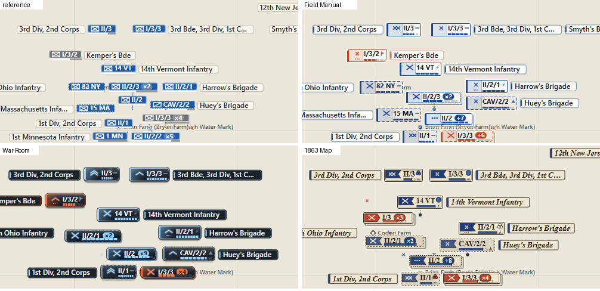

*The same units at the same moment and camera in four designs: the engine's plain test tile (top left, not a pitch), Field Manual (top right), War Room (bottom left), 1863 Map (bottom right).*

**My recommendation.** Build the engine once. Ship **War Room** as the hero look and **Field Manual** as its Paper mode (the second look costs about 2 KB compressed once the first exists, and it serves the people the first cannot: print, colour-blind readers, teachers). Hold **1863 Map** until its corps-badge source has been checked against the Official Records scan or by a historian. *(Section 10.)*

**The honest headline.**

- **What holds.** The data, the clock, every popup text and the Before view are correct to the source (23 of 23 data checks, 11 of 11 clock checks, 263 of 263 unit-card facts, 0 of 1,687 keyframes wrong). On a settled picture no two tiles overlap in 1,428 of 1,428 independently checked samples. In normal playback at 60 fps the jumps are gone: solid sudden jumps fall from 1.15 to 65.9 per second to 0 to 0.1, and the largest one-frame step from 311 to 1,550 px to 15 to 94 px. All twelve popups are kept and no popup card covered a tile in 11,256 frames. *(Section 12.)*
- **What does not hold yet.** Your absolute rules fail *while the picture moves*. A faint, ghost-like tile glides across solid neighbours on 22 to 27% of playback frames; some unit has no tile at all on about 4 to 5% of frames; the interface (toolbar, dock, narration card, Inspector) sits on top of 15 to 23% of the tiles in view; and the jitter returns under CPU load, in reduced-motion mode, at hard cuts and for seconds after a pause. There are 13 defects, 4 of them High. I would not show the prototype as finished, and no pitch should claim "never obscure" until the independent checker reads zero. *(Sections 9, 10 and 12.)*
- **Why that is fixable, with evidence.** I ran the independent checker again on all three looks and with changed settings. A setting that lets a tile be nudged off its true spot is what makes the ghosts: switching nudging off cut faint-over-solid frames from 29.0% to 2.9% at The Angle. A mode with atomic swaps and no gliding had no unit-without-a-tile at all, at the price of 9 hops a second. The strict-motion milestone in section 10 is built from exactly those two findings. *(Section 9.)*

**What you decide.** Ten decisions, each with my recommendation, are in section 11. The three that shape the build most: which pitch first, how strict "never obscure" is while things move, and whether a tile may ever be nudged off its unit's true spot.

**To see it now.** Double-click `docs/pitch/anim/prototype/battle-studio.html` and press *Watch the 60-second showcase*. Appendix A says what everything does.

---

## 2. What the battle looks like today, and why it jitters

Research report 01 measured the site's tile renderer in real Chrome and replayed its own code over the whole battle (the replay matched the real page frame for frame: 487 of 487, 365 of 365 and 485 of 485 frames, worst difference 0). Four findings drive everything in this pitch.

**A tile is a thin bar.** Eight pixels tall (four for cavalry), up to 120 pixels wide, with a 7 px dot and an id label. Its size does not change when you zoom: a 120 px bar spans 3.5 km at zoom 11, 623 m at zoom 13.5 and 55 m at zoom 17 *(Computed)*. Six postures (Line of Battle, Reserve, Bivouac and three more) are the identical bar apart from the dot. The legend's swatches match the drawn dot for only 3 of 11 postures, and "dot radius scales with strength" is false: the width scales, and it hits its cap at about 480 men on 49.9% of placement rows *(Measured)*.

**It moves like a slideshow.** The site stores 1,804 hand-placed keyframes (1,687 distinct unit-and-tick positions) for 478 units, on only 188 of the battle's 675 ticks. A unit's next keyframe is a median 17 ticks away. The shipped code only glides between *adjacent* ticks, and only 93 of 1,209 consecutive keyframe pairs (7.7%) are adjacent. The other 92.3% are *hold, then jump*: 833 jumps of 8 px or more at the default zoom (median 78 px = 404 m, worst 1,096 px, up to 47 tiles in one frame), while 99.9% of tile-frames do not move at all. On top of that: a stale-tick bug draws a gliding tile back at the start of its path for one frame at every tick boundary (66 snap-backs, worst 458 px), and 407 tiles pop in half a tick early, vanish for exactly one frame and pop in again *(Computed by replay; Measured in the real page)*.

**Tiles hide each other.** At zoom 13, 82% of drawn tiles touch another one and 57% are half or more covered (mean over all 675 ticks). At zoom 15, 35% still touch another and 608 of 675 ticks contain at least one overlap *(Computed from the shipped draw routine)*. Labels do most of the hiding.

**Popups run on the battle's clock, not on yours.** An event card is on screen exactly as long as its five-minute tick: 0.5 s at normal speed, 33 ms at 16x. Reading its median 32 words takes about 8 s. Reading only the 45 critical events and 24 stories takes 13.5 minutes; the whole battle plays in 5.6 *(Measured, report 02)*.

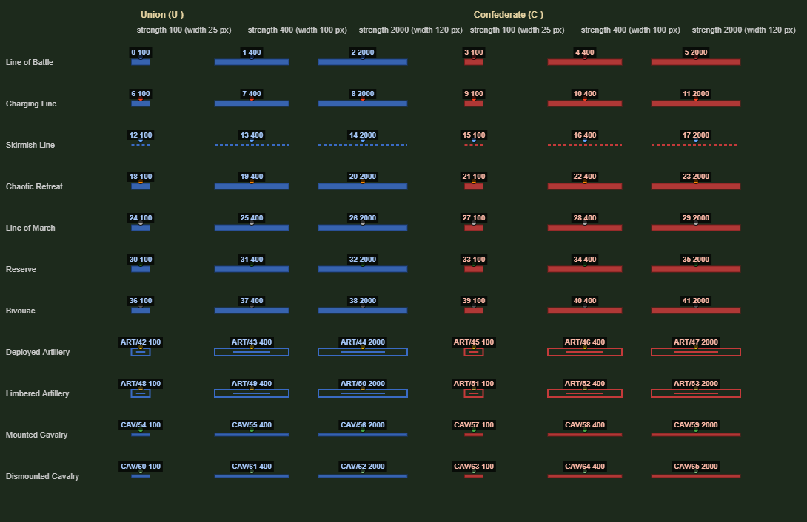

*Today's tiles, drawn by the shipped routine: six postures (line of battle, charging line, retreat, march, reserve, bivouac) are the same solid bar apart from a 7 px dot. (Report 01, `shots/current/`.)*

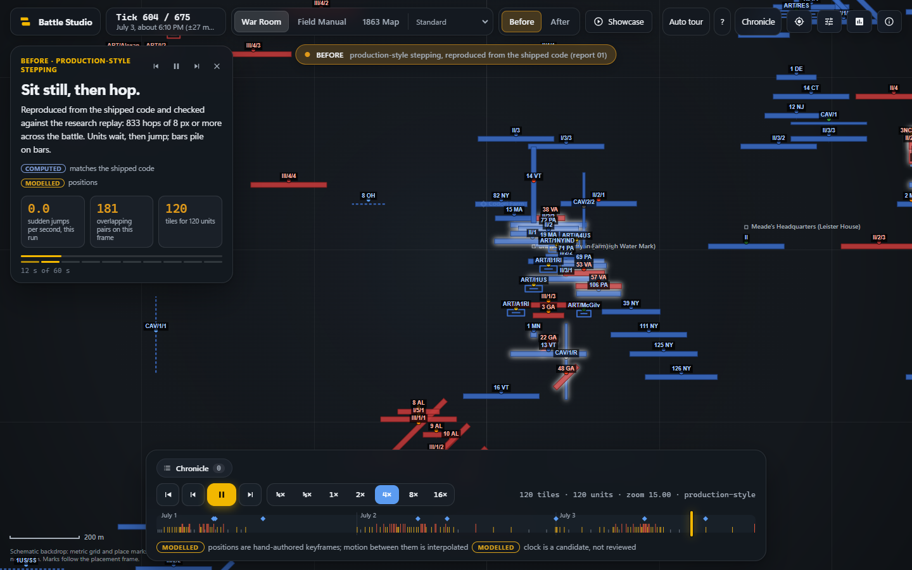

*The prototype's Before view replays the same moment through a reproduction of today's renderer. Bars pile onto each other; the card on the left counts 181 overlapping pairs on this frame. The reproduction matches report 01's whole-battle numbers to the unit (833 jumps in 159 frames, 66 snap-backs, 407 one-frame vanishes) and the shipped code's clock, tile set and positions in an independent check (0 mismatches in 1,560 clock frames and 522 tile-set frames, positions within 5e-10 px).*

A separate note: the build the live site serves today (not the fixed R1c build) also draws the wrong set of units after its intro (100 tiles at tick 1 where the data has 21). R1c fixes that. This pitch is about what comes next.

---

## 3. The rule you set: no split

You asked whether splitting the animation pipeline raises the chance of bugs, and said that if it does, or even possibly does, there should be no split. It does. Every place where two code paths must agree (a worker and the page, an offline layout and a live one, two canvases, a fast path and a safe path) is a place where they can disagree for exactly one frame, and one frame is all a viewer needs to see a tile in the wrong place. So every pitch below obeys the rule:

- **One straight line from the clock to the screen.** One clock, one function that says which units are on the field right now, one layout checker, one drawing pass. The same line runs headless in the tests and in the page, so the thing that is tested is the thing that is shown.
- **What the research proposed and I have left out.** A layout worker (report 06 recommended one because a cold solve takes about 0.1 s at zoom 12 to 13); an offline layout replayed at run time (report 04's principle P7, which that report itself flags as a split); a second canvas or an OffscreenCanvas worker for tiles; Mapbox's own symbol layers for moving tiles (measured: tiles lag their data by 0.8 to 2.7 s, and 5 to 7 fps on the phone stand-in); a second WebGL context. None is in the prototype.
- **What looks like a split and is not.** On slow devices the layout can be re-solved every second or third frame, with the solved tiles carried along by their units in between. That is the same function called less often, not a second path, and every frame that is actually drawn is checked by an independent verifier either way. The Before/After comparison is a hidden set of modules in the same slots of the same line, switched by one setting; it is a research view, not a product feature.
- **What no-split costs, said once.** Solving on the main thread means a cold solve after a jump in time (a seek, a cut) can take up to about 0.12 to 0.14 s at the densest ticks and zoom 11 to 13 (measured in Node and in Chrome's engine), and it means the engine itself takes 3.4 to 5.1 ms of every frame, so dense scenes slow down under a 4x CPU slowdown (24 to 38 fps in the prototype). Whether that cold-solve hitch is visible on a real low-end phone was not measured. I think that is the right price. A faster, split design would be a less trustworthy one.
- **For the real site.** Report 05 studied injecting an engine into today's bundle as one patch group (nine asserted string patches, with a kill switch back to today's renderer). That is *replacing* one drawing path with another, not running two. Report 05's prototype also kept an automatic mid-session fallback to the old renderer after a fault. Under your rule I would leave that out and keep only the manual switch.

---

## 4. The engine all three pitches share

The three pitches are three finished looks on **one engine** (the "Battle Studio" engine, built and committed in `docs/pitch/anim/prototype/`). They differ in how a tile looks, how it arrives and leaves, and how the interface around it is dressed. They do not differ in how the animation works, because that part has to be right once.

```
clock            time/transport.mjs     fixed 120 steps a second, drawn at the in-between moment; play, pause, speed ease in and out; a jump in time glides
camera           scene/engine.mjs       zoom keeps the ground under the pointer still
"on the field"   data/model.mjs         ONE function decides which units exist now (the site's carry-forward rule by default)
paths            interp/paths.mjs       each unit moves continuously through ALL its keyframes (smooth curve, or straight line with smooth speed)
layout checker   layout/engine.mjs      where each tile stands; tiles that cannot stand clear merge into one counted tile; an independent check before a frame is released
display layer    scene/display.mjs      a tile glides to its place; merges and splits fade in sequence; every displayed frame is verified again
drawing          render/canvas.mjs      the skin draws each tile; popups draw their leader lines beneath the tiles
measuring        metrics/metrics.mjs    frame times, jumps, overlaps, missing units, per renderer, live on screen
```

**What a tile can do (plain words).** A tile stays within 48 px of the true spot of its unit; if it had to be nudged, a small pin marks the true spot and a thin line (a *leader*) joins them. When a crowd cannot fit, the units merge into one *counted tile* ("x5") along the order of battle, and it splits again when there is room. A tile never covers another tile's true spot.

**What the engine promises, and what that promise does not cover.**

1. No two solid tiles overlap on a frame the layout checker releases, and every unit on the field is inside exactly one tile. *(Measured: 4,725 cold solves over all 675 ticks at zoom 11 to 17, carrying every unit forward, the worst case: 0 overlapping pairs, 0 clearance violations, 0 unrepresented units, 1,576,932 unit placements; plus 12 random-action runs of 500 actions each.)*
2. On the *settled* picture in real Chrome, judged on the pixels the page actually painted by a checker that shares no code with the engine: 1,428 samples (1,134 desktop across all nine style variants and zoom 11 to 18, 294 phone), 0 solid overlaps, closest approach at least 2.0 px, 0 unexplained pixels. *(Measured by the independent verifier, report 07.)*
3. **What the promise does not yet cover is the picture while it moves.** Between two layout solutions the tiles glide, fade and merge, and no proof covers that. The independent check found solid-on-solid overlaps of up to 1.9 px on 0 to 0.8% of playback frames, dimmed tiles lying over solid ones on 5 to 41% of frames, and a unit with no tile at all on 0 to 23% of frames. That is defect group V-01 to V-03 in section 12, and it is the first thing the build must close. I will not call the picture "never overlapping" until those are zero.

**How it ends the jitter.** Each cause measured on today's renderer has a specific replacement:

| Cause today (measured) | What the engine does instead | Result (real Chrome, 1440x900, same ticks) |
|---|---|---|
| 92.3% of keyframe pairs are hold-then-jump | each unit moves continuously through all its keyframes, exact at every keyframe | one-frame steps of 311 to 1,550 px (today) fall to 15 to 94 px |
| per-tick easing stops every unit at every tick | one continuous clock, drawn at the in-between moment | solid sudden jumps per second: 1.15 to 65.9 (today) against 0 to 0.1 |
| stale tick drawn on the tick-advance frame (66 snap-backs) | one consistent time per frame | by construction; snap-backs are not counted separately in the Studio |
| 407 tiles vanish for exactly one frame | one resolver for what is on the field | tiles that vanish for exactly one frame: 0 to 4.0 per second (today) against 0.00 |
| layout recomputed from scratch each redraw (offset jumps over 3 px: 116 per second at a still camera) | the layout remembers; the offset glides, critically damped, so a tile never lags its unit | overlapping pairs on an average frame: 295 to 1,255 (today) against 0 |

(The "today" columns are the Before view, which reproduces the shipped code; the "after" columns are the engine. Sources: README section 4.1 of the prototype and report 07, section 2, V-07. Those are measured at 60 fps on a desktop. Section 12 lists where the jitter returns: under a 4x CPU slowdown, in reduced-motion mode, at hard cuts, and for seconds after a pause.)

**How it grows.** Everything is a named module in a registry: tile skins, popups, effects, layout strategies, motion modes, motion models, backdrops. A single JSON file holds 177 *dials*, each with a unit, a range, a sentence and an evidence label; the live Tuning Studio (key `T`) builds its sliders from that file, exports and imports settings, and a test fails if a dial is defined and never read or read and never defined. Adding a skin is one import and one array entry, then `node build.mjs` (0.26 s). The independent verifier wrote a 45-line skin (a side stripe, an arm glyph, the code, a strength gauge, a selection ring and a generated 10-row legend), registered it that way, and it passed the zero-overlap sweep on 49 settled frames; the experiment also found friction, listed in section 12 (V-11).

**What it costs (as prototyped).** One self-contained page of 1,215,039 bytes with all three skin families, minified: the engine script is 327,867 bytes (96,906 compressed), its style sheet 52,306 (9,792), and the rest is data that the real site already ships as separate files (placements 460,042 bytes, popup texts 314,164, dials 53,489). Today's whole entry bundle (the fixed R1c build with the monuments layer) is 2.3 MB raw, about 525 KB compressed, so the engine's code would add up to about a fifth if dropped in as is. That is an upper bound: a product build would leave out the Tuning Studio, the metrics overlay, the tours and the Before view, which I did not measure separately. Each additional tile family costs about 12 to 14 KB of script (2 to 4 KB compressed). *(Measured here, by building variants of the prototype with different skin sets; "compressed" means brotli, a common web compression; see section 13.)*

---

## 5. The popups: everything stays, everything is improved

You said you love what pops up and that none of it may be removed. Report 02 inventoried 51 overlay entries on the live site (39 on the desktop, 12 on the phone). The prototype rebuilds twelve of them, the ones that belong to the battle itself, as registered modules of one **Overlay Director**, and does not touch the rest.

The Director is a pure function that runs in the same frame as the engine (no worker, no second path). It decides what is shown, in which form, where and for how long. Its placement rule: a card is put only on ground that is free of tile chips, labels, pins, counted-tile dots, leader lines, the interface, the map edge and other cards. A card with no free ground steps down a ladder (full, compact, peek, mini, chip), and the chip goes to the **Chronicle** strip in the dock, so nothing is lost. Long reading (a story's full script, a unit's panel, the tour) opens in a **rail** that makes the map smaller instead of covering it (a bottom sheet on a phone). A card lives for **reading time**, in wall-clock seconds that run only while the battle plays and stop while you hover, focus or pin it.

| Popup (today's id) | What is wrong today (measured) | What the prototype does |
|---|---|---|
| Event card (P-01) | on screen 0.5 s at 1x, 33 ms at 16x, against about 8 s to read; lies on its own subject tile in 24% of desktop moments (47% on the phone); points at nothing | lives for reading time; a thin leader joins it to its units; steps down to a chip instead of covering anything |
| Story card (P-02) | 1.5 s on screen against 14.6 s to read | a peek that docks; the whole script opens in the rail |
| Command toast (P-03) | after a seek made while paused, the next Play fires up to 4 stale toasts in 123 ms; 9 of 42 get the neutral title "Command change" and 5 of those are wounds | jump hygiene (a seek raises nothing for ticks it skipped); bursts merge; the kind is typed from the row's own cause |
| Cross-out card (P-04) | dead code in the product | revived: the old commander struck through, the successor named |
| Hover card and unit panel (P-05, P-06) | the hover card is dead code (rendered with wrong props, never shows); the panel covers 280 x 507-654 px of map | hover tooltip revived; the panel becomes a card and, for the full record, the rail |
| Auto tour (P-07) | flies each stop's subject to y=474 while its own drawer starts at y=470, so the subject sits under the text about it; the drawer covers 36.6% of the visible map | the rail shrinks the map and frames the subject; labelled "Auto tour" with an Unknown chip (its stop numbers are not matched to the National Park Service's list) |
| Clock badge (P-10) | at tick 28 the screen shows 8:15 AM (toolbar), 7:20am (event card) and "approximately 10:15am" (story text); the HUD flashes a false "0 fps" at every Play (61 fps measured) | one clock module; every clock reads "about 10:15 AM (+-20 min), candidate clock" (Modelled) |
| Legend (P-12) | swatches match the drawn dot for 3 of 11 postures; the Size tab describes circles that no longer exist | generated from the active skin's own drawing code, so it cannot disagree with the map |
| Overview map (P-13) | on the phone it draws only units with a keyframe on exactly the current tick, so it is empty on 72% of ticks | draws every tile of the frame; click to fly |
| Hints and onboarding (P-31, P-38) | copy still says "dots" although tiles are bars | four one-time hints, a key list, what the evidence labels mean |
| Day banner (P-39) | none exists; between midnight and dawn the HUD names the wrong day | a ribbon: "Day 2, July 2, 1863", "Night of July 1-2" |
| Chronicle (new) | nothing keeps a missed card | every moment so far, with Go to and Reopen |

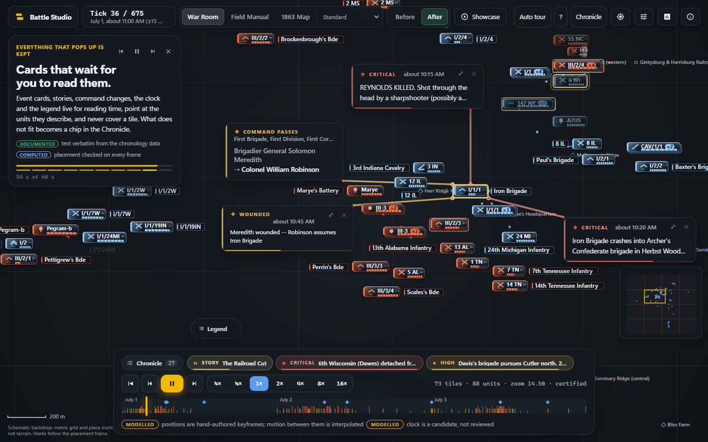

*Tick 36, War Room. A critical event card and a "wounded" card each have a leader line to the unit they describe; a command change card sits on free ground nearby; the Chronicle strip in the dock holds the cards that found no free ground; the overview map is bottom right. The narration card on the left says what you are looking at.*

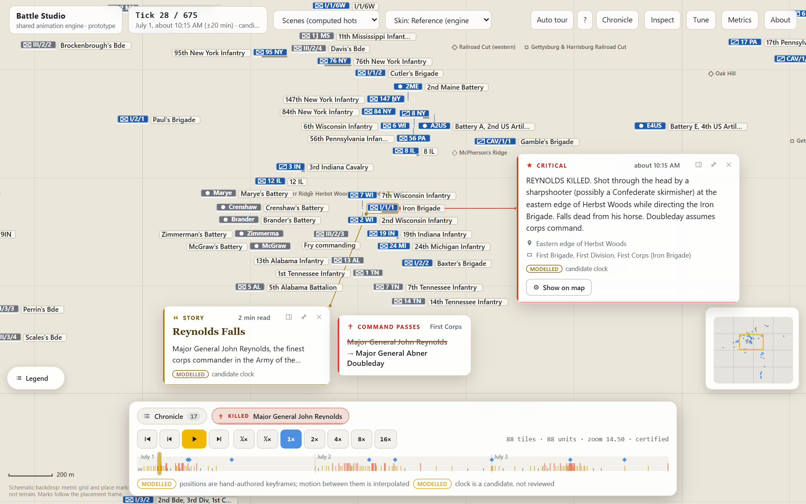

*Tick 28 (Reynolds killed). These popup pictures were taken before the three tile families were wired in, so the tiles are the engine's plain test skin; look at the cards, not the tiles. The event card, the story peek, the command change and the overview each sit on empty ground.*

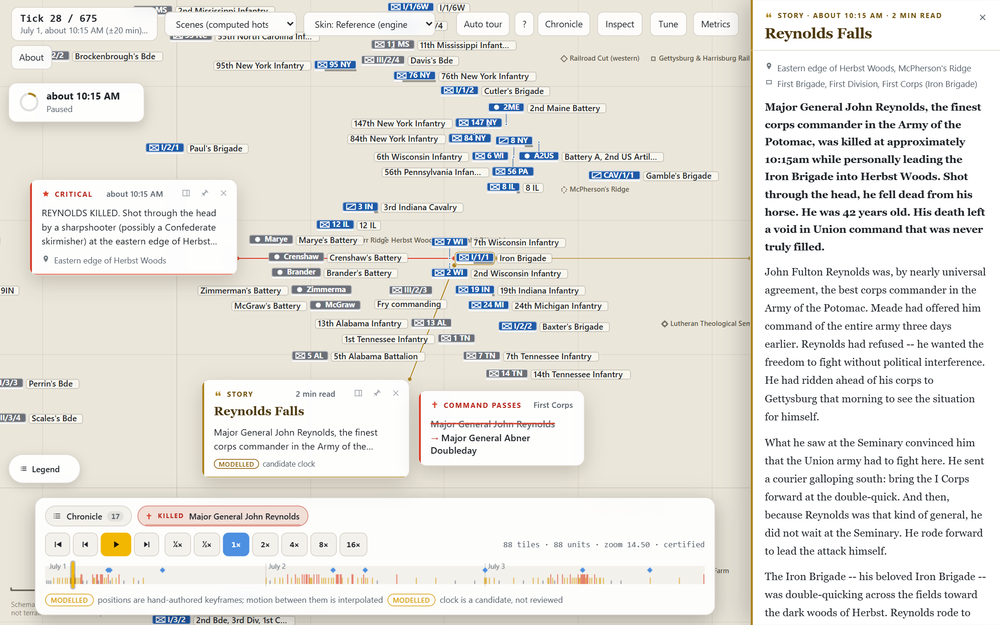

*The full story of Reynolds's death in the reading rail. The map is resized, not covered.*

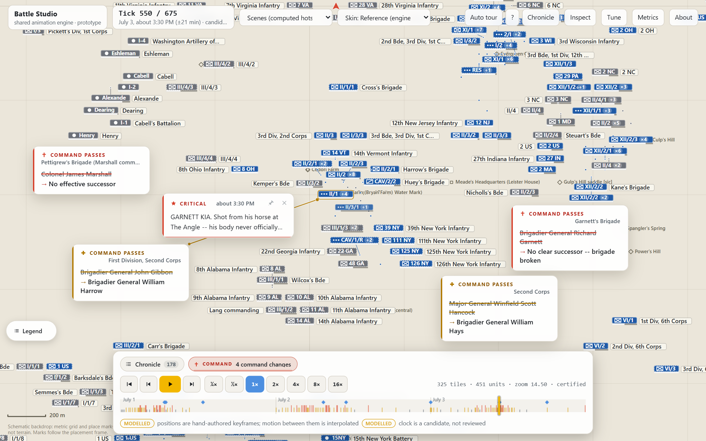

*Tick 550: four command changes, a critical card (Garnett killed in action) and a leader line, all on free ground. The Chronicle chip in the dock reads "4 command changes".*

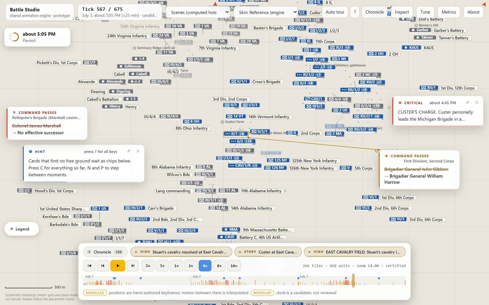

*At 4x the cards that cannot be read in time wait as chips in the strip (a story and two high events); the hint card explains it.*

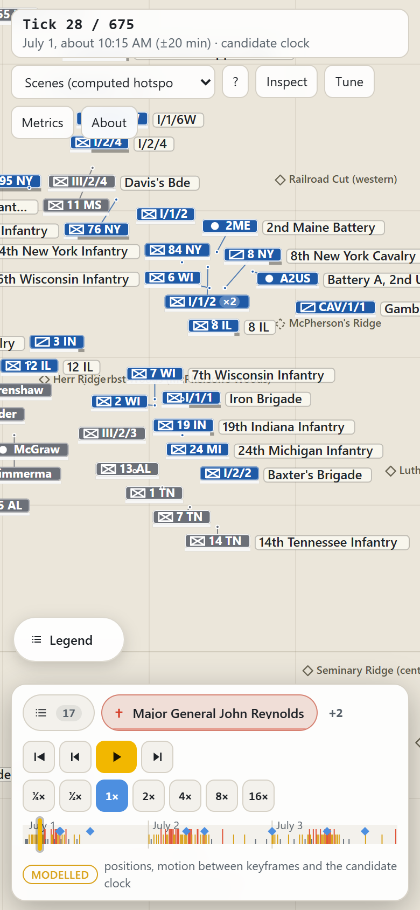

*On a phone, free-standing cards do not exist: chips in a lane above the dock, and a three-stop sheet.*

**What was measured about the popups.** All twelve are present (registry check, report 07). Over all 134 event and story ticks, at three cameras, 28 frames each (11,256 frames; on average 4.8 to 6.4 cards on screen, at most 16), **0 tile chips were covered by a card**. Playing at 4x in real Chrome ran at 60.003 fps with 0% of frames over 20 ms; the Director took a median 0.60 ms per frame (slowest 5%: 1.30 ms; worst 5.3 ms). With the camera on the subject, a critical event shows as a floating card 30, 34 and 40 of 45 times at zoom 13.5, 14.5 and 15.5; the rest become chips. Text is verbatim from the repo's chronology, story and command-change files (5,720 verbatim text leaves, 10,515 interface phrases, 312 leaves of derived codes, all read by the verifier); 263 of 263 unit-card facts matched the order of battle.

**What the prototype does not carry over, and what I recommend.** Search, filter, roster, order of battle, Soldier's Eye, Follow Your Ancestor, layers, distance tool, locations, help, bookmarks, the monuments markers and card, the Extra Features cluster, the trails button, the cursor ring and the day/night tint are not in the prototype; in the real site they stay exactly as they are. Registering each of them with the Director is the follow-up job (report 02 and report 04 list the improvement for every one, and none removes anything). The prototype also does **not** build the small "NN fps" readout, a debug number that printed a false "0 fps" at every Play. You asked that nothing be removed, so I would keep it and fix it, and drop it only if you say so (decision 8 in section 11).

**Two popup problems that are not the popups' fault.** The interface itself (toolbar, dock, the narration card, the 372 px Inspector) lies on top of the tiles and covers 15 to 23% of the tiles in view (defect V-04). And reading every critical card would take 13.5 minutes against a 5.6-minute show: the Director's *Narrated mode* slows the clock down while a critical card is read; it is built but off by default because it changes the feel of the show and is your decision.

---

## 6. PITCH 1: War Room ("make it a show")

### The idea

Turn the map into a command table and every unit into a small piece of lit glass. The side is the rim light (cool white-blue for the Union, hot orange for the Confederates). The arm is an engraved glyph. Strength is a segmented gauge. And the one cinematic thing the data can honestly carry, **how fresh the report is**, becomes light: a plate whose position comes from a recent keyframe glows; a plate that has been carried forward for most of a day goes dull and dashed. Echelon is height: a brigade plate floats a little above a regiment's, a division or corps a little higher. A tile arrives in a sweep of light and a selected tile is locked on by four corner brackets. Everything runs on one continuous clock, so the battle flows instead of stepping; crowds merge into counted tiles and open again when there is room; and the popups become glass cards that wait for you to read them and point a thin line at the units they describe. This is the pitch that makes the site look like a premium product in the first ten seconds.

### Against your rules

| Your rule | Where War Room stands |
|---|---|
| Tiles never obscure each other | **Settled: met** (0 overlaps in 378 of 378 real-Chrome samples). **Moving: not yet.** In the pitch runs solid tiles touched on 0.36% of frames and a faint tile lay over a solid one on 21.7%. Closes with milestone M1 (section 10). |
| Tiles never hide vital information | Name, side, arm and strength are painted at full strength on every tile, old or new. **Not yet:** a unit had no tile on 4.7% of frames, and the interface covers about a fifth of the tiles. Closes with M1. |
| Jitter fixed | **Met at 60 fps**: solid sudden jumps 0 to 0.07 per second (today up to 65.9). Open: heavy load, reduced-motion mode, hard cuts, after a pause. |
| Popups kept and improved | **Met** for the twelve map popups (dark glass cards, reading time, leader lines); every other overlay is untouched. |
| Easy to tweak and extend | **Met**: about 30 documented tokens, three variants, a 35-line starter skin. Friction listed in section 12 (V-11). |
| True to the data | **Met** for what it draws: every channel has an evidence label and the legend is generated. Nothing is invented. |

### What you will see

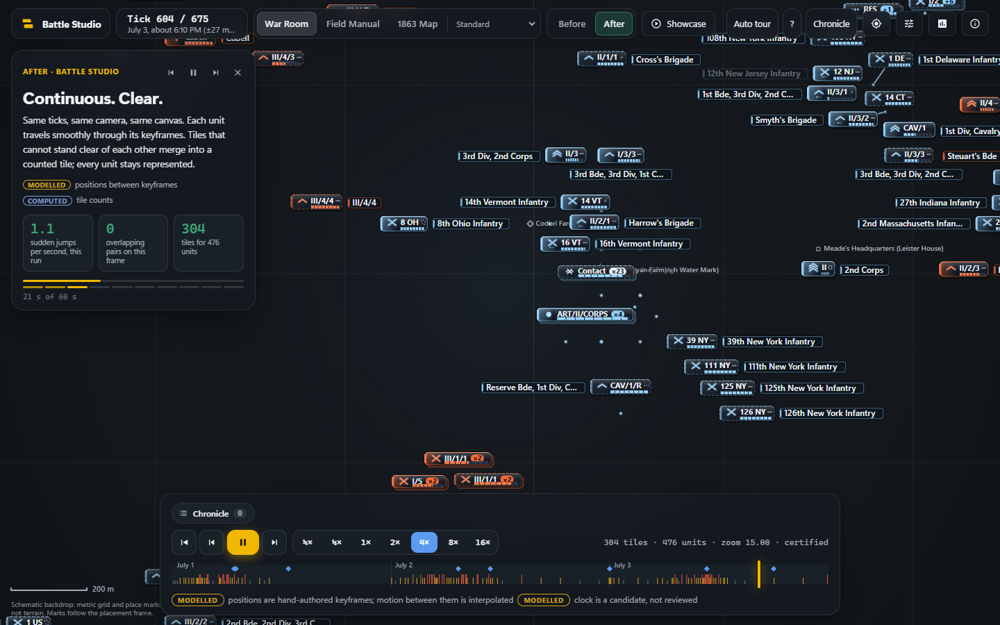

*The whole page (desktop 1440x900) at The Angle, July 3, about 6:10 PM. 304 tiles stand for 476 units; the card on the left reports 0 overlapping pairs on this frame. Counted tiles ("x2", "x23") are where crowds cannot fit.*

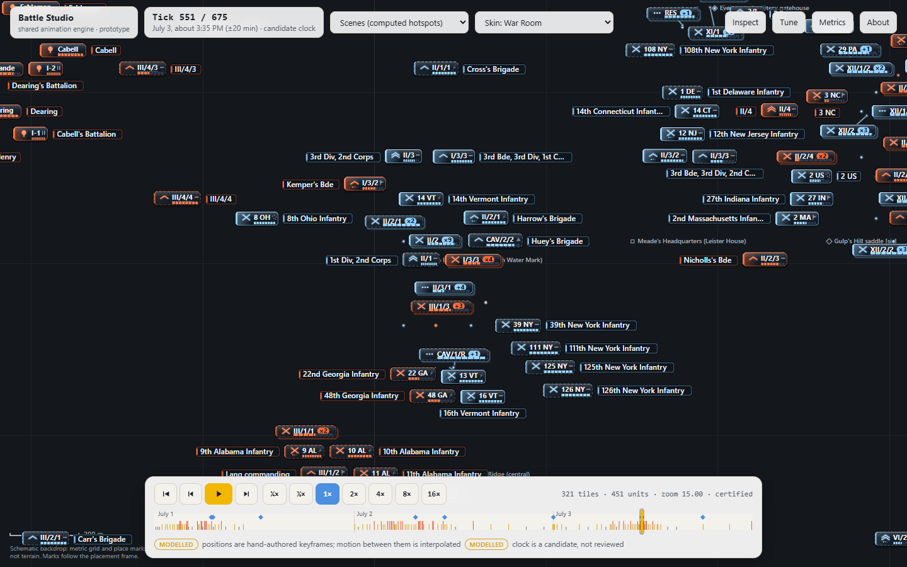

*Tick 551, zoom 15: 321 tiles for 451 units. Blue-rimmed plates are Union, orange are Confederate; a dashed rim marks a carried-forward position. Name labels sit beside their plates.*

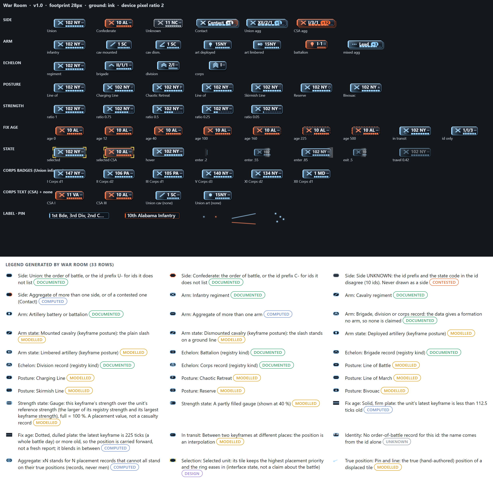

*The specimen sheet: side, arm, echelon, posture, strength, fix age, state (selected, hover, arriving, leaving, in transit), corps text, label and pin, with the legend the skin generates from its own code (33 rows, each with an evidence label).*

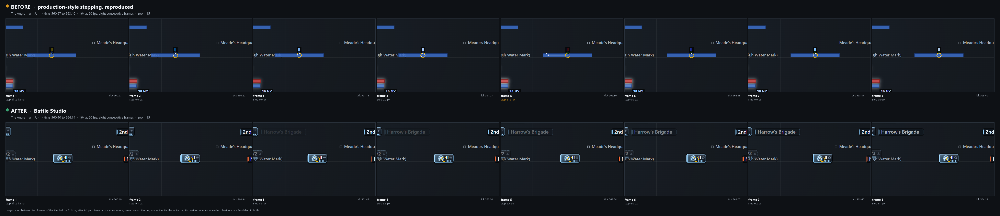

*One tile at The Angle, 16x. Today (top): it stands still and then steps 51.3 px in a single frame. Engine (bottom): the same tile moves every frame, its largest step 9.1 px.*

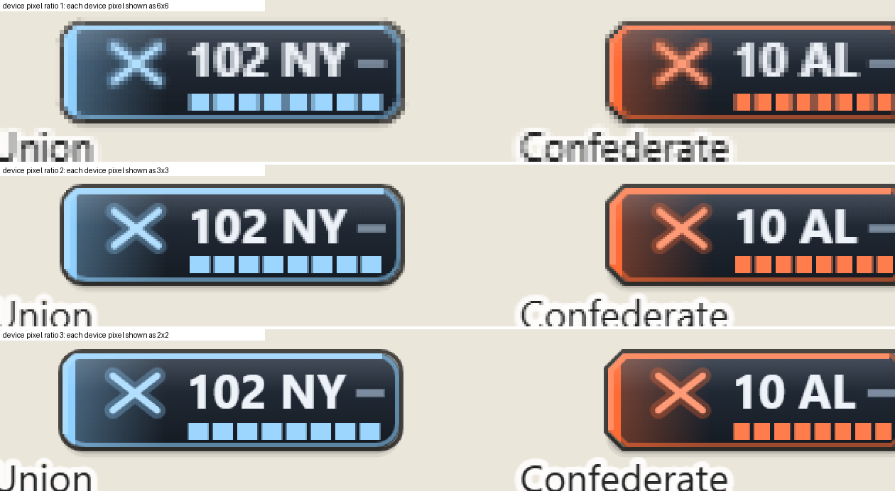

*Tiles at rest are snapped to the device-pixel grid, so edges stay sharp on a phone screen: a fractional position paints the same pixels as the aligned one on 1x, 2x and 3x screens (0 differing pixels, against 506 to 6,772 without the snap).*

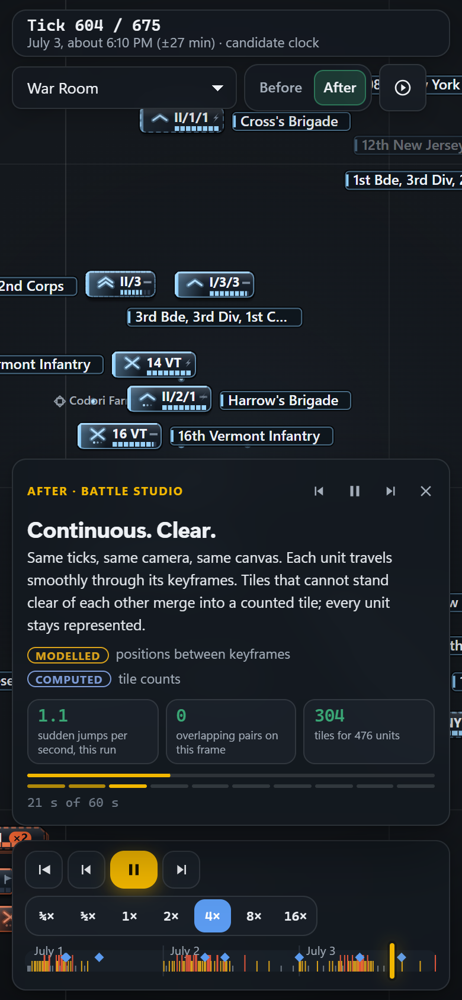

*The same moment on a 390x844 viewport.*

Open it with `?style=war-room` (it is the default). The popups wear the same dark glass (`shots/prototype/assembled/desktop-09-popups.png`, section 5).

### Why it is right for this site

- **It shows the thinness of the record without a sentence.** The site holds 1,687 hand-placed positions for 478 units. On the site's own carry-forward rule, at tick 548 81% of units stand on a position older than 50 ticks (median age 258 ticks) *(Computed, report 04)*. A look whose key variable is "light means fresh" lets the viewer see where the record is thin, which is the most honest thing the battle can say about itself.
- **Its drama comes from light and motion, not from invented content.** Report 03 lists what not to build because the record cannot support it: trails, speed, per-tile casualty shading, weather, terrain shadows. War Room draws none of them.
- **It is the most legible of the three when something is dimmed.** All 178 canvas strings on the settled picture are at least 6.4:1 (median 14.9:1); a dimmed tile's text has a median 3.75:1, against 2.57:1 for Field Manual and 2.37:1 for 1863 Map *(Measured, report 07)*.
- **The name, side, arm and strength of a tile are never dimmed.** The skin tests paint the short code identically for fresh, carried-forward, selected and empty-gauge tiles.

### How it ends the jitter

**Root causes today** (section 4 has the full table): hold-then-jump keyframes, per-tick stopping with a stale tick on every tick change, and a layout recomputed from scratch on every redraw. **The fix** is the engine's: each unit moves continuously through all its keyframes on one clock, and the layout remembers where tiles stand. **Measured on this look**, by the independent instrument in six 20-second real-time runs (The Angle, Rose Woods and Cemetery Hill, each at 1x and 4x, popups on, 60 fps, 7,200 frames): the page held 59.8 to 60 fps; **solid sudden jumps 0 to 0.07 per second** (today's renderer: 1.15 to 65.9); **largest one-frame step 16 to 85 px** (today: 311 to 1,550). *(Pitch runs, section 9.)* The look adds its own care: arrival and departure never take a step larger than 3.01 times the mean step; selection moves at most 14% of its change in one frame; hover at most 24%. What still moves is listed in section 12 (V-05 to V-07).

### How tiles stay clear of each other

The plate is 28 px tall (3 px of margin for shadow and lift), the tallest of the three, and the certified layout works for any footprint, so a bigger plate simply merges more: **296 to 305 individual tiles at The Angle, against 322 to 329 for Field Manual** *(pitch runs)*. Guarantee and limits are in section 4. On this look specifically:

- Settled picture: 0 overlaps in all 378 real-Chrome samples (3 variants x 9 zooms x 14 ticks), closest approach 2.1 px *(report 07, per style)*.
- In motion, in the pitch runs: **26 of 7,200 frames had two solid tiles touching (0.36%, at most 2.2 px; 27 of the 29 pairs were a chip over another tile's true-position pin).** Field Manual and 1863 Map had none. The verifier measured War Room's painted pin at 5.8 px against the 4 px the layout reserves, which points at the skin's pin drawing; that should be a quick fix, but I have not made it.
- The three shared motion defects (a faint tile crossing solid ones on 21.7% of frames, up to 27 px; a unit with no tile on 4.7% of frames, up to 26 units at once; the interface over 20.0% of tiles) are in section 12.

### How it grows

War Room's drawing is one file (`src/skins/war-room.mjs`, 17.7 KB) and its tokens another (`war-room.spec.mjs`, about 30 documented rows: palette, plate, rim, lift, shadow, glyph, gauge, level-of-detail, motion). **To tweak without code:** open the page with `?style=war-room&skinset={"war-room":{"rim.glow":0.6,"color.union":"#3fa0ff"}}`, or in the console `__skinKit.setToken('war-room','rim.glow',0.6)`; values are range-checked and a bad one is reported and ignored. Edit the spec file and run `node build.mjs` to make it permanent. **To add:** a variant is the same drawing under another token set (the colour-blind and high-contrast variants are exactly that); a new family is a copy of `minimal.mjs` (35 lines) plus one import and one array entry. The tests then run the conformance check (ink must stay inside the footprint), the layout guarantee with your footprint, the legend-is-the-drawing check and the honesty checks on it.

### What it costs and what could go wrong

- **Bytes:** about +13.6 KB of script (+3.8 KB compressed) as the first family, which includes the shared skin kit (section 4 has the whole page).
- **Frame cost:** the tile draw is 2.0 ms typical (median) and 7.7 ms for the slowest 5% of frames at The Angle (zoom 15), and 2.9 / 10.2 ms on the whole field (zoom 13.5), against 0.5 / 5.7 ms for the plain test skin. Under a 4x CPU throttle (a harsh stand-in for a mid phone) the median draw is 14.2 ms and 17.9 ms: **the heaviest of the three** (Field Manual 10.8 and 12.9, 1863 Map 11.3 and 16.4). A sprite cache for the static parts is the known remedy and is not built.
- **Regression risk:** the engine is not yet in the product (section 4); War Room adds no risk beyond the engine's.
- **Must be verified before it is called done:** the strict-motion milestone (section 10); legibility on the real satellite ground; rotated and tilted camera; a real phone.

### Honest limits

- A **dark ground** was designed for; the live map is bright satellite imagery. Plates are nearly opaque (alpha 0.95), which should help, but it has not been tested.
- "Light means fresh" is a convention a viewer must learn; the legend states it, but no one has tested whether viewers read it correctly. Nothing is claimed about brightness meaning importance or danger.
- Biggest plate means the fewest separate tiles and the most counted tiles.
- The 8x War Room run once showed 6.7% slow frames while the machine was busy (repeats 1.1 to 1.7%); the pitch runs above did not.

---

## 7. PITCH 2: Field Manual ("make it an instrument")

### The idea

Draw each unit the way a staff officer would read it: as a clean, modern map symbol in the NATO (APP-6) grammar, one channel for one variable. The **frame** is the side (blue, or red-orange, and a different silhouette as well, so it survives a black-and-white print and colour-blindness). The **glyph** is the arm (a cross for infantry, a slash for cavalry, a dot for artillery). **X, XX or XXX** is the echelon. A **dashed frame** means "not a fresh report". A small segmented **gauge** shows strength against the unit's reference strength. The ground is paper and the popups are cards on paper. The legend is not written by hand: it is generated from the very code that draws the tiles, so it cannot disagree with the map (today's legend disagrees with the drawn dot for 8 of 11 postures). Its recommended motion setting is the strictest of the three: straight-line geography, and no tile ever nudged off its unit's true spot. This is the pitch for the person who has to defend every mark on the map.

### Against your rules

| Your rule | Where Field Manual stands |
|---|---|
| Tiles never obscure each other | **Settled: met** (0 of 378). **Moving: not yet.** No frame had two solid tiles touching (0 of 7,202), but a faint tile lay over a solid one on 26.8%. Closes with M1; the "Instrument" setting already cuts that to 3.2% and 1.3% in two hard scenes. |
| Tiles never hide vital information | Name, side, arm and strength are never dimmed. **Not yet:** a unit had no tile on 4.7% of frames; the interface covers 23.1% of its chips. Closes with M1. |
| Jitter fixed | **Met at 60 fps**: solid sudden jumps 0 to 0.07 per second; the lightest draw cost of the three. Open: heavy load, reduced motion, cuts, after a pause. |
| Popups kept and improved | **Met** for the twelve map popups, as cards on paper; every other overlay untouched. |
| Easy to tweak and extend | **Met**: about 30 documented tokens, standard, colour-blind and high-contrast variants. |
| True to the data | **Met**, and strongest here: the legend is generated from the drawing, the geography can be exact, and the look draws only the core of what the research said is honest. |

### What you will see

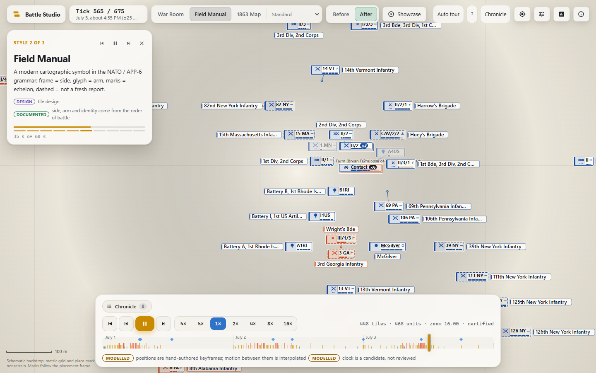

*The page in Field Manual (desktop 1440x900), tick 565, zoom 16: 448 tiles for 468 units. The narration card names the grammar: frame = side, glyph = arm, marks = echelon, dashed = not a fresh report.*

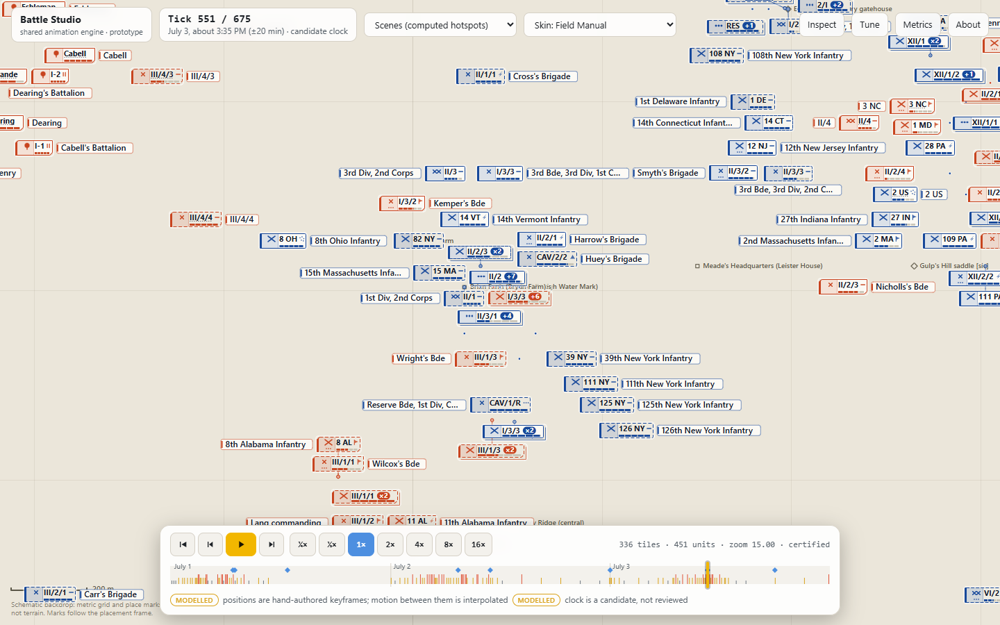

*Tick 551, zoom 15: 336 tiles for 451 units, against 321 for War Room on the same frame. Dashed frames are carried-forward positions; counted tiles carry a number badge.*

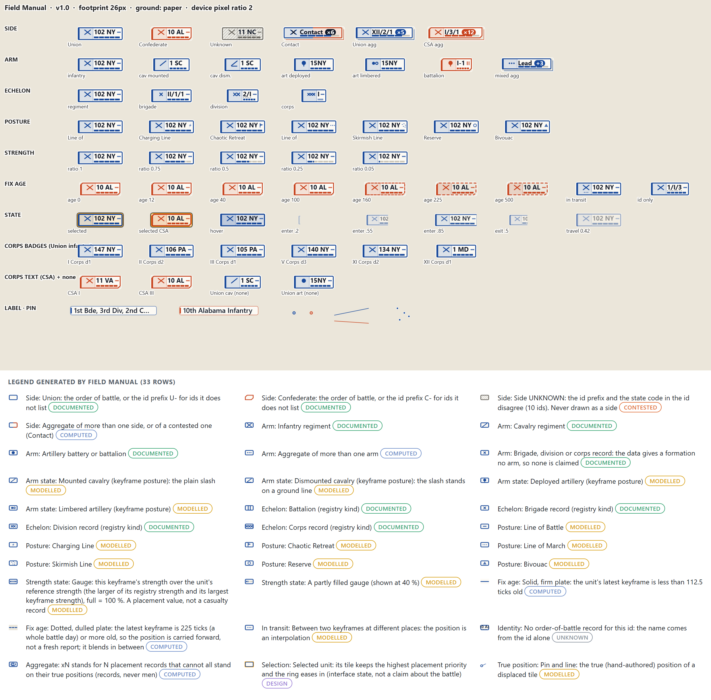

*The specimen sheet with the legend it generates for itself.*

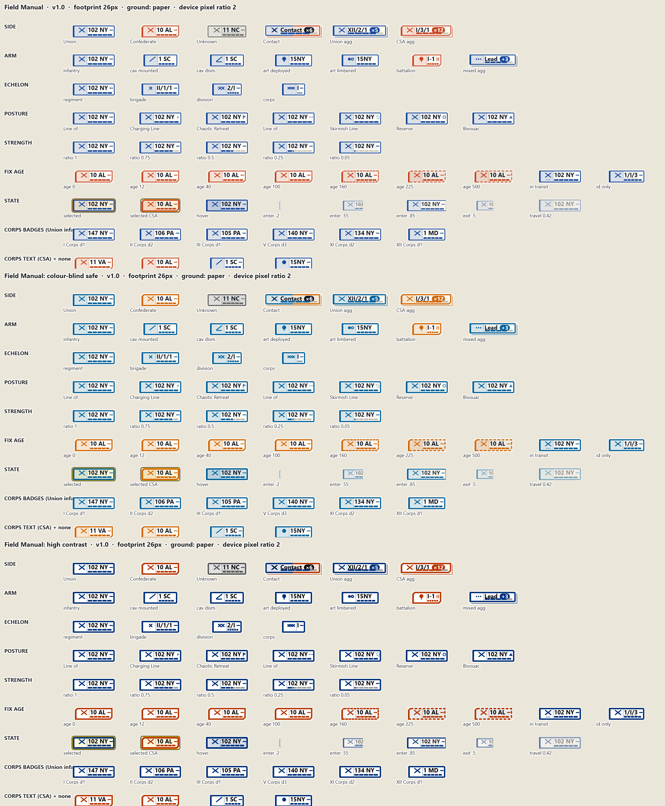

*Three variants of the same drawing: standard, colour-blind safe (blue and orange) and high contrast. A variant is the same drawing under another token set.*

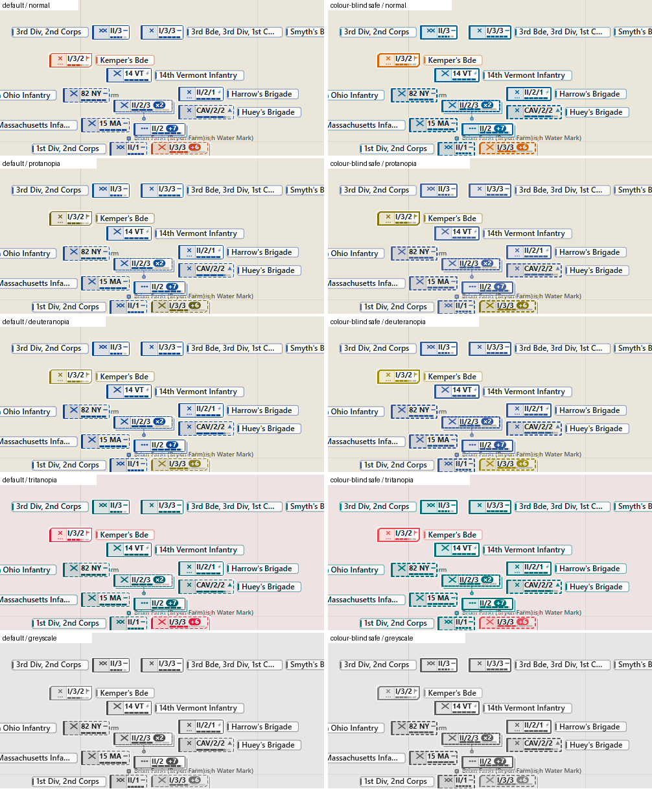

*The same moment in normal vision, protanopia, deuteranopia, tritanopia and greyscale (left standard, right colour-blind safe). Read the greyscale row: the side is carried by the silhouette (square corners against chamfered) and the frame as well as by the colour. Whether that is enough is for a colour-blind reader to say. The simulation matrices are the author's recollection of Machado 2009 and were not re-verified: indicative, not a certification.*

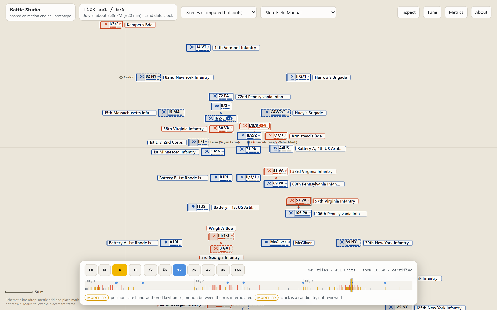

*Zoom 16.5 at the same moment: 449 tiles for 451 units, so almost every unit has its own tile, with a pin and leader on the few that were nudged and a counted tile ("x2") where two could not stand clear. (An earlier toolbar is visible; the tiles are the Field Manual of this pitch.)*

Open it with `?style=field-manual` (and `&variant=cvd` or `contrast`). The popups wear the same paper (`shots/prototype/popups-01-event-story-toast-tick28.png`, section 5).

### Why it is right for this site

- **It is the core of the "honest set" the research recommended, and nothing beyond it.** Report 03 ranked 24 candidate encodings by data, coverage and risk of misleading. Its recommended set is: side, arm and echelon from the order of battle; posture by line style; static strength facts with their label; a last-known-age channel; and (not built here) eight-point facing, heading from displacement and engaged rings only from documented windows and events. Field Manual draws the core of that set in that grammar and none of what the report said not to build (trails, speed, per-tile casualty shading, weather, terrain shadows, a proximity-based "engaged" glow); tests prove it changes its ink for every channel its legend lists and for no channel it does not list.
- **Today's legend is wrong in a way this fixes by construction.** The live legend's swatches match the drawn dot for 3 of 11 postures (report 01); here the legend's 33 swatches are painted by the skin's own drawing code in the real page.
- **It reaches the viewers who must be able to defend a screenshot**: teachers, descendants, historians, a printed handout. The three side colours (Union, Confederate, Contested) stay at least 22 apart on the CIE76 colour-difference scale under normal vision and three simulated deficiencies in every variant (22 to 29), Union and Confederate also differ by 15 to 21 in lightness, and the silhouette differs. Text on tiles is at least 4.5:1 everywhere in the standard and high-contrast variants (minimum 4.61:1; two strings in the colour-blind variant at 3.77 and 4.05:1).
- **Positions stay where the data puts them.** Its recommended motion setting (below) is the one report 03 asked for: never move a tile off its coordinate.
- **It shows the most separate tiles**: 322 to 329 at The Angle in the pitch runs, against 296 to 305 for War Room, because the plate is 26 px tall and merges less.

### How it ends the jitter

**Root causes today** (section 4): hold-then-jump keyframes, a stale tick, a layout recomputed on every redraw. **The fix** is the engine's, the same for all three looks. **Measured on this look** in the same six 20-second runs (7,200 frames, popups on): **60 fps in all six, no frame over 20 ms; solid sudden jumps 0 to 0.07 per second (today 1.15 to 65.9); largest one-frame step 17 to 79 px (today 311 to 1,550).** *(Pitch runs.)* The arrival is a wipe from the left; selection eases in 120 ms; hover 80 ms.

**The "Instrument" stance (a dial setting, not a different engine).** This pitch's recommended motion setting is `interp.model = chord-smooth` (each unit moves along the straight line between its two keyframes and only its *speed* is smoothed, so the geography is exactly the data's) together with `layout.dMaxPx = 0` (a tile is never nudged off its unit's coordinate; a crowd merges into a counted tile instead). Measured with the independent instrument at The Angle and Rose Woods at 4x (single 20-second runs): faint tiles over solid ones on **3.2% and 1.3% of frames** against 35.2% and 19.1% for Field Manual's default; no frame with two solid tiles touching; **226 and 81 separate tiles against 329 and 164** (the price: a crowd shows as a counted tile instead of separate tiles); and the one thing it does not cure, a unit with no tile on 8.8% and 6.9% of frames (default 4.3% and 8.3%), which is a hand-over problem (section 9.2). I have not looked at it by eye on a long run; open it with `?style=field-manual&set={"interp.model":"chord-smooth","layout.dMaxPx":0}`.

### How tiles stay clear of each other

- Settled picture: **0 overlaps in all 378 real-Chrome samples**, closest approach 2.0 px.
- In motion, in the pitch runs: **0 of 7,202 frames had two solid tiles touching** (War Room: 26 frames). Dimmed tiles lay over solid ones on 26.8% of frames (up to 25 px), a unit had no tile on 4.7% of frames (up to 29 units at once), and some unit was shown only by a faint tile on 65.1% of frames. Those three are the engine's open defects (section 12), identical in kind on all three looks.
- Footprint: 26 px tall; the guarantee holds for any footprint (150 irregular frames on three hard scenes, 1x, 4x and 8x: 0 overlaps and 0 unrepresented units).

### How it grows

`src/skins/field-manual.mjs` (15.5 KB) plus `field-manual.spec.mjs` (about 30 documented rows: palette, frame width and dash, chamfer, cell tint, gauge, level-of-detail, motion). **To tweak:** `?style=field-manual&skinset={"field-manual":{"color.union":"#17489a","frame.dash":4}}`, or edit the spec and rebuild. **To add:** a new variant is a token set (the colour-blind and high-contrast ones are two of them); a new family is `minimal.mjs` copied. The natural extensions in this pitch are an **export for print** (a frame with its generated legend as a figure) and a **teacher's lens** that highlights one corps or one posture; both are ideas, not built.

### What it costs and what could go wrong

- **Bytes:** about +11.9 KB of script (+2.0 KB compressed) when added after War Room; +11.9 KB / +3.0 KB if it is the only family (the shared skin kit is the difference).
- **Frame cost:** the tile draw is 1.6 ms median / 6.1 ms (slowest 5%) at The Angle and 2.1 / 7.3 ms on the whole field; under the 4x throttle 10.8 and 12.9 ms median, **the lightest of the three**.
- **Regression risk:** the engine's (section 4). The look adds none.
- **Must be verified:** the strict-motion milestone (section 10); legibility on satellite imagery; a real print; a pass by someone who is colour-blind (the simulation is indicative).

### Honest limits

- It has the **most chips for the interface to sit on**: in the settled sweeps the interface covers 23.1% of chips at zoom 13.5 to 15 (War Room 20.0%, 1863 Map 20.8%), and 18.7% are half or more hidden. That is the interface's fault (V-04), but it shows most here.
- **Dimmed-tile legibility is low** (median 2.57:1) and its faint tiles overlap solid ones most often (26.8% of frames). Both go away with the strict-motion milestone.
- The frame silhouettes, echelon marks and chevrons are **this project's conventions**; only the APP-6 grammar (frame, glyph, echelon marks, dashed for not-fresh) is borrowed, from a Wikipedia summary and a Canadian training package, not the official 2525D standard (its PDF returned 403).
- It is the **least cinematic** of the three. It will not make a stranger gasp; it will make a historian nod.

---

## 8. PITCH 3: 1863 Map ("make it a period document")

### The idea

Draw the battle as a surveyor's lithograph might have: a parchment tablet with an ink rule, a blue or red flag carrying the arm, and, for Union infantry, **the corps badge the army really wore in 1863** (a sphere for I Corps, trefoil for II, lozenge for III, Maltese cross for V, cross for VI, crescent for XI, star for XII) in the division colour (red, white or blue). Confederates carry their corps as a roman numeral, because no source for Confederate corps badges was found. Positions the record firmly supports are drawn in ink; provisional ones (carried-forward, modelled) in dotted pencil. A tile arrives as a pencil outline, then parchment, then wash, then ink. The type is a serif and the popups sit on paper. It is the pitch of authenticity: the badge is the one mark on the whole map that has a period source behind it.

### Against your rules

| Your rule | Where 1863 Map stands |
|---|---|
| Tiles never obscure each other | **Settled: met** (0 of 378). **Moving: not yet.** No frame had two solid tiles touching (0 of 7,199), but a faint tile lay over a solid one on 25.3%. Closes with M1. |
| Tiles never hide vital information | Name, side, arm and strength are never dimmed. **Not yet:** a unit had no tile on 4.3% of frames; the interface covers 20.8% of its chips; dimmed text is the least legible of the three. Closes with M1. |
| Jitter fixed | **Met at 60 fps**: solid sudden jumps 0 to 0.13 per second. Open: heavy load, reduced motion, cuts, after a pause. |
| Popups kept and improved | **Met** for the twelve map popups, as cards on paper; every other overlay untouched. |
| Easy to tweak and extend | **Met**: about 30 documented tokens, three variants; a new badge set is one drawing function and one rule. |
| True to the data | **Met except for one open source check**: a corps badge is a Documented claim, and its source was read through a reproduction, not the Official Records scan. |

### What you will see

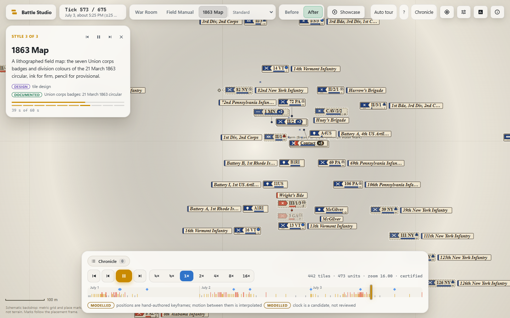

*The page in 1863 Map (desktop 1440x900), tick 573, zoom 16: 442 tiles for 473 units. The narration card reads "the seven Union corps badges and division colours of the 21 March 1863 circular, ink for firm, pencil for provisional" and carries a Documented chip for the badges.*

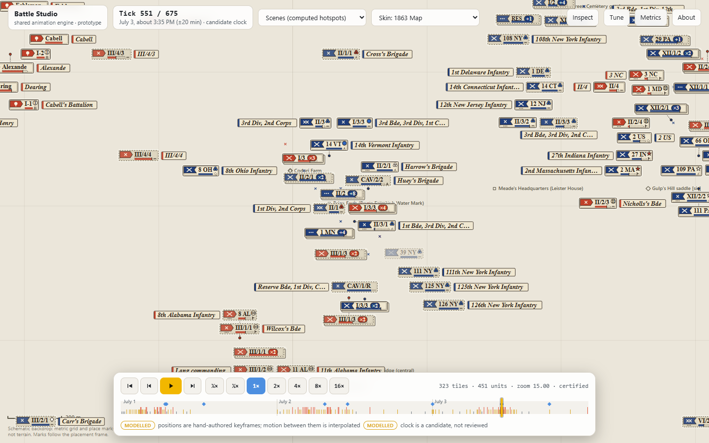

*Tick 551, zoom 15: 323 tiles for 451 units. Each Union infantry plate carries its corps badge at the right end; blue swallow-tail flags are Union, red pointed flags Confederate; a dotted rule marks a carried-forward position.*

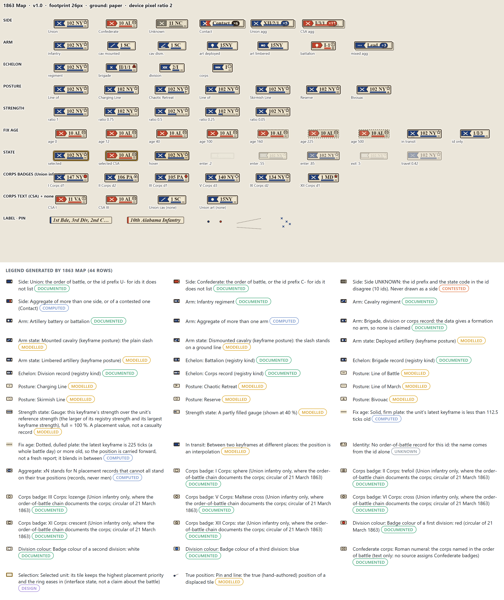

*The specimen sheet. The CORPS BADGES row shows six of the seven badges (VI Corps is not on the sheet; it has three placed units); the CORPS TEXT row shows the Confederate roman numerals and the cavalry and artillery plates that carry no badge. The legend lists each badge with its source, "circular of 21 March 1863", and a Documented chip.*

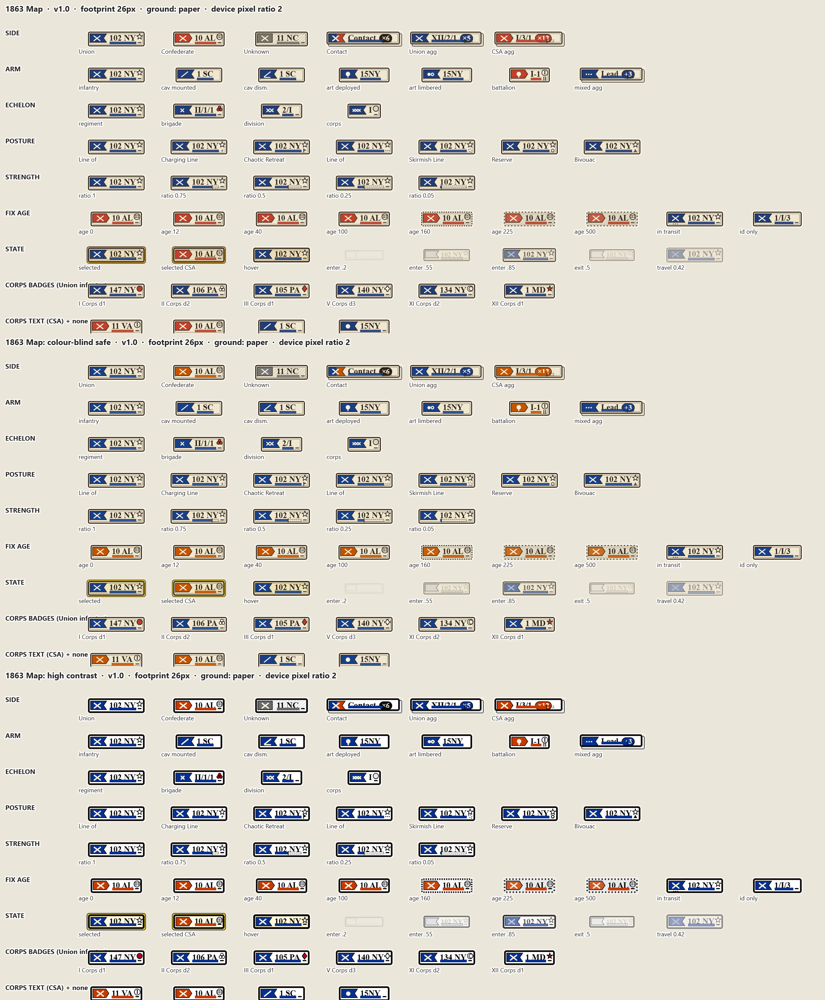

*Three variants of the same drawing.*

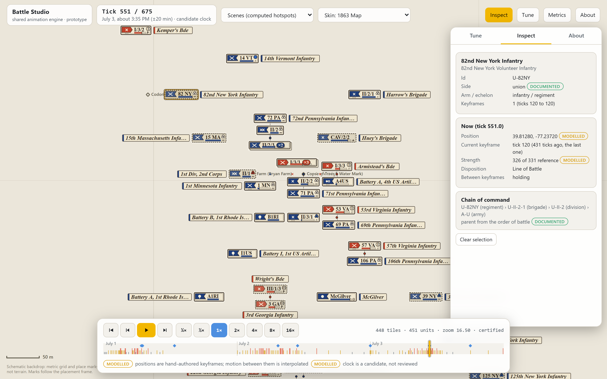

*Zoom 16.5, 1863 Map, with the 82nd New York selected. The Inspector gives its side (Documented), position (Modelled), strength (Modelled) and chain of command (Documented), and says the position is a keyframe from tick 120, 431 ticks ago: the most honest sentence on the map. (An earlier toolbar is visible; the tiles are the 1863 Map of this pitch.)*

Open it with `?style=map-1863` (and `&variant=cvd` or `contrast`).

### Why it is right for this site

- **It uses the one period convention the research could document.** The 21 March 1863 circular assigns the badge shapes and division colours; report 03 found it reproduced on civilwarnews.com and citing the Official Records (p. 152) and rated it Documented for seven corps. In the prototype, **174 of the 255 placed Union units get a badge** (I 34, II 47, III 21, V 18, VI 3, XI 26, XII 25; all 174 agree with the order of battle in the independent check), and **156 Confederate units carry a corps numeral**. The circular omits the Cavalry Corps and artillery, and Confederate corps had no documented badge in anything the research found, so those units get none, and the legend says so ("text only: no source assigns Confederate badges"); report 03 rates a Confederate badge convention Unknown and a question for a historian.
- **Ink against pencil is a real lesson from the site's own subject.** Report 04 (R06) records that Warren's survey and Bachelder's interpretive map of troop positions were kept apart and criticised apart. This look keeps the firm and the provisional visibly apart on every tile.
- **It treats the Union and the Confederates differently only where the sources do.** The asymmetry is the data's: documented badges for one side, none for the other.

### How it ends the jitter

**Root causes today** (section 4): hold-then-jump keyframes, a stale tick, a layout recomputed on every redraw. **The fix** is the engine's, the same for all three looks. **Measured on this look** in the six 20-second runs (7,199 frames, popups on): **60 fps in all six, no frame over 20 ms; solid sudden jumps 0 to 0.13 per second (today 1.15 to 65.9); largest one-frame step 15 to 109 px (today 311 to 1,550).** *(Pitch runs.)* The 109 px is the largest of the three looks (War Room 85, Field Manual 79); I do not know why, and each figure is a single 20-second run per scene. Arrival takes a pencil outline, parchment, wash and ink in that order; selection is a gilt ring that eases in over 140 ms.

### How tiles stay clear of each other

- Settled picture: **0 overlaps in all 378 real-Chrome samples**, closest approach 2.0 px.
- In motion, in the pitch runs: **0 of 7,199 frames had two solid tiles touching.** Dimmed tiles lay over solid ones on 25.3% of frames (up to 25 px), a unit had no tile on 4.3% of frames (up to 29 units at once), some unit was shown only by a faint tile on 60.1% of frames. Those are the engine's open defects (section 12).
- Footprint: 26 px tall but wider (13 px of side padding for the medallion). 310 to 314 individual tiles at The Angle.

### How it grows

`src/skins/map-1863.mjs` (18.7 KB) and `map-1863.spec.mjs` (about 30 documented rows: palette, division colours, rule, flag tail, pencil dash, badge size, level-of-detail, motion). **To tweak:** `?style=map-1863&skinset={"map-1863":{"pencil.dash":2.4,"badge.size":5}}` (values are range-checked) or edit the spec and rebuild. **To add:** a new badge set is a drawing function in `src/skins/glyphs.mjs` plus a rule in `src/skins/semantics.mjs` (which units get it, and its legend text and evidence label); for example, if a historian supplies a documented Confederate convention, that is where it would go. The look's natural extension is a **period type scale for the popups** (dispatches as paper slips); not built.

### What it costs and what could go wrong

- **Bytes:** about +13.6 KB of script (+2.7 KB compressed) added after War Room; +13.6 KB / +3.7 KB alone.
- **Frame cost:** the tile draw is 1.5 ms median / 6.5 ms (slowest 5%) at The Angle and 2.5 / 9.3 ms on the whole field; under the 4x throttle 11.3 and 16.4 ms median.
- **The claim risk is the highest of the three.** A corps badge is a Documented claim on a tile. The shapes and colours were checked against civilwarnews.com's reproduction of the circular, not the Official Records scan; if the scan or a historian disagrees, a tile is wrong in public. It should not ship before that check.
- **Must be verified:** the corps-badge source against the Official Records or a historian; legibility of the small badge medallion (radius 4.4 px) at the default zoom (the badge is drawn from zoom 13.0 up); the serif's real width on other systems; satellite imagery.

### Honest limits

- **The weakest dimmed-tile legibility** (median 2.37:1) and a **3.32:1 backdrop note** in the light skins (the honesty text "Schematic backdrop ... not terrain"), both below 4.5:1.
- The layout measures the engine's Segoe-based font table, not the serif, so the look **condenses text** that would render wider; on a system with different fonts it may look squeezed (it never overflows its box).
- Union and Confederate tiles look different in richness (badges for one side only). That is honest and may look unbalanced.
- 68% of placed Union units get a badge (174 of 255), not the 78% of rows quoted in report 03 (rows are not units).
- Cavalry (63 of 900 Union rows) and artillery get none. The circular does not cover them.

---

## 9. Side by side, and the one trade-off that decides the build

### 9.1 The three looks on the same engine

| | **1. War Room** | **2. Field Manual** | **3. 1863 Map** |
|---|---|---|---|
| Character | cinematic dark glass; light means a fresh report | modern NATO-style symbol on paper; the legend is generated | lithographed field map; documented corps badges; ink and pencil |
| First ten seconds | the strongest | calm and exact | charming and distinctive |
| Best for | everyone; the front door of the site | teachers, historians, print, colour-blind readers | the history audience; authenticity |
| Tile height, and separate tiles at The Angle (zoom 15) | 28 px; 296 to 305 | 26 px; 322 to 329 | 26 px, wider; 310 to 314 |
| Settled picture, real Chrome (378 samples each) | 0 overlaps; closest 2.1 px | 0 overlaps; closest 2.0 px | 0 overlaps; closest 2.0 px |
| Playback, about 7,200 frames: two **solid** tiles touching | 26 frames (0.36%, at most 2.2 px) | **0 frames** | **0 frames** |
| Playback: a **faint** tile over a solid one | 21.7% of frames | 26.8% | 25.3% |
| A unit with **no tile** on a frame (separate deterministic run) | 4.7% of frames | 4.7% | 4.3% |
| Median contrast of text on a *dimmed* tile | **3.75:1** | 2.57:1 | 2.37:1 |
| Text contrast, settled picture | every string 6.4:1 or more (median 14.9) | 4.5:1 or more (minimum 4.61); 2 strings per colour-blind variant at 3.77 and 4.05 | as Field Manual; the backdrop note is 3.32 |
| Tile draw at zoom 15, median / slowest 5%; at 4x CPU slowdown, median | 2.0 / 7.7 ms; 14.2 ms | 1.6 / 6.1 ms; **10.8 ms** | 1.5 / 6.5 ms; 11.3 ms |
| Script added, raw and compressed | +13.6 KB, +3.8 KB (first family, includes the shared kit) | +11.9 KB, +2.0 KB after the first | +13.6 KB, +2.7 KB after the first |
| Risk of a wrong claim | lowest | low (conventions are partly this project's) | **highest** (documented badges, read via a reproduction) |

*Playback figures are pitch runs: six 20-second real-time runs per look (The Angle, Rose Woods and Cemetery Hill, each at 1x and 4x, 60 fps, popups on), judged on painted ink by the independent verifier's own instrument; all three held 59.8 to 60 fps. The text-contrast, draw-cost and settled-picture figures are the verifier's and the skin author's, described in sections 6 to 8. All three share the same engine defects; the one difference that matters is that War Room's pin is the only thing that ever put two solid tiles in contact.*


*The same units at the same camera in four designs: the engine's plain test tile (top left, not a pitch), Field Manual, War Room, 1863 Map.*

### 9.2 The trade-off you must choose: smooth, or strictly clear

Your rule says tiles must not obscure each other *at all*. The layout checker keeps its promise on every layout it releases, but between two layouts a tile has to get from one place to another, and a hand-over (one tile becoming a counted tile, a crowd opening up) has to happen somehow. There are three honest ways, and they trade against each other. I measured them with the independent instrument on The Angle (zoom 15) and Rose Woods (zoom 14) at 4x speed, 1,200 frames each. (The Angle, Rose Woods and Cemetery Hill are the three hardest places in the data: where the most units stand within reach of each other, picked by reports 03 and 06.) Each pair of figures is The Angle then Rose Woods; each is a single run, so differences of a few points are noise.

| Setting | Faint tile over a solid one (of frames) | A unit with no tile (of frames) | Solid sudden jumps per second | Largest one-frame step | Separate tiles shown |
|---|---|---|---|---|---|
| **Default** (War Room: nudge up to 48 px, glide, fades) | 29.0%, 15.5% | 5.5%, 7.3% | 0.07, 0.07 | 85, 57 px | 305, 141 |
| Travel limit raised to its maximum (120 px) | 24.1%, 12.1% | 4.4%, 6.8% | 0.07, 0.2 | 120, 57 px | 294, 145 |
| Straight-line motion (chord-smooth) | 28.2%, 16.0% | 5.2%, 5.6% | 0, 0.13 | 118, 17 px | 308, 143 |
| Nudge budget 24 px | 16.2%, 3.9% | 6.9%, 4.9% | 0.13, 0.07 | 152, 66 px | 242, 111 |
| Nudge budget 12 px | 3.4%, 3.2% | 7.2%, 5.8% | 0.07, 0.07 | 104, 69 px | 221, 92 |
| **Never nudge** (budget 0) | 2.9%, 2.5% | 6.8%, 6.6% | 0.2, 0 | 118, 67 px | 225, 79 |
| Field Manual "Instrument" (straight line, never nudge) | 3.2%, 1.3% | 8.8%, 6.9% | 0.2, 0 | 118, 48 px | 226, 81 (Field Manual default: 329, 164, with 35.2%, 19.1% faint-over-solid) |
| **No gliding, no fades** ("snap": the layout exactly as solved) | 2.8%, 0.1% | **0%, 0%** | **9.1, 8.5** | **198, 126 px** | 307, 145 |

*(Figures: faint-over-solid from the real-time runs with popups on; units without a tile from the deterministic 60 Hz runs with popups off; sudden jumps and steps from 15-second real-time runs. Raw files in `pitch-runs/results/`.)*

What it says, in order of how much it surprised me:

1. **Nudging is what makes the ghosts.** A tile nudged far from its unit has to cross a neighbour to get there, and the display layer does that as a faint glide. Cutting the nudge budget cuts the ghosts: from 29.0% and 15.5% of frames to about 3% at a 12 px budget or with no nudging at all, but the price is **26 to 44% fewer separate tiles** (more counted tiles) at never-nudge, and 27 to 35% fewer at 12 px. At The Angle the 24 px budget still shows 16.2%, so there is no free middle.
2. **The dial the prototype offered for this does not work.** Raising `motion.travelPx` to its maximum only trimmed them (24.1% and 12.1% against 29.0% and 15.5%). Straight-line motion did not change them either.
3. **Units without a tile are a hand-over problem, not a nudging problem.** They stay at 4 to 9% under every setting that glides and fades, and fall to **zero only when tiles swap atomically** (the snap row). That is the case for the milestone's first step: make hand-overs atomic, and keep gliding for the tiles that persist.
4. **Snap is the strict end, and it hops.** Zero units without a tile, almost no faint-over-solid frames (2.8% and 0.1%), and about nine solid jumps a second with steps up to 198 px. That is the research lab's behaviour, the certified layout shown exactly as solved, and it is the reason not to stop at snap.
5. **"Never nudge" is a real option** and the one Field Manual's stance uses: nothing is ever displayed anywhere but its true spot, and a crowd becomes a counted tile. The honest cost is fewer separate tiles, which is a design choice you can look at in the Studio with `?set={"layout.dMaxPx":0}`.

### 9.3 The visibility rule changes the picture more than any look does

The rule decides how many tiles exist at all. The site's own rule (carry-forward) puts 305 and 141 separate tiles at those two scenes; a *fresh window* (units shown only within 24 ticks of one of their own keyframes) puts 39 and 35; a *latest snapshot* puts 9 and 11, and faint-over-solid frames fall to 8.1% and 12.0% (window) and 1.6% and 4.1% (snapshot) *(pitch runs)*. At tick 548 the carry-forward rule stands 81% of units on a position older than 50 ticks. The look you choose is smaller than this choice. My recommendation (decision 3) keeps the site's rule, with the age shown, and offers the fresh window as a toggle.

*A note on method. The pitch runs re-use the independent verifier's own scripts (`v3-play`, `v4-motion`, `v3b-gaps`) in a private copy of the prototype, with two additions: a style option and a `--set` option that applies dials (`pitch-runs/scripts/`). They run on one machine, in headless Chrome 155, with the same popups-on defaults. The "units without a tile" column cannot be read for the visibility-rule rows (the instrument's definition of "on the field" is the carry-forward rule), so those rows are not shown.*

---

## 10. Recommendation and build order

**Build one engine. Ship War Room as the hero and Field Manual as its Paper mode. Hold 1863 Map.**

- **Why War Room first.** It is the look you asked for (premium, cinematic, pro), it has the best legibility numbers of the three, and its central idea (light means a fresh report) is the most honest thing the data lets a map say about itself. Its weaknesses look fixable: a pin the verifier measured larger than the layout reserves (5.8 px against 4 px), and the heaviest draw cost, which a sprite cache addresses.
- **Why Field Manual second, and soon.** Once the engine exists a second look costs about 2 KB compressed. It serves what War Room cannot: print, colour-blind readers, a teacher's handout, a historian who wants to defend a screenshot. It also gives you a safe fallback on weak phones (the lightest draw).
- **Why 1863 Map third.** Not because it is the weaker design but because its claim risk is the highest. A corps badge is a Documented claim on a tile. It should ship after the circular is read in the Official Records scan (or a historian signs the shapes and colours) and after its dimmed text is lifted above 4.5:1.
- **The combination.** The three share the engine and the Tuning Studio, so a viewer can switch looks with one control and the choice is remembered. A product could ship two and keep the third behind a flag.

**Build order.**

| Step | What | Done when |
|---|---|---|
| **M1. The strict-motion milestone** (before any demo, and before any text says "never") | Close defects V-01 to V-04 and as many of V-05 to V-07 as the work allows (specified below) | The independent scripts read zero: no unit without a tile (`v3b-gaps`), no solid-on-solid and no faint-on-solid frame (`v3-play`), no tile under the interface (`v2-sweep`), at 1x, 4x and at a 4x CPU slowdown |
| **M2. The engine in the real site** | Inject the engine as one patch group behind a flag with a manual kill switch (report 05's design: nine asserted patches), with War Room as the look; test on the real satellite ground, on a rotated and tilted map and on real phones; re-run the product's suites and update the two tests that encode today's behaviour (DF-03, VMON-04) and the monuments layer's `unitsNow` | The product's suites pass; the independent scripts read zero on the real map |
| **M3. Field Manual as Paper mode** | Register the second look; run the colour-blind check with a person who has colour-vision deficiency; make one real print | Both looks pass M1's scripts |
| **M4. The rest of the popups** | Register the product's other overlays with the Director (search, filter, roster, layers, distance, bookmarks, Extra Features and the rest); decide the fps readout and Narrated mode | Every overlay's placement is covered by the Director's sweep |
| **M5. 1863 Map** | Check the badge source; lift the contrast; check the serif on other systems | Passes M1; a historian or the scan agrees with the badges |

**M1 in detail, from what I measured.** These are proposals for the build to try, each with its acceptance test; I have not built them.

1. **Make hand-overs atomic** (V-01). A tile that is leaving stays until its replacement is solid; where the two cannot both be solid, swap in a single frame. The evidence: with gliding and fades switched off ("snap" mode) the independent check found **no unit without a tile in 2,400 frames** (1,200 at each of two hard scenes at 4x), while in the default mode 4.3 to 8.3% of frames had one. Switching the safety net off (the last-resort check that dims any tile still overlapping) removed 25 to 60% of the gaps in report 07's run, so the net is a cause but not the only one.
2. **Stop nudging tiles far from their unit, or nudge them less** (V-02, V-03). The faint, ghost-like tiles are the display layer's way of moving a tile across a neighbour. Measured at The Angle and Rose Woods (4x): at the default 48 px budget faint-over-solid frames were 29.0% and 15.5%; at 24 px, 16.2% and 3.9%; at 12 px, 3.4% and 3.2%; with no nudging, 2.9% and 2.5%. The price is separate tiles: 305 and 141 at 48 px, 221 and 92 at 12 px, 225 and 79 at 0 (section 9.2). So the build should choose a small budget (or none) and let the Studio show what that looks like, and should also fix the fades. The dial the prototype offers for this, `motion.travelPx`, did **not** help: at its maximum (120 px) faint tiles still lay over solid ones on 24.1% of frames at The Angle (default 29.0%) and 12.1% at Rose Woods (default 15.5%).
3. **Give the layout the interface** (V-04). The layout solves the whole canvas while the toolbar, dock, narration card and Inspector lie on top. The Director already keeps its cards off the tiles by building an occupancy grid; the same grid, run the other way, can reserve the interface for the layout, and the map viewport can shrink for the dock the way it already does for the reading rail. `Esc` should close the Inspector.
4. **Cuts and rest** (V-05, V-06). Tours should glide their seeks; a cut becomes a one-frame swap; the "rest latch" that already settles a paused picture in most cases needs extending to the cases that still drift.
5. **Load** (V-07). A sprite cache for the static parts of a tile is the known remedy for the 4x-slowdown frame rate and is not built; what reduced-motion mode should show is a design decision.

**What I would not build** (the research's reasons are in reports 03 and 04): trails, speed styling, per-tile casualty shading over time, weather effects, terrain shadows, a proximity-based "engaged" glow, emblems for Confederate corps, cavalry or artillery, a layout worker, a second canvas or a WebGL context for tiles, and an automatic fallback to the old renderer. Each either invents something the record does not contain or adds a second path where a bug can hide.

---

## 11. What you decide

Each of these is a setting in the engine, not a rebuild. My recommendation is first; the evidence is in the sections named.

| # | Decision | Options | My recommendation | Why |
|---|---|---|---|---|
| 1 | **Which pitch first, and the default look** | War Room, Field Manual, 1863 Map (or two of them) | War Room first, Field Manual as Paper mode, 1863 Map held (section 10) | Payoff, legibility, claim risk (sections 6 to 9) |
| 2 | **How strict "never obscure" is while things move** | (a) smooth motion with brief faint ghosts, as prototyped; (b) strict: no ghosts, hand-overs swap in place; (c) no gliding at all ("snap") | (b), built as smooth within the strict envelope: tiles that persist glide, tiles that appear or disappear swap in one frame | You said "at all". (c) already reads zero gaps but hops about 9 times a second, up to 198 px; (a) fails your rule on 22 to 27% of frames (section 9) |
| 3 | **Which units get a tile at all** (visibility rule) | carry-forward (the site's own rule: typical 384 tiles, 478 at most); fresh window (about 44); latest snapshot (about 7) | Keep carry-forward as the default, with the fix-age channel; offer "fresh only" as a toggle | It is what the site does today and the age channel tells the truth about it: at tick 548, 81% of units stand on a position older than 50 ticks. Under the fresh window War Room shows 35 to 39 separate tiles at The Angle and Rose Woods instead of 141 to 305; under the snapshot 9 to 11 (section 9.3). |
| 4 | **How a unit travels between two keyframes** | a smooth curve (leaves the straight line by a median 0 m, 90th percentile 49 m, at most 391 m); the straight line with smooth speed (exact geography) | The straight line with smooth speed | Positions are Modelled; a curve is an invention in a place where the record has two points; 44% of the data's waypoints turn by more than 90 degrees (report 04). In the pitch runs it made no consistent difference to jitter (section 9) |
| 5 | **May a tile be nudged off its unit's true spot** | up to 48 px with a pin and leader (default); a smaller budget; never (merge instead) | A small budget at most, and settle it from the milestone's measurements | Nudging is what creates the faint ghosts; never nudging removes most of them but shows 26 to 44% fewer separate tiles (section 9) |
| 6 | **Weak devices** | accept 24 to 38 fps in dense scenes under a 4x slowdown; or build a sprite cache and a lower-resolution mode | Build the sprite cache; offer Field Manual (the lightest) by default on phones if a real phone needs it | Sections 6 to 8 give the costs; a real phone has not been tested |
| 7 | **Narrated mode** for popups | off (built); slow the clock while a critical card is read; slow it for any card | Off by default, one click to turn on | Reading every critical card takes 13.5 minutes against a 5.6-minute show; it changes the feel of the show |
| 8 | **The small "NN fps" readout** | keep and fix; drop | Keep and fix it | You said not to remove anything; it printed a false "0 fps" at every Play (61 fps measured), which is a bug, not a reason to remove it |
| 9 | **Corps badges** | ship 1863 Map after a source check; Union-only badges | Yes, after the check; Union-only is the honest state of the sources | Section 8 |
| 10 | **Keep the Before view** in a product | hidden flag; research only | A hidden flag while the build is being verified, then drop it | It reproduces today's renderer to the unit and is the best proof of the improvement, but it is not a feature |

**What I need from you before M1 starts:** decisions 2 and 5 (they set what "strict" means), and the name of whoever can read the Official Records scan or sign off the badges (decision 9).

---

## 12. What an independent check found: what held, and the open defects

After the prototype was assembled, a separate agent re-measured it in real Chrome with its own instruments and changed nothing (report 07, commit e64ad06, 40 re-runnable scripts). Its instrument records every pixel the page actually paints, and was itself tested: the same checker finds overlapping tiles on **100% of frames** of the Before view in all 10 runs, so it is not blind, and every changed pixel on 1,428 settled samples lies inside a recorded tile box. The page is not judged on what the engine says it draws but on what lands on the canvas.

**Verdict in one table.**

| Your rule | Verdict | In one line |
|---|---|---|
| Tiles never overlap, at all | **holds when settled, fails in motion** | 0 overlaps in 1,428 of 1,428 settled samples; while the picture moves, solid tiles touch on 0 to 0.8% of frames (at most 1.9 px) and dimmed tiles lie over solid ones on 5 to 41% of frames |
| Tiles never hide vital information | **fails in three ways** | a unit with no tile at all on 0 to 23% of frames; units shown only by a faint tile on 27 to 100% of frames; the interface covers 15 to 23% of the tiles in view (26 to 30% on a phone) |
| Jitter fixed | **true at 60 fps, with four exceptions** | holds in normal playback; returns under a 4x CPU slowdown, in reduced-motion mode, at hard cuts, and for seconds after a pause |
| Everything true to the data | **true for data, clock and text; a few interface sentences are not** | 23 of 23 data checks, 11 of 11 clock checks, 263 of 263 unit-card facts, 0 of 1,687 keyframes wrong; but "Shift steps an hour" is false |
| Popups kept and improved | **true** | 12 of 12 present; popup cards cover no tile in 11,256 frames |
| Extensible | **mostly true, with friction** | a new skin took 45 lines and one registration; it also broke one repo test and a bad token string stopped the whole page |

**What held, with the numbers.**

- **Data:** every one of the 1,687 keyframes equals its source row (0 mismatches, latitude and longitude to 6e-7 degrees); the SHA-256 of all 97 source files equals the file on disk; 478 units, every unit in exactly one tile.
- **Positions:** 1,040 true positions compared at 24 keyframe ticks and 3 zooms, worst error 3.7e-9 px; no tile farther than 47.94 px from its unit (budget 48) over 14,097 tiles, with a pin on every displaced one; the 11 place marks in view sit 0.000 px from an independent projection.
- **Clock:** equals the site's own clock module at all 675 ticks and passes exactly through all 33 anchors; every time on screen says "about" and "candidate clock".
- **Union corps badges:** 174 of 174 agree with the order of battle; the seven shapes and the red, white and blue division colours match the 21 March 1863 circular as printed by civilwarnews.com (not the Official Records scan).
- **The Before view is today's renderer:** 0 mismatches in 1,560 clock frames and 522 tile-set frames; 111,564 positions within 5e-10 px; the published numbers (833 jumps, 159 frames, 47 at once, 66 snap-backs, 407 reappearances) reproduce exactly.
- **The prototype's own suite:** 163 of 163 tests pass (re-run for this pitch: 214.8 s, log in `pitch-runs/logs/prototype-tests.log`). The verifier did not re-run them, because they share code with the engine; its checks above do not.
- **Real input:** wheel zoom keeps the ground under the pointer within 0.000 px; drag within 3e-9 px; every documented key works; the first frame is drawn 240 ms after load from a file; 1 request (the file itself).
- **Jitter in normal playback:** solid sudden jumps fall from 1.15 to 65.9 per second to 0 to 0.1; the largest one-frame step from 311 to 1,550 px to 15 to 94 px; 60 fps and a 16.8 ms frame time at the 95th percentile in 8 of 10 scenes (the whole-field scene ran 56 to 58 fps for both renderers).

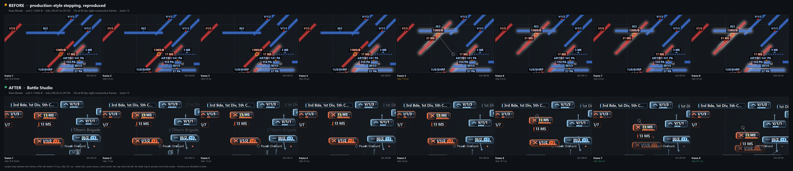

*Eight consecutive frames of one tile at Rose Woods, 16x, zoom 15. Top, today's renderer: the tile (ringed) stands still for four frames, jumps 77 px in the fifth, then stands still again. Bottom, the Studio: the same tile moves on every frame, its steps growing from 0.5 px to 29 px as it glides to its new place, so its largest step is 29 px against 77 px. Positions are Modelled in both.*

**The open defects, in plain words.** Severity is the verifier's. "Fix to specify" is my proposal, not a tested change; each defect has a repro script under `docs/pitch/anim/07-verify/` that is also the acceptance test for its fix.

| # | Sev. | What you would see | Numbers | Fix to specify (untested) |
|---|---|---|---|---|
| V-01 | High | a unit's tile blinks out for a few frames while it hands over to another tile | 0 to 23% of frames, 1 to 9 frames at a time, up to 29 units at once; switching the safety net off (the display layer's last-resort check, which dims any tile still overlapping) removes 25 to 60% of them | an outgoing tile stays until its replacement is solid; where both cannot be solid at once, swap in a single frame |
| V-02 | High | a faint travelling tile slides across solid neighbours; a few solid tiles touch for a frame | solid-on-solid 0 to 0.8% of frames (at most 1.93 px, chip against pin); solid-on-dim 5 to 41% (at most 27 px) | never draw a dimmed travelling tile: a far move becomes a swap or waits |
| V-03 | High | the faint tiles cannot be read | 27 to 100% of frames show some unit only by such a tile; median contrast 3.75:1 (War Room), 2.57:1 (Field Manual), 2.37:1 (1863 Map) | disappears with V-02; the dulling for old fixes already keeps the text full strength |
| V-04 | High | the toolbar, dock, narration card and Inspector sit on top of tiles | 15 to 23% of tiles in view (78% of those at least half hidden); 26 to 30% on a phone; 27% per frame in the 60-second showcase; 13 of 26 clicks landed on the Inspector | give the layout the interface as reserved ground (the Director already does the reverse) and shrink the map viewport for the dock; Esc closes the Inspector |
| V-05 | Med. | a hard cut blanks the tile layer for about three frames | ink falls to about 0 for 3 frames, under 20% for 8 to 12 | tours glide their seeks; a cut becomes a one-frame swap |
| V-06 | Med. | a paused picture is not at rest for seconds | tiles still moved more than 5 px up to 14.75 s after a pause; 13 of 36 stateful samples never rested | trace the remaining limit cycle; the "rest latch" (the rule that settles a paused picture) is the place to extend |
| V-07 | Med. | jitter returns under load and in reduced-motion mode | 4x CPU: 21.8 to 27.6 fps, 2.2 to 5.9 sudden steps per second; reduced motion: 3.1 to 8.7 solid sudden steps per second, up to 185 px; labels toggle up to 9.3 times a second | a sprite cache for the static parts of a tile (not built); decide what reduced motion should show |
| V-08 | Med. | importing a settings file with a bad module name throws or draws grey boxes | 12 of 14 tuning checks pass; skin colour and motion tokens are not in the panel or the export | validate ids on import; list skin tokens in the panel and the export |
| V-09 | Med. | accessibility gaps | an automated accessibility checker (axe-core): 1 critical, 2 serious (speed button 2.84:1; an unfocusable scroll pane); no focus ring on the canvas; no arrow keys in the menu; a light-skin note at 3.32:1 | a short punch list |
| V-10 | Low | a few interface sentences are untrue | "Shift steps an hour" (12 ticks is 10 to 386 minutes, median 49); 3 cross-out cards say "Command passes" where the data has no successor; one raw id (C-CAV); one repo document id printed | reword; the data itself is correct |
| V-11 | Low | adding a skin has two traps | a new skin breaks a hard-coded repo test and is missing from the conformance list; a token doc string under 6 characters passes the build and the page never starts | fault isolation at registration; derive the test lists |
| V-12 | Low | turning popups off after playing leaves the page redrawing | about 60 fps on a still picture | clear the persistent cards |
| V-13 | Info | smaller facts | a favicon 404 over HTTP; the Before view's relaxation matches today's only on aggregates (36% of bars within 0.5 px); the clock shows 12:00 AM of the next day for two ticks | none needed |

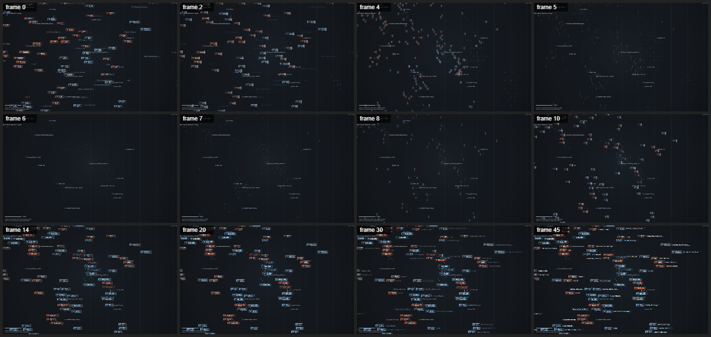

*V-05, frame by frame: after a hard cut the tile layer empties (frames 5 to 8) and rebuilds (frame 14 onward). Verifier figure.*

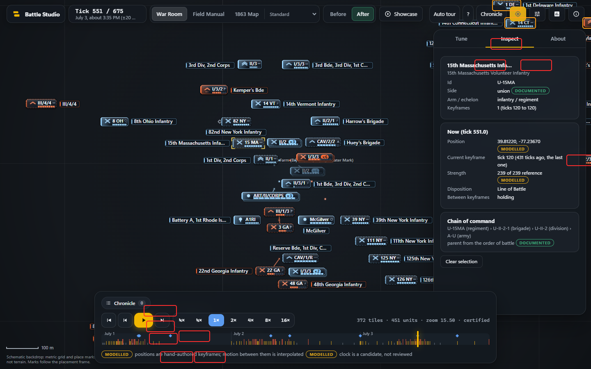

*V-04: red outlines mark tiles at least half hidden by the interface; here 10 of 40 tiles in view.*

*(On V-04's range: the verifier's own figure is 15.4 to 22.2% for War Room at zoom 13 to 18; recounting its raw files for each look at zoom 13.5 to 15 gives 20.0% for War Room, 23.1% for Field Manual and 20.8% for 1863 Map.)*

**What this means for the pitches.** The engine's idea works, and the data, clock, text and popups are right. But the version in the prototype does not yet meet the absolute wording of your rule while the picture moves, and the interface covers a fifth of the tiles. None of that is a reason to stop; all of it is a reason not to show the prototype as finished, and to make "zero on the verifier's scripts" the acceptance test of the first build milestone (section 10).

---

## 13. What is not verified, and where the evidence comes from

**Not verified.**

- **The real ground.** Every picture and measurement uses the prototype's plain grid. The live map is Mapbox's satellite imagery (the bundle's map style is `mapbox://styles/mapbox/satellite-v9`). The "imagery" specimen sheets (`shots/prototype/sheet-*-imagery-dpr2.png`) use a synthetic stand-in of green and tan blocks, not satellite tiles. Whether each tile family stays legible on real imagery has not been tested.
- **Rotating and tilting the map.** The live map is built with Mapbox's default controls and, as far as the bundle's map options show, nothing disables rotation or pitch. The Studio's camera is flat and north-up. What tiles do on a rotated or tilted map has not been designed or tested.
- **Integration.** The Studio is a standalone page. It has not been injected into the product bundle, and none of the product's own test suites have been run against it. Report 05 showed that a smaller engine could be injected as nine asserted patches and pass most suites (journeys 41 of 41, monuments builder 17 of 17, independent verifier 15 of 16, desktop-fixes 9 of 10); the two failures encode the shipped behaviour (DF-03 and VMON-04) and must be updated in the same change.
- **A real phone.** The phone numbers are a 390x844 viewport on a 2x screen, and "4x CPU" is a laptop throttled by software. Real touch pinch and drag were not exercised. A WebGL back end, which report 05 found fastest, is not built.
- **Other browsers.** One machine, one GPU path, headless Chrome 155 on Windows. No Firefox, Safari or Edge.
- **The data's own limits.** Every position is Modelled: the 1,804 rows are hand-authored and carry no basis, source or confidence field. Every clock statement inherits the candidate clock (33 anchors, all "proposed", five needing a historian). Strength and casualty figures are secondary (the registry's claimed sources, Busey and Martin and others, were not re-read). No historian read the popup texts; "verbatim" means equal to the repo's data files. Ten `U-` ids carry Confederate state codes and are shown as Contested; 95 of 478 ids lack a complete order-of-battle parent; 73 repeated (unit, tick) rows disagree. None is hidden in the prototype; all are labelled.
- **Corps badges.** The seven shapes and division colours were checked against the circular of 21 March 1863 as printed at <https://civilwarnews.com/issues/2022/may/the-library-of-congress-collection-may-2022/> (which cites the Official Records), not against the Official Records scan itself. No source assigning Confederate corps badges was found, so none is drawn.
- **Colour-vision simulation.** Used the Machado 2009 matrices as the author recalled them, not re-verified against the paper: indicative.
- **My own re-runs (the figures marked "pitch runs" in sections 6 to 9).** I ran the independent verifier's scripts again on the three styles in a private copy of the prototype and with a few changed dials, on this one machine. They are as good as that instrument and no better, and the dial experiments are single 20-second runs per scene.
- **Rankings and recommendations** are judgment. The numbers underneath them are measured; the weights I gave them are mine.

**Where every number comes from.** All paths are relative to `docs/pitch/anim/`. Each report is read-only evidence for this pitch.

| Section of this pitch | Evidence |
|---|---|
| Today's tiles, jitter, overlap | `01-current-tiles-jitter.md`, `data/current-metrics.json`, `shots/current/`, `harness-current/` |
| Popups inventory, dwell, coverage | `02-popups.md`, `shots/popups/`, `data/02-popups/`, `popups-lab/` |
| Data, visibility rules, badges, hotspots | `03-data-fuel.md`, `data/cluster-stats.json`, `data/fuel-coverage.json` |
| Principles, sources, licences | `04-benchmarks.md`, `04-benchmarks-evidence/` |
| Architecture, no-split, integration | `05-architecture.md`, `05-bench/`, `05-proto/` |
| The certified layout | `06-layout.md`, `layout-lab/`, `data/layout-results.json` |
| The prototype, its tests and measurements | `prototype/README.md`, `prototype/src/skins/README.md`, `prototype/src/popups/README.md`, `prototype/results/`, `prototype/test/` |
| The independent verification | `07-prototype-verification.md`, `07-verify/` (40 scripts, `results/`), `shots/verify/` |
| Pitch runs (per-style motion, dial experiments, byte sizes, prototype test run) | `pitch-runs/` (scripts, raw JSON and logs, committed with this pitch) |

---

## Appendix A. Try it yourself: what the prototype is and what to click

**What it is.** One file, `docs/pitch/anim/prototype/battle-studio.html` (1.5 MB), that holds the engine, the three tile families, the popup Director, the site's real data (478 units, 1,687 hand-placed keyframes, the 137 events, 24 stories and 42 command changes, copied verbatim with a fingerprint of every source file) and a reproduction of today's tile renderer for comparison. It needs no internet and no server, makes no network request, and touches no product file. The ground under the tiles is a plain metric grid with the site's 30 place marks (8 of them dashed because the live and legacy place files disagree by 166 to 733 m); it is **not** the satellite map, which needs a restricted Mapbox token.

**How to open it.** Double-click `C:\Users\mlege\gettysburg-map\docs\pitch\anim\prototype\battle-studio.html`. It opens in your default browser; I tested Chrome only (the author's notes say Edge and Firefox should work, which nobody checked).

**What to click, in order.**

1. A welcome card offers **Watch the 60-second showcase**. Click it and watch: the same ticks through today's renderer and through the engine, the numbers measured on that very run, the three styles, the whole field, the popups, and the honest limits. `Esc` stops it.
2. **Style** (top bar): War Room, Field Manual, 1863 Map. The drop-down beside it picks Standard, Colour-blind safe or High contrast.
3. **Before / After** (top bar, or key `B`): flips between today's tiles and the engine's, same ticks, same camera. Do it on a crowded scene. In the Before view, press Space and watch tiles hop.
4. **Space** plays and pauses; arrows step one tick; `[` and `]` change speed; the wheel (or a pinch) zooms; drag pans; click a tile to open **Inspect** (what the data says about that unit); hover a tile for its tooltip.
5. **Showcase** menu: the three hardest places (Cemetery Hill, Rose Woods, The Angle). Each plays the same six minutes twice, before then after, and ends with a card of numbers measured on that run. **Replay this view** does the same from wherever the camera is.
6. **Chronicle** (button or `C`): every moment so far, with Go to. `N` and `P` step between moments.
7. `T` opens the **Tuning Studio** (177 dials, each with its evidence label; export and import a settings file). `M` shows live metrics, one column per renderer. `A` shows the legend generated from the style you are using and the honest limits.
8. On a phone, or in a window under 760 px wide, the cards become chips in a lane above the dock and a bottom sheet.

**Open it straight into a view** by adding to the file's address (for example `file:///C:/Users/mlege/gettysburg-map/docs/pitch/anim/prototype/battle-studio.html?style=field-manual&variant=cvd&welcome=0`):

| Add this | You get |
|---|---|
| `?style=war-room`, `field-manual` or `map-1863`, and `&variant=standard`, `cvd` or `contrast` | that look |
| `?compare=before` | opens on today's renderer |
| `?tour=showcase`, `hotspot-cemetery-hill`, `hotspot-rose-woods` or `hotspot-the-angle` | starts that tour |
| `?tick=556&zoom=15&play=1&speed=4` | a moment, a zoom, and playing |
| `?welcome=0` | no welcome card |
| `?tune=1` or `?metrics=1` | opens the Tuning Studio or the metrics |
| `?set={"layout.dMaxPx":0}` | any dial, by name |
| `?skinset={"war-room":{"rim.glow":0.6}}` | a tile token of the look in use (use it with `?style=`) |

*Every address in this table was opened from a `file://` address in headless Chrome for this pitch: 17 cases, 0 console errors, 0 network requests (`pitch-runs/results/url-check.json`).*

**What to look for.** In the After view, no tile covers another and counted tiles ("x5") appear where a crowd cannot fit; compare with Before at the same tick. At 4x on The Angle, watch for faint, ghost-like tiles gliding across neighbours: that is the open defect V-01 to V-03, not a style choice. Press `M` and watch "sudden jumps per second" and "overlapping pairs per frame" in the two columns.

---

