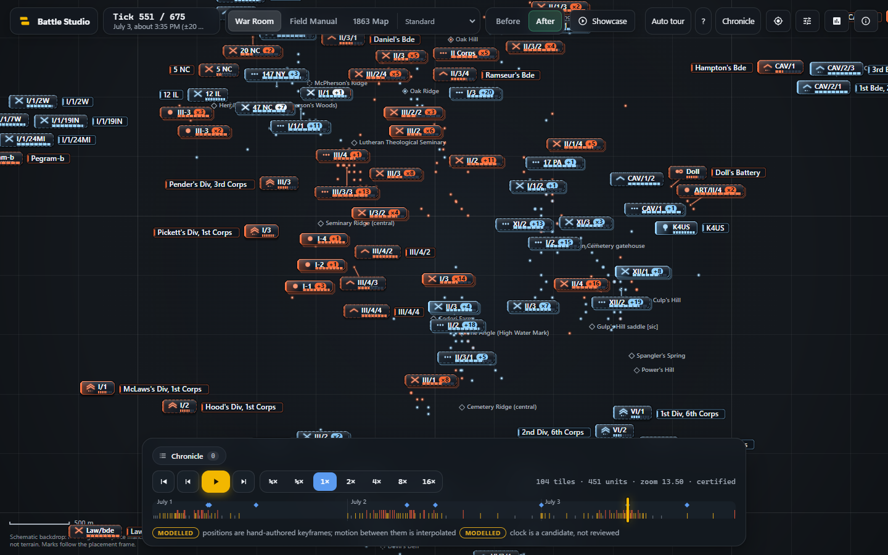
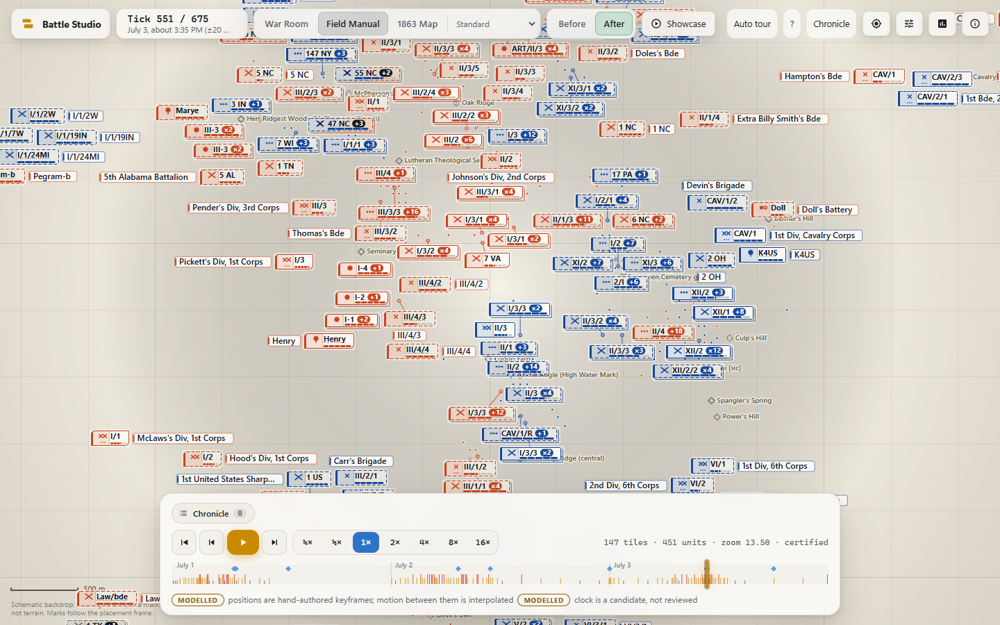
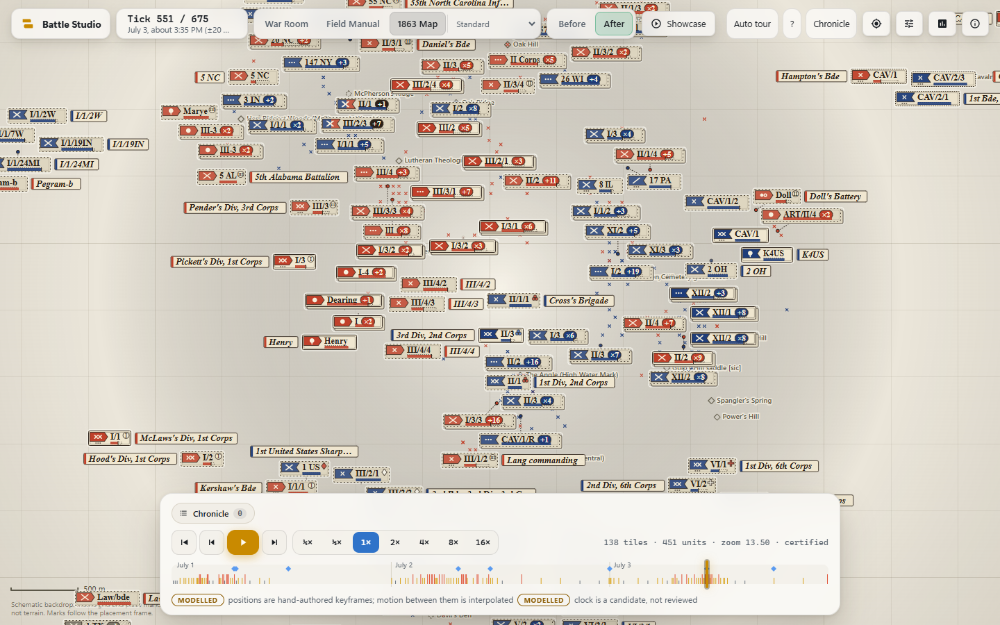
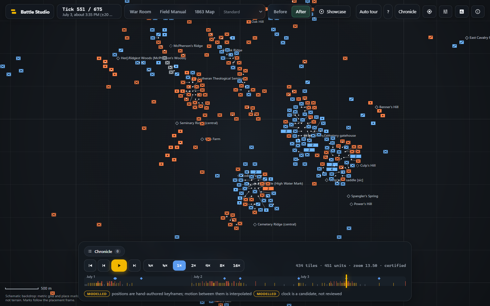

# Battle Studio: three pitches for a top-tier battle animation

### Unit tiles, map animation and popups: one engine, three finished looks, a working prototype, an independent check of it, and a revision that answers an adversarial review

*Design pitch for the site owner, first prepared 2026-10-06 and revised the same day after an adversarial review that made 38 required fixes (`PITCH-REVIEW.md`; Appendix B answers each). Pitch and prototype only: nothing here has been built into the live site, no product file was touched, nothing was deployed, uploaded or sent. Every picture is from the prototype (`docs/pitch/anim/prototype/battle-studio.html`, built at commit 93ace54 and independently checked at e64ad06, unchanged since) or from the research that preceded it, except the pictures and experiments marked "revision", which come from a scratch copy described in section 14. Every number comes from a command whose script and output are kept in this repository (the earlier reports, the prototype's tests, the independent verifier's scripts, the pitch runs, or `revision-runs/`); section 14 lists where.*

**Evidence words.** The site's own labels are used throughout. **Documented**: a source says it. **Measured**: a command was run and its output kept. **Computed**: derived from the data by a stated rule. **Modelled**: a hand-authored or interpolated value, not a record. **Contested** and **Unknown** mean what they say. **Design** marks a choice that is taste, not fact.

**Five terms.** A *tick* is one of the battle's 675 five-minute steps. A *tile* is a unit's marker on the map. A *counted tile* ("x5") stands for several units that cannot all stand clear of each other; those units are *counted, not shown*. A *pin and leader* are a small dot on a unit's true spot and a thin line to its tile, when the tile had to be nudged. A *keyframe* is a position a person placed by hand; a unit is *carried forward* from its last keyframe until its next.

---

## 1. The pitch in one page

**Your brief.** Make the unit tiles and the whole battle animation top notch, at the level of a large design firm. Fix the jitter for good. Keep every popup and improve it. Tiles must never obscure each other and never hide vital information. Build it so it can keep being improved. No error is permissible: every claim on screen must be true to the data.

**Five facts to know before anything else.** Each is measured, and each is a place where the first version of this pitch said more than the evidence supports.

1. **At the zoom the site opens at (13.5), most units have no tile of their own.** 82% of units sit inside counted tiles (94% if tiles may not be nudged), and a counted tile does not show a unit's name, arm or strength. The first version's pictures were all at zoom 15 to 16.5, where it is small. Small marks with a pin and a leader cut it to 3 to 5% in a sketch, but then the name is not on the mark. *(Section 5.)*
2. **"Tiles never overlap" is true for solid tiles on a paused picture** (0 overlaps in 1,428 of 1,428 independent samples). **While the battle plays**, a faint, ghost-like tile glides across solid neighbours on 22 to 27% of frames. A new display mode that never draws a ghost removes that entirely, but with nudging it hops 4 to 9 times a second; **without nudging it reads zero on every figure at about 1 to 2 hops a second, with 29 to 44% fewer separate tiles.** You cannot have all of: no ghosts, no hops, every unit visible, smooth motion. *(Section 10.2.)*
3. **"Jitter fixed" is true for unattended playback at a fixed camera, at 60 fps, on one laptop** (solid sudden jumps 0 to 0.13 a second against 1.15 to 65.9 today; the largest one-frame step 15 to 109 px against 311 to 1,550). **It is not true** under a 4x CPU slowdown, in reduced-motion mode (which breaks your decision of 2026-10-05), at a hard cut, for seconds after a pause, or while the camera zooms (the tiles boil; zooming in, a unit has no tile of its own on 77 of 90 frames). *(Section 4.2.)*
4. **A unit has no live tile of its own on 12 to 16% of real-time frames** (in the deterministic runs no tile of any kind on 4 to 5%, and 23% on the page's opening scene at 16x). The first version quoted only the lenient figure. *(Sections 4.1, 13.)*
5. **The prototype rebuilds 12 of the product's 51 overlay entries and adds two; the other 38 are untouched and not yet registered with the Director**, so its "a card never covers a tile" guarantee does not cover them. Four effects on the map (the hit flash, the engaged pulse, the trails, the tile rotation) had no stated fate; now each has one, and none is dropped without your yes. *(Section 6.)*

**What the research found about today's site.** The tiles are 8 px bars that look the same at every zoom. The motion is a slideshow: 92.3% of the data's keyframe pairs are *hold, then jump*, giving 833 teleports at the default zoom. At zoom 13, 82% of tiles touch another and 57% are half covered. A popup lasts as long as a five-minute tick (0.5 s at normal speed) for text that takes about 8 s to read. *(Section 2.)*

**What was built.** One engine and three finished looks, in a prototype you can open by double-clicking one file (Appendix A). The engine moves every unit continuously through all its keyframes, keeps tiles clear of each other by merging crowds into counted tiles, rebuilds twelve of the map's popups so they wait for you to read them and never cover a tile, and measures itself on every frame. It is one line from clock to screen with no worker; the audit of where it still has two things that must agree is in section 3.1. A scratch copy adds the experiments of sections 5 and 10.

**The three pitches.** They share one engine; they differ in the tile's look, a *motion personality* (how things ease and how long they wait), and how the popups are dressed. **Two rankings, because they differ:**

| Pitch | In one line | Rank on your rules (measured) | Rank on first impression (taste) | What worries me |
|---|---|---|---|---|
| **1. War Room** | A command table of lit glass; light means a fresh report; motion personality "Show" | 2 | **1** | The only look that put two solid tiles in contact (a pin 5.8 px against 4 px reserved); the largest plate, so the most counted units; the heaviest draw; designed on a dark ground; its hero look would be mostly dull (38% of units show the carried-forward look) |
| **2. Field Manual** | A modern map symbol in the NATO spirit on paper, its legend generated from the drawing; "Instrument" | **1** | 3 | The least cinematic; its dashed frame reverses the NATO meaning (stated); conventions partly this project's own |
| **3. 1863 Map** | A period lithograph with the documented 1863 corps badges; ink for firm, pencil for provisional; "Document" | 3 | 2 | The highest claim risk until the badge source is checked against the Official Records; the weakest dimmed text; a condensed serif |

*(Sections 7 to 10.)*


*The same units at the same moment and camera (zoom 15) in four designs: the engine's plain test tile (top left, not a pitch), Field Manual (top right), War Room (bottom left), 1863 Map (bottom right).*

**My recommendation.** Build the engine once. Put two questions in front of everything else: what a unit looks like when it has no room at the opening zoom (section 5), and how strict "never obscure" is while things move (section 10.2). Ship **Field Manual first** (it is the look that never failed one of your rules in the measurements, and the lightest), make **War Room the hero** once it passes the same gate, and **hold 1863 Map** until its badge source has been checked. The first version put War Room first on first impression; its own tables did not support that on your rules. *(Section 11.)*

**What you decide.** Seventeen decisions, each with my recommendation, are in section 12; the one-screen summary at the very end lists them. The four needed before anything is built: **how strict "never obscure" is while things move (2), whether a tile may be nudged (5), what a unit looks like at low zoom (11), and which of your rules wins when they cannot all hold (14).**

**To see it now.** Double-click `docs/pitch/anim/prototype/battle-studio.html` and press *Watch the 60-second showcase*. Appendix A says what everything does. The experiments are in `docs/pitch/anim/revision-runs/battle-studio-experiments.html` (section 14).

---

## 2. What the battle looks like today, and why it jitters

Research report 01 measured the site's tile renderer in real Chrome and replayed its own code over the whole battle (the replay matched the real page frame for frame: 487 of 487, 365 of 365 and 485 of 485 frames, worst difference 0). Four findings drive everything in this pitch.

**A tile is a thin bar.** Eight pixels tall (four for cavalry), up to 120 pixels wide, with a 7 px dot and an id label. Its size does not change when you zoom: a 120 px bar spans 3.5 km at zoom 11, 623 m at zoom 13.5 and 55 m at zoom 17 *(Computed)*. Six postures (Line of Battle, Reserve, Bivouac and three more) are the identical bar apart from the dot. The legend's swatches match the drawn dot for only 3 of 11 postures, and "dot radius scales with strength" is false: the width scales, and it hits its cap at about 480 men on 49.9% of placement rows *(Measured)*.

**It moves like a slideshow.** The site stores 1,804 hand-placed keyframes (1,687 distinct unit-and-tick positions) for 478 units, on only 188 of the battle's 675 ticks. A unit's next keyframe is a median 17 ticks away. The shipped code only glides between *adjacent* ticks, and only 93 of 1,209 consecutive keyframe pairs (7.7%) are adjacent. The other 92.3% are *hold, then jump*: 833 jumps of 8 px or more at the default zoom (median 78 px = 404 m, worst 1,096 px, up to 47 tiles in one frame), while 99.9% of tile-frames do not move at all. On top of that: a stale-tick bug draws a gliding tile back at the start of its path for one frame at every tick boundary (66 snap-backs, worst 458 px), and 407 tiles pop in half a tick early, vanish for exactly one frame and pop in again *(Computed by replay; Measured in the real page)*.

**Tiles hide each other.** The site opens at zoom 13.5. At zoom 13 (the nearest computed zoom), 82% of drawn tiles touch another one and 57% are half or more covered (mean over all 675 ticks). At zoom 15, 35% still touch another and 608 of 675 ticks contain at least one overlap *(Computed from the shipped draw routine)*. Labels do most of the hiding.

**Popups run on the battle's clock, not on yours.** An event card is on screen exactly as long as its five-minute tick: 0.5 s at normal speed, 33 ms at 16x. Reading its median 32 words takes about 8 s. Reading only the 45 critical events and 24 stories takes 13.5 minutes; the whole battle plays in 5.6 *(Measured, report 02)*.


*Today's tiles, drawn by the shipped routine: six postures (line of battle, charging line, retreat, march, reserve, bivouac) are the same solid bar apart from a 7 px dot. (Report 01, `shots/current/`.)*


*The prototype's Before view replays the same moment through a reproduction of today's renderer. Bars pile onto each other; the card on the left counts 181 overlapping pairs on this frame. The reproduction matches report 01's whole-battle numbers to the unit (833 jumps in 159 frames, 66 snap-backs, 407 one-frame vanishes) and the shipped code's clock, tile set and positions in an independent check (0 mismatches in 1,560 clock frames and 522 tile-set frames, positions within 5e-10 px).*

A separate note: the build the live site serves today (not the fixed R1c build) also draws the wrong set of units after its intro (100 tiles at tick 1 where the data has 21). R1c fixes that. This pitch is about what comes next.

## 3. The rule you set: no split

You asked whether splitting the animation pipeline raises the chance of bugs, and said that if it does, or even possibly does, there should be no split. It does. Every place where two code paths must agree (a worker and the page, an offline layout and a live one, two canvases, a fast path and a safe path) is a place where they can disagree for exactly one frame, and one frame is all a viewer needs to see a tile in the wrong place. So every pitch below obeys the rule:

- **One straight line from the clock to the screen.** One clock, one function that says which units are on the field right now, one layout checker, one drawing pass. The same line runs headless in the tests and in the page, so the thing that is tested is the thing that is shown.
- **What the research proposed and I have left out.** A layout worker (report 06 recommended one because a cold solve takes about 0.1 s at zoom 12 to 13); an offline layout replayed at run time (report 04's principle P7, which that report itself flags as a split); a second canvas or an OffscreenCanvas worker for tiles; Mapbox's own symbol layers for moving tiles (measured: tiles lag their data by 0.8 to 2.7 s, and 5 to 7 fps on the phone stand-in); a second WebGL context. None is in the prototype.
- **What no-split costs, said once.** Solving on the main thread means a cold solve after a jump in time (a seek, a cut) can take up to about 0.12 to 0.14 s at the densest ticks and zoom 11 to 13 (measured in Node and in Chrome's engine), and it means the engine itself takes 3.4 to 5.1 ms of every frame at normal speed and 11 to 18 ms under a 4x CPU slowdown, so dense scenes slow down (21.8 to 27.6 fps in the independent check). Whether the cold-solve hitch is visible on a real low-end phone was not measured. I think that is the right price. A faster, split design would be a less trustworthy one.
- **For the real site.** Report 05 studied injecting an engine into today's bundle as one patch group (nine asserted string patches, with a kill switch back to today's renderer). That is *replacing* one drawing path with another, not running two. Report 05's prototype also kept an automatic mid-session fallback to the old renderer after a fault. Under your rule I would leave that out and keep only the manual switch.

### 3.1 The audit: where the prototype still has two things that must agree

The first version of this pitch said the prototype was "one straight pipeline with no second path". An independent review found that was too strong. The line from clock to screen is single, but inside it the prototype keeps several pairs of representations that can disagree for a frame, and the three defects that remain in motion (a faint tile gliding across solid ones, a unit with no tile for a few frames, a tile that blinks) are exactly that kind of disagreement. This is the audit, with what ships in a product build.

| # | Pair that must agree | How they can disagree | In the prototype | In a product build |
|---|---|---|---|---|
| 1 | **The layout's certified place** and **the display layer's glided, faded place** | the picture shows a tile where the layout never certified one; a hand-over shows two tiles or none for a few frames. This is the cause of the open defects V-01 to V-03 (section 13) | both exist; a "safety net" repairs a disagreement by dimming a tile | **one model.** The net is kept only as a counter that must read zero in every acceptance run (a failing assertion, not a repair path). Section 10.2 measures the simplest version: show the certified place, and glide only when the glide is clear |
| 2 | **A fresh layout solve** and **the same solve carried along by its units** (the "solve every 2nd or 3rd frame" cadence, chosen automatically from frame times) | two ways to place the same tile on different frames, and the choice changes with the load, so the picture depends on how busy the machine is | both exist (the cadence governor is automatic) | **solve every frame, one cadence.** A slow device gets a cheaper drawing, not a second way to place tiles. Where the first version of this pitch called the cadence "not a second path", that was wrong |
| 3 | **The display layer's offsets fed back into the layout** (the layout starts its next solve from where the tiles are shown) | a loop between two states, each correcting the other | exists | disappears when the shown place is the certified place (section 10.2); otherwise keep and test |
| 4 | **Three layout strategies** (certified, raw diagnostic, production reproduction) | a viewer could be shown the wrong one | all three exist in the research build | **certified only** |
| 5 | **Three display modes** (glide and push, glide only, snap; the experiments build adds two more) | three behaviours to keep equally right | all three | **one** |
| 6 | **Four motion models** (smooth curve, straight line with smooth speed, straight line, today's stepping) | the same unit on different paths | all four | **one** (decision 4, section 12) |
| 7 | **Three rules for which units are on the map** (carry-forward, fresh window, latest snapshot) | the set of units depends on a toggle | all three | **one** unless you choose the toggle (decision 3) |
| 8 | **The Before view** (a reproduction of today's renderer) | a second renderer | exists, hidden in the research page | **not in the product** (decision 10) |
| 9 | **A cached tile drawing and a live tile drawing** (the sprite cache recommended for slow devices) | the cache shows an old state of a tile | **not built** | build only with a test that every tile state paints identical pixels cached and live; otherwise do not build |
| 10 | **The text width the layout assumed and the text width the browser paints** | wider text than measured pushes ink out of its box and breaks "never overlap" | a width table measured in Chrome on Windows, re-measured in each browser at start-up; worst error 3.3% on 478 short codes, 4% safety margin | add a run-time check that painted ink stays inside the box, and test on macOS, Android and Linux fonts (not done) |
| 11 | **The engine's camera and clock** and **the product's** (Mapbox's camera, the store's tick) | the tile layer lags or leads the map | not applicable (the prototype has its own) | the engine reads both and owns neither; test that a tile never lags its map by a frame |
| 12 | **The layout and the independent overlap checker** | none by design: the checker is a second implementation on purpose, so a bug in one is caught by the other | exists | keep as a test and as a development check, not as a repair |
| 13 | **A kill switch back to today's renderer** | a second path on purpose | exists in report 05's design | **manual only**, no automatic fallback |

The rule for the build is therefore stricter than "no worker": **a product build ships rows 1 to 7 with exactly one choice each, rows 8 and 13 only as a manual research switch, and rows 9 to 12 only with the tests named.** The prototype still carries all of them because it is a research page.

## 4. The engine all three pitches share

The three pitches are three finished looks on **one engine** (the "Battle Studio" engine, built and committed in `docs/pitch/anim/prototype/`). They differ in how a tile looks, how it arrives and leaves, how the interface around it is dressed, and in a *motion personality* (section 10.4). They do not differ in how the animation works, because that part has to be right once.

```
clock            time/transport.mjs     fixed 120 steps a second, drawn at the in-between moment; play, pause, speed ease in and out; a jump in time glides
camera           scene/engine.mjs       zoom keeps the ground under the pointer still
"on the field"   data/model.mjs         ONE function decides which units exist now (the site's carry-forward rule by default)
paths            interp/paths.mjs       each unit moves continuously through ALL its keyframes (smooth curve, or straight line with smooth speed)
layout checker   layout/engine.mjs      where each tile stands; tiles that cannot stand clear merge into one counted tile; an independent check before a frame is released
display layer    scene/display.mjs      a tile glides to its place; merges and splits fade in sequence; every displayed frame is verified again
drawing          render/canvas.mjs      the skin draws each tile; popups draw their leader lines beneath the tiles
measuring        metrics/metrics.mjs    frame times, jumps, overlaps, missing units, per renderer, live on screen
```

**What a tile can do (plain words).** A tile stays within 48 px of the true spot of its unit; if it had to be nudged, a small pin marks the true spot and a thin line (a *leader*) joins them. When a crowd cannot fit, the units merge into one *counted tile* and it splits again when there is room. A tile never covers another tile's true spot. **What that costs in units that have no tile of their own is in section 5, and it is large at the zoom the site opens at.**

### 4.1 What the promises mean, in plain words

Two words matter, and the first version of this pitch used them too loosely.

- **Solid and faint.** A tile is *solid* when its opacity is 0.5 or more and *faint* below that. The engine's guarantee is about solid tiles; a faint tile "neither obscures nor is obscured" **by the engine's own definition**. Your wording is "at all", so in this document **a faint tile lying over a solid one counts against the engine**, and every such figure is printed next to the solid one.
- **Settled and moving.** A picture is *settled* when nothing is gliding or fading (a paused frame, or one after a jump has finished). *Moving* means during playback or a camera move. The guarantee is proven for settled pictures and **not** for moving ones.
- **Vital information.** A unit's short name, side, arm and strength state (report 06, V1, V2, V3, V5), and that the unit is on the map at all. A counted tile does not carry a unit's own name, arm or strength (section 5).

The promises, each with what it covers:

1. **No two solid tiles overlap on a frame the layout checker releases, and every unit on the field is inside exactly one tile.** *(Measured: 4,725 cold solves over all 675 ticks at zoom 11 to 17, carrying every unit forward, the worst case: 0 overlapping pairs, 0 clearance violations, 0 unrepresented units, 1,576,932 unit placements; plus 12 random-action runs of 500 actions each.)* "Inside exactly one tile" includes being inside a counted tile.
2. **On the settled picture, solid tiles never overlap, as judged on the pixels the page painted by a checker that shares no code with the engine:** 1,428 samples (1,134 desktop across all nine style variants and zoom 11 to 18, 294 phone), 0 solid overlaps, closest approach at least 2.0 px, 0 unexplained pixels. *(Measured by the independent verifier, report 07.)* **Read "0" in every table of this pitch as "solid tiles, paused picture"; the playing figure is printed beside it.**
3. **What the promise does not cover is the picture while it moves.** Between two layout solutions the tiles glide, fade and merge, and no proof covers that. In real-time playback with popups on (six 20-second runs per look, 7,200 frames each) a faint tile lay over a solid one on 22 to 27% of frames, and solid tiles touched on 0.36% of frames in one look and on none in the other two; the independent check found up to 41% faint-over-solid in single scenes. That is defect group V-01 to V-03 in section 13, and section 10 measures what closes it and what each way of closing it costs. **I will not call the picture "never overlapping" until the playing figure reads zero.**

### 4.2 How it ends the jitter, and where it does not

Each cause measured on today's renderer has a specific replacement:

| Cause today (measured) | What the engine does instead | Result in unattended playback (real Chrome, 1440x900, same ticks, 60 fps) |
|---|---|---|
| 92.3% of keyframe pairs are hold-then-jump | each unit moves continuously through all its keyframes, exact at every keyframe | largest one-frame step 15 to 109 px (today 311 to 1,550) |
| per-tick easing stops every unit at every tick | one continuous clock, drawn at the in-between moment | solid sudden jumps per second 0 to 0.13 (today 1.15 to 65.9) |
| stale tick drawn on the tick-advance frame (66 snap-backs) | one consistent time per frame | not counted separately in the Studio (no measurement) |
| 407 tiles vanish for exactly one frame | one resolver for what is on the field | tiles that vanish for exactly one frame: 0 to 0.47 per second (today 0 to 4.0) |
| layout recomputed from scratch each redraw (offset jumps over 3 px: 116 per second at a still camera) | the layout remembers; the offset glides, critically damped, so a tile never lags its unit | overlapping solid pairs on an average frame: 295 to 1,255 (today) against 0 (settled) |

(The "today" figures are the Before view, which reproduces the shipped code's clock, tile set and true positions to the unit, but its drawn bar positions only in aggregate: 36% of bars within 0.5 px, median 3.2 px, 95th percentile 61 px, so the Before view is "today's renderer in aggregate, not frame by frame". Sources: report 07, sections 2 and V-13.)

**"Jitter fixed" is a claim about one condition.** It holds for unattended playback at a fixed camera on a 60 Hz screen on one 16-thread laptop. It is not met in the others:

| Condition | What was measured | Verdict |
|---|---|---|
| Playback, fixed camera, 60 Hz | solid sudden jumps 0 to 0.13 a second; largest step 15 to 109 px; 59.8 to 60 fps | **met** |
| Display refresh rate | real-time runs were 60 Hz only. Engine-level check at 30 / 60 / 144 / 240 Hz (section 10.3): the glide gets smoother as the rate rises (steps of 8 px or more a second at The Angle: 10.8, 3.4, 2.7 and 0 at 30, 60, 144 and 240 Hz), while the hand-over gaps (2.5 to 8.7% of frames) and the hops of strict, never-nudged motion (1.2 to 1.7 a second) do not depend on the rate | **partly shown** (engine level, not the independent pixel instrument; no real 120 or 144 Hz display) |
| A hard cut (tour stop, seek) | the tile layer is blank for about 3 frames; ink under 20% for 8 to 12 frames (V-05) | **not met** |
| After a pause | tiles still drift up to 14.75 s after a pause; 13 of 36 stateful samples never come to rest (V-06) | **not met** |
| 4x CPU slowdown (a stand-in for a mid phone, not a phone) | independent check: 21.8 to 27.6 fps, 2.2 to 5.9 sudden steps a second. The prototype's own table: Studio 24, 28 and 24 fps on the desktop viewport and 36 to 38 on the phone viewport, against 38, 53, 59 and 59 to 60 for the reproduction of today's renderer **on the same slowdown**. The engine degrades **more** than the reproduction of today's drawing code does under the same load, but the reproduction leaves out the real page's React, Mapbox and compositing: the real shipped page measured 13 to 15 fps under this slowdown (report 01), and report 05's smaller engine 26 to 34 fps against 13 to 17 for the shipped renderer | **not met** |
| **Reduced motion** | 3.1 to 8.7 solid sudden steps a second, steps to 185 px, opacity flashes 12.7 to 28.9 a second, against 0.2 to 1.55 in normal mode (V-07). **Your decision of 2026-10-05 says reduced motion is respected**, so this is a High defect, not a Medium one | **not met** |
| **Camera zoom** (not measured by anyone before this review) | War Room default, 90 frames at 60 Hz: zoom in from 13.5 to 15.5: 346 tile births and 82 deaths in 1.5 s, 56% of tile-frames below 0.5 opacity; zoom out from 15.5 to 13.5: 498 births, 379 deaths, 23% faint, and a solid tile shifted more than 3 px against its own unit 184 times in 22 of the 90 frames (largest 16 px). Panning at zoom 15: 0 pops. One scene, one metric; re-run for this revision with the same result. **With the independent instrument** (real time, popups off, 90 frames of each zoom): zooming in, **77 of 90 frames have a unit with no live tile of its own** (up to 47 units at once) and 8 have a faint tile over a solid one; zooming out, 81 frames have a faint tile over a solid one, 7 have two solid tiles touching, and 31 have a unit with no live tile (up to 80 units at once) | **not met**; the tiles "boil" while you zoom |

### 4.3 How it grows

Everything is a named module in a registry: tile skins, popups, effects, layout strategies, motion modes, motion models, backdrops. A single JSON file holds 177 *dials*, each with a unit, a range, a sentence and an evidence label; the live Tuning Studio (key `T`) builds its sliders from that file, exports and imports settings, and a test fails if a dial is defined and never read or read and never defined. Adding a skin is one import and one array entry, then `node build.mjs` (0.26 s). The independent verifier wrote a skin of 45 lines, registered it that way, and it passed the zero-overlap sweep on 49 settled frames. **That is "met with listed friction", not "met":** skin colour and motion tokens are not in the Tuning panel or in the exported settings file (V-08); importing a bad skin id draws grey boxes (V-08); a new skin breaks one hard-coded repo test and is missing from the conformance list, and a token doc string of fewer than 6 characters passes the build and then the page never starts (V-11). The "35-line starter skin" is 54 lines wrapped at 100 columns and leans on about 543 lines of shared kit, semantics and glyphs.

**You asked for a system you can keep improving. That needs a gate, not only a registry.** Proposed standing gate, to be run on every skin change and every dial change (the scripts exist, in `07-verify/`; the thresholds are mine and are the acceptance test of milestone M1):

| Gate | Script | Threshold today | Threshold after M1 |
|---|---|---|---|
| Settled overlaps | `v2-sweep` | 0 solid overlaps in every sample; closest approach at least 2.0 px | same |
| Units with no tile at all | `v3b-gaps` | measured 4 to 5% of frames (default) | 0% |
| Playing overlaps | `v3-play` | solid-on-solid 0 frames; faint-over-solid measured 22 to 27% | 0 frames |
| Jumps and steps | `v4-motion` | solid sudden jumps at most 0.13 a second (default) | at most the strict-mode figure chosen in section 10.2 |
| Skin tests and legend | the prototype's 163 tests | all pass, ink inside the footprint, legend equals the drawing | same |
| Text | a new check | 0 name labels cut with an ellipsis; contrast figures unchanged | same |
| Pictures | golden screenshots | at zoom 13.5, 15 and 16.5 for each look, compared to the last accepted ones | same |
| Changelog | a file | every token change recorded with the gate result | same |

### 4.4 What it costs (as prototyped)

The page you open is **1,502,479 bytes** (unminified). A minified build with all three skin families is **1,215,039 bytes**: the engine script is 327,867 bytes (96,906 compressed), its style sheet 52,306 (9,792), and the rest is data that the real site already ships as separate files (placements 460,042 bytes, popup texts 314,164, dials 53,489). Today's whole entry bundle (the fixed R1c build with the monuments layer) is 2.3 MB raw, about 525 KB compressed, so the engine's code would add up to about a fifth if dropped in as is. **That is an upper bound, and it is about nine times the size of report 05's smaller engine** (+12.3 KB compressed), because it also holds the Director, three looks, the Tuning Studio and the tours; a product build would leave out the Tuning Studio, the metrics overlay, the tours and the Before view, which I did not measure separately. Each additional tile family costs about 12 to 14 KB of script (2 to 4 KB compressed). *(Measured by building variants of the prototype with different skin sets; "compressed" means brotli, a common web compression.)*

**Time per frame, which matters more.** The engine takes 3.4 to 5.1 ms of every frame at 1x on this laptop against 1.1 to 2.8 ms for the reproduction of today's drawing code, and 11 to 18 ms under a 4x slowdown (prototype README, section 4.1). War Room's tile draw alone has a median of 17.9 ms on the whole field at 4x, more than one 60 fps frame, before the engine. **None of this was measured inside the real page with Mapbox and React**; report 01 measured the fixed build at 44 to 51 fps in dense scenes on this laptop at 1x. Milestone M2 therefore carries a go or no-go on frame time inside the product (section 11).

## 5. The hard problem: what a unit looks like when it has no room of its own

This section did not exist in the first version of this pitch. The independent review found that the pitch scored your rule "tiles never hide vital information" only on motion, and never reported the cost of the layout's own remedy for overlap. It is the most important thing in this document for the decision you have to make, so it comes before the three pitches.

### 5.1 The two remedies, and what each hides

When tiles cannot all stand clear of each other, the layout has two remedies. It can **nudge** a tile off its unit's true spot (up to 48 px by default) and mark the true spot with a small pin and a thin leader line. Or it can **merge** the units that cannot be separated into one **counted tile** ("x5", "Lead +20", "Contact x23"). A merged unit is still counted, and the Inspector can list it, but its own name, arm and strength are no longer on the map.

I use these words from here on. A unit is **shown** when it has a tile of its own. It is **counted** when it sits inside a counted tile. The vital items per unit, as research report 06 defines them, are its short name, its side, its arm and its strength state (items V1, V2, V3, V5). A count badge is a different item (V4): it says how many records are inside, not what any of them is. A counted tile therefore **hides the vital items of every unit inside it**, even though it never hides that the units exist.

### 5.2 The cost at the zoom the site opens at

The live site opens at **zoom 13.5** (report 03, line 60; confirmed by loading the prototype at the same start). Every picture and measurement in the first version of this pitch was at zoom 15 to 16.5, where the problem is small. Measured (re-run for this revision with the reviewer's own script, same result; `revision-runs/results/agg-summary-repro.txt`): the share of units on the field that sit inside a counted tile, settled picture, camera on the middle of the field, 12 ticks spread over the battle, popups off:

| Setting | zoom 13 | **zoom 13.5** | zoom 14 | zoom 15 | zoom 15.5 | zoom 16 | zoom 17 |
|---|---|---|---|---|---|---|---|
| War Room plate, default (nudge up to 48 px) | 90% | **82%** (worst tick 90%) | 67% | 31% | 17% | 7% | 2% |
| War Room plate, **never nudge** | 98% | **94%** | 86% | 57% | 49% | 36% | 20% |
| Field Manual frame, default | 85% | **77%** | 59% | 27% | 13% | 5% | 0% |
| Field Manual "Instrument" (straight line, never nudge) | 98% | **94%** | 85% | 55% | 47% | 35% | 19% |

At tick 551 and zoom 13.5 in War Room (default), 104 tiles stand for 451 units: 47 are single units, 57 are counted tiles holding the other 404. Research report 06 had already said this (319 of 384 units inside counted tiles at zoom 13 with the 48 px budget; 96% with none) and the first version of this pitch dropped it. At the zoom the site opens at, **most units are counted, not shown**, in every one of the three looks. The pictures below are at that zoom.



*War Room, the site's own start zoom (13.5), tick 551, the prototype's plain ink ground. 104 tiles for 451 units; 404 units are inside the 57 counted tiles ("II/3 +5", "I/3 +20" and so on). The scattered blue and orange dots are the true spots of the units inside each counted tile. The toolbar and dock are the research page's.*



*Field Manual at the same moment and camera: 147 tiles for 451 units (375 units counted).*



*1863 Map: 138 tiles for 451 units (379 counted).*

### 5.3 What a counted tile says, and what it claims

How the prototype names a counted tile (`layout/tiles.mjs`, `aggregateName`): if it holds both sides it is named **Contact**; if its units share a brigade, division or corps it takes that formation's code; anything else is named after its lead unit plus "+k". Measured at zoom 13.5 over the same 12 ticks, the units inside counted tiles split like this:

| Counted tile named by | War Room default | War Room never nudge |
|---|---|---|
| a shared formation (brigade, division, corps, battalion) | 34% | 10% |
| the lead unit plus "+k" (units from several formations) | 59% | 44% |
| "Contact" (both sides in one tile) | 7% | **46%** |
| units that sit in a tile that mixes sides (both sides, or a contested-side unit with one of them) | 12% | **49%** |

Three honest problems follow, and they are about **claims on the screen**, which is where "no error is permissible" bites.

1. **"Contact x 23" is a proximity guess that reads like a military fact.** It means "units of both sides stand within a tile's width of each other at this zoom". It is not an engagement. Research report 03 (E15) and this pitch's section 11.3 refuse a proximity-based "engaged" claim, and the unit positions are hours old for carried-forward units. A mixed tile also loses the side of every unit inside it.
2. **"I/3 +20" invites reading "I/3 and 20 of its subordinates".** For 59% of counted units it is not that: it is the lead unit plus units from other formations.
3. **The Inspector stops at 40 members** ("and 31 more" for the 71-unit counted tile at tick 400), so some units cannot be reached at that zoom at all.

**Fixes I recommend and that are not built:** name a counted tile only by what is true (for example "Mixed x 24, both sides, positions up to N ticks old", or "6 units, 3 formations"), merge only within one side where the layout allows, print the rule and its evidence label in the legend, and page the Inspector list instead of cutting it.

### 5.4 What it would take to show every unit

These are the ways out, measured where I could. Each number is the same kind of figure as the table above (share of units counted at the site's start zoom), 6 ticks, so the default row is the baseline for these runs (83%).

| Option | Share counted at zoom 13.5 | What it costs |
|---|---|---|
| **A. As built.** Full plates; nudge up to 48 px | 82 to 83% | most units have no name on the map at the opening zoom |
| **B. Nudge much further** (96 px, 120 px) | 68%, 64% | tiles stand far from their units; still two-thirds counted. No free lunch from the dial |
| **C. Never nudge** | 94% | no ghosts or hops (section 10.2), but nearly all units counted, and half of them in mixed-side tiles |
| **D. Compact marks at low zoom** (a sketch: a 12 px side-colour mark per unit with an arm cut and no text; full plates from zoom 15 or 16), nudge up to 48 px with pin and leader | **4.5%** (8 px marks: 2.5%; 10 px: 3.0%; 14 px: 10.5%; 18 px: 23%) | every unit is a visible mark; **its name is not on the mark** (shown by hover, click, a label where there is room, or a closer zoom); 190 of 357 marks are nudged off their units with a pin and leader at 12 px |
| **D'. Compact marks, never nudge** | 69% (8 px marks: 44%; 12 px: 69%) | **marks cannot cure co-located units**: even 8 px marks leave 21% counted at zoom 15, because many units stand on the same spot in the data |
| **E. Open the site closer in** (zoom 15 or 16) | 31%, 7% (plates) | the opening picture shows a part of the field, not the whole |

Two things this table settles. First, **small marks fix the zoom 13.5 picture only if tiles may be nudged**: units that share a spot need a pin and a leader, or a count. Second, the compact-mark rows model only the **size** of a mark (its footprint, with no text on it); I drew a quick sketch to see it, but no look has been designed that way and nobody has judged it by eye beyond that sketch.



*Option D, a sketch for this question only (not one of the three pitches): 434 tiles for 451 units at zoom 13.5; 254 of the marks are nudged and drawn with a pin and a leader; 31 units remain counted. Blue and orange are the sides, an X is infantry, a slash is cavalry, a dot is artillery. The names are not on the marks.*

**My recommendation (decision 11 in section 12): semantic zoom, option D.** Below about zoom 15, every unit is a small mark that carries its side and arm; the full plate with its name and strength gauge appears from about zoom 15 and for any selected or hovered unit; counted tiles remain only where units stand on the same spot, and say exactly what they hold. This is the only measured combination in which **no unit is hidden at the opening zoom**. It is **not** built into the three looks, it removes the unit's name from the map at low zoom (the owner decides whether that counts as hiding vital information), and it still has to be tested for motion (section 10.2).

### 5.5 Tiles also cover the map's own names

The independent review noticed that in the pitch's own hero pictures a tile covers place names ("Codori Farm", "Herr Ridge", "Lee's Headquarters"). Nothing measured it. Measured now (`revision-runs/results/rev-places.json`): settled picture, popups off, 4 ticks, the place names and marks the prototype's backdrop draws (the 30 named places; from zoom 14.5 also the 3 features and 8 structures), counting only those inside the map area, against every solid tile:

| | Names in view | Touched by a tile | Half or more covered | 95% or more covered | Place mark itself under a tile |
|---|---|---|---|---|---|
| War Room, zoom 13.5 | 76 | 54 (71%) | 28 (37%) | 7 (9%) | 51 (67%) |
| Field Manual, zoom 13.5 | 76 | 56 | 31 | 5 | 46 |
| War Room never nudge, zoom 13.5 | 76 | 38 | 13 | 4 | 31 |
| War Room, zoom 15 | 44 | 31 (70%) | 16 (36%) | 6 | 18 |

(Counts are over four ticks, so one name can count more than once. Zoom 16 had no place name inside the map area in this camera.) **At the opening zoom roughly a third of the place names are half hidden by tiles.** The real site has a Locations layer (P-29), overlay lines, Mapbox's own labels and a 512-monument array that the engine does not know exist. The fix is to give the layout the place names, Locations and monument markers as obstacles, or to declare them lower priority and measure the overlap. It is added to milestone M1's acceptance (section 11). On the real satellite imagery the reviewer's composites show the same in kind (four of seven names in view partly or wholly under tiles at zoom 13.5; "The Angle" wholly hidden at zoom 15 in two looks), judged by eye on one frame each.

### 5.6 Names cut in the pitch's own pictures

"Name, side, arm and strength are painted at full strength on every tile" was true of the ink, not of the text. In the pitch's own pictures the long names are cut: "3rd Bde, 3rd Div, 1st C...", "2nd Massachusetts Infan...", "Reserve Bde, 1st Div, C...". Each plate also carries the same fact twice ("14 VT" next to "14th Vermont Infantry"). By the pitch's own meaning of vital, a name cut mid-word is partly hidden, and that duplicate is the main source of the clutter and of the room the plates use. Counted over a settled frame at zoom 14, 15 and 16, ticks 551 and 604, popups off (`revision-runs/results/rev-ellipsis.json`): the prototype paints 34 to 53 name labels per frame, and **3 to 12 of them (6% to 31%) end in an ellipsis**, in all three looks. The cut is made by the data loader at 24 characters (`data/loader.mjs`, line 116), whatever room the label has, so it is a fixed rule and not a fit. **Fix:** show the full name (the layout already measures label widths, so it can reserve the room) or a short form that cannot be misread, drop the duplicate (the code or the name, not both) and count ellipsised names in the verifier. Card sentences cut with an ellipsis (section 6) are the same kind of defect.

## 6. The popups and the effects on the map: what happens to each one

You said you love what pops up and that none of it may be removed. Report 02 inventoried **51 overlay entries** on the live site (ids P-01 to P-51: 39 on the desktop shell, 12 on the phone shell). This section says what the prototype does with every one of them, then separately what happens to the effects drawn on the map itself (the flash, the pulse, the trails). Nothing is dropped without your yes.

### 6.1 The twelve that were rebuilt, the one gap that was filled, and the thirty-eight that were not touched

"Twelve popups kept" in the first version of this pitch counted the prototype's twelve registered modules. That is not the same as twelve of the product's popups. The exact count:

| What | Entries (report 02 ids) | State in the prototype |
|---|---|---|
| **Rebuilt as modules of the Overlay Director: 12 entries, by 10 modules** | P-01 event card, P-02 story card, P-03 command toasts, P-04 cross-out card (dead code today, revived), P-05 hover popup (dead code today, revived) and P-06 unit panel (one module: unit card), P-07 NPS auto tour, P-10 clock badge, P-12 legend, P-13 overview map, P-31 onboarding and P-38 hints (one module: hints) | rebuilt and improved as in the table below; none removed |
| **A gap that was filled (new module)** | P-39 day banners (none exist on the live site) | new |
| **New and replacing nothing** | the Chronicle strip (every moment so far, with Go to and Reopen) | new |
| **Not touched, not registered with the Director: 38 entries** | desktop: P-08 monument markers (dead in the R1c build), P-09 monuments card, P-11 trails button, P-14 toolbar, P-15 timeline dock, P-16 Extra Features cluster, P-17 Mapbox controls, P-18 cursor ring, P-19 day/night tint, P-20 trail and unit canvases, P-21 search, P-22 filter, P-23 unit roster, P-24 order of battle, P-25 Soldier's Eye View, P-26 Follow Your Ancestor, P-27 map layers, P-28 distance tool, P-29 locations, P-30 help and bookmarks, P-32 loading layer, P-33 boot splash, P-34 virtual walkthrough, P-35 layout chooser, P-36 sound toggle (dead), P-37 canvas fps text. Phone: P-40 top bar, P-41 day tabs, P-42 dock, P-43 mini legend, P-44 phone minimap, P-45 story and event stack, P-46 toast stack, P-47 unit popup, P-48 tools sheet, P-49 slide panels, P-50 phone onboarding, P-51 monuments sheet | in the product they stay exactly as they are. **The Director's guarantee "a card never covers a tile" does not cover them**: the roster (560 px wide), search, filter, the Extra Features cluster, layers, the distance tool, locations, help, bookmarks and the monuments card are not registered, and nobody has tested them against the new tiles. Registering them is milestone M4 |

In the prototype's own page the toolbar and the timeline dock are the Studio's research chrome, not the product's P-14 and P-15.

**Two of the "kept" ones are not kept exactly as they are, and you should decide.**

- **Onboarding (P-31).** The product's onboarding has an archetype choice, a five-step tour that jumps to ticks 1, 17, 28, 267 and 538, and a quick-reference page. The prototype's `hints` module covers P-31 with "four one-time hints, a key list, what the evidence labels mean". If it shipped instead of the onboarding it would remove the archetype choice and the five-step tour. **My recommendation: the product keeps its onboarding** (restaged over a real scrim, with the "dots" copy corrected) **and the hints module only adds** (decision 12, section 12).
- **The day/night tint (P-19)** runs on its own formula (5:00 plus 5 minutes per tick), which disagrees with the toolbar clock. The prototype does not include it. Report 02 recommends driving it from the clock module, easing at 3 to 4 s rather than 8 s so it follows a jump. Until that is done, **"one clock module" is true of everything the prototype draws, and false of the product** (the tint still runs on its own).

### 6.2 What each rebuilt popup fixes

| Popup (today's id) | What is wrong today (measured, report 02) | What the prototype does |
|---|---|---|
| Event card (P-01) | on screen 0.5 s at 1x, 33 ms at 16x, against about 8 s to read; lies on its own subject tile in 24% of desktop moments (47% on the phone); points at nothing | lives for reading time; a thin leader joins it to its units; steps down to a chip instead of covering anything |
| Story card (P-02) | 1.5 s on screen against 14.6 s to read | a peek that docks; the whole script opens in the rail |
| Command toast (P-03) | after a seek made while paused, the next Play fires up to 4 stale toasts in 123 ms; 9 of 42 get the neutral title "Command change" and 5 of those are wounds | a seek raises nothing for ticks it skipped; bursts merge; the kind is typed from the row's own cause |
| Cross-out card (P-04) | dead code in the product | revived: the old commander struck through, the successor named |
| Hover card and unit panel (P-05, P-06) | the hover card is dead code (rendered with wrong props, never shows); the panel covers 280 x 507-654 px of map | hover tooltip revived; the panel becomes a card and, for the full record, the rail |
| Auto tour (P-07) | flies each stop's subject to y=474 while its own drawer starts at y=470, so the subject sits under the text about it; the drawer covers 36.6% of the visible map | the rail shrinks the map and frames the subject; labelled "Auto tour" with an Unknown chip (its stop numbers are not matched to the National Park Service's list) |
| Clock badge (P-10) | at tick 28 the screen shows 8:15 AM (toolbar), 7:20am (event card) and "approximately 10:15am" (story text); the HUD flashes a false "0 fps" at every Play (61 fps measured) | one clock module for everything the prototype draws; every clock reads "about" with its uncertainty (Modelled). **Visible-text problem found in review:** at 1440, 1366 and 1280 px wide the top-bar clock string ("July 3, about 6:10 PM (+-27 min) - candidate clock") is cut off by an ellipsis, so a viewer sees "...(+-27 m"; it is complete only at 1920 px and on the phone (Measured, re-run, section 13.3) |
| Legend (P-12) | swatches match the drawn dot for 3 of 11 postures; the Size tab describes circles that no longer exist | generated from the active look's own drawing code, so it cannot disagree with the map |
| Overview map (P-13) | on the phone it draws only units with a keyframe on exactly the current tick, so it is empty on 72% of ticks | draws every tile of the frame; click to fly |
| Hints and onboarding (P-31, P-38) | copy still says "dots" although tiles are bars | four one-time hints, a key list, what the evidence labels mean (additions; see the decision above) |
| Day banner (P-39) | none exists; between midnight and dawn the HUD names the wrong day | a ribbon: "Day 2, July 2, 1863", "Night of July 1-2" |
| Chronicle (new) | nothing keeps a missed card | every moment so far, with Go to and Reopen |


*Tick 36, War Room. A critical event card and a "wounded" card each have a leader line to the unit they describe; a command change card sits on free ground nearby; the Chronicle strip in the dock holds the cards that found no free ground; the overview map is bottom right. The narration card on the left says what you are looking at. Note that some card text ends in an ellipsis ("(possibly a...", "in Herbst Wood...") and the top-bar clock is cut off: both are real defects, listed in section 13.*


*Tick 28 (Reynolds killed). These popup pictures were taken before the three tile families were wired in, so the tiles are the engine's plain test skin; look at the cards, not the tiles.*


*The full story of Reynolds's death in the reading rail. The map is resized, not covered.*


*Tick 550: four command changes, a critical card (Garnett killed in action) and a leader line, all on free ground. The Chronicle chip in the dock reads "4 command changes".*


*At 4x the cards that cannot be read in time wait as chips in the strip (a story and two high events); the hint card explains it.*


*On a phone, free-standing cards do not exist: chips in a lane above the dock, and a three-stop sheet.*

### 6.3 What was measured about the popups, and what the numbers do not say

- **Cover test.** Over all 134 event and story ticks, at three cameras, 28 frames each (11,256 frames), **0 tile chips were covered by a card**. Those are settled frames after a seek to each event or story tick, **not playback**. During playback the evidence is one 9-second run at 4x in real Chrome: 60.003 fps, 0% of frames over 20 ms, the Director's own cost a median 0.60 ms per frame (slowest 5%: 1.30 ms; worst 5.3 ms).
- **How crowded the screen gets.** "4.8 to 6.4 cards on screen on average, at most 16" includes the three **persistent** cards (legend on 3,752 of 3,752 frames, overview map on 3,721, clock card on 3,481 in the default camera). Event and story cards alone are about half that. **How much of the map the cards and chips cover was not measured.**
- **How a floating card fares.** With the camera on the subject, a critical event shows as a floating card 30, 34 and 40 of 45 times at zoom 13.5, 14.5 and 15.5; the rest become chips.
- **Text.** Verbatim from the repo's chronology, story and command-change files (5,720 verbatim text leaves, 10,515 interface phrases, 312 leaves of derived codes, all read by the verifier); 263 of 263 unit-card facts matched the order of battle. Some card sentences are shown cut with an ellipsis in the prototype's own pictures; a sentence cut mid-word is partly hidden, and the verifier does not yet count it.
- **Not shown to anyone.** Cards that live for reading time mean several are on screen at once. Nobody has judged by eye whether that feels right, and Narrated mode (which slows the clock while a critical card is read) is built but off. **The old timing stays available as a setting** (`popup.dwell.*` and the speed ladder), so nothing about the product's current popup timing is lost if you prefer it.

**Two problems that are not the popups' fault.** The interface itself (toolbar, dock, the narration card, the 372 px Inspector) lies on top of the tiles and covers 15 to 23% of the tiles in view (defect V-04). And reading every critical card would take 13.5 minutes against a 5.6-minute show: Narrated mode slows the clock down while a critical card is read; it is off by default because it changes the feel of the show, so it is your decision (decision 7).

### 6.4 The effects drawn on the map itself

The first version of this pitch listed some of these as "not carried over" and omitted four. Each one, with what the research says and what I recommend. **None is dropped without your yes.**

| Effect today (report 01) | In the prototype | Recommendation |
|---|---|---|
| **Hit flash**: for 1 s after a tick in which a unit's strength fell, its tile turns light blue (Union) or orange (Confederate). It can fire only for a unit with rows on both the old and the new tick: 93 adjacent-tick pairs exist, 45 with a strength drop | not built (the Before view leaves it out too) | **Keep.** Rebuild as a one-shot flash on a real strength drop between keyframes (report 04, row on engaged glow, flash and trails); label the number Modelled (a placement strength, not a casualty count) |
| **"Engaged" glow and cannon sound**: a Union and a Confederate tile within 40 screen pixels pulse white together (220 tiles pulse at zoom 13); it follows zoom, not contact; the sound hook crashed the page in the shipped build | not built | **Keep the glow and the sound as features; replace the trigger** (documented engagement windows and events, report 03 row E15) instead of screen proximity. The first version listed "a proximity-based engaged glow" under "what I would not build": that removes a feature you like, so it needs your yes |
| **Trails**: segments between per-frame positions on a second canvas that is stuck at 300 x 150 px, so they exist only in the top-left 3.7% of the map | not built; the trails button stays as it is | **Keep the button and fix the canvas**; draw trails from the timeline (report 05), fading, still under reduced motion (report 04). The first version said report 03 rules trails out; **it does not** (report 03's do-not-build list is casualty shading over time, terrain shadows, speed styling, Confederate emblems, cavalry or artillery badges, weather and the proximity glow) |
| **Selection glow** | rebuilt by each look (brackets, ring, gilt ring) | **Replace** (the idea is kept) |
| **Leader lines, name labels, label thresholds** | rebuilt (leaders for nudged tiles; labels placed by free room from zoom 12) | **Keep** |
| **Tile rotation by bearing** (the long axis lies along the facing direction; the data's schema says a line of battle extends perpendicular to it, so the shipped art is 90 degrees off, 451 of 451 tiles) | none of the three looks rotates | **Drop only with your yes**; the research (report 03, row E12) recommends an 8-point facing mark for lines at rest and never rotating the art. No look draws that mark yet |
| **"NN fps" text** (a debug number in the visitor's picture; printed a false "0 fps" at every Play) | not built | decision 8: keep and fix |
| **Day/night tint** | not in the prototype | stays; decide the formula (above) |

The Before view reproduces the shipped renderer's clock, tile set and true positions to the unit, but **not its hit flash, trails, fps text or sound**, so a Before and After comparison is not a comparison of everything the layer does.

## 7. PITCH 1: War Room ("make it a show")

### The idea

Turn the map into a command table and every unit into a small piece of lit glass. The side is the rim light (cool white-blue for the Union, hot orange for the Confederates). The arm is an engraved glyph. Strength is a segmented gauge. And the one cinematic thing the data can honestly carry, **how fresh the report is**, becomes light: a plate whose position comes from a recent keyframe glows; a plate that has been carried forward for most of a day goes dull and dashed. Echelon is a lift of a pixel or two (0.7 px per level, at most 2.8 px for a corps): a shadow detail, **not an encoding I would claim without a legibility test**. A tile arrives in a sweep of light and a selected tile is locked on by four corner brackets. The popups become glass cards that wait for you to read them and point a thin line at the units they describe. This is the pitch that makes the site look like a premium product in the first ten seconds.

**Motion personality: "Show".** Slow, generous easing: speed changes ease over 400 ms, a jump in time glides over 800 ms, the camera eases over 320 ms (zoom) and 220 ms (pan), merges wait 700 ms before they split, tiles dissolve over 300 ms, cards rise 10 px over 280 ms and their leader lines draw over 320 ms. It is a set of dial values (section 10.4), not a different engine.

### Against your rules

| Your rule | Where War Room stands |
|---|---|
| Tiles never obscure each other | **Settled picture, solid tiles: met** (0 overlaps in 378 of 378 real-Chrome samples). **Playing: not yet.** In the pitch runs solid tiles touched on 0.36% of frames (26 of 7,200) and a faint tile lay over a solid one on 21.7%. Closes, or does not, in the milestone M1 experiment (section 10.2). |
| Tiles never hide vital information | **Not met at the zoom the site opens at.** At zoom 13.5, 82% of units sit inside counted tiles (94% if tiles may not be nudged) and show no name, arm or strength of their own (section 5). In motion, some unit has no live tile of its own on 15.9% of real-time frames (and no tile of any kind on 4.7% of deterministic frames); the interface covers about a fifth of the tiles; 6 to 24% of name labels are cut with an ellipsis. |
| Jitter fixed | **Met for unattended playback at 60 fps on one laptop**: solid sudden jumps 0 to 0.07 per second (today up to 65.9). **Not met** under CPU load, in reduced-motion mode, at hard cuts, after a pause or while the camera zooms (section 4.2). |
| Popups kept and improved | The prototype rebuilds **12 of the 51** overlay entries (dark glass cards, reading time, leader lines) and adds two; the other 38 are untouched and not yet registered with the Director; the product's onboarding must stay (section 6). |
| Easy to tweak and extend | **Met with listed friction**: about 30 documented tokens, three variants, a starter skin of 35 lines (54 at 100 columns). Friction listed in section 4.3 (V-08, V-11). |
| True to the data | **Met for what it draws**: every channel has an evidence label and the legend is generated. "Contact x N" and "Lead +k" counted tiles are proximity and naming conventions, not facts, and are a problem for every look (section 5.3). |

### What you will see


*The opening view the site actually shows (zoom 13.5): 104 tiles for 451 units. This is the picture the first version of this pitch left out (section 5).*


*The whole page (desktop 1440x900) at The Angle, July 3, about 6:10 PM. 304 tiles stand for 476 units; the card on the left reports 0 overlapping pairs on this frame. Counted tiles ("x2", "x23") are where crowds cannot fit. Note the cut names ("3rd Bde, 3rd Div, 1st C...") and the clock in the top bar cut off at "(+-27 m...".*


*Tick 551, zoom 15: 321 tiles for 451 units. Blue-rimmed plates are Union, orange are Confederate; a dashed rim marks a carried-forward position. Name labels sit beside their plates.*


*The specimen sheet: side, arm, echelon, posture, strength, fix age, state (selected, hover, arriving, leaving, in transit), corps text, label and pin, with the legend the skin generates from its own code (33 rows, each with an evidence label).*


*One tile at The Angle, 16x. Today (top): it stands still and then steps 51.3 px in a single frame. Engine (bottom): the same tile moves every frame, its largest step 9.1 px.*


*Tiles at rest are snapped to the device-pixel grid, so edges stay sharp on a phone screen: a fractional position paints the same pixels as the aligned one on 1x, 2x and 3x screens (0 differing pixels, against 506 to 6,772 without the snap).*


*The same moment on a 390x844 viewport.*

Open it with `?style=war-room` (it is the default). With the motion personality: `?style=war-room&set=` followed by the "Show" dial set in section 10.4. The popups wear the same dark glass (`shots/prototype/assembled/desktop-09-popups.png`, section 6). **Real imagery:** the reviewer drew the three looks over real Mapbox satellite tiles in static composites (kept on this machine under `tmp/pitch-anim/review/shots/`, not committed because the imagery provider's redistribution terms were not checked). By eye the dark plates read against the olive and dark-green ground. Motion over imagery, bright urban areas in sun, and the site's own overlay lines and labels are not tested.

### Why it is right for this site

- **It shows the thinness of the record without a sentence.** The site holds 1,687 hand-placed positions for 478 units. On the site's own carry-forward rule, at tick 548 81% of units stand on a position older than 50 ticks (median age 258 ticks) *(Computed, report 04)*. A look whose key variable is "light means fresh" lets the viewer see where the record is thin, which is the most honest thing the battle can say about itself. **But the hero look would be mostly dull:** over 27 ticks (8,993 unit-ticks, Measured) only 8.3% of units have a fix younger than 12 ticks, about 41% still look fully settled (under 112.5 ticks, a design threshold of this layer and not a finding), 21% are blending and **37.8% show the carried-forward look**. A plate that is mostly dull is true to the data and a cost to the "show".
- **Its drama comes from light and motion, not from invented content.** Report 03 lists what not to build because the record cannot support it: per-tile casualty shading over time, terrain shadows, speed styling, weather, Confederate emblems, a proximity-based "engaged" claim. War Room draws none of them. (Trails are **not** on that list; they stay in the product and are listed in section 6.4.)
- **It has the best contrast when a tile is dimmed, and the best at rest.** All 178 canvas strings on the settled picture are at least 6.4:1 (median 14.9:1; Field Manual's minimum is 4.61:1). A dimmed tile's text has a median 3.75:1, against 2.57:1 for Field Manual and 2.37:1 for 1863 Map *(Measured, report 07)*. **The dimmed-tile advantage is the legibility of a defect state**: it disappears if the faint ghost tiles are removed (section 10.2).
- **The name, side, arm and strength of a tile are never dimmed**, whatever the age of its fix. The skin tests paint the short code identically for fresh, carried-forward, selected and empty-gauge tiles.

### How it ends the jitter

**Root causes today** (section 4): hold-then-jump keyframes, per-tick stopping with a stale tick on every tick change, and a layout recomputed from scratch on every redraw. **The fix** is the engine's: each unit moves continuously through all its keyframes on one clock, and the layout remembers where tiles stand. **Measured on this look**, by the independent instrument in six 20-second real-time runs (The Angle, Rose Woods and Cemetery Hill, each at 1x and 4x, popups on, 60 fps, 7,200 frames): the page held 59.8 to 60 fps; **solid sudden jumps 0 to 0.07 per second** (today's renderer: 1.15 to 65.9); **largest one-frame step 16 to 85 px** (today: 311 to 1,550). The look adds its own care: arrival and departure never take a step larger than 3.01 times the mean step; selection moves at most 14% of its change in one frame; hover at most 24%. Where it is not fixed is in section 4.2.

### How tiles stay clear of each other

The plate is 28 px tall (3 px of margin for shadow and lift), the tallest of the three, and the certified layout works for any footprint, so a bigger plate simply merges more: **296 to 305 individual tiles at The Angle, against 322 to 329 for Field Manual** *(pitch runs)*; 121 against 142 on the whole field at zoom 13.5.

- Settled picture: 0 overlaps in all 378 real-Chrome samples (3 variants x 9 zooms x 14 ticks), closest approach 2.1 px *(report 07, per style)*.
- In motion, in the pitch runs: **26 of 7,200 frames had two solid tiles touching (0.36%, at most 2.2 px; 27 of the 29 pairs were a chip over another tile's true-position pin).** Field Manual and 1863 Map had none. The verifier measured War Room's painted pin at 5.8 px against the 4 px the layout reserves, which points at the skin's pin drawing; that should be a quick fix, but I have not made it. **This is the only look that ever put two solid tiles in contact**, and it is the look with the largest plate.
- The three shared motion defects (a faint tile crossing solid ones on 21.7% of frames, up to 27 px; a unit with no live tile on 15.9% of real-time frames; the interface over about a fifth of the tiles) are in section 13.

### How it grows

War Room's drawing is one file (`src/skins/war-room.mjs`, 17.7 KB) and its tokens another (`war-room.spec.mjs`, about 30 documented rows: palette, plate, rim, lift, shadow, glyph, gauge, level-of-detail, motion). **To tweak without code:** open the page with `?style=war-room&skinset={"war-room":{"rim.glow":0.6,"color.union":"#3fa0ff"}}`, or in the console `__skinKit.setToken('war-room','rim.glow',0.6)`; values are range-checked and a bad one is reported and ignored. Edit the spec file and run `node build.mjs` to make it permanent. **To add:** a variant is the same drawing under another token set (the colour-blind and high-contrast variants are exactly that); a new family is a copy of `minimal.mjs` plus one import and one array entry. The tests then run the conformance check (ink must stay inside the footprint), the layout guarantee with your footprint, the legend-is-the-drawing check and the honesty checks on it. The standing gate for any such change is in section 4.3. The skin's tokens are not yet in the Tuning panel or the exported settings (V-08).

### What it costs and what could go wrong

- **Bytes:** about +13.6 KB of script (+3.8 KB compressed) as the first family, which includes the shared skin kit (section 4.4 has the whole page).
- **Frame cost:** the tile draw is 2.0 ms typical (median) and 7.7 ms for the slowest 5% of frames at The Angle (zoom 15), and 2.9 / 10.2 ms on the whole field (zoom 13.5), against 0.5 / 5.7 ms for the plain test skin. Under a 4x CPU throttle the median draw is 14.2 ms and 17.9 ms: **the heaviest of the three** (Field Manual 10.8 and 12.9, 1863 Map 11.3 and 16.4). A sprite cache is the known remedy, is not built, and is a second drawing path that needs a pixel-equality test (section 3.1, row 9).
- **Regression risk:** the engine is not yet in the product (section 4); War Room adds no risk beyond the engine's.
- **Must be verified before it is called done:** the strict-motion experiment (section 10.2) and the standing gate (section 4.3); the pin fix; legibility on the real satellite ground in motion; rotated and tilted camera; a real phone.

### Honest limits

- A **dark ground** was designed for; the live map is bright satellite imagery. Plates are nearly opaque (alpha 0.95). In the reviewer's static satellite composites they read well; nothing is tested in motion.
- "Light means fresh" is a convention a viewer must learn; the legend states it, but no one has tested whether viewers read it correctly. Nothing is claimed about brightness meaning importance or danger.
- Biggest plate means the fewest separate tiles and the most counted tiles; the "compact plate" experiment in section 5.4 is the way to measure how much that matters.
- The 8x War Room run once showed 6.7% slow frames while the machine was busy (repeats 1.1 to 1.7%); the pitch runs above did not.

## 8. PITCH 2: Field Manual ("make it an instrument")

### The idea

Draw each unit the way a staff officer would read it: as a clean, modern map symbol in the NATO (APP-6) *spirit*, one channel for one variable. The **frame** is the side (blue, or red-orange, and a different silhouette as well, so it survives a black-and-white print and colour-blindness). The **glyph** is the arm (a cross for infantry, a slash for cavalry, a dot for artillery). **X, XX or XXX** is the echelon. A **dashed frame** means "this position is not a fresh report". A small segmented **gauge** shows strength against the unit's reference strength. The ground is paper and the popups are cards on paper. The legend is not written by hand: it is generated from the very code that draws the tiles, so it cannot disagree with the map (today's legend disagrees with the drawn dot for 8 of 11 postures). Its recommended motion setting is the strictest of the three: straight-line geography, and no tile ever nudged off its unit's true spot. This is the pitch for the person who has to defend every mark on the map.

**One correction to the first version.** In real APP-6 and MIL-STD-2525 a **dashed frame means "planned" or "anticipated"**, and a solid one "present" (Wikipedia, "NATO Joint Military Symbology", section "Status", read 2026-10-06: "Present status is indicated by a solid line and planned status by a dashed line"). This look uses a dashed frame for the **past** (a carried-forward position). That is **this project's own convention and it reverses the NATO meaning**; the legend says so, and the pitch should not be sold as "NATO-style" without saying that. If a reader trained on APP-6 would be misled, the alternative is another cue for "not a fresh report" (a lighter frame, a hatched tint), at the cost of the generated-legend story staying the same.

**Motion personality: "Instrument".** Crisp and exact: straight chords with smooth speed (the geography is the data's), no nudging, speed changes ease over 120 ms, a jump in time glides over 350 ms, the camera eases over 120 ms (zoom) and 80 ms (pan), tiles dissolve over 120 ms, cards rise 3 px over 140 ms and their leaders draw over 140 ms (section 10.4).

### Against your rules

| Your rule | Where Field Manual stands |
|---|---|
| Tiles never obscure each other | **Settled picture, solid tiles: met** (0 of 378). **Playing: not yet.** No frame had two solid tiles touching (0 of 7,202), but a faint tile lay over a solid one on 26.8% of frames. The "Instrument" setting cuts that to 3.2% and 1.3% in two hard scenes; the strict-motion experiment (section 10.2) takes it to zero. |
| Tiles never hide vital information | **Not met at the zoom the site opens at**: at zoom 13.5, 77% of units are counted (94% with the "Instrument" setting). Name, side, arm and strength are never dimmed on a tile that exists. In motion some unit has no live tile of its own on 13.9% of real-time frames (4.7% of deterministic frames have none of any kind); the interface covers 23.1% of its chips; 8 to 31% of name labels are cut with an ellipsis. |
| Jitter fixed | **Met for unattended playback at 60 fps**: solid sudden jumps 0 to 0.07 per second; the lightest draw cost of the three. **Not met** under CPU load, in reduced motion, at hard cuts, after a pause and while the camera zooms (section 4.2). |
| Popups kept and improved | **12 of the 51** entries rebuilt as cards on paper, 2 modules added, 38 untouched (section 6). |
| Easy to tweak and extend | **Met with listed friction**: about 30 documented tokens, standard, colour-blind and high-contrast variants (section 4.3). |
| True to the data | **Met, and strongest here**: the legend is generated from the drawing, the geography can be exact, and the look draws only the core of what the research said is honest. Its dashed-frame convention reverses the NATO meaning (above) and says so. |

### What you will see


*The opening view the site shows (zoom 13.5): 147 tiles for 451 units (375 counted).*


*The page in Field Manual (desktop 1440x900), tick 565, zoom 16: 448 tiles for 468 units. The narration card names the grammar: frame = side, glyph = arm, marks = echelon, dashed = not a fresh report.*


*Tick 551, zoom 15: 336 tiles for 451 units, against 321 for War Room on the same frame. Dashed frames are carried-forward positions; counted tiles carry a number badge.*


*The specimen sheet with the legend it generates for itself.*


*Three variants of the same drawing: standard, colour-blind safe (blue and orange) and high contrast. A variant is the same drawing under another token set.*


*The same moment in normal vision, protanopia, deuteranopia, tritanopia and greyscale (left standard, right colour-blind safe). Read the greyscale row: the side is carried by the silhouette (square corners against chamfered) and the frame as well as by the colour. Whether that is enough is for a colour-blind reader to say. The simulation matrices are checked: they equal Table 1 of Machado, Oliveira and Fernandes (2009) as published on the authors' page, <https://www.inf.ufrgs.br/~oliveira/pubs_files/CVD_Simulation/CVD_Simulation.html> (read 2026-10-06; the page does not say whether they act on linear or gamma RGB, the test kit uses linear, the usual practice). What is still missing is a person with colour-vision deficiency looking at it.*


*Zoom 16.5 at the same moment: 449 tiles for 451 units, so almost every unit has its own tile, with a pin and leader on the few that were nudged and a counted tile ("x2") where two could not stand clear. (An earlier toolbar is visible; the tiles are the Field Manual of this pitch.)*

Open it with `?style=field-manual` (and `&variant=cvd` or `contrast`). The popups wear the same paper (`shots/prototype/popups-01-event-story-toast-tick28.png`, section 6).

### Why it is right for this site

- **It is the core of the "honest set" the research recommended, and nothing beyond it.** Report 03 ranked 24 candidate encodings by data, coverage and risk of misleading. Its recommended set is: side, arm and echelon from the order of battle; posture by line style; static strength facts with their label; a last-known-age channel; and (not built here) eight-point facing, heading from displacement and engaged rings only from documented windows and events. Field Manual draws the core of that set in that grammar and none of what the report said not to build (per-tile casualty shading over time, terrain shadows, speed styling, Confederate emblems, weather, a proximity-based "engaged" glow); tests prove it changes its ink for every channel its legend lists and for no channel it does not list.
- **Today's legend is wrong in a way this fixes by construction.** The live legend's swatches match the drawn dot for 3 of 11 postures (report 01); here the legend's 33 swatches are painted by the skin's own drawing code in the real page.
- **It reaches the viewers who must be able to defend a screenshot**: teachers, descendants, historians, a printed handout. The three side colours (Union, Confederate, Contested) stay at least 22 apart on the CIE76 colour-difference scale under normal vision and three simulated deficiencies in every variant (22 to 29), Union and Confederate also differ by 15 to 21 in lightness, and the silhouette differs. Text on tiles is at least 4.5:1 everywhere in the standard and high-contrast variants (minimum 4.61:1; two strings in the colour-blind variant at 3.77 and 4.05:1).
- **Positions stay where the data puts them.** Its recommended motion setting is the one report 03 asked for: never move a tile off its coordinate. **The price is in section 5: never nudging merges 94% of units at the opening zoom.**
- **It shows the most separate tiles**: 322 to 329 at The Angle in the pitch runs, against 296 to 305 for War Room, because the plate is 26 px tall and merges less.

### How it ends the jitter

**Root causes today** (section 4): hold-then-jump keyframes, a stale tick, a layout recomputed on every redraw. **The fix** is the engine's, the same for all three looks. **Measured on this look** in the same six 20-second runs (7,202 frames, popups on): **60 fps in all six, no frame over 20 ms; solid sudden jumps 0 to 0.07 per second (today 1.15 to 65.9); largest one-frame step 17 to 79 px (today 311 to 1,550).** *(Pitch runs.)* The arrival is a wipe from the left; selection eases in 120 ms; hover 80 ms.

**The "Instrument" stance (a dial setting, not a different engine).** This pitch's recommended motion setting is `interp.model = chord-smooth` (each unit moves along the straight line between its two keyframes and only its *speed* is smoothed, so the geography is exactly the data's) together with `layout.dMaxPx = 0` (a tile is never nudged off its unit's coordinate; a crowd merges into a counted tile instead). Measured with the independent instrument at The Angle and Rose Woods at 4x (single 20-second runs): faint tiles over solid ones on **3.2% and 1.3% of frames** against 35.2% and 19.1% for Field Manual's default; no frame with two solid tiles touching; **226 and 81 separate tiles against 329 and 164** (the price: a crowd shows as a counted tile instead of separate tiles); and the one thing it does not cure by itself, a unit with no tile on 8.8% and 6.9% of frames (default 4.3% and 8.3%), which is a hand-over problem. Section 10.2 shows that adding the strict hand-over makes all three zero in the same scenes. Open it with `?style=field-manual&set={"interp.model":"chord-smooth","layout.dMaxPx":0}`.

### How tiles stay clear of each other

- Settled picture: **0 overlaps in all 378 real-Chrome samples**, closest approach 2.0 px.
- In motion, in the pitch runs: **0 of 7,202 frames had two solid tiles touching** (War Room: 26 frames). Faint tiles lay over solid ones on 26.8% of frames (up to 25 px), a unit had no live tile on 13.9% of frames (up to 29 units at once in the deterministic runs), and by the verifier's rule some unit was shown only by a faint tile on 65.1% of frames (the verifier's strict recount, section 13: 44 to 90% of frames by scene, about 4 to 5% of unit-frames). Those are the engine's open defects, identical in kind on all three looks.
- Footprint: 26 px tall; the guarantee holds for any footprint (150 irregular frames on three hard scenes, 1x, 4x and 8x: 0 overlaps and 0 unrepresented units).

### How it grows

`src/skins/field-manual.mjs` (15.5 KB) plus `field-manual.spec.mjs` (about 30 documented rows: palette, frame width and dash, chamfer, cell tint, gauge, level-of-detail, motion). **To tweak:** `?style=field-manual&skinset={"field-manual":{"color.union":"#17489a","frame.dash":4}}`, or edit the spec and rebuild. **To add:** a new variant is a token set (the colour-blind and high-contrast ones are two of them); a new family is `minimal.mjs` copied. The natural extensions in this pitch are an **export for print** (a frame with its generated legend as a figure) and a **teacher's lens** that highlights one corps or one posture; both are ideas, not built.

### What it costs and what could go wrong

- **Bytes:** about +11.9 KB of script (+2.0 KB compressed) when added after War Room; +11.9 KB / +3.0 KB if it is the only family (the shared skin kit is the difference).
- **Frame cost:** the tile draw is 1.6 ms median / 6.1 ms (slowest 5%) at The Angle and 2.1 / 7.3 ms on the whole field; under the 4x throttle 10.8 and 12.9 ms median, **the lightest of the three**.
- **Regression risk:** the engine's (section 4). The look adds none.
- **Must be verified:** the strict-motion experiment (section 10.2); legibility on satellite imagery in motion; a real print; a pass by someone who is colour-blind.

### Honest limits

- It has the **most chips for the interface to sit on**: in the settled sweeps the interface covers 23.1% of chips at zoom 13.5 to 15 (War Room 20.0%, 1863 Map 20.8%), and 18.7% are half or more hidden. That is the interface's fault (V-04), but it shows most here.
- **Dimmed-tile legibility is low** (median 2.57:1) and its faint tiles overlap solid ones most often (26.8% of frames). Both go away if the faint tiles go away (section 10.2).
- The frame silhouettes, echelon marks and chevrons are **this project's conventions**; only the frame, glyph and echelon-mark grammar is borrowed, from a Wikipedia summary and a Canadian training package, not the official 2525D standard (its PDF returned 403), and **the dashed-frame meaning is reversed** (above).
- It is the **least cinematic** of the three. It will not make a stranger gasp; it will make a historian nod.

## 9. PITCH 3: 1863 Map ("make it a period document")

### The idea

Draw the battle as a surveyor's lithograph might have: a parchment tablet with an ink rule, a blue or red flag carrying the arm, and, for Union infantry, **the corps badge the army really wore in 1863** (a sphere for I Corps, trefoil for II, lozenge for III, Maltese cross for V, cross for VI, crescent for XI, star for XII) in the division colour (red, white or blue). Confederates carry their corps as a roman numeral, because no source for Confederate corps badges was found. Positions the record firmly supports are drawn in ink; provisional ones (carried-forward, modelled) in dotted pencil. A tile arrives as a pencil outline, then parchment, then wash, then ink. The type is a serif and the popups sit on paper. It is the pitch of authenticity: the badge is the one mark on the whole map that has a period source behind it.

**Motion personality: "Document".** Deliberate, like a page being drawn: speed changes ease over 600 ms, a jump in time glides over 1,000 ms, the camera eases over 420 ms (zoom) and 300 ms (pan), merges wait 1,000 ms before they split, tiles dissolve over 400 ms, cards rise 8 px over 380 ms and their leaders draw over 420 ms (section 10.4).

### Against your rules

| Your rule | Where 1863 Map stands |
|---|---|
| Tiles never obscure each other | **Settled picture, solid tiles: met** (0 of 378). **Playing: not yet.** No frame had two solid tiles touching (0 of 7,199), but a faint tile lay over a solid one on 25.3%. |
| Tiles never hide vital information | **Not met at the zoom the site opens at**: at zoom 13.5 the layout counts 379 of 451 units at tick 551 (84%). On tiles that exist, name, side, arm and strength are never dimmed. In motion some unit has no live tile of its own on 12.4% of real-time frames (4.3% of deterministic frames have none of any kind); the interface covers 20.8% of its chips; dimmed text is the least legible of the three; 12 to 31% of name labels are cut with an ellipsis. |
| Jitter fixed | **Met for unattended playback at 60 fps**: solid sudden jumps 0 to 0.13 per second. **Not met** under CPU load, in reduced motion, at hard cuts, after a pause and while the camera zooms. |
| Popups kept and improved | **12 of the 51** entries rebuilt as cards on paper, 2 modules added, 38 untouched (section 6). |
| Easy to tweak and extend | **Met with listed friction**: about 30 documented tokens, three variants; a new badge set is one drawing function and one rule. |
| True to the data | **Met except for one open source check**: a corps badge is a Documented claim, and its source was read through one secondary reproduction, not the Official Records scan. |

### What you will see


*The opening view the site shows (zoom 13.5): 138 tiles for 451 units (379 counted).*


*The page in 1863 Map (desktop 1440x900), tick 573, zoom 16: 442 tiles for 473 units. The narration card reads "the seven Union corps badges and division colours of the 21 March 1863 circular, ink for firm, pencil for provisional" and carries a Documented chip for the badges.*


*Tick 551, zoom 15: 323 tiles for 451 units. Each Union infantry plate carries its corps badge at the right end; blue swallow-tail flags are Union, red pointed flags Confederate; a dotted rule marks a carried-forward position.*


*The specimen sheet. The CORPS BADGES row shows six of the seven badges (VI Corps is not on the sheet; it has three placed units); the CORPS TEXT row shows the Confederate roman numerals and the cavalry and artillery plates that carry no badge. The legend lists each badge with its source, "circular of 21 March 1863", and a Documented chip.*


*Three variants of the same drawing.*


*Zoom 16.5, 1863 Map, with the 82nd New York selected. The Inspector gives its side (Documented), position (Modelled), strength (Modelled) and chain of command (Documented), and says the position is a keyframe from tick 120, 431 ticks ago: the most honest sentence on the map. (An earlier toolbar is visible; the tiles are the 1863 Map of this pitch.)*

Open it with `?style=map-1863` (and `&variant=cvd` or `contrast`).

### Why it is right for this site

- **It uses the one period convention the research could document.** The 21 March 1863 circular assigns the badge shapes and division colours; report 03 found it reproduced on civilwarnews.com and citing the Official Records (p. 152) and rated it Documented for seven corps. **Checked again for this revision** (read 2026-10-06): <https://civilwarnews.com/issues/2022/may/the-library-of-congress-collection-may-2022/> lists sphere, trefoil, lozenge, Maltese cross, cross, crescent and star for I, II, III, V, VI, XI and XII Corps, the division colours red, white and blue, and cites the Official Records, p. 152. The Wikipedia page on American Civil War corps badges could not be used to confirm the shapes in text, so **"Documented" still rests on one secondary reproduction**; the gate in milestone M5 stands. In the prototype, **174 of the 255 placed Union units get a badge** (I 34, II 47, III 21, V 18, VI 3, XI 26, XII 25; all 174 agree with the order of battle in the independent check), and **156 Confederate units carry a corps numeral**. The circular omits the Cavalry Corps and artillery, and Confederate corps had no documented badge in anything the research found, so those units get none, and the legend says so ("text only: no source assigns Confederate badges"); report 03 rates a Confederate badge convention Unknown and a question for a historian.
- **Ink against pencil is a real lesson from the site's own subject.** Report 04 (R06) records that Warren's survey and Bachelder's interpretive map of troop positions were kept apart and criticised apart. This look keeps the firm and the provisional visibly apart on every tile.
- **It treats the Union and the Confederates differently only where the sources do.** The asymmetry is the data's: documented badges for one side, none for the other.

### How it ends the jitter

**Root causes today** (section 4): hold-then-jump keyframes, a stale tick, a layout recomputed on every redraw. **The fix** is the engine's, the same for all three looks. **Measured on this look** in the six 20-second runs (7,199 frames, popups on): **60 fps in all six, no frame over 20 ms; solid sudden jumps 0 to 0.13 per second (today 1.15 to 65.9); largest one-frame step 15 to 109 px (today 311 to 1,550).** *(Pitch runs.)* The 109 px is the largest of the three looks (War Room 85, Field Manual 79); I do not know why, and each figure is a single 20-second run per scene. Arrival takes a pencil outline, parchment, wash and ink in that order; selection is a gilt ring that eases in over 140 ms.

### How tiles stay clear of each other

- Settled picture: **0 overlaps in all 378 real-Chrome samples**, closest approach 2.0 px.
- In motion, in the pitch runs: **0 of 7,199 frames had two solid tiles touching.** Faint tiles lay over solid ones on 25.3% of frames (up to 25 px), a unit had no live tile on 12.4% of frames, and by the verifier's rule some unit was shown only by a faint tile on 60.1% of frames (strict recount, section 13: 44 to 75% of frames by scene). Those are the engine's open defects.
- Footprint: 26 px tall but wider (13 px of side padding for the medallion). 310 to 314 individual tiles at The Angle.

### How it grows

`src/skins/map-1863.mjs` (18.7 KB) and `map-1863.spec.mjs` (about 30 documented rows: palette, division colours, rule, flag tail, pencil dash, badge size, level-of-detail, motion). **To tweak:** `?style=map-1863&skinset={"map-1863":{"pencil.dash":2.4,"badge.size":5}}` (values are range-checked) or edit the spec and rebuild. **To add:** a new badge set is a drawing function in `src/skins/glyphs.mjs` plus a rule in `src/skins/semantics.mjs` (which units get it, and its legend text and evidence label); for example, if a historian supplies a documented Confederate convention, that is where it would go. The look's natural extension is a **period type scale for the popups** (dispatches as paper slips); not built.

### What it costs and what could go wrong

- **Bytes:** about +13.6 KB of script (+2.7 KB compressed) added after War Room; +13.6 KB / +3.7 KB alone.
- **Frame cost:** the tile draw is 1.5 ms median / 6.5 ms (slowest 5%) at The Angle and 2.5 / 9.3 ms on the whole field; under the 4x throttle 11.3 and 16.4 ms median.
- **The claim risk is the highest of the three.** A corps badge is a Documented claim on a tile. The shapes and colours were checked against civilwarnews.com's reproduction of the circular, not the Official Records scan; if the scan or a historian disagrees, a tile is wrong in public. It should not ship before that check.
- **Must be verified:** the corps-badge source against the Official Records or a historian; legibility of the small badge medallion (radius 4.4 px) at the default zoom (the badge is drawn from zoom 13.0 up); the serif's real width on other systems; satellite imagery in motion.

### Honest limits

- **The weakest dimmed-tile legibility** (median 2.37:1) and a **3.32:1 backdrop note** in the light skins (the honesty text "Schematic backdrop ... not terrain"), both below 4.5:1.
- The layout measures the engine's Segoe-based font table, not the serif, so the look **condenses text** that would render wider; on a system with different fonts it may look squeezed (it never overflows its box).
- Union and Confederate tiles look different in richness (badges for one side only). That is honest and may look unbalanced.
- 68% of placed Union units get a badge (174 of 255), not the 78% of rows quoted in report 03 (rows are not units).
- Cavalry (63 of 900 Union rows) and artillery get none. The circular does not cover them.

## 10. Side by side, and the one trade-off that decides the build

### 10.1 The three looks on the same engine

| | **1. War Room** | **2. Field Manual** | **3. 1863 Map** |
|---|---|---|---|
| Character | cinematic dark glass; light means a fresh report | modern map symbol in the NATO spirit on paper; the legend is generated | lithographed field map; documented corps badges; ink and pencil |
| Motion personality (section 10.4) | "Show": slow, generous | "Instrument": crisp, exact, never nudged | "Document": deliberate |
| **Rank on your rules, as measured** | 2 | **1** | 3 |
| **Rank on first impression (taste, not measured)** | **1** | 3 | 2 |
| Best for | everyone; the front door of the site | teachers, historians, print, colour-blind readers, weak phones | the history audience; authenticity |
| **Units counted, not shown, at zoom 13.5** (12 ticks, default dials) | **82%** | **77%** | **78%** |
| Tile height, and separate tiles at The Angle (zoom 15) | 28 px; 296 to 305 | 26 px; 322 to 329 | 26 px, wider; 310 to 314 |
| Tiles on the whole field at zoom 13.5, tick 620 (478 units) | 121 | 142 | 141 |
| Settled picture, real Chrome (378 samples each): solid overlaps | 0; closest 2.1 px | 0; closest 2.0 px | 0; closest 2.0 px |
| Playing, about 7,200 frames: two **solid** tiles touching | 26 frames (0.36%, at most 2.2 px) | **0 frames** | **0 frames** |
| Playing: a **faint** tile over a solid one (single runs; the quiet re-run of War Room gave 18 to 24% at The Angle) | 21.7% of frames | 26.8% | 25.3% |
| Playing: some unit has **no live tile of its own** (real time, popups on) | 15.9% of frames (9.2 to 22.2) | 13.9% (6.9 to 20.5) | 12.4% (7.7 to 17.3) |
| Playing: some unit has **no tile of any kind** (deterministic 60 Hz, popups off; mean of six runs) | 4.7% | 4.7% | 4.4% |
| Playing: some unit shown only by a faint tile (verifier's rule / strict recount) | 67.9% / 53% | 65.1% / 62% | 60.1% / 59% |
| Name labels cut with an ellipsis (zoom 14 to 16) | 6 to 24% | 8 to 31% | 12 to 31% |
| Place names half or more covered by tiles, zoom 13.5 (4 ticks) | 37% (28 of 76) | 41% (31 of 76) | 38% (29 of 76) |
| Median contrast of text on a *dimmed* tile | **3.75:1** | 2.57:1 | 2.37:1 |
| Text contrast, settled picture | every string 6.4:1 or more (median 14.9) | 4.5:1 or more (minimum 4.61); 2 strings per colour-blind variant at 3.77 and 4.05 | as Field Manual; the backdrop note is 3.32 |
| Tile draw at zoom 15, median / slowest 5%; at 4x CPU slowdown, median | 2.0 / 7.7 ms; 14.2 ms | 1.6 / 6.1 ms; **10.8 ms** | 1.5 / 6.5 ms; 11.3 ms |
| Script added, raw and compressed | +13.6 KB, +3.8 KB (first family, includes the shared kit) | +11.9 KB, +2.0 KB after the first | +13.6 KB, +2.7 KB after the first |
| Risk of a wrong claim | lowest | low (dashed frame reverses the NATO meaning, stated) | **highest** (documented badges, read via a reproduction, twice) |

*Playback figures are pitch runs: six 20-second real-time runs per look (The Angle, Rose Woods and Cemetery Hill, each at 1x and 4x, 60 fps, popups on), judged on painted ink by the independent verifier's own instrument; all three held 59.8 to 60 fps. The text-contrast, draw-cost and settled-picture figures are the verifier's and the skin author's, described in sections 7 to 9. All three share the same engine defects. **The one difference on your rules is that War Room's pin is the only thing that ever put two solid tiles in contact, and that its larger plate counts more units.** The rest of the War Room advantage is first impression, which is taste.*


*The same units at the same camera in four designs (zoom 15): the engine's plain test tile (top left, not a pitch), Field Manual, War Room, 1863 Map.*

### 10.2 The trade-off you must choose, measured again, with a new experiment

Your rule says tiles must not obscure each other *at all*. The layout checker keeps its promise on every layout it releases, but between two layouts a tile has to get from one place to another, and a hand-over (one tile becoming a counted tile, a crowd opening up) has to happen somehow. There are three honest ways: **glide with brief faint ghosts** (the prototype's default), **swap in one frame** (strict), or **never move at all** (snap, the research lab's behaviour). The first version recommended a fourth, a strict version that still glides (decision 2b), without having built it. The review asked whether it exists. **I built it in a scratch copy and measured it**, so this section has both the old figures and the new.

**What "strict glide" is.** A scratch display mode of about twenty lines (diff in `revision-runs/scratch-patch/`). A tile that persists glides to its certified place if that is a short move (24 px or less) and clear of every other solid tile. A tile that appears or disappears is swapped in a single frame. A tile that would have to travel farther, or that would touch another solid tile, is swapped into its certified place in that frame. **No tile is ever dimmed.** Every certified place is clear of every other, so a swap can never cause an overlap.

All figures are The Angle (zoom 15) then Rose Woods (zoom 14) at 4x. The faint-over-solid, no-live-tile and separate-tile columns come from 20-second real-time runs of the independent instrument with popups on (60 fps in each); the jumps and steps from 15-second real-time runs with popups off; the "no tile of any kind" column from a deterministic run of 1,200 frames at 60 Hz with popups off. Every row is a single run, so differences of a few points are noise (the quiet re-run of the default gave 23.8% and 15.1% faint-over-solid; the first run gave 29.0% and 15.5%). Raw files: `pitch-runs/results/` and `revision-runs/results/`.

| Setting | Faint tile over a solid one (% of frames) | A unit with no live tile of its own (% of frames) | A unit with no tile of any kind (% of frames) | Solid sudden jumps per second | Largest one-frame step (px) | Separate tiles |
|---|---|---|---|---|---|---|
| **Default** (War Room plate, glide and fades, nudge up to 48 px), quiet re-run | 23.8 / 15.1 | 16.7 / 19.9 | 5.5 / 7.3 | 0.07 / 0.07 | 83 / 57 | 308 / 143 |
| Never nudge (glide and fades), pitch run | 2.9 / 2.5 | 21.0 / 14.5 | 6.8 / 6.6 | 0.20 / 0.00 | 118 / 67 | 225 / 79 |
| Nudge budget 12 px (glide and fades), pitch run | 3.4 / 3.2 | 19.7 / 9.2 | 7.2 / 5.8 | 0.07 / 0.07 | 104 / 69 | 221 / 92 |
| Snap (no gliding, no fades), pitch run | 2.8 / 0.1 | 0.0 / 0.0 | 0.0 / 0.0 | 9.13 / 8.53 | 198 / 126 | 307 / 145 |
| **Strict glide**, nudge up to 48 px (new) | 0.7 / 1.6 | 0.0 / 0.0 | 0.0 / 0.0 | 8.86 / 6.40 | 93 / 120 | 310 / 144 |
| **Strict glide, nudge up to 12 px** (new) | 0.0 / 0.0 | 0.0 / 0.0 | 0.0 / 0.0 | 2.93 / 2.40 | 271 / 153 | 222 / 89 |
| **Strict glide, never nudge** (new) | 0.0 / 0.0 | 0.0 / 0.0 | 0.0 / 0.0 | 1.93 / 1.40 | 227 / 275 | 218 / 80 |
| Field Manual "Instrument" with strict glide (new) | 0.0 / 0.2 | 0.0 / 0.0 | 0.0 / 0.0 | 1.80 / 2.07 | 196 / 193 | 225 / 79 |
| Strict glide with pushing (new) | 0.9 / 1.1 | 0.0 / 0.0 | 0.0 / 0.0 | 7.20 / 5.87 | 138 / 120 | 312 / 142 |
| **12 px marks**, default motion (new sketch) | 16.1 / 34.2 | 0.0 / 1.8 | 0.8 / 2.4 | 0.20 / 0.00 | 62 / 30 | 475 / 382 |
| **12 px marks, strict glide**, nudge up to 48 px (new sketch) | 0.0 / 0.0 | 0.0 / 0.0 | 0.0 / 0.0 | 3.13 / 13.99 | 42 / 68 | 475 / 381 |
| 12 px marks, strict glide, nudge up to 12 px (new sketch) | 0.0 / 0.0 | 0.0 / 0.0 | 0.0 / 0.0 | 3.33 / 5.00 | 64 / 145 | 453 / 277 |
| 12 px marks, strict glide with pushing (new sketch) | 0.0 / 0.0 | 0.0 / 0.0 | 0.0 / 0.0 | 1.87 / 8.79 | 42 / 81 | 475 / 372 |

*"Solid sudden jumps": a step of 8 px or more that is at least three times the same tile's step in the frame before, between frames in which the tile is solid. "Separate tiles" is the mean number of tiles drawn: fewer separate tiles means more units counted.*

**What the table says, in order of how much it surprised me.**

1. **The strict version exists, and it removes what it was built to remove.** Strict glide reads **zero solid overlaps, zero frames with a unit missing its live tile, zero frames with no tile of any kind, and faint-over-solid frames from 0.0 to 1.6%** (the remainder is name labels fading out; with `motion.labelFadeMs` set to 0 they were 0.0% and 0.3% in the 4x runs) against 15 to 24%, 17 to 20% and 5.5 to 7.3% for the default. The first version's guess that atomic hand-overs close V-01 was right.
2. **With nudging it hops as often as the lab's snap does.** Strict glide with a 48 px nudge budget makes 8.9 and 6.4 solid sudden jumps a second at 4x (snap: 9.1 and 8.5), and 4.2 and 4.3 a second at 1x. The display layer's own counters show that the safety net swaps 20 to 60 tiles a second (`revision-runs/results/rev-hops.json`); my reading is that most glides run into a neighbour that is also moving, and a glide that touches a solid tile is, by the rule, a swap. **So with plates and nudging, gliding buys almost nothing.** There is no free middle, as the first version found for the default.
3. **Without nudging it is quiet.** Strict glide with a nudge budget of 0 reads zero on every figure and makes **1.9 and 1.4 hops a second at 4x** (1.4 and 0.7 at 1x). The price is in the last column: **218 and 80 separate tiles instead of 308 and 143**, that is 29% and 44% fewer, because units that cannot stand on their own spot are counted. The steps are large (up to 227 and 275 px): they are counted tiles whose members change and so whose centre jumps.
4. **Small marks change the picture.** A 12 px mark (the sketch of section 5.4) with strict glide and a 48 px nudge shows **nearly every unit** (at 1x, 467 tiles for the 475 units on the field at The Angle and 358 for the 379 at Rose Woods; the few others are in counted tiles), reads zero on every overlap, ghost and gap figure, and hops 1.5 and 5.1 times a second at 1x (3.1 and 14.0 at 4x), **but each hop is small: the largest step is 42 and 68 px, against 93 to 275 px for plates.** Adding the default mode's collision-aware pushing helps marks (1.1 and 4.2 hops a second at 1x, 1.9 and 8.8 at 4x, largest step 42 and 81 px) and does little for plates (5.9 and 7.2 at 4x against 6.4 and 8.9). In the densest scene at 4x, 9 hops a second among 372 tiles is still a lot of small jumps.
5. **The dial the prototype offered for this still does not work, and straight-line motion still does not help** (travel limit at its maximum: 24.1% and 12.1% faint-over-solid; straight chords: 28.2% and 16.0%; pitch runs).

**The camera.** The same experiment during a camera zoom (War Room, 90 frames at 60 Hz, `revision-runs/results/rev-zoom.json`; the numbers of the default re-ran as before):

| Setting | Zoom in, 13.5 to 15.5 | Zoom out, 15.5 to 13.5 |
|---|---|---|
| Default | 346 births, 82 deaths; **56% of tile-frames faint**; 0 solid pops | 498 births, 379 deaths; **23% faint**; 184 solid pops in 22 frames (largest 16 px) |
| Strict glide, nudge 48 | 324 births, 41 deaths; 0% faint; 9 solid pops (22 px) | 324 births, 205 deaths; 0% faint; **537 solid pops in 32 frames (largest 87 px)** |
| Strict glide, never nudge | 230 births, 31 deaths; 0% faint; **0 solid pops** | 269 births, 204 deaths; 0% faint; **0 solid pops** |
| Snap | 324 births, 41 deaths; 9 solid pops | 326 births, 201 deaths; 418 solid pops in 27 frames |

The independent instrument agrees (real time, popups off, 90 frames of each zoom, `revision-runs/results/rev-zoom-play.json`):

| Setting | Zoom in | Zoom out |
|---|---|---|
| Default | 77 frames with a unit with no live tile (up to 47 units at once); 8 faint-over-solid | 7 solid-on-solid; 81 faint-over-solid; 31 with a unit with no live tile (up to 80 units) |
| Strict glide, nudge 48 | 0 / 0 / 0 | 0 solid-on-solid; 22 faint-over-solid (fading name labels); 0 with no live tile |
| Strict glide, never nudge | 0 / 0 / 0 | 0; 5 faint-over-solid; 0 |
| Snap | 0 / 0 / 0 | 0; 23 faint-over-solid; 0 |

So **strict glide ends the unit-missing and ghost problems during a camera zoom, and only the never-nudged version also stops the tiles from boiling** (the engine-level table above); with nudging, zooming out makes hundreds of swaps, as snap does.

**Pick three of four.** This is the decision in one table (decision 14, section 12). Each row is a package I measured (numbered here to keep them apart from the options of section 5.4); the columns are the four things you asked for.

| Package | No solid overlaps | No ghost tiles | Every unit shown at the opening zoom | No hops | Cost |
|---|---|---|---|---|---|
| **1. The prototype as it stands** (plates, glide, nudge 48) | settled yes; 0.36% of frames in War Room | **no**: 15 to 24% of frames | **no**: 82% counted | **yes** (0.07 a second) | the ghosts; the gaps (12 to 16% of frames with no live tile) |
| **2. Strict glide, never nudge** (plates) | **yes** | **yes** | **no**: 94% counted | nearly (1.4 to 1.9 a second, large) | 29 to 44% fewer separate tiles; units in mixed-side "Contact" tiles |
| **3. Strict glide, nudge** (plates) | **yes** | **yes** | **no**: 82% counted | **no** (6 to 9 a second at 4x) | the hops |
| **4. 12 px marks, default motion** (sketch) | yes | **no**: 16 to 34% of frames | **yes** | **yes** (0 to 0.2) | the ghosts; no name on the mark |
| **5. 12 px marks, strict glide with pushing, nudge 48** (sketch) | **yes** | **yes** | **yes** | **no** (1.1 to 4.2 a second at 1x, 1.9 to 8.8 at 4x, steps up to 81 px) | smaller hops; no name on the mark |
| **6. Snap** (the lab) | yes | almost (0.1 to 2.8%) | no | **no** (8.5 to 9.1) | the hops |

**What I conclude, and what I do not.** *I cannot honestly promise all four.* The best single candidate against your rules is **package 5**: every unit is shown, nothing overlaps, no ghost crosses a solid tile and no unit is ever without a mark, at the price of small hops (steps of 8 to 81 px, about 1 to 4 a second at normal speed) and of the name not being on the mark at low zoom (section 5.4). **Package 2** is the quietest, and it is the one that hides the most units. **Package 1** is the smoothest and the one your rules reject. These are single 20-second runs of a scratch implementation of about twenty lines and of a quick sketch of a mark, and **a better implementation of the glide could well change the hop rates**; that is what milestone M1b is for (section 11). **I have not looked at any of this by eye over a long run, and nobody should decide on the numbers alone: open the experiments build (Appendix A) and look.**

### 10.3 Does the motion depend on the refresh rate?

The real-time runs are all 60 Hz, and the clock is a fixed 120 Hz step, so this was plausible but not shown. I stepped the same 20 seconds of playback (4x) in virtual time at 30, 60, 144 and 240 frames a second, each in a fresh page, and counted the engine's own frames (not the independent pixel instrument; `revision-runs/results/rev-hz.json`). The Angle / Rose Woods, 4x, popups off:

| Display rate | Default: steps of 8 px or more per second | Default: solid sudden jumps per second | Default: frames with no tile of any kind | Strict, never nudged: solid sudden jumps per second | Strict, never nudged: frames with no tile of any kind |
|---|---|---|---|---|---|
| 30 Hz | 10.8 / 3.8 | 0.50 / 0.65 | 3.8% / 8.7% | 1.70 / 1.15 | 0% / 0% |
| 60 Hz | 3.4 / 0.6 | 0.10 / 0.05 | 3.7% / 5.3% | 1.40 / 1.20 | 0% / 0% |
| 144 Hz | 2.7 / 0.0 | 0.05 / 0.00 | 2.5% / 5.8% | 1.15 / 1.25 | 0% / 0% |
| 240 Hz | 0.0 / 0.1 | 0.00 / 0.05 | 3.1% / 4.1% | 1.30 / 1.20 | 0% / 0% |

*(Engine-level counts: a step or a jump is defined as in the independent instrument but computed on the engine's own frame, so these numbers are not interchangeable with the real-time figures above.)* Reading: the default's glide gets smoother as the rate rises (steps of 8 px or more fall from 10.8 to 0 a second at The Angle between 30 and 240 Hz), as expected, because each glide is spread over more frames. The hand-over gaps do not depend on the rate (2.5 to 8.7% of frames), because they are a matter of time and not of frames. The hops of strict, never-nudged motion are the same at every rate (1.2 to 1.7 a second), because they are intended swaps. So the fixed 120 Hz clock does make the motion rate-independent in the way that matters; "plausible" is now "shown at engine level". **No 120 or 144 Hz display was used**, and the 120 Hz virtual run was dropped for time.

### 10.4 Motion personalities: what makes the three pitches different in motion

The review's fair complaint about the first version was that the three pitches were one idea in three skins. They still share one engine, one chip-plus-name structure, one counted tile and one dock. What differs, besides the tile's look and its arrival (a sweep of light, a wipe, a pencil that turns to ink), is now a named **motion personality**: a set of dial values for how fast a change of speed eases in, how a jump in time glides, how the camera eases, how long a merge waits before it splits, how long a tile takes to dissolve, and how a popup rises and draws its leader line. Each is applied by a URL and is a plain list of dials, so you can edit any of them in the Tuning Studio (key `T`).

| Dial | **Show** (War Room) | **Instrument** (Field Manual) | **Document** (1863 Map) | Engine default |
|---|---|---|---|---|
| Speed ease (`time.speedRampMs`) | 400 ms | 120 ms | 600 ms | 220 ms |
| Jump-in-time glide (`time.glideMs`) | 800 ms | 350 ms | 1,000 ms | 450 ms |
| Camera zoom / pan glide (`camera.zoomGlideMs`, `camera.panGlideMs`) | 320 / 220 ms | 120 / 80 ms | 420 / 300 ms | 180 / 120 ms |
| Tile glide (`motion.smoothMs`) | 140 ms | 80 ms | 200 ms | 110 ms |
| Tile dissolve (`motion.fadeMs`) | 300 ms | 120 ms | 400 ms | 220 ms |
| Merge waits before it splits (`layout.splitDwellMs`) | 700 ms | (default 500 ms) | 1,000 ms | 500 ms |
| Straight chords, never nudged | no | **yes** (`interp.model` chord-smooth, `layout.dMaxPx` 0) | no | no |
| Card rise / enter / leader draw (`popup.motion.*`) | 10 px / 280 / 320 ms | 3 px / 140 / 140 ms | 8 px / 380 / 420 ms | 6 px / 220 / 240 ms |

Open one with, for example, `battle-studio.html?style=field-manual&set=` followed by the Instrument dials as JSON (the exact JSON for each is in `revision-runs/scripts/url-check-presets.mjs`; all three opened from a `file://` address with 0 console errors, 0 network requests and every dial reading back its value, `revision-runs/results/url-check-presets.json`).

**What was measured, and what was not.** Each personality was run on its own look in the same 4x runs as the defaults (The Angle then Rose Woods, 20 s real time with popups on, 60 fps in each; single runs, so a few points are noise):

| Look and setting | Faint tile over a solid one (% of frames) | A unit with no live tile of its own (%) | A unit with no tile of any kind (%) | Solid sudden jumps per second | Largest step (px) | Separate tiles |
|---|---|---|---|---|---|---|
| War Room, engine default (quiet re-run) | 23.8 / 15.1 | 16.7 / 19.9 | 5.5 / 7.3 | 0.07 / 0.07 | 83 / 57 | 308 / 143 |
| **War Room "Show"** | 24.4 / 9.5 | 17.8 / 22.2 | 5.5 / 6.4 | 0.00 / 0.00 | 125 / 87 | 298 / 141 |
| Field Manual, engine default (pitch run) | 35.2 / 19.1 | 14.2 / 20.5 | 4.3 / 8.3 | 0.07 / 0.07 | 56 / 73 | 329 / 164 |
| **Field Manual "Instrument"** | 1.9 / 1.6 | 11.3 / 8.2 | 2.3 / 2.0 | 0.33 / 0.07 | 121 / 99 | 227 / 83 |
| 1863 Map, engine default (pitch run) | 45.3 / 18.2 | 14.9 / 11.0 | 5.2 / 7.7 | 0.13 / 0.00 | 109 / 94 | 310 / 146 |
| **1863 Map "Document"** | 46.8 / 31.1 | 22.5 / 17.4 | 8.8 / 10.9 | 0.13 / 0.00 | 44 / 73 | 303 / 156 |

The reading is not what I expected. **"Show" leaves War Room's figures where its default has them. "Instrument" cuts the ghosts and gaps** (faint-over-solid 1.9% and 1.6% against 35.2% and 19.1%; no tile of any kind 2.3% and 2.0% against 4.3% and 8.3%), the ghosts because it never nudges (the pitch runs already showed 3.2% and 1.3% for that setting) and the gaps most likely because it dissolves in 120 ms (8.8% and 6.9% with the earlier 220 ms setting), at the price of 227 and 83 separate tiles instead of 329 and 164. **"Document" makes the ghosts and gaps worse** (faint-over-solid 46.8% and 31.1% against 45.3% and 18.2%; no tile of any kind 8.8% and 10.9% against 5.2% and 7.7%), because its slow 400 ms dissolve keeps two tiles on screen longer at every hand-over. **The dissolve time is the dial that decides how long a hand-over leaves two tiles on screen**, so a slow "Document" is at odds with your rules in the default display mode. Under the strict mode of section 10.2 there is no dissolve at a hand-over, and that difference goes away: the personalities would then differ only in the glide, the speed and camera easing and the popups. **What was not measured is the feel**: nobody has looked at these by eye, the dials were chosen by me, and a dial set that keeps the numbers intact can still look wrong. That is why choosing one is decision 17.

**What none of the three pitches does, said plainly.** None choreographs the camera beyond the tours that already exist (the 16 National Park Service stops and the three hotspot tours; a dial, `popup.event.frameSubject`, can keep an event's subject in view and is off by default); none has a day-and-night treatment (the product's tint is untouched); and none draws a cue for "where the fighting is". The research rules out inventing that cue, because the record has no fighting-intensity data beyond documented engagement windows and events (report 03, E15), and the honest versions of it (an engaged ring tied to those windows) are listed in section 6.4 and decision 13. If you want camera work, that is a fourth pitch, not a dial.

### 10.5 The visibility rule changes the picture more than any look does

The rule decides how many tiles exist at all. The site's own rule (carry-forward) puts 305 and 141 separate tiles at those two scenes; a *fresh window* (units shown only within 24 ticks of one of their own keyframes) puts 39 and 35; a *latest snapshot* puts 9 and 11, and faint-over-solid frames fall to 8.1% and 12.0% (window) and 1.6% and 4.1% (snapshot) *(pitch runs)*. At tick 548 the carry-forward rule stands 81% of units on a position older than 50 ticks. The look you choose is smaller than this choice. **Under your rule "never hide a unit", the fresh window and the snapshot hide most of the units by design**, so they can only be an explicit viewer toggle that says what it is doing ("showing fresh positions only: 39 of 384 units"). My recommendation (decision 3) keeps the site's rule, with the age shown, and offers the fresh window as that toggle only if you accept a second path in the build (section 3.1, row 7).

*A note on method. The pitch runs re-use the independent verifier's own scripts (`v3-play`, `v4-motion`, `v3b-gaps`) in a private copy of the prototype, with two additions: a style option and a `--set` option that applies dials (`pitch-runs/scripts/`). They run on one machine, in headless Chrome 155, with the same popups-on defaults. The "units without a tile" column cannot be read for the visibility-rule rows (the instrument's definition of "on the field" is the carry-forward rule), so those rows are not shown.*

## 11. Recommendation and build order

**Build one engine. Put the strict-motion experiment (section 10.2) and the low-zoom question (section 5) in front of everything else. Ship Field Manual first and War Room as the hero once it passes the same gate. Hold 1863 Map.**

- **Why the ranking changed.** The first version ranked War Room first and argued it from first impression, while its own tables gave War Room the only solid-on-solid contacts, the largest plate (so the most counted units), the heaviest draw and the least tested ground. Its legibility advantage was the contrast of a *dimmed* tile, which is the legibility of a defect that the strict-motion experiment removes. **There are two rankings and they differ.** *On your rules, as measured:* Field Manual first (no solid contacts, the lightest draw, the most separate tiles, the lowest claim risk apart from its reversed dashed-frame convention), War Room second (fixable pin contact, a plate 2 px taller), 1863 Map third (the highest claim risk, the weakest dimmed text). *On first impression, which is taste:* War Room, then 1863 Map, then Field Manual. I recommend building to the first ranking and designing toward the second: **ship what passes your rules first, make the strongest design pass the same gate, and keep the choice reversible** (all three share one engine and one gate).
- **War Room as the hero** has two measured fixes ahead of it: the pin the verifier measured at 5.8 px against the 4 px the layout reserves (the cause of 27 of the 29 solid contacts), and a compact-plate measurement (how many more separate tiles a smaller plate gets, section 5.4).
- **Field Manual as the first look** serves what War Room cannot: print, colour-blind readers, a teacher's handout, a historian who wants to defend a screenshot, and a weak phone (the lightest draw). Once the engine exists a second look costs about 2 KB compressed.
- **1863 Map third.** Not because it is the weaker design but because its claim risk is the highest. A corps badge is a Documented claim on a tile. It should ship after the circular is read in the Official Records scan (or a historian signs the shapes and colours) and after its dimmed text is lifted above 4.5:1.
- **The combination.** The three share the engine and the Tuning Studio, so a viewer can switch looks with one control and the choice is remembered. A product could ship two and keep the third behind a flag.

### 11.1 Precedence, and what happens if your rules cannot all hold

Section 10.2 shows that with full plates and nudging you cannot have, at once, no solid overlap, no ghost tiles, no unit without a mark and smooth motion. The build needs an order for the cases where the measurement says so. **Recommended order (decision 14):** (1) no two solid tiles overlap; (2) no unit is ever without a mark; (3) no faint ghost tile crossing a solid one; (4) smooth motion. If you prefer smoothness over the third, the prototype's default is the result (package 1 in section 10.2).

### 11.2 Build order

| Step | What | Done when |
|---|---|---|
| **M0. Decisions** | Decisions 2, 5, 11 and 14, and the effects in 13 (section 12) | You have answered them |
| **M1a. What is provably reachable** | The hand-over by swap in the display layer (measured, section 10.2); the interface given to the layout as reserved ground (V-04) and `Esc` closing the Inspector; names no longer cut at 24 characters and the duplicate code or name dropped; place names, Locations and monument markers given to the layout as obstacles; the pin drawing fixed; counted tiles named only by what is true; the clock label built from each anchor's own state and fitted | The independent scripts read zero on **paused** pictures for: solid overlaps, tiles under the interface, cut names; and the new place-name overlap count is reported |
| **M1b. What needs a feasibility result first** | Strict glide with the chosen nudging policy; low-zoom marks (decision 11); camera-zoom behaviour; hard cuts and pauses (V-05, V-06); reduced motion (decision 16) | A prototype of each in the Studio, measured with the independent instrument at 1x, 4x and a 4x CPU slowdown, **and a stated fall-back to the precedence above if a figure cannot reach zero.** The first version said "zero on every script, smooth, at 4x CPU"; nobody has shown that attainable, so it is not a promise |
| **M2. The engine in the real site** | Inject the engine as one patch group behind a flag with a manual kill switch (report 05's design: nine asserted patches), with the chosen look; test on the real satellite ground in motion, on a locked-rotation map and on real phones; re-run the product's suites and update the two tests that encode today's behaviour (DF-03, VMON-04) and the monuments layer's `unitsNow`; **measure frame time inside the product with Mapbox and React, with a go or no-go**; a data check of the place frame | The product's suites pass; the independent scripts read zero on the real map; frame time inside the product meets a stated budget |
| **M3. The second look** | Register the other look; run the colour-blind check with a person who has colour-vision deficiency; make one real print | Both looks pass M1's scripts |
| **M4. The rest of the popups** | Register the product's other 38 overlay entries with the Director (search, filter, roster, layers, distance, bookmarks, Extra Features, monuments card and the rest); decide the fps readout and Narrated mode; keep the product's onboarding | Every overlay's placement is covered by the Director's sweep |
| **M5. 1863 Map** | Check the badge source; lift the contrast; check the serif on other systems | Passes M1; a historian or the scan agrees with the badges |

**Standing gate.** From M1 onward every skin change and every dial change runs the gate in section 4.3 (the independent scripts with numeric thresholds, golden pictures at zoom 13.5, 15 and 16.5, and a changelog of tokens). That is what makes the system improvable without regressions.

### 11.3 What the experiment of section 10.2 says about M1, in advance

M1 is **not** a specified fix. It is research with one measured result so far: a display mode that glides what persists, swaps what appears, disappears or cannot glide clear, and never dims a tile reads **zero** units without a tile, **zero** faint-over-solid and **zero** solid overlaps on the settled and playing figures in the two hardest scenes, but at a price in hops (section 10.2). Whether the combination with compact marks at low zoom holds, and what happens at a camera zoom and a hard cut, is what M1b exists to find out.

**What I would not build** (the research's reasons are in reports 03 and 04): per-tile casualty shading over time, speed styling, weather effects, terrain shadows, a *proximity-based* "engaged" claim (the glow stays, with a data trigger, decision 13), emblems for Confederate corps, cavalry or artillery, a layout worker, a second canvas or a WebGL context for tiles, and an automatic fallback to the old renderer. Each either invents something the record does not contain or adds a second path where a bug can hide. **Trails are not on this list; they stay.**

## 12. What you decide

Each of these is a setting in the engine or a scope choice, not a rebuild. My recommendation is first; the evidence is in the sections named. The first ten are the first version's, revised; 11 to 17 are new, from the review.

| # | Decision | Options | My recommendation | Why |
|---|---|---|---|---|
| 1 | **Which pitch first, and the default look** | War Room, Field Manual, 1863 Map (or two of them) | **Field Manual first** (it is the one that never failed a rule of yours in the measurements and is the lightest to draw); **War Room as the hero look** as soon as it passes the same gate (the pin fix and a compact-plate test); 1863 Map held | On your rules the three are within noise of each other except two War Room specifics (the pin contact, the heaviest draw). On first impression War Room wins, and **that is taste, not measurement** (sections 7 to 10) |
| 2 | **How strict "never obscure" is while things move** | (a) smooth motion with brief faint ghosts, as prototyped; (b) strict: no ghosts, hand-overs swap in place; (c) no gliding at all ("snap") | **(b), in the form measured in section 10.2**: glide what persists, swap what appears, disappears or cannot glide clear, never dim | You said "at all". (a) fails your rule on 22 to 27% of frames. (c) hops 9 times a second. (b) with no nudging reads zero on every figure I measured, at 1 to 2 hops a second (section 10.2). **But "zero ghosts" and "show every unit" pull against each other: see 11 and 14** |
| 3 | **Which units get a tile at all** (visibility rule) | carry-forward (the site's own rule: typical 384 tiles, 478 at most); fresh window (about 44); latest snapshot (about 7) | Keep carry-forward as the default, with the fix-age channel; offer "fresh only" as a toggle **only if you accept a second path (section 3.1, row 7)** | It is what the site does today and the age channel tells the truth about it: at tick 548, 81% of units stand on a position older than 50 ticks. Under the fresh window War Room shows 35 to 39 separate tiles at The Angle and Rose Woods instead of 141 to 305; under the snapshot 9 to 11 (section 10.5) |
| 4 | **How a unit travels between two keyframes** | a smooth curve (leaves the straight line by a median 0 m, 90th percentile 49 m, at most 391 m); the straight line with smooth speed (exact geography) | The straight line with smooth speed | Positions are Modelled; a curve is an invention in a place where the record has two points; 44% of the data's waypoints turn by more than 90 degrees (report 04). In the pitch runs it made no consistent difference to jitter |
| 5 | **May a tile be nudged off its unit's true spot** | up to 48 px with a pin and leader (default); a smaller budget; never (merge instead) | **Depends on 11.** With full plates: never (it is what removes the ghosts and hops). With compact marks at low zoom: a nudge with pin and leader is what keeps every unit visible | Nudging is what creates the ghosts and hops (section 10.2); never nudging counts 94% of units at the opening zoom with plates, and 44 to 69% even with small marks (section 5.4) |
| 6 | **Weak devices** | accept 22 to 28 fps in dense scenes under a 4x slowdown; or build a sprite cache and a lower-resolution mode | Build the cheaper drawing only with the pixel-equality test (section 3.1, row 9); offer Field Manual (the lightest) by default on phones if a real phone needs it | Sections 7 to 9 give the costs; a real phone has not been tested; the real shipped page runs at 13 to 15 fps under the same slowdown, so the engine is not worse than today, only worse than its own reproduction |
| 7 | **Narrated mode** for popups | off (built); slow the clock while a critical card is read; slow it for any card | Off by default, one click to turn on | Reading every critical card takes 13.5 minutes against a 5.6-minute show; it changes the feel of the show |
| 8 | **The small "NN fps" readout** | keep and fix; drop | Keep and fix it | You said not to remove anything; it printed a false "0 fps" at every Play (61 fps measured), which is a bug, not a reason to remove it |
| 9 | **Corps badges** | ship 1863 Map after a source check; Union-only badges | Yes, after the check; Union-only is the honest state of the sources | Section 9; the check so far is one secondary reproduction read twice |
| 10 | **Keep the Before view** in a product | hidden flag; research only | A hidden flag while the build is being verified, then drop it | It reproduces today's clock, tile set and true positions to the unit, but not the drawn bar positions frame by frame (36% within 0.5 px) |
| **11** | **What a unit looks like when it has no room of its own at low zoom** | (A) as built: full plates, counted tiles; (D) semantic zoom: a small side-and-arm mark for every unit below about zoom 15, full plate above, counted tiles only for units on the same spot; (E) open the site closer in (zoom 15 or 16) | **(D)**, as a sketch to be designed and tested; and rename counted tiles to say what is true (section 5.3) | At the opening zoom 82% of units are counted today; small marks with nudging cut that to 3 to 5% (section 5.4). The price is that the name is not on the mark. **Whether that counts as hiding vital information is your call** |
| **12** | **Onboarding and hints** | the hints module replaces the product's onboarding; the product keeps its onboarding and the hints add | **Keep the product's onboarding** (archetype choice, five-step tour, quick reference), restaged over a real scrim with the "dots" copy corrected; hints add | The prototype's `hints` module carries no archetype choice and no tour (section 6.1) |
| **13** | **The effects on the map** | for each of hit flash, engaged glow and sound, trails, selection glow, rotation by bearing, fps text: keep, replace or drop | Keep all; replace the engaged trigger with documented windows and events; fix the trails canvas; replace rotation with an 8-point facing mark only if you want it | Section 6.4. Nothing is dropped without your yes |
| **14** | **Which of your rules wins when they cannot all hold** | any order of: no solid overlap, no hidden unit, no ghosts, smooth motion | **No solid overlap, then no unit without a mark, then no ghost tiles, then smoothness** | Section 10.2 shows they cannot all hold with full plates and nudging. You asked for "at all" on the first three and "absolutely" on jitter; an order is needed for the cases where the measurement says you cannot have both |
| **15** | **Rotating and tilting the map** | lock bearing and pitch while the engine is on; design for rotation | Lock them | The live map allows both; the Studio's camera is flat and north-up; nothing has been designed or tested for a rotated map |
| **16** | **What reduced motion shows** | the same as normal motion with shorter fades (as built: fails); steps, no glides, no fades, no pulses | Steps: tiles change place only when a keyframe does, at a calm cadence, hand-overs swap in one frame, no pulses (report 04, "reduced motion as another channel for the same information") | Your decision of 2026-10-05, item 5, says reduced motion is respected; today's build flashes opacity 12.7 to 28.9 times a second in that mode. Not built, not measured |
| **17** | **Motion personality** | the neutral default; "Show" (War Room), "Instrument" (Field Manual), "Document" (1863 Map) | Try the three with `?set=` (section 10.4) and choose by eye; nobody has judged them by eye yet | They are dial sets that change timing and easing, tested only for not breaking the measurements |

**What I need from you before milestone M1 starts:** decisions **2, 5, 11 and 14** (they set what "strict" means and what is shown), the name of whoever can read the Official Records scan or sign off the badges (decision 9), and your yes or no on each effect in decision 13.

## 13. What the independent checks found: what held, and the open defects

### 13.1 The first check (report 07) and the verdict

After the prototype was assembled, a separate agent re-measured it in real Chrome with its own instruments and changed nothing (report 07, commit e64ad06, 40 re-runnable scripts). Its instrument records every pixel the page actually paints, and was itself tested: the same checker finds overlapping tiles on **100% of frames** of the Before view in all 10 runs, so it is not blind, and every changed pixel on 1,428 settled samples lies inside a recorded tile box. The page is not judged on what the engine says it draws but on what lands on the canvas.

**Verdict in one table.**

| Your rule | Verdict | In one line |
|---|---|---|
| Tiles never overlap, at all | **holds when settled, fails in motion** | 0 overlaps in 1,428 of 1,428 settled samples; while the picture moves, solid tiles touch on 0 to 0.8% of frames (at most 1.9 px) and dimmed tiles lie over solid ones on 5 to 41% of frames |
| Tiles never hide vital information | **fails in three ways** | a unit with no tile at all on 0 to 23% of frames; units shown only by a faint tile on 27 to 100% of frames; the interface covers 15 to 23% of the tiles in view (26 to 30% on a phone) |
| Jitter fixed | **true for unattended playback at 60 fps, with five exceptions** | holds in normal playback at a fixed camera; returns under a 4x CPU slowdown, in reduced-motion mode, at hard cuts, for seconds after a pause, and (found by the later review) while the camera zooms |
| Everything true to the data | **true for data, clock and text; a few interface sentences are not** | 23 of 23 data checks, 11 of 11 clock checks, 263 of 263 unit-card facts, 0 of 1,687 keyframes wrong; but "Shift steps an hour" is false |
| Popups kept and improved | **12 of the 51 entries rebuilt, none removed; 38 untouched** | 12 of 12 modules present; popup cards cover no tile in 11,256 settled frames (not playback); onboarding is reduced by the hints module unless the product keeps its own (section 6) |
| Extensible | **true with listed friction** | a new skin took 45 lines and one registration; it also broke one repo test and a bad token string stopped the whole page |

**What held, with the numbers.**

- **Data:** every one of the 1,687 keyframes equals its source row (0 mismatches, latitude and longitude to 6e-7 degrees); the SHA-256 of all 97 source files equals the file on disk; 478 units, every unit in exactly one tile.
- **Positions:** 1,040 true positions compared at 24 keyframe ticks and 3 zooms, worst error 3.7e-9 px; no tile farther than 47.94 px from its unit (budget 48) over 14,097 tiles, with a pin on every displaced one; the 11 place marks in view sit 0.000 px from an independent projection.
- **Clock:** equals the site's own clock module at all 675 ticks and passes exactly through all 33 anchors; every time in the page's text says "about" and "candidate clock" (**but not on screen at 1280 to 1440 px wide, where the top-bar string is cut off: R-3 below**).
- **Union corps badges:** 174 of 174 agree with the order of battle; the seven shapes and the red, white and blue division colours match the 21 March 1863 circular as printed by civilwarnews.com (not the Official Records scan).
- **The Before view reproduces today's renderer's clock, tile set and true positions:** 0 mismatches in 1,560 clock frames and 522 tile-set frames; 111,564 true positions within 5e-10 px; the published numbers (833 jumps, 159 frames, 47 at once, 66 snap-backs, 407 reappearances) reproduce exactly. **It does not reproduce the drawn bar positions frame by frame**: 36% of bars within 0.5 px, median 3.2 px, 95th percentile 61 px, maximum 129 px; the aggregates agree within 4%. It reproduces today's renderer in aggregate, not frame by frame.
- **The prototype's own suite:** 163 of 163 tests pass (re-run for this pitch: 214.8 s, log in `pitch-runs/logs/prototype-tests.log`). The verifier did not re-run them, because they share code with the engine; its checks above do not.
- **Real input:** wheel zoom keeps the ground under the pointer within 0.000 px; drag within 3e-9 px; every documented key works; the first frame is drawn 240 ms after load from a file; 1 request (the file itself).
- **Jitter in normal playback:** solid sudden jumps fall from 1.15 to 65.9 per second to 0 to 0.13; the largest one-frame step from 311 to 1,550 px to 15 to 109 px (the verifier's own single run gave 0 to 0.1 and 15 to 94 px; the six pitch runs per look give the wider range); 60 fps and a 16.8 ms frame time at the 95th percentile in 8 of 10 scenes (the whole-field scene ran 56 to 58 fps for both renderers).


*Eight consecutive frames of one tile at Rose Woods, 16x, zoom 15. Top, today's renderer: the tile (ringed) stands still for four frames, jumps 77 px in the fifth, then stands still again. Bottom, the Studio: the same tile moves on every frame, its steps growing from 0.5 px to 29 px as it glides to its new place, so its largest step is 29 px against 77 px. Positions are Modelled in both.*

### 13.2 The open defects, in plain words

Severity is the verifier's. "Fix to specify" is my proposal, not a tested change; each defect has a repro script under `docs/pitch/anim/07-verify/` that is also the acceptance test for its fix.

| # | Sev. | What you would see | Numbers | Fix to specify (untested) |
|---|---|---|---|---|
| V-01 | High | a unit's tile blinks out for a few frames while it hands over to another tile | 0 to 23% of frames by scene (4.4 to 4.7% on average in the deterministic runs, **12 to 16% of real-time frames have a unit with no live tile of its own**, and 23.1% on the page's opening scene at 16x, the first thing a viewer sees), 1 to 9 frames at a time, up to 29 units at once; switching the safety net off removes 25 to 60% of them | an outgoing tile stays until its replacement is solid, or both swap in a single frame. **Measured in section 10.2: the swap version gives 0% of frames with a gap in the same scenes** |
| V-02 | High | a faint travelling tile slides across solid neighbours; a few solid tiles touch for a frame | solid-on-solid 0 to 0.8% of frames (at most 1.93 px, chip against pin); solid-on-dim 5 to 41% (at most 27 px) | never draw a dimmed travelling tile: a far move becomes a swap or waits |
| V-03 | High | the faint tiles cannot be read | the verifier's rule gave 27 to 100% of frames with some unit shown only by such a tile; **the 100% is partly an artefact** (a plate straddling the top edge counts as in view but the renderer culls it, so no ink is painted). With a strict rule (tile fully inside the viewport, engine opacity; re-run, same result) it is 28 to 73% of frames for War Room (mean 53%), 44 to 90% for Field Manual (mean 62%), 44 to 75% for 1863 Map (mean 59%), and faint-only unit-frames are 1.4 to 10% (about 4 to 5% on average). Median contrast 3.75:1 (War Room), 2.57:1 (Field Manual), 2.37:1 (1863 Map) | disappears with V-02 |
| V-04 | High | the toolbar, dock, narration card and Inspector sit on top of tiles | 15 to 23% of tiles in view (78% of those at least half hidden); 26 to 30% on a phone; 27% per frame in the 60-second showcase; 13 of 26 clicks landed on the Inspector | give the layout the interface as reserved ground (the Director already does the reverse) and shrink the map viewport for the dock; Esc closes the Inspector |
| V-05 | Med. | a hard cut blanks the tile layer for about three frames | ink falls to about 0 for 3 frames, under 20% for 8 to 12 | tours glide their seeks; a cut becomes a one-frame swap |
| V-06 | Med. | a paused picture is not at rest for seconds | tiles still moved more than 5 px up to 14.75 s after a pause; 13 of 36 stateful samples never rested | trace the remaining limit cycle; the "rest latch" (the rule that settles a paused picture) is the place to extend |
| V-07 | **High (reduced motion), Med. (load)** | jitter returns in reduced-motion mode and under load | **reduced motion: 3.1 to 8.7 solid sudden steps per second, up to 185 px, opacity flashes 12.7 to 28.9 a second against 0.2 to 1.55 in normal mode: this breaks your decision of 2026-10-05, item 5 ("reduced-motion respected")**; 4x CPU: 21.8 to 27.6 fps, 2.2 to 5.9 sudden steps per second; labels toggle up to 9.3 times a second | decide what reduced motion should show (section 12, decision 16); a sprite cache for the static parts of a tile (not built; a second drawing path, section 3.1) |
| V-08 | Med. | importing a settings file with a bad module name throws or draws grey boxes | 12 of 14 tuning checks pass; skin colour and motion tokens are not in the panel or the export | validate ids on import; list skin tokens in the panel and the export |
| V-09 | Med. | accessibility gaps | an automated accessibility checker (axe-core): 1 critical, 2 serious (speed button 2.84:1; an unfocusable scroll pane); no focus ring on the canvas; no arrow keys in the menu; a light-skin note at 3.32:1 | a short punch list |
| V-10 | Low | a few interface sentences are untrue | "Shift steps an hour" (12 ticks is 10 to 386 minutes, median 49); 3 cross-out cards say "Command passes" where the data has no successor; one raw id (C-CAV); one repo document id printed | reword; the data itself is correct |
| V-11 | Low | adding a skin has two traps | a new skin breaks a hard-coded repo test and is missing from the conformance list; a token doc string under 6 characters passes the build and the page never starts | fault isolation at registration; derive the test lists |
| V-12 | Low | turning popups off after playing leaves the page redrawing | about 60 fps on a still picture | clear the persistent cards |
| V-13 | Info | smaller facts | a favicon 404 over HTTP; the Before view's relaxation matches today's only on aggregates (36% of bars within 0.5 px); the clock shows 12:00 AM of the next day for two ticks | none needed |


*V-05, frame by frame: after a hard cut the tile layer empties (frames 5 to 8) and rebuilds (frame 14 onward). Verifier figure.*


*V-04: red outlines mark tiles at least half hidden by the interface; here 10 of 40 tiles in view.*

*(On V-04's range: the verifier's own figure is 15.4 to 22.2% for War Room at zoom 13 to 18; recounting its raw files for each look at zoom 13.5 to 15 gives 20.0% for War Room, 23.1% for Field Manual and 20.8% for 1863 Map.)*

### 13.3 What the review of this pitch added

An adversarial review of the first version of this pitch (`PITCH-REVIEW.md`, 38 numbered fixes) found the following, which none of the earlier checks measured. I re-ran each measurement for this revision with the reviewer's own script and got the same numbers (`revision-runs/`).

| # | What | Measured |
|---|---|---|
| R-1 | **Units counted, not shown, at the opening zoom** | 82% (94% if never nudged) at zoom 13.5; section 5 |
| R-2 | **Counted tiles named "Contact" or "Lead +k"** | 7% to 46% of counted units sit in "Contact" tiles; 59% in "Lead +k"; section 5.3 |
| R-3 | **The top-bar clock is cut off on screen** | the string "July 3, about 6:10 PM (+-27 min) - candidate clock" is 246 to 250 px wide in a box 156 px (1440, 1366 wide) or 170 px (1280) wide, so a viewer reads "...(+-27 m"; complete only at 1920 px wide and on the phone. Also "candidate clock" is hard-coded in `src/time/clock.mjs` (line 49: `candidate: true, state: 'proposed'`); your decision of 2026-10-05 (item 2) settles the anchors in this release, after which "candidate clock" printed on every screen becomes false, and it is internal jargon. Fix: build the label from each anchor's own state and review flag, in your wording (approximate, with the uncertainty), and fit it |
| R-4 | **Tiles boil while the camera zooms** | section 4.2 |
| R-5 | **Tiles cover place names** | about a third of the names in view are half or more covered at the opening zoom; section 5.5 |
| R-6 | **Names cut at 24 characters** | 6 to 31% of the painted name labels; section 5.6 |
| R-7 | **Strict faint-only recount and the edge artefact** | V-03 above |
| R-8 | **Age of the fixes** | only 8.3% of unit-ticks have a fix younger than 12 ticks; 37.8% show the carried-forward look; section 7 |
| R-9 | **Reduced motion breaks your decision 5** | V-07 above |
| R-10 | **Four effects had no stated fate** | hit flash, engaged pulse, trails, rotation: section 6.4 |

**What this means for the pitches.** The engine's idea works, and the data, clock, text and popups are right. But the version in the prototype does not yet meet the absolute wording of your rule while the picture moves, and the interface covers a fifth of the tiles. None of that is a reason to stop; all of it is a reason not to show the prototype as finished, and to make "zero on the verifier's scripts" the acceptance test of the first build milestone (section 11).

## 14. What is not verified, and where the evidence comes from

**Not verified.**

- **The real ground.** Every committed picture and every measurement uses the prototype's plain grid. The live map is Mapbox's satellite imagery (the bundle's map style is `mapbox://styles/mapbox/satellite-v9`). The "imagery" specimen sheets (`shots/prototype/sheet-*-imagery-dpr2.png`) use a synthetic stand-in of green and tan blocks. The reviewer drew the three looks over real satellite tiles in **static composites** at zoom 13.5 and 15 (85 tile requests through the harness's referer injection; kept on this machine, not committed, because the imagery provider's redistribution terms were not checked): by eye all three stay legible. **Not tested:** motion over imagery, bright urban areas in sun, the site's own overlay lines and labels, and the tiles over the Locations layer and the monument markers.
- **Rotating and tilting the map.** The live map is built with Mapbox's default controls and, as far as the bundle's map options show, nothing disables rotation or pitch. The Studio's camera is flat and north-up. What tiles do on a rotated or tilted map has not been designed or tested. **The cheap option is to lock bearing and pitch while the engine is on** (decision 15, section 12).
- **Integration.** The Studio is a standalone page. It has not been injected into the product bundle, and none of the product's own test suites have been run against it. Report 05 showed that a smaller engine could be injected as nine asserted patches and pass most suites (journeys 41 of 41, monuments builder 17 of 17, independent verifier 15 of 16, desktop-fixes 9 of 10); the two failures encode the shipped behaviour (DF-03 and VMON-04) and must be updated in the same change.
- **A real phone, other displays.** The phone numbers are a 390x844 viewport on a 2x screen, and "4x CPU" is a laptop throttled by software. Real touch pinch and drag were not exercised. A WebGL back end, which report 05 found fastest, is not built. The real-time runs are 60 Hz only; the 30 to 240 Hz check in section 10.3 is engine-level in virtual time, with no 120 or 144 Hz display behind it.
- **Other browsers and windows.** One machine, one GPU path, headless Chrome 155 on Windows. No Firefox, Safari or Edge, and no window narrower than 1280 px except the phone viewport.
- **Memory over a long session** was measured for 10 to 12 seconds per run (about 10.7 to 14.3 MB), not for an hour.
- **Text widths on other platforms.** The layout's width table was measured in Chrome on Windows (Segoe UI): worst error 3.3% on the 478 short codes, a 4% safety factor (0.7 points of margin), re-measured in the viewer's browser at start-up. It was not tested on macOS, Android or Linux fonts, long names were not in the validation, and 1863 Map measures one font and draws another. The zero-overlap guarantee is exactly as good as this model.
- **The place frame.** The prototype draws its 30 place marks in the legacy frame; production `terrain.json` puts 8 of them 166 to 733 m elsewhere, and which frame is right is Unknown. In the product the tiles sit over the production place layer; a data check belongs in M2.
- **The data's own limits.** Every position is Modelled: the 1,804 rows are hand-authored and carry no basis, source or confidence field. Every clock statement inherits the candidate clock (33 anchors, all "proposed", five needing a historian). Strength and casualty figures are secondary (the registry's claimed sources, Busey and Martin and others, were not re-read). No historian read the popup texts; "verbatim" means equal to the repo's data files. Ten `U-` ids carry Confederate state codes and are shown as Contested; 95 of 478 ids lack a complete order-of-battle parent; 73 repeated (unit, tick) rows disagree. None is hidden in the prototype; all are labelled.
- **Corps badges.** The seven shapes and division colours were checked twice (the research, and again for this revision) against the circular of 21 March 1863 as printed at <https://civilwarnews.com/issues/2022/may/the-library-of-congress-collection-may-2022/> (which cites the Official Records, p. 152), not against the Official Records scan itself; the Wikipedia corps-badge page could not be used to confirm them in text. No source assigning Confederate corps badges was found, so none is drawn.
- **Colour-vision simulation.** The matrices were checked against the authors' page (section 8); no colour-blind person has looked at the result.
- **My own re-runs (the figures marked "pitch runs" in sections 7 to 10, and the new runs for this revision).** I ran the independent verifier's scripts again on the three styles in a **private scratch copy** of the prototype, and with a few changed dials, on this one machine. **The experiments of section 10.2 and the compact-mark sketch of section 5.4 use a scratch build with a few lines added** (a display mode, a skin and a footprint switch; the diff is in `revision-runs/scratch-patch/`); the committed prototype is unchanged (same SHA-256 as the one the verifier checked). They are as good as that instrument and no better, every figure is a single run, and differences of a few points are noise (the reviewer's re-runs agreed with the pitch runs within about 1.5 points).
- **Rankings and recommendations** are judgment. The numbers underneath them are measured; the weights I gave them are mine, and section 1 says which ranking is taste.
- **Design judgement the review made** (that a mid-map floating Legend chip, scores of unlabelled hull dots at zoom 13.5, a code and a full name side by side on every plate, plates at 10 to 12 px type and developer vocabulary on screen would be objected to by a design director) is the reviewer's, and I have not tested it with a designer. Several of those are the research page's chrome, not the proposal.

**Where every number comes from.** All paths are relative to `docs/pitch/anim/`. Each report is read-only evidence for this pitch.

| Section of this pitch | Evidence |
|---|---|
| Today's tiles, jitter, overlap | `01-current-tiles-jitter.md`, `data/current-metrics.json`, `shots/current/`, `harness-current/` |
| Popups inventory, dwell, coverage | `02-popups.md`, `shots/popups/`, `data/02-popups/`, `popups-lab/` |
| Data, visibility rules, badges, hotspots | `03-data-fuel.md`, `data/cluster-stats.json`, `data/fuel-coverage.json` |
| Principles, sources, licences | `04-benchmarks.md`, `04-benchmarks-evidence/` |
| Architecture, no-split, integration | `05-architecture.md`, `05-bench/`, `05-proto/` |
| The certified layout | `06-layout.md`, `layout-lab/`, `data/layout-results.json` |
| The prototype, its tests and measurements | `prototype/README.md`, `prototype/src/skins/README.md`, `prototype/src/popups/README.md`, `prototype/results/`, `prototype/test/` |
| The independent verification | `07-prototype-verification.md`, `07-verify/` (40 scripts, `results/`), `shots/verify/` |
| Pitch runs (per-style motion, dial experiments, byte sizes, prototype test run) | `pitch-runs/` (scripts, raw JSON and logs, committed with the first version of this pitch) |
| The adversarial review of the first version | `PITCH-REVIEW.md`, `review-runs/` |
| Re-runs and new experiments for this revision (units counted at zoom 13.5, compact marks, place names, ellipsis, strict glide, refresh rates, motion personalities, clock clipping, camera zoom, age bands) | `revision-runs/` (scripts, raw JSON, logs, the scratch-build diff) and `shots/revision/` |

## Appendix A. Try it yourself: what the prototype is and what to click

**What it is.** One file, `docs/pitch/anim/prototype/battle-studio.html` (1.5 MB), that holds the engine, the three tile families, the popup Director, the site's real data (478 units, 1,687 hand-placed keyframes, the 137 events, 24 stories and 42 command changes, copied verbatim with a fingerprint of every source file) and a reproduction of today's tile renderer for comparison. It needs no internet and no server, makes no network request, and touches no product file. The ground under the tiles is a plain metric grid with the site's 30 place marks (8 of them dashed because the live and legacy place files disagree by 166 to 733 m); it is **not** the satellite map, which needs a restricted Mapbox token.

**How to open it.** Double-click `C:\Users\mlege\gettysburg-map\docs\pitch\anim\prototype\battle-studio.html`. It opens in your default browser; I tested Chrome only (the author's notes say Edge and Firefox should work, which nobody checked).

**What to click, in order.**

1. A welcome card offers **Watch the 60-second showcase**. Click it and watch: the same ticks through today's renderer and through the engine, the numbers measured on that very run, the three styles, the whole field, the popups, and the honest limits. `Esc` stops it.
2. **Style** (top bar): War Room, Field Manual, 1863 Map. The drop-down beside it picks Standard, Colour-blind safe or High contrast.
3. **Before / After** (top bar, or key `B`): flips between today's tiles and the engine's, same ticks, same camera. Do it on a crowded scene. In the Before view, press Space and watch tiles hop.
4. **Space** plays and pauses; arrows step one tick; `[` and `]` change speed; the wheel (or a pinch) zooms; drag pans; click a tile to open **Inspect** (what the data says about that unit); hover a tile for its tooltip.
5. **Showcase** menu: the three hardest places (Cemetery Hill, Rose Woods, The Angle). Each plays the same six minutes twice, before then after, and ends with a card of numbers measured on that run. **Replay this view** does the same from wherever the camera is.
6. **Chronicle** (button or `C`): every moment so far, with Go to. `N` and `P` step between moments.
7. `T` opens the **Tuning Studio** (177 dials, each with its evidence label; export and import a settings file). `M` shows live metrics, one column per renderer. `A` shows the legend generated from the style you are using and the honest limits.
8. On a phone, or in a window under 760 px wide, the cards become chips in a lane above the dock and a bottom sheet.

**Open it straight into a view** by adding to the file's address (for example `file:///C:/Users/mlege/gettysburg-map/docs/pitch/anim/prototype/battle-studio.html?style=field-manual&variant=cvd&welcome=0`):

| Add this | You get |
|---|---|
| `?style=war-room`, `field-manual` or `map-1863`, and `&variant=standard`, `cvd` or `contrast` | that look |
| `?compare=before` | opens on today's renderer |
| `?tour=showcase`, `hotspot-cemetery-hill`, `hotspot-rose-woods` or `hotspot-the-angle` | starts that tour |
| `?tick=556&zoom=15&play=1&speed=4` | a moment, a zoom, and playing |
| `?welcome=0` | no welcome card |
| `?tune=1` or `?metrics=1` | opens the Tuning Studio or the metrics |
| `?set={"layout.dMaxPx":0}` | any dial, by name |
| `?skinset={"war-room":{"rim.glow":0.6}}` | a tile token of the look in use (use it with `?style=`) |
| `?style=war-room&set=` plus a motion personality's dial set (section 10.4) | that look with its motion personality |

*Every address in this table except the motion-personality row was opened from a `file://` address in headless Chrome for the first version of this pitch: 17 cases, 0 console errors, 0 network requests (`pitch-runs/results/url-check.json`). The three motion-personality addresses were opened the same way for this revision, 0 console errors, 0 network requests, every dial reading back its value (`revision-runs/results/url-check-presets.json`).*

**The experiments build.** `docs/pitch/anim/revision-runs/battle-studio-experiments.html` is the prototype with a few lines added for the experiments of sections 5 and 10 (the diff is in `revision-runs/scratch-patch/`; the committed `prototype/battle-studio.html` is unchanged). In it: `?mode=strict` (a display mode that glides what persists, swaps everything else in one frame and never dims a tile), `?mode=strict-push` (the same with the default mode's collision-aware pushing), and `?style=mark-sketch` (a sketch of the low-zoom mark: a 12 px side-colour mark per unit with no text on it, drawn on the dark ground; try `?style=mark-sketch&zoom=13.5&tick=551&mode=strict-push`). Combine them with `?set={"layout.dMaxPx":0}` to see a package of section 10.2. All five addresses of that kind were opened from a `file://` address for this revision: 0 console errors, 0 network requests (`revision-runs/results/url-check-experiments.json`). It is a research page for your decisions 2, 5 and 11 and not one of the three pitches.

**What to look for.** In the After view, no tile covers another and counted tiles ("x5") appear where a crowd cannot fit; compare with Before at the same tick. **Zoom out to 13.5 (the site's own opening zoom) and count how many units are inside counted tiles** (section 5). At 4x on The Angle, watch for faint, ghost-like tiles gliding across neighbours: that is the open defect V-01 to V-03, not a style choice. Press `M` and watch "sudden jumps per second" and "overlapping pairs per frame" in the two columns.

---

## Appendix B. How each of the review's 38 points was resolved

The review (`PITCH-REVIEW.md`, 2026-10-06) numbered 38 required fixes: 8 of severity S1 (would mislead you or misreport one of your rules), 8 S2, 19 S3 and 3 S4. Where the review disputed a number I re-ran the measurement with the reviewer's own script, or recomputed it from the committed result files, before changing the text (the scripts, raw results and logs are in `revision-runs/`; every re-run reproduced the reviewer's number). Each row says what I did and where. Where a fix could not be completed (for example a real phone, a 144 Hz display or a colour-blind reader), the text now says so plainly instead.

| # | Sev. | What the review said | What I did | Where |
|---|---|---|---|---|
| 1 | S1 | Units hidden in counts at zoom 13.5 (82%, 94% never-nudge) not in the pitch | **Re-run, reproduced** (82.0% / 94.4%, worst tick 90% / 97%). New section; the table in every look's rules table; compact-mark and nudge-budget experiments; a decision | sections 1, 5, 7 to 9, 12 (11) |
| 2 | S1 | "Contact x N" and "Lead +k" tiles: side lost, a proximity guess, 58% not formation groups | **Re-run**: Lead +k 59%, formation 34%, Contact 7% (46% never-nudge); renaming rule, Inspector cap | section 5.3 |
| 3 | S1 | "Never overlap" is solid tiles on paused pictures; say so at first use | Definitions at first use; "0" always labelled "solid, paused" with the playing figure beside it | sections 1, 4.1, 7 to 9 |
| 4 | S2 | M1 and decision 2(b) are unproven and may not exist | **Built and measured** a scratch display mode (glide what persists, swap the rest, never dim). Result in section 10.2; M1 split into a reachable part and a part that needs a feasibility result, with a precedence | sections 10.2, 11, 12 (2, 14) |
| 5 | S2 | Redo the no-split audit; the engine has a second state of its own | Audit table of 13 pairs with what ships; the "not a second path" claim about the solve cadence retracted | section 3.1 |
| 6 | S1 | "Jitter fixed: Met" is conditional; reduced motion breaks decision 5 | Per-condition table; **camera zoom re-run (same numbers) and measured with the independent instrument**; refresh rates measured at engine level (no real high-refresh display); reduced motion raised to High | sections 1, 4.2, 10.3, 13 |
| 7 | S1 | "All twelve popups kept" counts modules; onboarding reduced; tint unregistered | Count restated (12 of 51 rebuilt by 10 modules, 2 new modules, 38 untouched); per-entry table; onboarding kept; tint stated | section 6.1, decisions 12 |
| 8 | S2 | Four effects have no stated fate | Table of every effect with keep, replace or drop and a reason; wrong attribution about trails corrected | section 6.4, decision 13 |
| 9 | S2 | Tiles cover the map's place names | **Measured** (new probe): about a third of names half covered at zoom 13.5; place names added to M1a | section 5.5, 11.2 |
| 10 | S2 | Names cut with an ellipsis; duplicate code and name | **Measured** (new probe): 6 to 31% of painted labels; cause found (a fixed 24-character cut in the loader) | section 5.6, 4.3 gate |
| 11 | S2 | "Easy to tweak: Met" overclaims; a process is missing | Changed to "met with listed friction"; a standing gate with thresholds, golden pictures and a changelog | section 4.3 |
| 12 | S1 | The clock disclosure is clipped on screen and "candidate" is hard-coded | **Re-run, reproduced** (clipped at 1440, 1366, 1280; complete at 1920 and on the phone); stated; fix in M1a | sections 6.2, 13.3 |
| 13 | S1 | "No tile on 4 to 5% of frames" takes the lenient metric | Both metrics printed and named: no tile of any kind 4.4 to 4.7% (deterministic), **no live tile of its own 12.4 to 15.9%** (real time); opening scene 23.1% | sections 1, 4.1, 7 to 9, 13.2 |
| 14 | S3 | Sudden jumps and largest step contradict the pitch runs (0.1 vs 0.13; 94 vs 109 px) | **Recomputed**: 0 to 0.13 per second and 15 to 109 px everywhere | sections 1, 4.2, 7 to 9, 13 |
| 15 | S3 | V-03's "27 to 100%" is partly an instrument artefact; War Room's figure missing | **Re-run, reproduced** the strict recount (WR 53%, FM 62%, 1863 59% mean); all three pitch-run figures printed | section 13.2 (V-03), 7 to 9 |
| 16 | S3 | "The Before view is correct to the source" overstates | Reworded: reproduces today's renderer in aggregate, not frame by frame | sections 2, 13.1 |
| 17 | S3 | Weak-device figures mix desktop and phone rows and omit today's code | Independent figure 21.8 to 27.6 fps stated; desktop and phone separated; the reproduction's and the real page's fps added; engine ms per frame added | sections 3, 4.2, 4.4 |
| 18 | S3 | Popup measurements: scope | Settled frames, not playback; persistent cards separated; map share covered not measured | section 6.3 |
| 19 | S3 | "Dashed means not fresh" is called borrowed APP-6 grammar but reverses its meaning | **Source re-read** (Wikipedia, "NATO Joint Military Symbology"); stated as this project's convention that reverses the NATO meaning | section 8 |
| 20 | S3 | "Light means fresh": say how often each state appears; echelon lift is 0.7 px | **Re-run, reproduced** the age bands (8.3 / 12.9 / 19.6 / 21.3 / 37.8%); the hero look is mostly dull; echelon not claimed as an encoding | section 7 |
| 21 | S3 | Bytes: the file is 1,502,479 B; engine about nine times report 05's | Both sizes stated; the nine-times comparison stated | section 4.4 |
| 22 | S3 | Colour-vision matrices now verified | **Source read** (Machado 2009 page): equal; "not re-verified" dropped; "no colour-blind person has looked" kept | section 8 |
| 23 | S3 | Corps-badge list confirmed once; keep the gate | **Source re-read** (civilwarnews); the Wikipedia page could not confirm; gate M5 kept | section 9 |
| 24 | S4 | "A 35-line starter skin" | "(54 at 100 columns)" added | sections 4.3, 7 |
| 25 | S4 | "snap-backs are not counted separately" is a claim with no measurement | Reworded: "not counted separately in the Studio (no measurement)" | section 4.2 |
| 26 | S2 | Cost in the real page is unmeasured; the engine is heavier | Engine ms per frame and War Room's 17.9 ms draw at 4x stated; a go or no-go on frame time in the product added to M2 | sections 4.4, 11.2 |
| 27 | S3 | Text widths validated on one platform | Stated; added to the audit and to M2 | sections 3.1, 14 |
| 28 | S3 | Rotation and tilt: the cheap option | "Lock bearing and pitch while the engine is on" proposed | section 14, decision 15 |
| 29 | S3 | Other untested conditions | Added: high-refresh (engine-level check only), memory, narrower windows | section 14, 10.3 |
| 30 | S3 | Popup feel and crowd | Stated; the old timing stays available as a setting | section 6.3 |
| 31 | S3 | Real satellite imagery: what the review found, what remains | Used in the War Room section and in section 14; the composites are not committed (terms unchecked) | sections 7, 14 |
| 32 | S3 | Reproducibility and instrument hygiene | Which numbers come from the popups-off deterministic mode and which from real time is now stated at each figure; the in-view rule fixed in the text | sections 4.1, 13.2, 14 |
| 33 | S3 | Place frame | Added to M2 and to section 14 | sections 11.2, 14 |
| 34 | S3 | A design director would object to several things on sight | The objections are listed; a hero picture at the product's own zoom 13.5 for each look is added; one sketch of the low-zoom alternative | sections 5, 7 to 9, 14 |
| 35 | S2 | The three pitches are one idea in three skins; map animation unpitched | Relabelled "one engine, three looks"; each look now has a **motion personality** (a named dial set, measured for not breaking the measurements); what is not pitched (camera choreography, day and night, a cue for where the fighting is) stated | sections 1, 7 to 9, 10.4 |
| 36 | S1 | The ranking contradicts the pitch's own scores on your rules | Two rankings printed, one on your rules and one on first impression, with the second labelled taste; the recommendation changed accordingly | sections 1, 11, decision 1 |
| 37 | S3 | Ten decisions become fourteen | Seventeen decisions; the four needed before M1 listed | section 12 |
| 38 | S4 | Summary hygiene | Section 1 now opens with the facts of fixes 1, 3, 6 and 13; the document ends with a one-screen summary | sections 1, 15 |

**One thing the review did not catch, found while resolving it:** the first version said report 03 rules trails out. It does not (section 6.4). It also described the cadence governor as "not a second path" (section 3.1) and attributed a 4.0 per second "vanish for one frame" to the Before view only (the pitch runs show the engine at up to 0.47).

---

## 15. One-screen summary: the three pitches and your decisions

**One engine, three looks.** Each look has its own tile design, motion personality and popup dress. Where they differ on your rules is small; where they differ on first impression is taste.

| | **1. War Room** | **2. Field Manual** | **3. 1863 Map** |
|---|---|---|---|
| The idea | lit glass; light means a fresh report | a modern map symbol, its legend generated from the drawing | a period lithograph; documented corps badges; ink and pencil |
| Motion personality | "Show": slow, generous | "Instrument": crisp, never nudged | "Document": deliberate |
| Rank on your rules / on first impression | 2 / **1** | **1** / 3 | 3 / 2 |
| Biggest worry | only look that put solid tiles in contact; most counted units | least cinematic; dashed frame reverses the NATO meaning | badge source read twice via one reproduction; weakest dimmed text |

**Where the engine stands against your rules (measured, one laptop, 60 Hz).**

- **Never overlap:** true for solid tiles on a paused picture (1,428 of 1,428). While it plays, ghost tiles cross solid ones on 22 to 27% of frames; a strict display mode removes them (section 10.2).
- **Never hide vital information:** at the site's opening zoom (13.5) **82% of units are counted, not shown** (94% if never nudged). Small marks with pins cut that to 3 to 5%, but the name is not on the mark (section 5).
- **Jitter:** fixed for unattended playback at a fixed camera (0 to 0.13 solid jumps a second against 1.15 to 65.9 today). **Not fixed** under CPU load, in reduced motion, at hard cuts, after a pause, or while zooming; a strict, never-nudged display fixes the zoom boil (section 4.2).
- **Popups:** 12 of the 51 overlay entries rebuilt, 2 added, 38 untouched; nothing removed; the product keeps its onboarding; four effects have a stated fate (section 6).
- **No error permitted:** the data, clock and text are right (23 of 23 data checks, 11 of 11 clock checks, 263 of 263 card facts); five on-screen defects are listed in section 13 (the clipped clock, names cut at 24 characters, "Contact" tiles, tiles over place names, a "Shift steps an hour" sentence).

**Your decisions** (my recommendation first; the four marked **bold** are needed before anything is built).

1. Which look first: **Field Manual first, War Room as hero once it passes the same gate, 1863 Map held.**
2. **How strict while things move: strict glide (swap what cannot glide clear), never a faint ghost.**
3. Which units get a tile: the site's carry-forward rule, with the age shown.
4. Path between keyframes: the straight line with smooth speed.
5. **May a tile be nudged:** not with plates; with small marks, yes (pin and leader).
6. Weak devices: a cheaper drawing only with a pixel-equality test; Field Manual by default on phones if needed.
7. Narrated mode: off, one click to turn on.
8. The "NN fps" readout: keep and fix.
9. Corps badges: ship after a check against the Official Records scan or a historian.
10. The Before view: a hidden flag, then drop.
11. **What a unit looks like at low zoom: small side-and-arm marks below about zoom 15, full plates above; counted tiles named only by what is true.**
12. Onboarding: keep the product's own; the hints only add.
13. Effects (hit flash, engaged glow and sound, trails, rotation): keep all; replace the engaged trigger with documented windows and events.
14. **Which rule wins when they cannot all hold:** no solid overlap, then no unit without a mark, then no ghost, then smoothness.
15. Rotating and tilting the map: lock them.
16. Reduced motion: steps, no glides, no fades, no pulses.
17. Motion personality: try the three by eye and choose.

**Where things are.** This document: `docs/pitch/anim/PITCH.md`. The prototype (double-click): `docs/pitch/anim/prototype/battle-studio.html`. The experiments build (strict glide, the low-zoom mark sketch): `docs/pitch/anim/revision-runs/battle-studio-experiments.html`. The review and how each point was answered: `docs/pitch/anim/PITCH-REVIEW.md` and Appendix B. Every number's script and raw output: `docs/pitch/anim/revision-runs/`, `pitch-runs/`, `07-verify/`.
