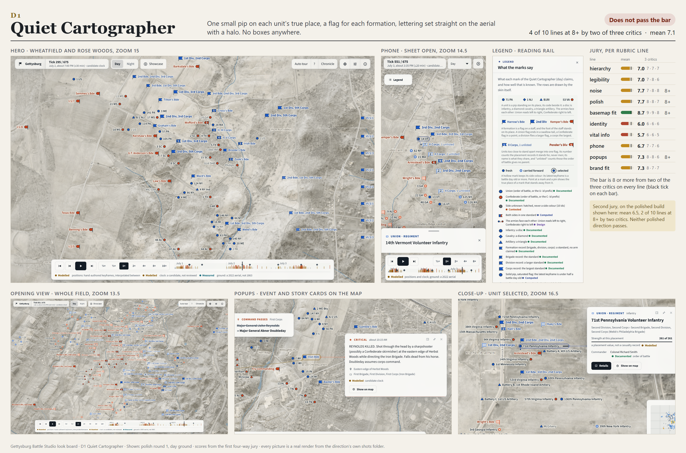
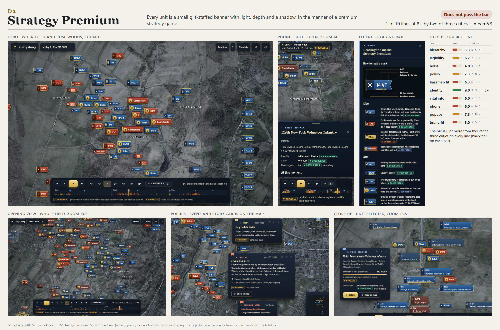
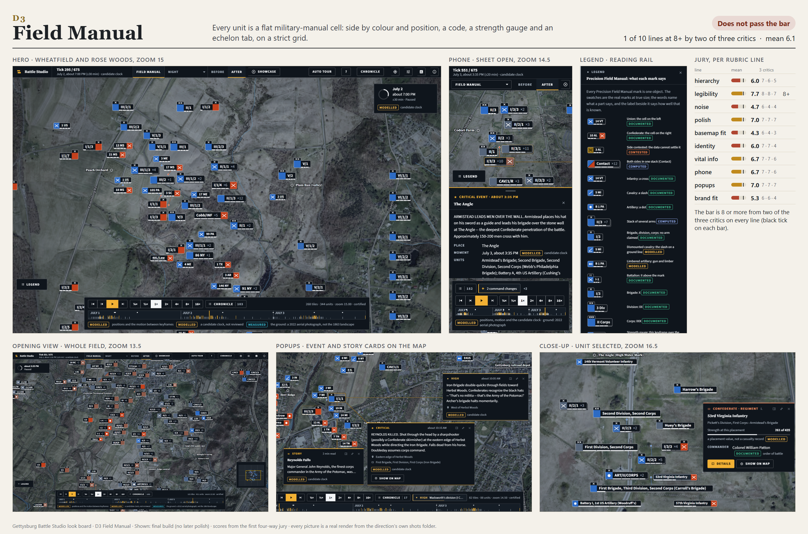
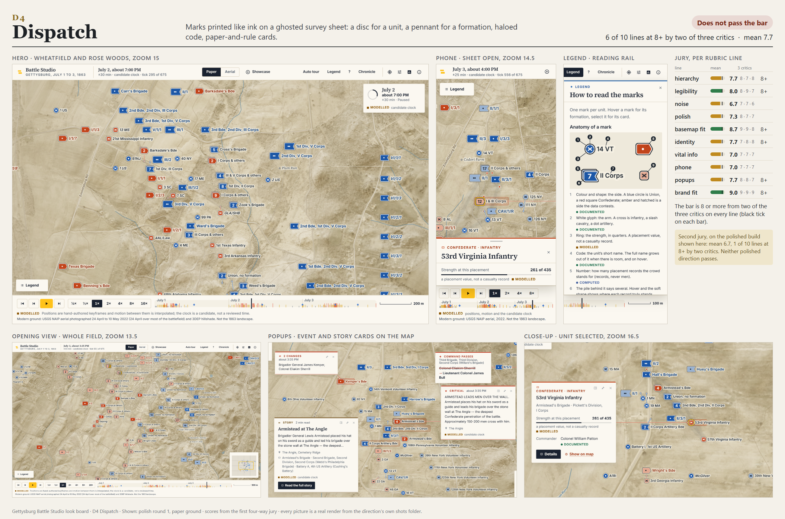

# Look board: four directions for the Gettysburg battle animation

**The short answer.** None of the four passes the bar. Dispatch (D4) comes closest, clears 6 of 10 rubric lines, and was ranked first by all three critics. Quiet Cartographer (D1) is second. Strategy Premium (D2) and Field Manual (D3) each clear one line and should not go forward as they are.

All four fixed the things you called out in the first prototype: one object per unit instead of plate plus caption chip, no dashed outlines, no 8 px badges, a real aerial instead of a blank beige grid, and clearly different designs rather than recolours. Every direction also passes the safety rules by measurement: **0 overlapping marks and 0 units without a mark, in every direction and every scene.** What stops them is taste and clarity, not correctness.

The bar I applied: every one of the ten rubric lines scored 8 or more by at least two of the three critics.

## The four contact sheets

Each sheet shows the hero scene (Wheatfield and Rose Woods, zoom 15), the phone shot, the legend, the opening view of the whole field, popups placed on the map, a close-up with a unit selected, and the jury scores. Every picture is a real render from that direction's own shots folder.

| | |
|---|---|
| D1 Quiet Cartographer |  |
| D2 Strategy Premium |  |
| D3 Field Manual |  |
| D4 Dispatch |  |

Files: `board/d1.png`, `board/d2.png`, `board/d3.png`, `board/d4.png`.

A note on versions. The jury scored the first builds. D1 and D4 were then polished once (D1 commit 80f331f, D4 commits 1c95c7f and 7f6fa26), so the D1 and D4 sheets show the polished builds, while D2 and D3 are their only builds. A second jury looked at the polished D1 and D4; it is reported under each of them. The two juries are not comparable as progress, because the second one scored more harshly across the board.

## Jury scores, mean of three critics (first jury)

| Line | D1 | D2 | D3 | D4 |
|---|---:|---:|---:|---:|
| hierarchy | 7.0 | 5.3 | 6.0 | **7.7** |
| legibility | 7.0 | 6.7 | 7.7 | **8.0** |
| noise (calm) | **7.7** | 4.0 | 4.7 | 6.7 |
| polish | **7.7** | 7.3 | 7.0 | 7.3 |
| basemap fit | **8.7** | 6.3 | 4.3 | **8.7** |
| identity | 6.0 | **9.0** | 6.0 | 7.7 |
| vital info | 5.7 | 6.0 | 6.7 | **7.0** |
| phone | 6.7 | 6.0 | 6.7 | **7.0** |
| popups | 7.3 | 7.3 | 7.0 | **7.7** |
| brand fit | 7.3 | 5.0 | 5.3 | **9.0** |
| **mean** | 7.1 | 6.3 | 6.1 | **7.7** |
| lines at 8+ by two critics | 4 of 10 | 1 of 10 | 1 of 10 | 6 of 10 |
| passes | no | no | no | no |

Ranking by critic: D4, D1, D3, D2 (critic 1); D4, D1, D2, D3 (critics 2 and 3). D4 and D1 are first and second in every ranking.

## D1 Quiet Cartographer

**The idea.** A small pip stands on each unit's true place, a flag stands for each formation, and the words sit straight on the aerial with a soft halo. No boxes anywhere. The two armies face each other: Union flags swallow-tailed and reading rightward, Confederate pointed and reading leftward.

**Jury.** Calmest and best on the photograph (basemap fit 8.7, noise 7.7, polish 7.7, popups 7.3). Weakest on vital info (5.7) and identity (6.0). Verdict: it looks like a very good web map, not like this product. Worst thing: at the first jury's build the opening view was bare pips, so you could not tell which regiment a dot was without hovering. Polish round 1 put a code on every pip from zoom 13, and the second jury (mean 6.5, 2 of 10 lines at 8+) then found the opposite problem: about 110 lettered marks at the opening zoom, "a plate of lettering", plus half-faded labels under the top bar and dock, road names colliding with unit names, and generic symbols.

**Numbers that matter (build 9db3f4b, before polish).** 72 percent of units are drawn as their own mark at zoom 13.5 (the others: 12 to 14 percent), 65 percent at zoom 15, 93 percent at zoom 16.5. Side colour against the ground is 2.6:1 at night and 2.8:1 by day, the best of the aerial looks, yet only 35 to 45 percent of marks reach 3:1. Smallest lettering 11 px. Greyscale Union to Confederate ratio is only 1.5:1, so the side needs a second cue that is not colour.

**Passes?** No. Four lines at 8+. Stopped by: vital info, identity, phone, hierarchy.

**Next iteration.** Letter only the top two echelons at the opening zoom and show the rest as bare pips until closer. One signature device that survives at zoom 13.5 (make the facing flags larger). Stop drawing labels half-faded under the bars. Make road and stream names step aside for marks. One card at a time, anchored with a short leader.

## D2 Strategy Premium

**The idea.** Each unit is a small banner on a gilt staff, lit from the north-west with a baked shadow. Side is the cloth colour and the fly shape, arm is a sign on the hoist band, size shows echelon. Crowds are gilt-counted banner stacks.

**Jury.** The most original look (identity 9.0, a 9 from all three critics) and finely made, but the wrong register. Noise 4.0, hierarchy 5.3, brand fit 5.0. Verdict: it reads as a game launcher. Gloss, bevel, gilt frame, shadow and finial on every mark, and gold used for everything. Worst thing: at the opening view the loudest objects on the map are crowd banners that say only "Union" or "Confederate" and a number, which hides about 85 percent of units behind the least informative marks.

**Numbers that matter.** 13 percent of units as their own mark at zoom 13.5, 53 percent at zoom 15, 56 percent at zoom 16.5. Side colour against the ground 1.4:1, the lowest of any direction, and 0 percent of marks reach 3:1. The weakest lettering on any direction is here: "Part contested" at 2.1:1 on the gold half of a two-colour mark. Still-frame draw at the whole-field zoom 104 ms, against 31 ms for D3.

**Passes?** No. One line at 8+ (identity). Stopped by: noise, hierarchy, brand fit, basemap fit.

**Next iteration, if it were chosen.** Strip each mark to cloth, hoist sign, code and a hairline. Gold only for selection. Name crowds by what they hold (II Corps, 3 more), never Union or Confederate. What is worth stealing regardless: the annotated legend anatomy, the fly shape that survives greyscale, and the light and depth on the hillshade.

## D3 Field Manual

**The idea.** A flat cell per unit in the manner of a military manual: side by colour and by position (Union cell left, Confederate right), a code, a strength gauge and an echelon tab, on a strict grid.

**Jury.** The clearest type and the most information per mark (legibility 7.7), but it brought back the thing you rejected. Basemap fit 4.3, noise 4.7, brand fit 5.3. Verdict: more than 120 opaque black plates with white keylines on a photograph are the floating-chip look again, and stale Union cells wash to grey, which reads as unknown rather than old. Worst thing: black boxes with borders pinned on an aerial. It also labels a both-sides crowd "Contact", which claims an engagement the data does not record. That breaks your truth rule.

**Numbers that matter.** 12 percent of units as their own mark at zoom 13.5, 50 percent at zoom 15, 64 percent at zoom 16.5. Only 50 percent of marks carry their side colour as solid ink at all. Side colour against the ground 1.5:1. Lettering contrast is the best (median 16.9:1). Lightest to draw: still frame 31 ms, 200 kB of skin, stylesheet and fonts.

**Passes?** No. One line at 8+ (legibility). Stopped by: basemap fit, noise, brand fit, hierarchy.

**Next iteration, if it were chosen.** Letter on a halo with only the side cell, or a 60 percent glass plate. Hold hue under age. Remove "Contact". Gauge on selection only. Keep: the mirrored side cell and the type discipline.

## D4 Dispatch

**The idea.** Marks printed like ink on a ghosted survey sheet. A disc is a unit, a swallow-tailed or pointed standard with one to three pips is a formation, with a haloed code on every mark. The name grows out of the same mark in place, the glyph stands on the true position, and every card is paper and rule with a serif voice. A switch gives the paper ground or the aerial.

**Jury.** Best overall and the only one that looks like a serious history publication (brand fit 9.0, hierarchy 7.7, basemap fit 8.7, identity 7.7, legibility 8.0). Below 8: noise 6.7, polish 7.3, vital info 7.0, phone 7.0. At the first build the worst things were the legend and crowd names saying "Contact" (a claim the data does not make), the opening view washed to brown and slate by the age fade, and a hull wedge that read as an attack arrow. Polish round 1 replaced "Contact" with formation words and kept the interface out of the map's frame. The second jury (mean 6.7, 1 of 10 lines at 8+) still ranked it first in two of three rankings and named what remains: crowd names that say "Union, no formation" and "& others" (bookkeeping, not meaning), the muddy sepia on aged marks, labels cut at the edge of the frame, the grey hull wedge, long leader lines, and card text wrapping badly.

**Numbers that matter (build 9db3f4b, before polish).** 14 percent of units as their own mark at zoom 13.5, 53 percent at zoom 15, **96 percent at zoom 16.5**, the best close-up. On the paper ground the side colour reaches 3.2:1 against the ground and 5.1:1 against its own outline; on the aerial it is 1.4:1. Smallest lettering 12 px, the only direction with nothing under 12. Median lettering contrast 14.3:1 on paper. 12 percent of marks sat under the top bar or dock in that build. Heaviest to draw: 111 ms for a still frame at the whole-field zoom, and the largest skin and fonts at 285 kB.

**Passes?** No. Six lines at 8+. Stopped by: noise, polish, vital info, phone.

**Next iteration.** Name crowds by the shared formation with a count, never by the lead record. Age drains toward a lighter tint of the side hue, never toward grey. Marks held clear of the frame by the camera, not only faded. Hull as dotted outline of the formation's own records. Phone top bar down to one row.

## What the numbers say across all four

| Measure (build 9db3f4b) | D1 | D2 | D3 | D4 |
|---|---:|---:|---:|---:|
| overlapping marks, units without a mark | 0, 0 | 0, 0 | 0, 0 | 0, 0 |
| units drawn as own mark, zoom 13.5 / 15 / 16.5 | 72 / 65 / 93 % | 13 / 53 / 56 % | 12 / 50 / 64 % | 14 / 53 / 96 % |
| median lettering contrast on marks | 12.8 night, 8.8 day | 7.7 | 16.9 | 14.3 paper, 18.2 aerial |
| side colour against ground | 2.6 night, 2.8 day | 1.4 | 1.5 | 3.2 paper, 1.4 aerial |
| smallest map lettering at 1x | 11 px | 11 px | 11 px | 12 px |
| still-frame draw, whole field, ms | 50 night | 104 | 31 | 111 |
| skin plus styles plus fonts | 208 kB | 232 kB | 200 kB | 285 kB |

Two readings. First, the "own mark" row is a real design question: three of four hide about 86 percent of units inside numbered crowd marks at the opening zoom, which is allowed (nothing is dropped) but means the opening picture shows formations, not regiments. Second, place names are the weak text in every direction (only 30 to 67 percent reach 4.5:1), which is a ground problem the shared basemap should fix once, not four times.

Caveat on these numbers: they pin to build 9db3f4b. D1 and D4 have changed since, so treat theirs as a floor for the layout checks and out of date for lettering and crowd counts. Draw times come from one shared Windows machine and only large gaps mean anything.

## Recommendation

**Take D4 Dispatch into polish and motion.** It is first with all three critics, it is the only direction whose look says "history site" before you read a word, and its failures are specific and fixable rather than a matter of register. Its fix list is short: crowd names, age colour, frame clearance, hull, card wraps, phone bar.

**Keep D1 Quiet Cartographer alive as the second track for one more round,** not as a merge. It wins on the two things D4 is weakest on: what a crowd says in words (II Corps, 3 unlisted, Both sides) and how the marks sit on the photograph. If the next round shows D4's crowd naming cannot be made honest and informative, D1's grammar is the fall-back. Retire D2 and D3; steal their legend anatomy (D2) and mirrored side cell (D3) only if the polish needs them.

## Questions for you, by looking

1. Open the D4 and D1 hero sheets. Does the warm paper ground feel like Gettysburg, or does the cool grey aerial of D1 feel more like the real place?
2. Look at the two opening views (bottom left of each sheet). D4 shows mostly numbered formation flags; D1 shows individual regiments. Which one feels like a battlefield you want to zoom into?
3. Disc and pennant (D4) against pip and flag (D1): which reads at a glance as "this side, this size", before you read the lettering?
4. Look at the popups (bottom middle). Do the paper cards of D4 feel like the same product as its marks, and are the cards too big for the map?
5. Look at the D2 hero. Is there anything in its light and depth you want in the winner, or is the whole language too much like a game?
