# Iterations

Each round is the same loop: render the scenes of the brief at DPR 2 in real Chrome, look at them (the whole picture and the 100 percent crop of the busiest 600x400), write down what is ugly or wrong, fix the cause, render again.  Where a number came from a tool it is the tool's; where a picture shows it, the picture is in `shots/iterations/`.  Rounds are named by the folder their pictures were kept in (`it1` to `it5`); "first light" is the first render of the fork before any of them.  The last round's pictures are the deliverable set in `shots/`.

Looking turned out not to be enough, so measurements joined the loop in the rounds where they first caught something the eye had passed over: contrast on rendered pixels, ink outside the reserved footprint, overlaps by an independent routine, and the type sizes actually on the page.

How this record was made: the pictures of rounds 1 to 4 and of first light were kept as they were rendered; the lists below are what those pictures show plus what the tools reported, written down after the fact from the pictures, the code comments of the time and my working notes.  Where a defect has no kept picture I say so.

## First light

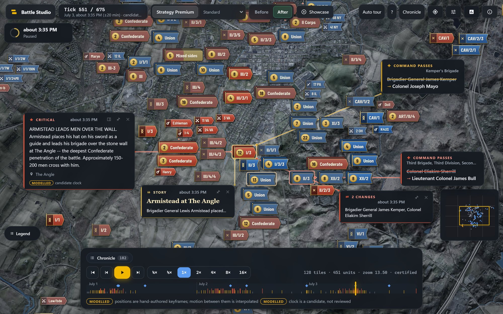

The fork renders: banners on the real aerial, crowd marks with gilt counts, the popups restyled.  The mark language already reads (side, rank, crowds), so the first look was about everything around it.

Ugly:

1. **Twelve controls across the top** (brand, a style select and a palette select, Before and After, Showcase, Auto tour, help, Chronicle, four icon buttons): research controls on a page meant for a visitor.
2. **The clock told twice**: a chip ("Tick 551 / 675, July 3, about 3:35 PM (+-20 min), candidat...", cut off at its right end) and the clock card ("about 3:35 PM, Paused").
3. **A dock a fifth of the picture high** (a Chronicle row above the transport, a monospace stats line "128 tiles, 451 units, zoom 13.50, certified") that covered the lower field.
4. **Five cards open at once on the opening tick** (a critical event, a story, two command cross-outs, a toast) plus the minimap and the legend pill: a large part of the picture, in looks that did not agree.
5. **Heavy outlines and several corner radii** on marks and cards: the language had no single line weight.

Fixed, carried into round 1: the research controls moved behind `?lab=1`; one hairline (`geo.hairline`) and one corner radius (`geo.radius`) for every mark; the brand renamed "Gettysburg"; the clock chip rewritten.

## Round 1 (`it1`)

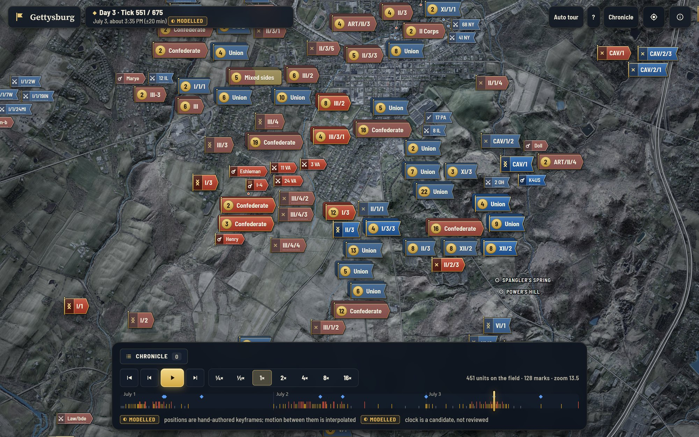
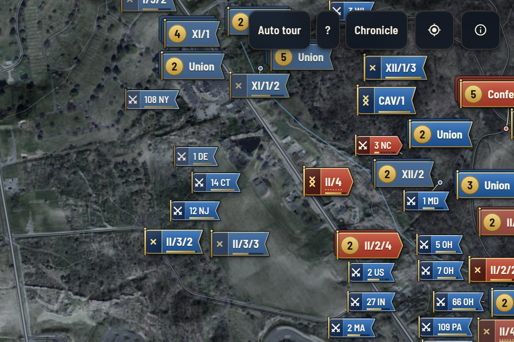

Rendered S1 to S8 with the cleaner chrome.  Looked:

1. **The dock was still tall**: the Chronicle chip sat on a row of its own above the transport.
2. **The clock chip still had two lines** and repeated the clock card.
3. **Unit names were cut mid-word and place names cut at the edge** in probe renders: the names that unfold in the banner were built from the label, which is shortened for chips, instead of from the full designation (no kept picture of this one).
4. **The ground competes with the marks**: the inverted hillshade is as strong as the banners' own shading (visible in the crop and in the whole field: the terrain texture is the busiest thing on the page after the marks).

Fixed, carried into round 2: the Chronicle button became part of the transport row; the unfolded name is built by `nameOf(unit)` from the full designation (trailing parenthesis dropped, ordinals shortened, cut at a word); place names are drawn by the Studio's own layer with avoidance, a fade and cached sprites, so they step aside for marks.

Not fixed in this round: item 4 (the ground).  It was left because the marks, not the ground, were the subject of the round; it comes back in round 5.

## Round 2 (`it2`)

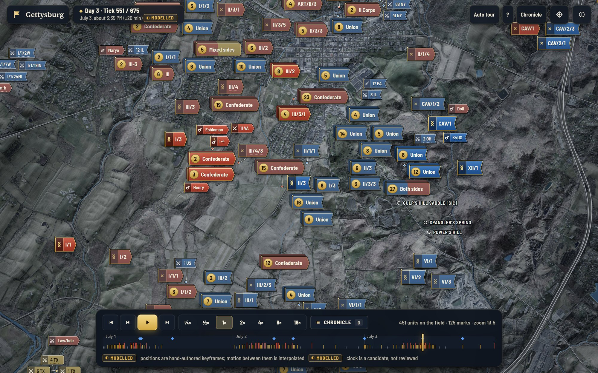
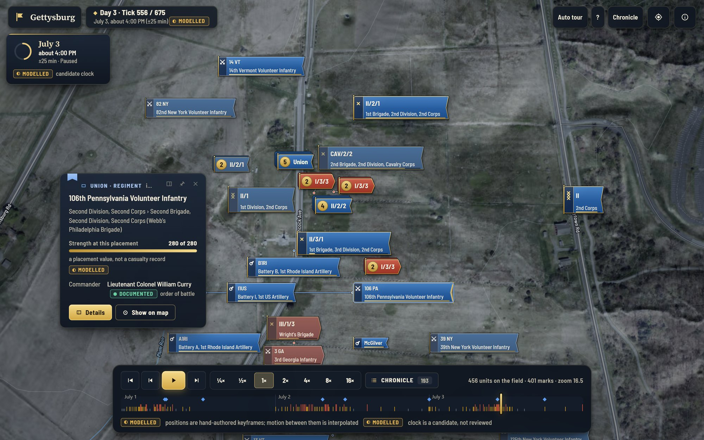

Looked:

1. **The legend fell back to its pill on every busy scene**: its 21 rows are too tall for a floating card on a crowded map, so the card kept losing its slot.
2. **The clock was still told twice** (a two-line chip and the clock card).
3. **The Inspect card's kicker is cut** to "UNION - REGIMENT i..." (visible in this picture; I did not see it until round 5).

Fixed, carried into round 3: the legend pill opens the reading rail (the map makes room, nothing is covered) with an annotated mark first and the rows grouped by what they encode; the chip lost its second line.  Item 3 was not noticed.

## Round 3 (`it3`)

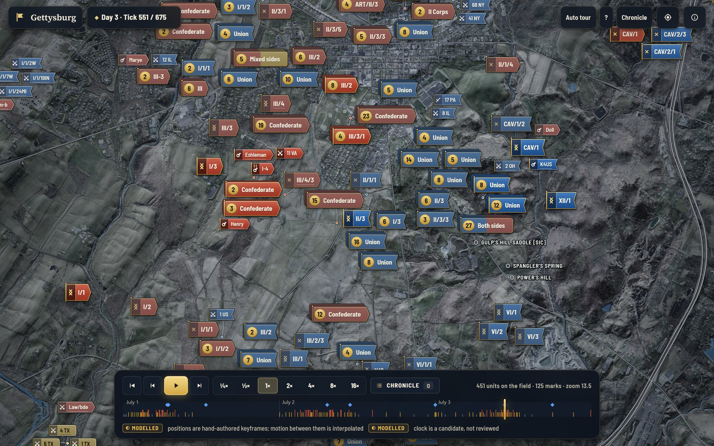
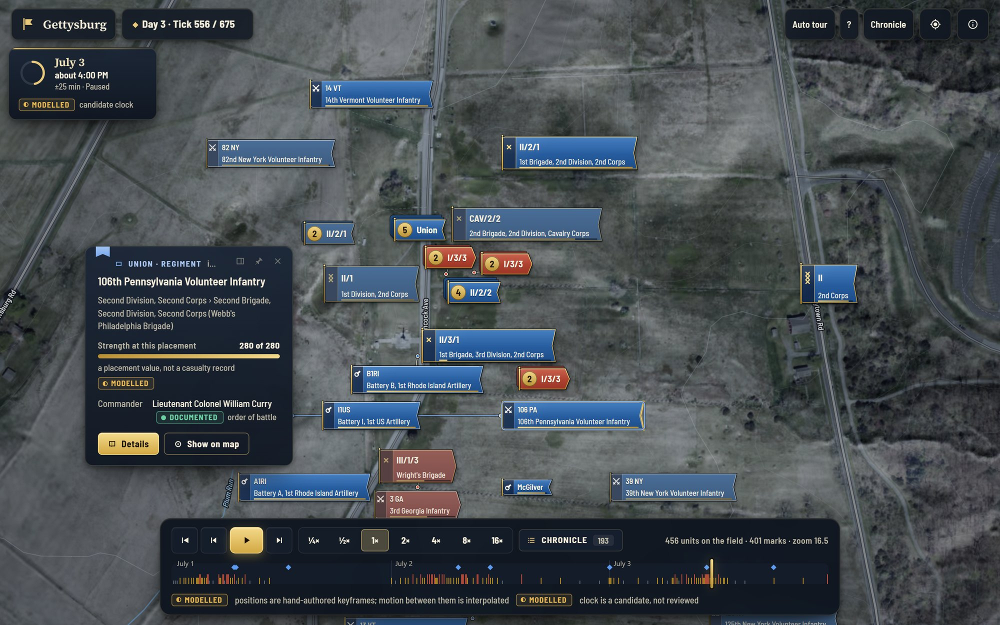

Looked at the same set plus the new scenes (day banner, narration, tour, chronicle):

1. **Selecting a unit in a crowded place broke the layout.**  Asking the layout for the named size at selection put a 190 px name over the true positions of the neighbours at zoom 14.5, and the selected unit could not be placed within the displacement budget, so it was merged into a crowd mark.
2. **An attempt to keep the selected unit out of crowds** (excluding it from aggregation) made leaf and crowd marks flicker as the camera moved.  It was reverted rather than patched.

Fixed, carried into round 4: the selected unit carries a placement priority above any seniority (`SELECTED_PRIO`); selection never changes the layout footprint any more; its name unfolds by drawing the same banner larger into ground the renderer has checked free (paused only).

## Round 4 (`it4`)

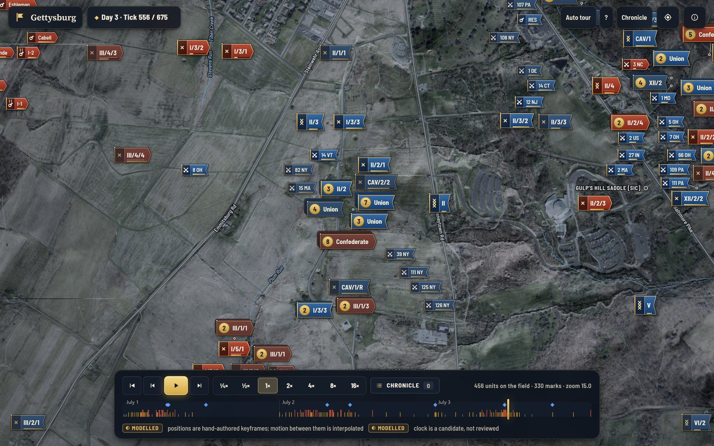
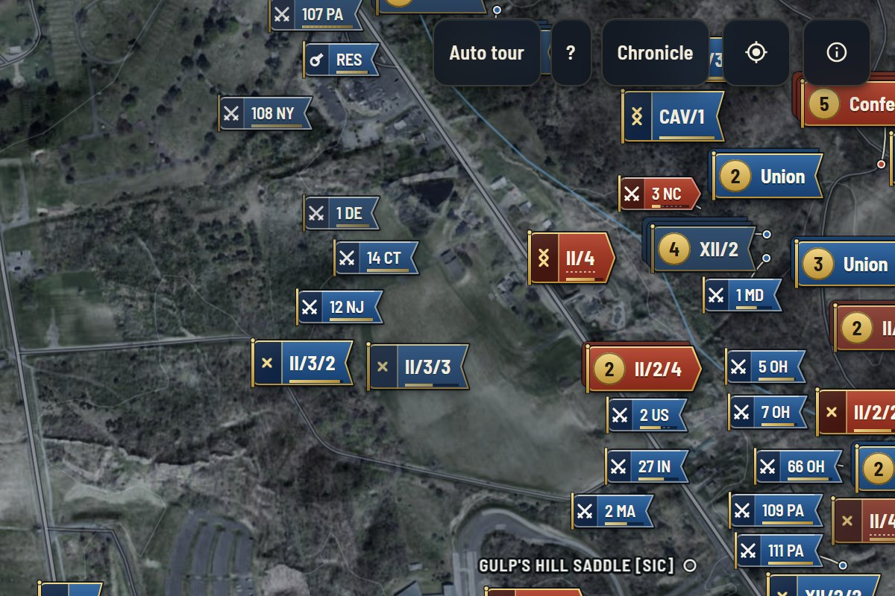

The round that added the measurements.  Looking said the marks were good; two tools said otherwise:

1. **Contrast on pixels**: 41 of 48 rendered type samples were below 4.5:1.  Two causes: my first sampler counted the strength line and the keyline as "background" (a measuring error, fixed by sampling the pixels within 3 px of the glyphs and stopping 7 px above the bottom), and a real shortfall on the lit end of the cloth and on carried-forward and gold cloth.  Fixed by darkening the cloth gradients, reducing the gloss to 0.06 and the sheen to 0.05, keeping the gold cloth light under dark type, and retuning the colour-blind-safe palette: 0 of 48 below 4.5 (lowest 4.77).
2. **Ink outside the footprint**: 7,550 of 15,440 paints reached outside the box the layout reserved (hover lift, pole and finial, selection ring), which is how a mark can touch its neighbour without the layout knowing.  Fixed by carrying lift in the shadow alone, shrinking the pole, finial and ring to fit the 2 px band: now 0.
3. **The specimen sheet** (the language on three grounds, drawn by the skin's own painter) showed what the pictures had hidden: the name was revealed before the banner had grown to hold it, so for a few frames it stood outside the cloth.  Fixed: the name is revealed inside the banner, clipped, with its alpha ramped after 40 percent of the growth.
4. **The first motion strips** showed units moving too fast to read; strips are now captured at 2x and the frame is picked by the mark's true speed.

## Round 5 (`it5`, the delivered set in `shots/`)

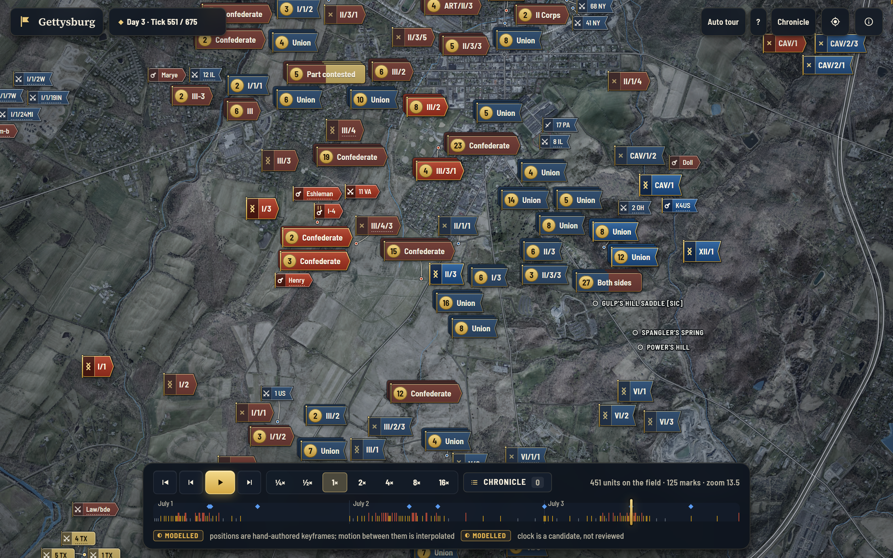

Looked, and measured the type on the page for the first time (every visible text node, by computed size):

1. **Ten type sizes on screen** (11 to 24 px, 26 on the welcome card) in the popups and chrome: the brief allows two.  Marks were already on two (11 and 13).  Cards were large because reading text was 15 to 17 px serif.  The canvas timeline labels were 10 px, below the 11 px floor.
2. **The Inspect card's kicker was cut** to "UNION - REGIMENT i..." (the arm word did not fit beside the three tool buttons), as in the round 2 and 4 pictures.
3. **A crowd called "Mixed sides"** meant one side together with records of an undecided side; next to "Both sides" it read as a synonym.
4. **The legend's annotated mark** had leaders crossing the cloth and the code.
5. **Marks under fixed chrome** had never been counted: the layout is independent of the viewport (so that panning never re-solves it) and so cannot route around the clock chip, the tool strip or the dock; and the crop picker happily chose windows with controls in them.
6. **The ground** (item 4 of round 1): see below.

Fixed: all interface type snapped to a three-step scale (11 and 13 px text; 17 px serif for titles and for the long passages of a story or tour), card text at 13 px, canvas labels at 11 px (measured: sizes 11, 13 and 17 on all fourteen scenes); the unit-card kicker carries the formation only and the arm moved to the meta line; the crowd of one side with undecided records is named "Part contested"; the legend's leaders leave their dots straight up or down and turn once; the shot tool counts marks under fixed chrome and under cards and the crop window avoids the chrome; the unused easing helpers were removed so the spec names only curves the page uses; the node suite was repaired for the one-language fork.

**The ground** (item 4 of round 1, left for last): the campaign look's hillshade strength was 0.95 (soft light, inverted so that it is lit from the north-west like the marks).  At the opening zoom the forest texture was the busiest thing on the page after the marks, and a banner on a slope lost its edge.  Lowered to 0.6: the relief still reads and still agrees with the light on the marks, and the aerial (fields, roads, the town) shows through.  Before (strength 0.95) and after (0.6), same scene:

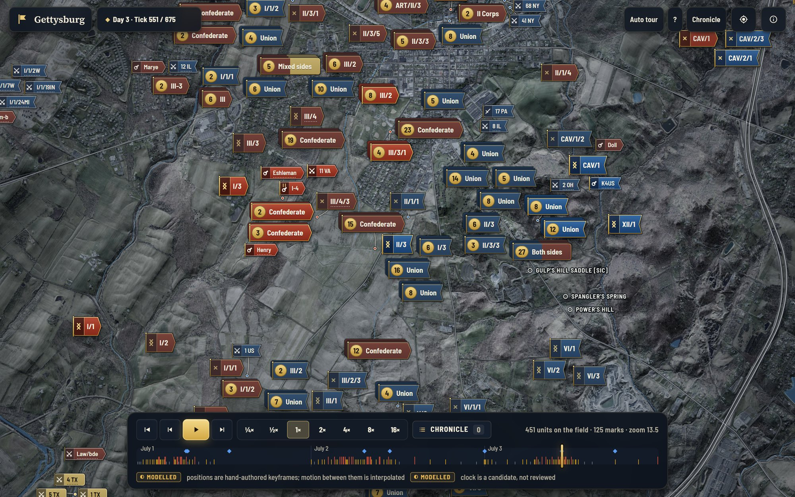
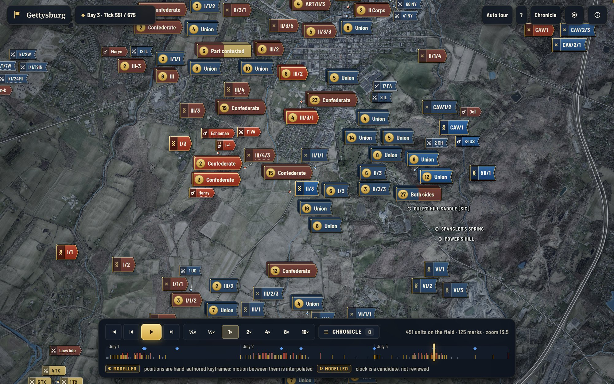

**The welcome card** covered the first marks of the opening view because the view was framed before the card opened; the opening view is now framed in the part of the map the card leaves free (S10).

Re-rendered and re-measured (`results/`): ink 0 of 15,440; legibility 0 of 48 below the bar; side colours 0 pairs below 20 CIEDE2000; sweeps 0 overlaps in 99 desktop and 63 phone samples; playback 0 overlap frames; the node suite 157 of 157; everything in `SPEC.md`.

## What the loop did not fix

Listed in section 14 of `SPEC.md`: marks can sit under the fixed chrome; place names can be under cards; greyscale luminance of the two sides is close (the fly shape carries it); the zoom-out pops (22 per second, 0.13 percent of mark-frames, largest 7.4 px, no teleport); the whole field at 4x and DPR 2 ran at 49 to 55 fps in the two runs made (the rest of the frame was not profiled); dimmed marks glide under solid ones while the camera zooms.
